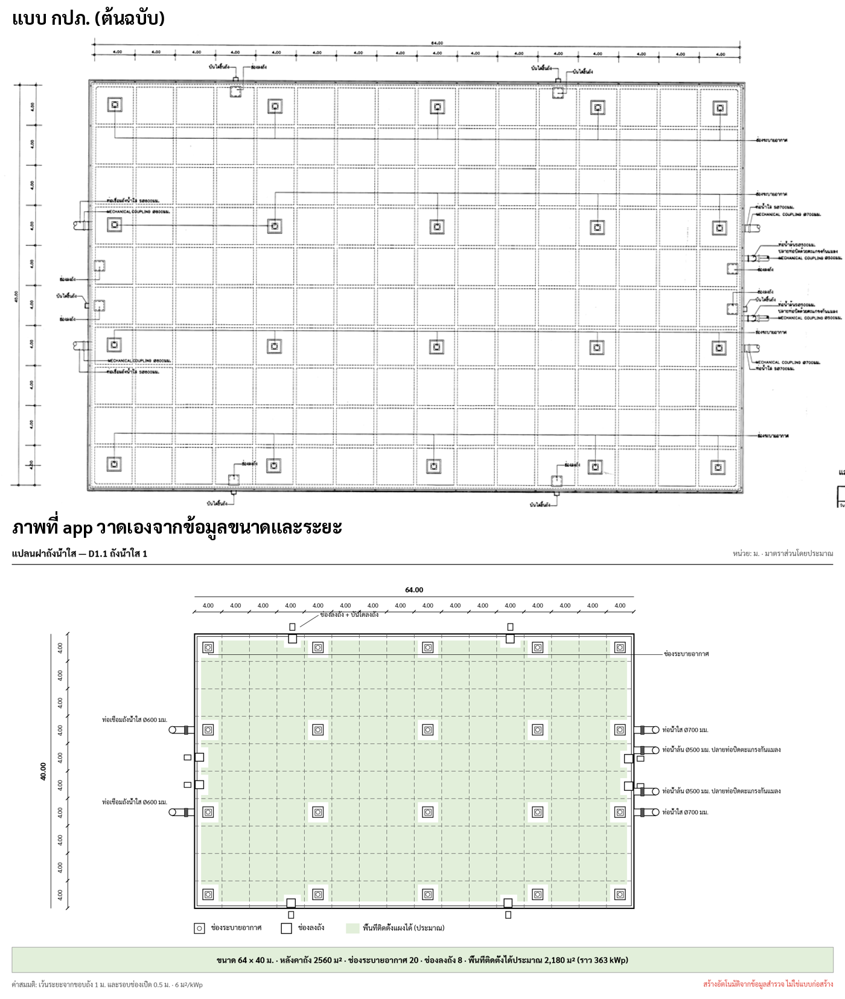
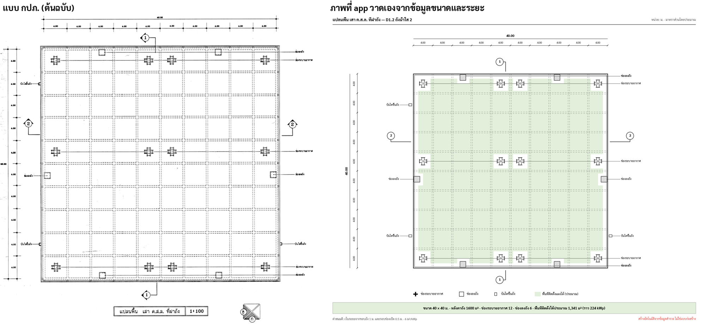
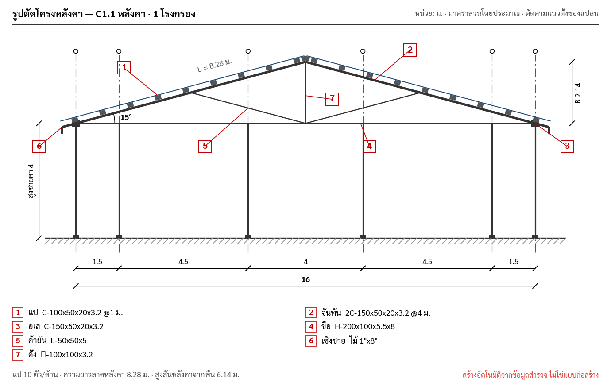
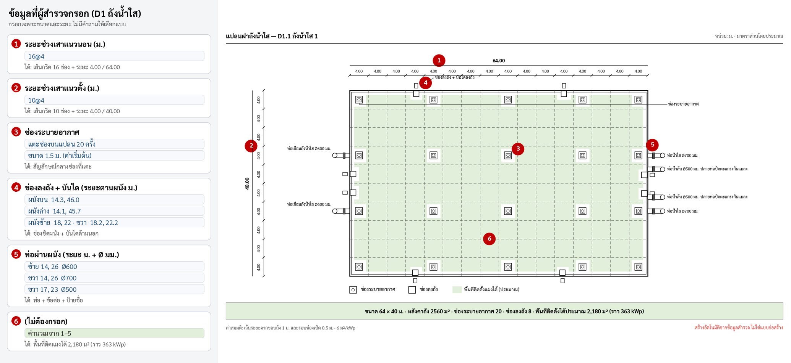

# Auto 2D Drawings: Roof Structure & Tank Size

**Status:** Partly built, by a different route than this spec first planned.
- **Built:** the C1 roof plan and section A-A from a chosen frame type (`TCRoofCore/Roof.swift`, `RoofPlan.swift`, `RoofSection.swift`), C1's pitch from a measured ridge height (`Roof.pitch`, §4.4), the C2 and C3 sections from measured sizes (`RoofSectionMeasured.swift`, §4.4), the `n@d` span shorthand (`parseSpans`), the D1 tank plan, size presets, standard designs and checked points (`Tank.swift`, `TankPlan.swift`, `TankPoints.swift`, `TankDesign.swift`), the tank sections 1–1 / 2–2 and the size and volume summary (`TankDrawings.swift`, `Tank.summary`, §5.5), the printed tank plan's beams, section marks and cross vents (`TankPlan(details:)`), the Howe truss as C1's seventh frame type, details A / B and the member schedule (`RoofTruss.swift`, built 2026-10-20) with its steel weights (`SteelSection.swift`, built 2026-10-21), the tank panel layout (`TankLayout.swift`), DXF export of both (`RoofDXF.swift`, `TankDXF.swift`), the PDF units (`PDFReport/ReportLayout+Sections.swift`) and the plan image in Excel, with its sections under it (`Drawings.planWithSections`, built 2026-10-26).
- **Not built:** the `TCRoofCore/Drawing/` pipeline (`RoofInput`, `MemberSpec`, `DrawingKit`, `RoofDrawings`, `TankInput`, `TankGeometry`, `DrawingSettings`; the built parts went on top of the existing code instead), `MemberSpec` depth parsing, `uniformLabel`, `DrawOp.arc`, the `autoDrawings` flag and the SVG snapshot tests.

**Owner:** TCRoof · **Module:** `TCRoofKit` (TCRoofCore / TCRoofUI / PDFReport / ExcelExport)
**Date:** 2026-09-29, tank parts updated 2026-10-01 to the D1 design, merged with the Swift implementation spec and checked against the code 2026-10-17 · **Tank feature (iPad/iPhone):** [`tank-drawing-swift.md`](tank-drawing-swift.md) · **Standard tank designs:** [`standard-designs.md`](standard-designs.md) · **Single line diagram:** [`single-line-diagram.md`](single-line-diagram.md)

## 1. Goal

Generate dimensioned 2D drawings automatically from answers the surveyor already enters, so the report no
longer depends on a hand sketch:

| Drawing | Survey section | Replaces / adds | Built |
|---|---|---|---|
| **Roof framing section** (รูปตัดโครงหลังคา) | C1 หลังคา, C2 หลังคาอาคาร, C3 บ้าน | Generic `Drawings.truss()` diagram | C1 (`RoofSection`), C2 and C3 (`MeasuredRoofSection`, a rafter frame; no truss) |
| **Roof framing plan** (แปลนโครงหลังคา) | C1, C2 | Adds rafters / purlins / ridge to the existing `Drawings.plan()` | C1 only (`RoofPlan`) |
| **Tank drawing** (แปลน + รูปตัดถัง + ขนาด) | D1 ถังน้ำใส | Plan from a standard tank or custom size, confirmed openings, section, size/volume summary; feeds the panel layout (D1 step 3) | Built |

The drawings must show in the editor while typing, in the PDF (NO.215), and in Excel (NO.224).
They are **indicative survey drawings, not construction drawings**. Every sheet carries that note.

### Non-goals (v1)
- Structural checks (member capacity, load). Geometry only.
- PV module layout on building roofs: its own feature, see [`roof-pv-layout.md`](roof-pv-layout.md) (built as the
  `pv` mode of `RoofPlan`). Tanks get a panel layout in D1 step 3 ([`tank-mounting-layout.md`](tank-mounting-layout.md), `TankLayout`).
- 3D, perspective or editable CAD. DXF R12 export was a stretch goal; it is built (§8.3).

### Prototype output

Rendered from sample data by the Python prototypes in `docs/specs/img/` (`draw.py`, `truss.py`, `tank_plan.py`), and the
interactive tank prototype [`prototype/tank-layout.html`](prototype/tank-layout.html). They follow the first draft of this spec. The
built C1 drawings follow the C1 page design (`docs/ui/survey-c1`) instead, so they don't match `truss_howe.png` or
`framing_plan.png` line for line.

| Truss section (Howe) + details + schedule | Truss types (Pratt, Warren) |
|---|---|
|  |  |
| **Framing plan** | **Tank plan + section** |
|  |  |
| **Tank roof plan, กปภ. style (64 × 40 m)** | **Side by side with the original กปภ. sheet** |
|  |  |
| **Second sheet: 40 × 40 m, cross vents, separate ladders, section marks** | **Plain section** |
|  |  |

**How the surveyor's input becomes the layout** (numbers 1–6 link each form field to what it draws):



## 2. Principles

- **Units.** Geometry works in **metres**. `Sketch` works in **points, y-down**. Plans keep y down (metres from the
  top-left corner); sections flip y.
- **Pure functions.** Drawings are built from `Values` by pure Swift in `TCRoofCore`, so they compile and test on macOS
  (`swift test`) with no simulator.
- **Old jobs keep working.** New answers are optional and hidden from the form page (`when: { _ in false }`), so section
  completion counts as before. Old JSON decodes through `decodeIfPresent` defaults.
- **Measured or assumed.** The first draft's rule was that the surveyor enters only sizes and distances, with
  everything else derived and any assumed value printed in grey ("ค่าสมมติ: …"). The built C1 page breaks this rule:
  the surveyor **picks a frame type** and the slope follows from it (§4.1). Open question 7.

## 3. Library decision

**No new dependency.** Build on the drawing model in `TCRoofCore/Sketch.swift`:

- `Sketch` / `DrawOp` (line, rect, hatch, circle, polygon, polyline, text, textBox, photo, checkbox) is platform-neutral Swift.
- It has these renderers:
  - PDF: `PDFRenderer.draw`, Core Graphics
  - Editor: `SketchView`, SwiftUI `Canvas`
  - Excel: PNG via `PDFRenderer.png`
  - Tests: SVG via `Sketch.svg()`
  - CAD: DXF R12 via `SketchDXF`

| Option | Verdict | Why |
|---|---|---|
| **Extend `Sketch`/`DrawOp` (chosen)** | ✅ | One drawing feeds every output; pure Swift; testable; matches the existing plan style |
| SwiftUI `Path`/`Canvas` directly | ❌ | UI-only; PDF and Excel would need a second copy |
| Core Graphics directly | ❌ | UIKit-bound, so no Linux tests; duplicates the PDF path |
| Third-party (e.g. a CAD/DXF kit) | ❌ | Not needed for 2D lines/text; adds SPM weight and licence review |

**Arcs (not built).** The draft planned one `DrawOp` case:

```swift
/// Circular arc, angles in degrees clockwise from +x (y-down), for curved roofs, angle marks and round tanks.
case arc(center: Pt, r: Double, from: Double, to: Double, width: Double, color: RGBA, dash: [Double] = [])
```

It would need handling in `Sketch.translated`, `Sketch.svg`, `PDFRenderer.draw`, `SketchView` and `SketchDXF`. The built
section draws its pitch arc as a 13-point `.polyline` instead, which is enough so far.

## 4. Roof

### 4.1 C1, as built (`Roof.swift`)

The C1 wide page (`docs/ui/survey-c1`) stores its own answers as hidden optional text fields in group "โครงสร้าง":
`frameType`, `ridgeDir`, `trussBays`, `postGrid`, `pvOrientation`, `roofShots`, `eaveOverhang`, `clearHeight`,
`purlinSpacing`, `roofStd`, `pvRows`, `pvPerTable`, `pvGap`. Field ids, labels and Excel cells of the old form are unchanged.

| Value | Source | Default |
|---|---|---|
| Spans | `spansX` / `spansY`, comma list in metres | The schema's placeholder `1.5,4,4,4,4,1.5` × `1.5,4.5,4,4.5,1.5`, so the plan is never empty |
| Ridge direction | `ridgeDir` `h` (along x) or `v` (along y). Setting it writes `sheetDir` back (`h` → แนวตั้ง, `v` → แนวนอน) so the old plan, PDF and Excel agree | From `sheetDir`: แนวตั้ง → along x; แนวนอน or empty → along y |
| Span `B` | Σ of the spans across the ridge | — |
| Frame type | `frameType`, one of seven (table below) | ถัก Pratt |
| Slope | The frame type's: 30° for ขื่อรัด, 15° for every other; from the measured `ridgeHeight` when entered (§4.4, `Roof.pitch`) | — |
| Rise | `B/2 · tan(slope)` | — |
| Heel depth | 0.5 m for trusses and จันทันถัก, 0 for the rafter frames | — |
| Truss panels per half | `trussBays`, 2–20 | `max(2, round(B/2))`, about one per metre |
| Eave overhang | `eaveOverhang` (m) | 0.70, or 1.20 for ชายคาฝ้า |
| Clear height (สูงใต้ขื่อ / สูงถึงหัวเสา) | `clearHeight` (m) | 4.00 |
| Purlin spacing (ระยะแป, along the slope) | `purlinSpacing`, clamped to 0.60–1.50 | 1.00 |
| Posts | Default posts per frame type at grid intersections, plus per-frame edits in `postGrid` (JSON) | — |
| Members | `comp1`…`comp7`, always "size @spacing". Only the row names change with the frame type | Each frame's default size |

Frame types (`RoofFrame`):

| `frameType` | Label | Kind | Members 1–7 |
|---|---|---|---|
| `n` | ปกติ | Truss: king post and two struts | แป, คอร์ดบน, คอร์ดล่าง, ตัวตั้ง, ตัวทแยง, เชิงชาย, เสากลาง |
| `p` | ถัก Pratt | Truss: verticals at every node, diagonals sloping down toward the ridge | as `n` |
| `h` | ถัก Howe | Truss: verticals at every node, diagonals rising from the bottom chord toward the ridge (Pratt's mirror; added 2026-10-20) | as `n` |
| `w` | ถัก Warren | Truss: zig-zag diagonals plus a king post | as `n` |
| `c` | ขื่อรัด | Rafter frame, 30° | แป, จันทัน, ขื่อรัด, อเส, ตัวค้ำ, เชิงชาย, เสากลาง |
| `r` | จันทันถัก | Tube rafter truss on T2 beams, 4 posts | แป, คอร์ดบน, คอร์ดล่าง, ตัวทแยง, T2 รับจันทัน, เชิงชาย, เสา |
| `k` | ชายคาฝ้า | Rafters on column-head beams, boxed eave | แป, จันทัน, ขื่อรัด, คานหัวเสา, โครงฝ้า, เชิงชาย, เสา |

Standard roofs (`Roof.standards`, the design's `STD`): โรงกรอง, อาคารสูบน้ำ, อาคารสำนักงาน, อาคารเก็บสารเคมี, โรงจอดรถ.
Applying one fills the spans, frame type and (for a saved roof) the purlin spacing, resets that frame's post edits
and the truss panels, sets ทรงจั่ว and stores `roofStd`. A team member can save the current roof as a new standard.

The page's bottom bar lists what is still missing (`Roof.gaps`, `statusLine`): the section's required fields, as
`Progress` counts them, then the six photo angles.

### 4.2 C1 section A-A, as built (`RoofSection.swift`)

A true-scale cut across the ridge, in the design's fixed 760 × 250 viewBox:
- Grid lines at both supports and the ridge, with grid bubbles named from the plan (1… or A…).
- Trusses: top chord, bottom chord, web per frame type, gusset diamonds at the supports, nodes and ridge, columns at
  the two supports. จันทันถัก adds two inner posts at 80% of the half-span. Rafter frames draw outlines of the owner's
  ST1 / Type 1 drawings, with C purlins square to the rafter.
- The corrugated sheet along the slope with a ridge cap, purlin marks spread evenly on each slope
  (`max(3, round(slope length / purlin spacing))` per side), and the fascia at each eave.
- Dimensions: the panel chain per half ("8 × 1.00 = 8.00"), the span "16 (จากแปลน)", the overhang at each eave, the
  clear height, the rise "R 2.14" and the heel depth on the right, and the slope arc with "15°".
- Callouts ①–⑦ in red, one per member row the frame draws. `highlight` fills the chosen row's callout.
- `tags` name each op's CAD layer (`SECTION`, `DIM`, `GRID`). The page makes the overhang and clear-height labels tappable.

Line weights: chords 6 pt dark with a 3.6 pt light core, web 3.2 / 1.3, columns 7 / 4.4, sheet 1.1, dimensions 0.8,
grid 0.6 dash-dot `[12,3,2,3]`. Colours are the design's hex values.

### 4.3 C1 plan, as built (`RoofPlan.swift`)

580 × 446 (the design's viewBox), in two modes:
- **structure:** grid lines and bubbles, dimension chains with 45° ticks and totals,
  the ridge, frame lines (trusses T1 across the ridge, T2 along it for จันทันถัก; rafters @1.00 for the rafter
  frames), purlin lines, posts, slope arrows, section mark A-A, skylights and obstacles, `แป @1.00` on one bay.
- **pv:** the `RoofMount` layout of [`roof-pv-layout.md`](roof-pv-layout.md): rows on the purlins, cut slots, shade and keep-out zones.

Purlin lines run parallel to the ridge: 0.15 m each side of it, then every `spacing · cos(slope)` down to the eaves
(`Roof.purlinLines`). Each op carries the design's path key in `tags` (`grid`, `purl`, `tbd`, `post` …), which the DXF
export maps to layers and the member highlight redraws in red. `Layout` gives the page its chips, nodes and
metre ↔ point conversion. Skylights (`sky`) and keep-out zones (`keep`) are `Obstacle`s in `obst`.

`Drawings.plan` draws `RoofPlan` once a frame type is chosen (`Roof.hasFrame`), and the old generic plan otherwise.

### 4.4 Section from measured heights (partly built)

The draft derived the section from measured heights instead of a frame-type choice. **As built:**
- **C1:** one optional hidden field `ridgeHeight` (ความสูงสันหลังคา, m), set by tapping the rise label "R …" on section
  A-A. The eave is the existing `clearHeight` (สูงใต้ขื่อ / สูงถึงหัวเสา), not a new `eaveHeight`. `Roof.pitch` gives
  `atan((ridgeHeight − clearHeight − heel) / run)`, run half the span (the span for a shed); without `ridgeHeight` it is
  the frame type's slope as before. A ridge not 0.05 m above the eave, or a pitch over 60°, keeps the frame's slope and
  says why; under 3° or over 45° it is used with "ตรวจความสูงอีกครั้ง (มุมประมาณ x°)". Every reader of the slope
  (section A-A, the plan's purlin lines, the PV layout's rise, the DXF title) goes through `Roof.slope`; the page shows
  the pitch's source or check under the section, and the PDF prints it under section A-A. The frame type still picks
  the truss pattern (open question 7 stays open for whether it should).
- **C2 and C3:** `MeasuredRoofSection` (`RoofSectionMeasured.swift`), shown by a new non-countable
  `FieldKind.roofSection` at the end of C3's group 13 and C2's group "โครงสร้างหลังคา", and printed after that group in
  `formSection` (or the line "ข้อมูลไม่พอวาดรูปตัด: …"). It draws a rafter frame only (rafter, tie beam, king post and two
  struts; no truss: the member parsing below is not built): gable and hip alike, shed, flat slab and curved, with
  fixed-size purlin markers every spacing along the slope plus one at the ridge when the last gap is over a quarter,
  columns and ground when the eave height is known (dashed stubs and "ไม่ทราบความสูงชายคา" otherwise), fascia, the span
  and overhang chain, the eave height, rise, pitch arc and slope length, the members as entered, the assumed values,
  the warnings and the note.
  - C3: the width `buildingWidth` (ซม.) is across the ridge; `measI1` / `measI2` are ground → ridge / ground → the
    eave's tip, so the pitch is `atan((i1 − i2) / (run + h))` with `measH` the rafter's tip to the column, and the
    column head is at `i2 + h·tanθ`. `roofAngle` is used only without the heights, and a > 10 % difference is a warning.
    Purlins at `measC`; the members listed are the purlin and rafter sizes (wood f×g or steel type f×g×h).
  - C2: two new optional, visible fields in group "อาคาร", `eaveHeight` and `ridgeHeight` (ม.); purlins at `space1`;
    the members listed are `size1…7` with their `space`.

**Details and schedule, as built (`RoofTruss.swift`):** `RoofTruss.geometry` gives C1's truss in metres, the same
members section A-A draws (verticals with the heel ends, diagonals, the king post); the §9.3 numbers hold for Howe (17
verticals with the king post, 16 diagonals, 34 nodes, king post 2.644).
- **Schedule** (`RoofTruss.schedule`): trusses on the plan's T1 lines (grid lines inside, along the ridge; a one-bay
  roof counts one, with a note), rafter frames per pair @1.00. Per row: purlins `Roof.purlinLines` × the length along
  the ridge; top chords `2 · (half + overhang) / cos θ`; bottom chord `B`; verticals and diagonals counted with their
  total length; fascia 2 × the length; king post `d + R`; gusset plates one per node. ขื่อรัด / ชายคาฝ้า: rafters,
  the tie at half (0.55) the rise, the eaves beams, the posts × clear height; จันทันถัก: both tube chords, a diagonal and
  a vertical per panel, T2 on the inside grid lines across the ridge, the posts. A row set to "-" is left out; an empty
  one reads "ไม่ระบุขนาด". Centre-line lengths, no laps or waste; no steel weights yet.
- **Details** (`RoofTruss.details`, trusses with a bottom chord only): A at the left support (column, cap plate and
  anchors, heel gusset with bolts, the chords, the first web members, purlins with cleats, the sheet, the fascia) and B
  at the ridge (ridge gusset, king post, the first diagonals and verticals, the ridge purlins, ridge cap, bottom-chord
  splice), drawn from the geometry cut to a window around each joint, not to scale, labelled ①–⑦ with the entered sizes.
- **Where:** C1's section card `ชิ้นส่วน` opens them in a sheet; the PDF prints both after section A-A.

The rest of this section is the draft's plan for deriving the frame from member sizes (`MemberSpec`), not built.

**New fields (sizes and distances only):**

| Section | Field id | Label | Kind | Req. | What it's used for |
|---|---|---|---|---|---|
| C1, C2 | `eaveHeight` | ความสูงชายคา (พื้น → ใต้ขื่อที่เสา) | `.number("ม.")` | yes | Column height; base of the rise |
| C1, C2 | `ridgeHeight` | ความสูงสันหลังคา (พื้น → หลังคาที่สัน) | `.number("ม.")` | yes | Rise → pitch |
| C1 | `heelDepth` | ความลึกโครงถักที่เสา (ขื่อบน ↔ ขื่อล่าง) | `.number("ม.")` | no | Truss heel; default 0 (triangular) |
| C1 | `compTop`, `compBottom`, `compVertical`, `compDiagonal` | ขื่อบน, ขื่อล่าง, ตัวตั้ง, ตัวทแยง (ขนาด) | `.member` | no | Fall back to `comp2`, `comp4`, `comp7`, `comp5` |

C1 already has `eaveOverhang` for the overhang. C3 has the heights `measI1` / `measI2` (ซม.) and keeps `roofAngle` only
as a fallback. C2 would add `eaveHeight` and `ridgeHeight` to group "อาคาร". Each section would get a non-countable
`FieldKind.roofSection` after its structure group (C3: after group 13); `FieldView.body`, `FieldSpec.countable`,
`WebBackup` and `ReportLayout.formSection` switch on `FieldKind` and would need the new case.

**Derived values:**

| Value | Derived from | Fallback (shown as ค่าสมมติ) |
|---|---|---|
| Span `B` (across the ridge) and length along it | C1: the spans, oriented by the ridge. C2/C3: `buildingWidth`/`buildingLength` ÷ 100 | — (required) |
| Rise `R` | `ridgeHeight − eaveHeight − heelDepth`. C3: `(measI1 − measI2)/100` | C3 only: `tan(roofAngle) · B/2` |
| Pitch `θ` | `atan(R / (B/2))` for gable/hip, `atan(R / B)` for shed. `R < 0.05 m` means flat | — |
| Shape | `roofShape`: ทรงปั้นหยา → hip, เพิงหมาแหงน → shed, คอนกรีต (ดาดฟ้า) → flat, ทรงโค้ง → curved. A flat rise overrides it | Gable |
| Frame | **Truss** when a bottom chord and at least one web member are **entered explicitly** (the fallbacks from ดั้ง and ค้ำยัน don't count, or every old job with a king post would become a truss); otherwise rafter frame | — |
| Truss pattern | Verticals + diagonals → **Howe**. Diagonals only → **Warren**. Verticals only → no diagonals, plus the warning "ไม่ได้ระบุตัวทแยง" | — |
| Panels per half `n` | `max(2, round(L / purlin spacing))`, so purlins sit on nodes | Purlin spacing 1.0 m |

Checks shown next to the fields: ridge ≤ eave → "ความสูงสันต้องมากกว่าชายคา"; derived pitch > 45° or < 3° on a
pitched shape → "ตรวจความสูงอีกครั้ง (มุม ≈ x°)". For C3, when the heights and `roofAngle` disagree by > 10%, the
heights win and a warning goes under the drawing. Numbers are read through `NumberInput.value`, so "1,200", "50 ซม."
and Thai digits work.

**Member size parsing (`MemberSpec.parse`, after `StructureSizes.split`).** Depth is the first dimension of the section,
with the unit taken from the list it came from (C1 lists are mm, C2 lists are cm):

| Entered | Depth |
|---|---|
| empty | `nil` (not entered) |
| `-` | `isAbsent = true` (member not drawn, and not listed as missing) |
| `C-100x50x20x3.2`, `2C-150x…`, `□-100x100x3.2`, `H-200x100…`, `I-150x…`, `L-50x50x5`, `Ø-76.3x3.2` | first number × 0.001 (mm) or × 0.01 (cm) |
| `ไม้ 2"x8"` (contains `"`) | largest number × 0.0254 → 8″ = 0.203 m |
| `ค.ส.ล 0.20x0.40` | largest number; < 5 is metres, else cm × 0.01 → 0.40 |
| C2 `ไม้ 5x15` | largest number × 0.01 → 0.15 |
| anything else | `depth = nil`, still drawn at the default marker size and labelled as entered |

Spacing comes from the `@1.00M` part, or from C2 `space{n}` (cm) × 0.01. Values outside 0.2–12 m are ignored as typos.
Parse depth with `#"(\d+(?:\.\d+)?)"#` over the size part only, never the spacing part.

**Geometry** (metres, y-up; `B = Σ across`, `h = B/2`, `E = eaveHeight ?? 0`, `d = heel`, `o = overhang`):
- **Gable / hip:** roof line (0,E) → (h, E+R) → (B, E), extended by `o` along the slope at each end. Rafter on the same
  line, tie beam (0,E)–(B,E), king post (h,E)–(h,E+R), struts from (h,E) to the rafter at x = h/2 and 3h/2. Wall plate
  a marker at each eave column head, fascia 0.2 m down from each rafter tip.
- **Purlins:** slope length `L = h / cosθ`; positions `t = 0, s, 2s, …` while `t ≤ L`, plus one at the ridge if the last
  gap is > 0.25 s. Gable/hip/curved mirror both halves.
- **Columns** at each grid line up to the rafter underside, only when `eaveHeight` is known; otherwise dashed 0.6 m
  stubs and "ไม่ทราบความสูงชายคา".
- **Shed:** one slope (0,E)→(B,E+R), no king post or struts. **Flat:** slab 0.15 m (assumed) at E, columns, no purlins.
  **Curved:** arc through (0,E), (h,E+R), (B,E), purlins by arc length. **Hip (plan):** hip lines at 45°; ridge length
  `along − across` (0 is a pyramid).
- **Truss:** bottom chord (0,E)–(B,E); top chord (0,E+d)→(h,E+d+R)→(B,E+d). Node x = `i·h/n`, mirrored with `B − x`.

  | Part | Segments, per half |
  |---|---|
  | Verticals | `(X[i],E)→(X[i],top)` for i in 0…n. Skip i = 0 when `d = 0`, draw the king post once, only i = n for Warren |
  | Diagonals Howe | `(X[i],E)→(X[i+1],top)`, rising toward the ridge |
  | Diagonals Pratt | `(X[i],top)→(X[i+1],E)`, skip i = 0 when `d = 0`. Never auto-selected: sizes can't tell it from Howe |
  | Diagonals Warren | alternate: even i bottom → top, odd i top → bottom |

  Nodes are the web ends plus the two supports, deduplicated to 1 mm; each gets a gusset marker. Purlins sit on the
  top-chord nodes. Columns at x = 0 and B only (open question 1).
- **Detail callouts (truss):** bubble A at the left heel, B at the ridge, and two "ไม่ได้มาตราส่วน" insets from fixed
  templates (`TrussDetails.eave`, `.ridge`). A: column, cap plate and anchors, heel gusset with bolts, chords, first
  web members, purlins with cleats, sheet line, fascia. B: ridge gusset, king post, first diagonals, a pair of ridge
  purlins, ridge cap, bottom-chord splice. Labels use the entered sizes.
- **Member schedule** per truss: purlins `2(n+1)` (shed `n+1`), top chord `2(L+o)`, bottom chord `B`, verticals and
  diagonals (count and Σ length), fascia per metre run, king post `d+R`, gussets = node count. A rafter frame lists
  purlin, rafter, tie beam, king post and struts.
- **Steel weight (built 2026-10-21, `SteelSection.swift`):** each steel row shows kg/m, kg per truss (per rafter pair)
  and kg for the roof, and the table ends with a steel total for one truss and the roof, labelled ประมาณ, in the
  `ชิ้นส่วน` sheet and the PDF. `SteelSection.parse` reads lipped C `C-h×b×lip×t`, `2C-…` (two channels), tube
  `□-h×b×t`, pipe `Ø-D×t` and `ท่อกลม Øn" หนา t` (outside diameters of the JIS / มอก. 107 series, 1" = 34.0),
  H / I `h×b×tw×tf` and angle `L-a×b×t`. Mass = area × 7,850 kg/m³, with the tables' method: cold-formed shapes are
  centre line × t less each 90° bend's rounding at inside radius t ((1 − π/4)·3t² a bend); H adds four root fillets
  (JIS radii for the listed sizes, else r = tf); I takes its tapered flanges as parallel; angles leave out the radii.
  Against มอก. 1228 / JIS G 3350, G 3466, G 3444 and G 3192 tables (`SteelSectionTests`): C, □ and pipe within
  0.5 %, H within 1 %, angle and I within 2 %. Wood, ค.ส.ล., the T2 truss, an empty size and anything not read
  have no weight ("-"), never a guess; the note names those rows. Gusset plates are left out of the total (their
  size is the engineer's), as are laps, bolts and waste.
- **Guards:** return `nil` with a missing reason when `B ≤ 0`, `θ ∉ (0, 60]` or any number is non-finite. Cap purlins
  at 200 and rafters at 300; past the cap draw every n-th and note the real count.

**Span shorthand (built).** `parseSpans` (`Progress.swift`) reads `n@d` from the กปภ. sheets ("16@4" = sixteen 4 m bays,
"1.5, 3@4, 1.5", spaces around the @ allowed), with `n` a whole number 1–500; the `@` token is tested before the plain
number, since `NumberInput.clean("16@4")` returns `"164"`. A token that isn't a valid count is dropped. The pages still
write spans expanded ("4,4,4,…").

## 5. Tank (D1)

The D1 page itself (steps, iPad and iPhone layouts) is in [`tank-drawing-swift.md`](tank-drawing-swift.md); this section
covers its data and drawings.

### 5.1 Size, position and azimuth, as built (`Tank.swift`)

- **Size** is the spans: `spansX` / `spansY`. Presets write them expanded; a custom size edits them directly. There is no
  `tankTemplate`, `tankWidth` or `tankLength` field. A preset shows when the spans equal it exactly.

  | Preset | Grid |
  |---|---|
  | 40 × 40 ม. (กปภ. มาตรฐาน) | 10 × 10 @ 4 |
  | 64 × 40 ม. (กปภ. ขนาดใหญ่) | 16 × 10 @ 4 |
  | 30 × 30 ม. (กปภ. ขนาดกลาง) | 6 × 6 @ 5 |
  | 20 × 20 ม. (สถานีขนาดเล็ก) | 5 × 5 @ 4 |

- **Height and setting:** `tankHeight` (at least 1 m) and `tankPos` บนดิน / ฝังดิน / กึ่งฝัง. The exposed part is
  `tankExposed` (not `tankAboveGround`): the height above ground, 0 buried, typed only when partly buried (1.20 m the
  first time), and always clamped to 0…height. `soilDepth` is the cover.
- **Surface:** the existing free-text `surface`; the page offers คอนกรีต, คอนกรีตเคลือบกันซึม, ดินปลูกหญ้า, หินกรวด.
  There is no separate `roofSurface` field.
- **Azimuth:** `tankAzimuth` (0–359, the direction wall A faces), with `tankAzimuthSrc` (compass / manual),
  `tankAzimuthAt` and `tankAzimuthAcc`. From the compass, wall A faces the heading along wall A minus 90°. `HeadingLock`
  locks when every reading of the last 2 s is within ±2°; saving needs an accuracy within ±10°. The plan's N arrow turns;
  wall A stays on top.
- **Vent height:** `ventHeight` (m above the roof), used by the panel layout; 1.00 m assumed until measured.
- **Step 1 done** with spans, type, height, position and surface; the azimuth is optional.
- **Round tanks** (first version, 2026-10-21): `tankShape` = `round` with `tankDiameter` (m, at least 2), both optional and hidden; the diameter writes the legacy spans as one span of D each way (the bounding square), so completion, `Progress`, the site plan and Excel's plan picture keep reading them. Presets and the standard designs stay rectangular. See [`tank-drawing-swift.md`](tank-drawing-swift.md) §1a.

### 5.2 Openings, as built (`TankPoints.swift`, `TankDesign.swift`)

Openings live in `obst` as `Obstacle`s, so the plan drawings, the PDF and Excel keep reading them. `x` / `y` are the
top-left corner in metres from the tank's top-left, y down. The fields added to `Obstacle` (`Models.swift`), all with defaults:

| Field | Values |
|---|---|
| `kind` | `vent`, `hatch`, `ladder`, `pipe`; `""` an obstacle (C1 also uses `sky`, `keep`) |
| `status` | `""` not checked, `ok` there (มีตรงแบบ), `absent` not there (ไม่มีจริง, kept but left out of the drawings) |
| `origin` | `standard` from the layout or a design, `added` on site, `""` an older entry |
| `stdX`, `stdY` | the standard position; a point away from it reads as moved (ย้ายแล้ว) |
| `note` | e.g. a pipe's "ท่อน้ำใส Ø700 มม." |
| `bulk` | confirmed with `ยืนยันที่เหลือ n จุดว่าตรงแบบ`, printed as ยืนยันแบบรวม |

There is no `pending` or `moved` status, no `fromTemplate`, `photoTag`, `edge`, `along` or `diameter`: moved is derived
from `stdX`/`stdY`, and ladders and pipes are boxes just inside their wall.

- **Sizes drawn:** vent 1.45 m, hatch 1.15 m, as the กปภ. sheets (`TankPoints.ventSize`, `hatchSize`; decided 2026-10-20). Ladders and pipes keep a 0.60 m mark (`wallSize`). Each point keeps the size it was made with, so tanks surveyed earlier keep 0.60 / 0.80 m. Positions snap to 2.5 cm, so the corner of a 1.45 m vent can put its centre on a whole 5 cm.
- **Generic layout** (any size, seeded the first time step 2 opens): V1–V10 and H1–H5 at fixed fractions of the width
  and height (vents in the corners, the side walls' middles, two pairs in the middle and along the bottom wall; hatches
  at the quarter lines of the top and bottom walls and one on the left wall).
- **Standard designs** (`TankDesign`, [`standard-designs.md`](standard-designs.md)) from the two กปภ. sheets:

  | Design | Grid | Vents | Hatches | Ladders | Pipes |
  |---|---|---|---|---|---|
  | `pwa-64x40` ถังน้ำใส 64×40 (ช่องระบายแบบกล่อง) | 16 × 10 @ 4 | 20, box | 8 | 6 | 6 (ท่อเชื่อมถังน้ำใส Ø600, ท่อน้ำใส Ø700, ท่อน้ำล้น Ø500) |
  | `pwa-40x40` ถังน้ำใส 40×40 (ช่องระบายแบบเห็ด) | 10 × 10 @ 4 | 12, cross | 6 | 3, apart from the hatches | — |

  Designs are ranked by |ΔW| + |ΔL| against the measured size; within 1.00 m it matches (`TankDesign.tolerance`). A tank turned a quarter takes the
  design turned (`@r`). Applying one replaces the spans and points and stores `tankDesign`.
- **Checking:** each point gets `ok` or `absent`; only added points can be deleted, standard ones are marked absent. A drag
  snaps to 0.025 m (`TankPoints.grid`), stays inside the tank and takes another point's row or column within 0.30 m; ladders and pipes slide
  along their wall. `add` puts a new point (`ok`, `added`) at the centre, moved down 1 m at a time while crowded.
  `ทำซ้ำเป็นแถว` adds copies to the right at the first column span (else 4 m), skipping any that would leave the tank.
- **Live check:** alignment with other points, overlaps (ladders and pipes overlap nothing), outside the tank.
- **Step 2 done** when every standard point has a status. `TankDesign.summary` counts ตรงแบบ / ย้าย / ไม่มีจริง /
  เพิ่มหน้างาน / ยืนยันแบบรวม / ยังไม่ตรวจ and lists each difference.

### 5.3 Tank plan, as built (`TankPlan.swift`)

- Grid bubbles 1… across the top and A… down the left, dashed grid lines, a double wall outline.
- Span chains along the bottom and right with the totals, 2-decimal numbers. The D1 page takes the span numbers as
  tappable chips instead.
- Level tags "ระดับหลังถัง +1.20" in the four quadrants when `tankExposed` is set.
- Openings as hatched red boxes labelled "V1 1.45x1.45"; ladders and pipes as small boxes outside their wall, pipes with a
  diagonal. Absent points are left out.
- The N arrow turned by `tankAzimuth`, a note with the wall type, and the caption "แปลนหลังคาถังน้ำใส 40 × 40 ม." ·
  "หน่วย: เมตร".
- `tags` name the DXF layers (`grid`, `out`, `dim`, `dimtxt`, `obst`, `north`, `txt`); `frame` gives the tank's corner and
  points per metre. `TankPlan.compact` is the iPhone's 330 × 300 plan.

### 5.4 Panel layout, as built (`TankLayout.swift`)

The draft's "usable area for PV" (roof minus setbacks, green fill, m² ÷ 6 for kWp) is superseded by the real panel layout
of [`tank-mounting-layout.md`](tank-mounting-layout.md): rows face the wall nearest south, 1.00 m edge setback, hatches
grown by 0.50 m, footings 0.30 m clear of every opening, vents kept under the panels when the panel underside is high
enough. That spec holds its rules.

### 5.5 Tank section and summary (built)

As built: the sections are `TankDrawings.section` (D1's B1-C3 sheet and the PDF; the cover over a buried tank is an
assumed 0.50 m, not `soilDepth`). `Tank.summary` gives the size, `L·W` and `L·W·H` (from the spans; a round tank `πD²/4` and `πD²/4·H`, labelled `Ø D × H ม.`): on D1 step 1 under the heights, on each section, and under the printed plan's caption. The printed plan
(`TankPlan(details: true)`, which `Drawings.plan` gives the PDF and Excel and `TankDXF` exports on layers `BEAM` and
`SECTION_MARK`) adds the beams, the section marks and the cross vents; D1's own plan is unchanged. The draft:

- Section ("รูปตัด 1–1") showing the width, the height `H` and the ground line: at the base above ground; at the top with a
  hatched cover of `soilDepth` when buried; at `H − tankExposed` when partly buried.
- Summary: roof area `L·W` (or `πD²/4`); gross volume = area · H, labelled "ปริมาตรภายนอกโดยประมาณ", e.g.
  "12.00 × 8.00 × 4.50 ม. · หลังคา 96 ม² · ปริมาตร ≈ 432 ม³".
- Section marks 1–1 and 2–2 at the centre lines of the plan; beams as a double dashed band 0.30 m wide (assumed) on
  every grid line, as on the sheets.
- A cross-vent symbol (plus-shaped column head with flange ticks and a centre circle) for `ventStyle` `cross`.

## 6. Drawing standard

The first draft's standard, for the drawings still to build. The built C1 drawings use the C1 page design's sizes and
colours (§4.2); the tank plan keeps 690 pt and the look below.

- **Canvas:** width 690 pt (PDF content width). Height follows the aspect ratio, capped at 0.55 × width. Equal
  scale in x and y (scale "โดยประมาณ").
- **Line weights (pt):** roof outline / rafters 2.2; tie beam / king post 1.6; struts / columns 1.2; grid 0.7 dash-dot
  `[10,3,2,3]`; dimensions 0.6; hatch 1.4 @ 6. For a truss: top chord 2.8, bottom chord 2.4, web 1.3, columns 2.4, sheet
  line 1.0 `.blue`, gusset hexagon r = 3.2 pt filled `#6b6b6b`.
- **Colours:** members `.dark`, dimensions and text `.black`, notes `.ink2`, missing / warnings `.red`, ground and
  cover hatch `.faint`. Nothing may rely on colour alone.
- **Small members** (purlins, wall plates) are **fixed-size markers** (7 × 5 pt, rotated to the slope, 2.8 pt off the
  chord), not drawn to scale.
- **Dimensions:** a span chain under the section with the total on a second line; eave height on the left, rise on the
  right; pitch as an arc plus "15°"; slope length along the rafter "L = 8.28 ม.". Numbers use `fmt()` (at most 2
  decimals, trailing zeros dropped). Unit ม. is stated once in the title.
- **Tags:** numbered squares 1–7 at the first occurrence of each member, moved along their leader in 6 pt steps (at most
  8 tries) to avoid overlaps. A legend lists them ("1 แป · C-100x50x20x3.2 @1.00 ม."); a missing member shows
  "— ไม่ได้ระบุ —".
- **Title strip:** "รูปตัดโครงหลังคา — {section title}" · "หน่วย: ม. · มาตราส่วนโดยประมาณ". Footnote:
  "สร้างอัตโนมัติจากข้อมูลสำรวจ ไม่ใช่แบบก่อสร้าง", after the assumed values and warnings.
- **Section layout, top to bottom:** title strip 28 pt; section fitted to `W − 128` × `min(0.36·W, 250)`; dimension
  chains 50 pt; truss details A and B side by side, each `(W−40)/2` × 220 pt; schedule table 16 pt per row (a rafter frame
  gets a 2-column legend instead); notes.
- **Font:** Sarabun. Text sizes 8.5 (dimensions), 9 (labels), 10 bold (title). Measure text with `ApproxText.width`
  (SketchSVG.swift), so layout is the same in tests and on device. Sarabun has no `□ ▽ ≈ →`; write "ประมาณ", not "≈".

## 7. Planned API (not built)

The draft's pipeline, for the parts in §4.4 and §5.5. Every stage is a pure function; drawing functions return `nil`
when input is insufficient, and the caller shows `input.missing`.

```
Values (survey answers)
   │  parse + validate            TCRoofCore/Drawing/RoofInput.swift, TankInput.swift, MemberSpec.swift, Spans.swift
   ▼
RoofInput / TankInput   ── missing / assumed / warnings
   │  pure geometry, metres, y-up TCRoofCore/Drawing/RoofGeometry.swift, TankGeometry.swift
   ▼
RoofGeometry / TankGeometry
   │  layout: scale to points, flip y, dimensions, tags, legend
   ▼                              TCRoofCore/Drawing/RoofDrawings.swift, TankDrawings.swift, DrawingKit.swift
Sketch  ──► SketchView (editor) · PDFRenderer (PDF) · png (Excel) · svg (tests) · SketchDXF (CAD)
```

Input knows the schema field ids; geometry knows only numbers; drawings know nothing about fields.

```swift
public enum RoofComponent: Int, CaseIterable, Sendable, Codable {
    case purlin = 1, rafter, wallPlate, tieBeam, strut, fascia, kingPost   // 1–7, as comp1…7 and Drawings.truss()
    case topChord = 20, bottomChord, vertical, diagonal                    // compTop…compDiagonal
}
public struct MemberSpec: Hashable, Sendable {
    public var label: String; public var depth: Double?; public var spacing: Double?; public var isAbsent: Bool
    public enum Unit: Sendable { case millimetre, centimetre }
    public static func parse(_ raw: String, unit: Unit = .millimetre, spacingCm: String? = nil) -> MemberSpec?
}
public enum RoofShape: Sendable { case gable, hip, shed, flat, curved }
public enum TrussPattern: Sendable { case howe, pratt, warren, verticalsOnly }
public enum RoofFrameKind: Sendable, Equatable { case rafter, truss(TrussPattern) }   // RoofFrame is taken by the C1 page

public struct RoofInput: Sendable {
    public var title: String, shape: RoofShape, frame: RoofFrameKind
    public var across: [Double], along: [Double]          // m, ⟂ and ∥ the ridge
    public var eaveHeight: Double?, rise: Double, heel: Double, overhang: Double
    public var members: [RoofComponent: MemberSpec]
    public var missing: [String], assumed: [String], warnings: [String]
    public var span: Double { across.reduce(0, +) }
    public var half: Double { shape == .shed ? span : span / 2 }
    public var pitch: Double { atan2(rise, half) }        // radians
    public var slopeLength: Double { half / cos(pitch) }
    public static func from(_ m: SurveyModule) -> RoofInput?   // .roof, .roofForm, .house
}
public struct RoofGeometry: Sendable {
    public var segments: [Segment], nodes: [Pt], purlins: [PurlinMark], panelsPerHalf: Int, supports: [Double]
    public var schedule: [ScheduleRow] { … }
    public static func section(_ i: RoofInput) -> RoofGeometry?
}
public enum RoofDrawings {
    public static func section(_ i: RoofInput, width: Double = 690) -> Sketch?
}
public enum TankDrawings {
    public static func section(_ i: TankInput, width: Double = 690) -> Sketch?
    public static func summary(_ i: TankInput) -> (roofArea: Double, grossVolume: Double, text: String)
}
```

As built, there is no `TankInput`: the tank API is `TankDrawings.section(_ v: Values, across: Bool)` and
`Tank.summary(v)`, both reading D1's values directly.

## 8. Integration

### 8.1 Editor

| Where | As built |
|---|---|
| C1 | `RoofPageWide` (`TCRoofUI/Survey/Pages/Roof`) draws `RoofPlan` and `RoofSection` live, with the span chips, post buttons, member highlight and tappable overhang / clear height |
| D1 | `TankPageWide` (`TCRoofUI/Survey/Pages/Tank`): `TankPlan`, the points plan and the layout plan per step |
| Form page (`Fields.swift`) | `.plan` shows `Drawings.plan`; `.diagram` (C1, C2, C3) still shows the generic `Drawings.truss()`; `.roofSection` (C2, C3) shows `MeasuredRoofSection` or what it needs |

### 8.2 PDF (`ReportLayout+Sections.swift`, `planSection`)

- The plan: the hand sketch `planPhoto` when attached, else `Drawings.plan` (`RoofPlan` for a framed C1, `TankPlan` for D1).
- C1 with a frame type: section A-A under the plan, titled "รูปตัด A-A · {frame title} (หน่วย ม.)", full width. The
  structure box then names the 7 rows by the frame. Without a frame type, the generic truss diagram stays beside the table.
- D1: the obstacle table (two side by side past 16 points, absent points read ไม่มีจริง), then "เทียบกับแบบมาตรฐาน"
  (`TankDesign.summary`) when a standard design was applied.
- C2/C3: `MeasuredRoofSection` after the group holding `.roofSection` (`measuredSectionUnit`), scaled down to fit a page,
  never split. D1: the tank sections 1–1 and 2–2 after the layout units, each with the size and volume summary.
- Section A-A and the tank sections carry "สร้างอัตโนมัติจากข้อมูลสำรวจ ไม่ใช่แบบก่อสร้าง" (`TankDrawings.note`).

### 8.3 Excel and CAD

- **Excel:** `ExcelExporter.export(planImage:)` puts the rendered plan (`Drawings.plan` at 1100 pt, PNG at 1.5×) on the
  roof and tank sheets when there is no `planPhoto` (`SurveyModel+Export.swift`). The section is not in Excel (open question 3).
- **DXF R12:** `RoofDXF` writes the C1 plan, section A-A, member table and PV layout on named layers, in mm (1:1) or m,
  Thai text in TIS-620. `TankDXF` writes `TankPlan` at real scale in mm plus the step 3 panel layout. Both go through `SketchDXF`.
- **Web (`SolarSurveyWeb/survey-app.html`):** parity later; it can port the geometry or read `Sketch.svg()`.
- **Feature flag:** the draft's `SurveySettings.autoDrawings` was not built. Choosing a C1 frame type (`Roof.hasFrame`)
  is what switches a roof to the new drawings.

## 9. Testing

All in `Tests/TCRoofCoreTests`, run with `swift test` on the Mac, no simulator.

**Built:**
- `RoofTests`: old JSON decodes, spans round trip, ridge ↔ `sheetDir`, members keep their slots, section and plan draw for
  every frame (span 16, 8 panels, rise `8 · tan(slope)`), purlin spacing, standards, callouts, path parser, gaps agree with
  `Progress`, completion unchanged. `ROOF_SVG_DIR=<dir>` writes each frame's section, plan and PV plan as SVG.
- `RoofPlanGoldenTests` and `RoofDXFTests`: plan and DXF output pinned by `Fixtures/roof-plan-*.dxf`, `roof-pv-mm.dxf`.
- `TankTests`, `TankPointsTests`, `TankDesignTests`, `TankLayoutTests`, `TankDXFTests`: presets, exposed part, azimuth and
  heading lock, plan drawing (`Fixtures/tankplan-before.svg`), points, designs, layout and DXF.

**Planned with §4.4 and §5.5:**
1. **Parsing:** `MemberSpec.parse` for every row of §4.4 (`C-100x50x20x3.2 @1.00M` → 0.100 and 1.0; `ไม้ 2"x8"` → 0.2032;
   `ค.ส.ล 0.20x0.40` → 0.40; C2 `C 10x5x2` with `space` 100 → 1.0; `-` absent; empty → nil). Spans: `16@4` → sixteen 4s,
   `1.5, 3@4, 1.5`, `4ม., ๔` → [4, 4]; `uniformLabel` "16 @ 4.00 = 64.00"; old `parseSpans` callers unchanged.
2. **Derivation:** C1 spans `1.5,4,4,4,4,1.5`, eave 4.0, ridge 6.643594, heel 0.5 → B = 16, θ = 15.0°; verticals +
   diagonals → Howe; diagonals only → Warren; no web → rafter frame; ridge ≤ eave → missing "ความสูงสันหลังคา".
3. **Geometry:** B = 16, θ = 15°, s = 1.0 → R = 2.144, L = 8.282, 10 purlins per slope (9 plus the ridge, last gap
   0.28 > 0.25); Howe with d = 0.5 → n = 8, 17 verticals, 16 diagonals, 34 nodes, king post 2.644; tank 12 × 8 × 4.5 → 432 m³;
   circle D = 10, H = 5 → 392.7 m³.
4. **Invariants**, 50 seeded inputs: every op inside the sketch, no NaN or ∞, fewer than 2,000 ops, `nil` exactly when
   `missing` is non-empty.
5. **Snapshots:** `Sketch.svg()` of C1 Howe, C1 Warren, C2 shed, C3 house and a partly buried 12 × 8 tank against
   `Fixtures/drawings/*.svg`; `RECORD_SNAPSHOTS=1` rewrites them.
6. **Manual:** editor preview and PDF on an iPad simulator for the fixtures; an engineer signs off one real job's PDF.

## 10. Done when

| # | Deliverable | Done when | State |
|---|---|---|---|
| 1 | C1 frame types, plan, section A-A, standards (`Roof`, `RoofPlan`, `RoofSection`) | Matches `docs/ui/survey-c1` | Built |
| 2 | D1 presets, azimuth, plan (`Tank`, `TankPlan`) | Matches `docs/ui/survey-d1-size` | Built |
| 3 | D1 points and standard designs (`TankPoints`, `TankDesign`) | Pick 40 × 40, check and move points, see the plan live | Built |
| 4 | Panel layout (`TankLayout`) | [`tank-mounting-layout.md`](tank-mounting-layout.md) | Built |
| 5 | PDF section A-A and design summary; Excel plan image | Pages match the page designs | Built |
| 6 | DXF R12 (`SketchDXF`, `RoofDXF`, `TankDXF`) | Golden files pass | Built |
| 7 | `Spans` `n@d`, `MemberSpec`, `RoofInput`, `RoofGeometry` + tests | Numbers in §9 pass; old plans unchanged | `n@d`, C1 pitch and the C2/C3 rafter geometry built (`RoofPitchTests`, `MeasuredRoofSectionTests`); `MemberSpec` not built |
| 8 | `DrawingKit`, `RoofDrawings.section`, `TrussDetails`, schedule + snapshots | SVGs match `img/roof_section.png`, `img/truss_howe.png` | Howe, details A / B and the schedule built on C1's code (`RoofTruss`, `RoofTrussTests`); no `DrawingKit` or snapshots |
| 9 | C2/C3 section fields and `.roofSection`; PDF `formSection` | Export lists drawing gaps ("ข้อมูลไม่พอวาดรูปตัด: …") | Built (the gap line is printed in place of the drawing; there is no `missingGroups`) |
| 10 | Tank section and summary; cross-vent symbol; beams and section marks on the plan | Matches `img/tank.png`, `img/tank_40x40.png` | Built (`TankSummaryTests`) |

Items 7–8 touch only `TCRoofCore` and its tests. Item 9 needs an iOS build (`xcodebuild`), since `TCRoofUI` is
`#if canImport(UIKit)`.

## 11. Open questions

1. **C1 overhang and posts:** are the first and last spans (e.g. 1.5 in "1.5,4,4,4,4,1.5") overhangs or real bays? The
   built page has `eaveOverhang` (0.70 by default) on top of them. And should interior grid lines under a truss get columns?
2. **Ridge direction:** C1 now stores it (`ridgeDir`); without it, it follows `sheetDir` and defaults to along y. Is that
   default right for station roofs, or should it follow the longer side as the draft said?
3. ~~**Excel:**~~ Built 2026-10-26: NO.224's roof and tank sheets have one drawing box each (about 1.3 : 1), and the plan's
   canvas already has about that shape, so `Drawings.planWithSections` puts section A-A (a tank's 1–1 and 2–2, once it
   has a height) under the plan in the height that still draws the plan at 75 % of its size alone or more; the plan
   alone when that leaves too little. No cell or layout of the sheets changed.
4. **Tank dimensions:** only the 64 × 40 and 40 × 40 sheets exist as designs. Confirm the 30 × 30 (6 @ 5) and 20 × 20
   presets, and each design's openings, against กปภ. drawings (`tank-drawing-swift.md` open questions 1–3).
5. **C3 mapping:** confirm that `measA` = rafter spacing, `measC` = purlin spacing, and `measI1`/`measI2` = ground→ridge
   and ground→eave, as the labels suggest.
6. ~~**Opening sizes:** the plan draws vents 0.60 m and hatches 0.80 m; the กปภ. sheets give 1.45 m and 1.15 m. Which is right?~~ The กปภ. sheets only: vents 1.45 m, hatches 1.15 m (2026-10-20).
7. **Measured or chosen pitch:** C1 asks for a frame type and fixes the slope (15°, or 30° for ขื่อรัด), against the
   "sizes and distances only" rule. Should C1 also take `eaveHeight` / `ridgeHeight` and derive the pitch (§4.4)?
