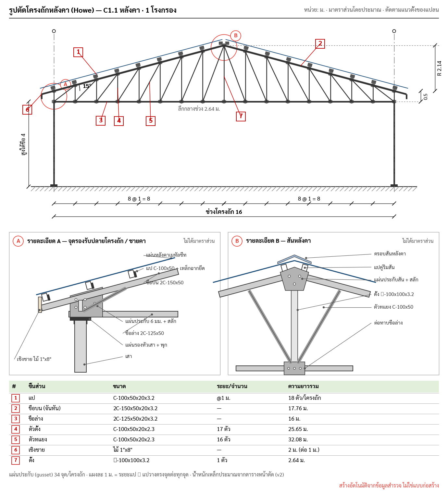
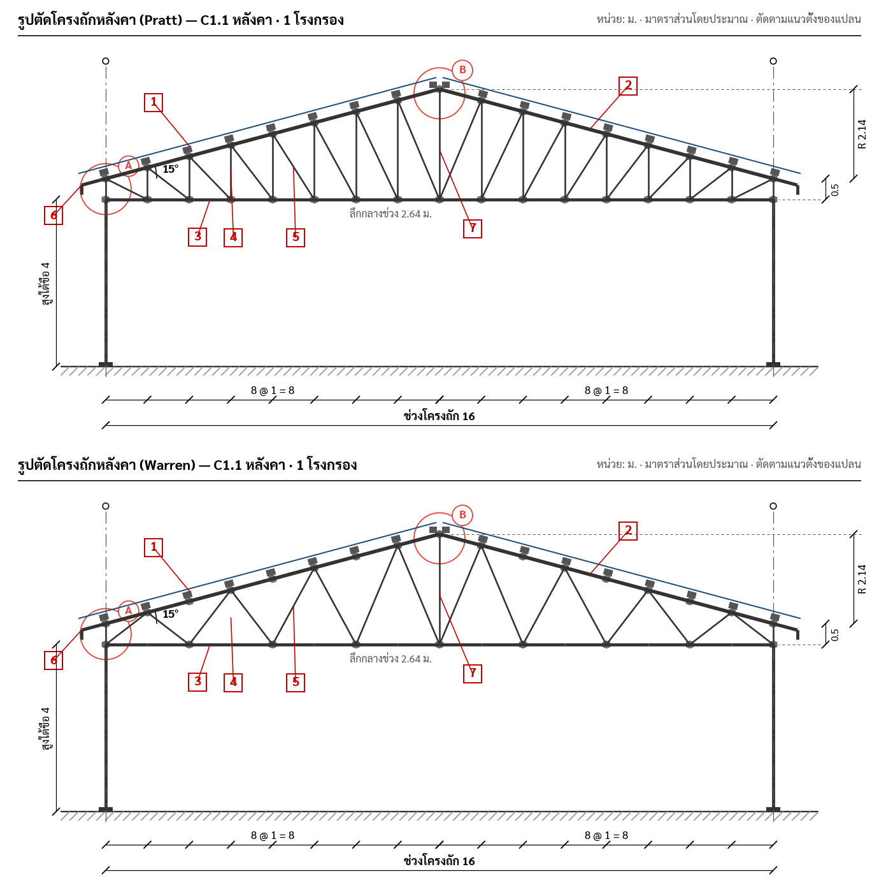
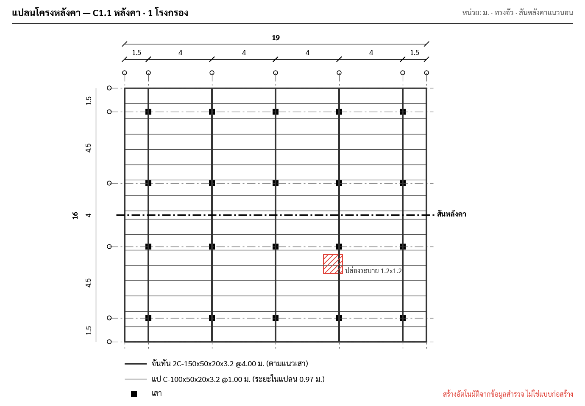
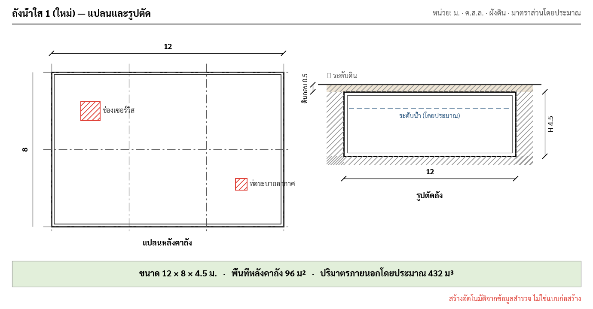

# Auto 2D Drawings: Roof Structure & Tank Size

**Status:** Draft · **Owner:** TCRoof · **Module:** `SolarSurveyKit` (SurveyCore / SurveyUI / PDFReport / ExcelExport)
**Date:** 2026-09-29

## 1. Goal

Generate dimensioned 2D drawings automatically from answers the surveyor already enters, so the report no
longer depends on a hand sketch:

| Drawing | Survey section | Replaces / adds |
|---|---|---|
| **Roof framing section** (รูปตัดโครงหลังคา) | C1 หลังคา, C2 หลังคาอาคาร, C3 บ้าน | Generic `Drawings.truss()` diagram |
| **Roof framing plan** (แปลนโครงหลังคา) | C1, C2 | Adds rafters / purlins / ridge to the existing `Drawings.plan()` |
| **Tank drawing** (แปลน + รูปตัดถัง + ขนาด) | D1 ถังน้ำใส | Adds a section, round tanks and a size/volume summary |

The drawings must show in the editor while typing, in the PDF (NO.215), and later in Excel (NO.224).
They are **indicative survey drawings, not construction drawings**. Every sheet carries that note.

### Non-goals (v1)
- Structural checks (member capacity, load). Geometry only.
- PV module layout on the roof (planned for v2, see §11).
- 3D, perspective or editable CAD. DXF export is a stretch goal (§10).

### Prototype output

Rendered from sample data by the Python prototypes in `docs/specs/img/` (`draw.py`, `truss.py`), which follow
this spec. The Swift implementation should match them.

| Truss section (Howe) + details + schedule | Truss types (Pratt, Warren) |
|---|---|
|  |  |
| **Framing plan** | **Tank plan + section** |
|  |  |

## 2. Library decision

**No new dependency.** Build on the drawing model that already exists in `SurveyCore/Sketch.swift`:

- `Sketch` / `DrawOp` (line, rect, hatch, circle, polygon, text, textBox, photo) is platform-neutral Swift.
- It already has four renderers:
  - PDF: `PDFRenderer.draw`, Core Graphics
  - Editor: `SketchView`, SwiftUI `Canvas`
  - Excel: PNG via `PDFRenderer.png`
  - Tests: SVG via `Sketch.svg()`
- Geometry written against it compiles and **tests on macOS and Linux** (`swift test`) with no simulator.

| Option | Verdict | Why |
|---|---|---|
| **Extend `Sketch`/`DrawOp` (chosen)** | ✅ | One drawing feeds every output; pure Swift; testable; matches the existing plan style |
| SwiftUI `Path`/`Canvas` directly | ❌ | UI-only; PDF and Excel would need a second copy |
| Core Graphics directly | ❌ | UIKit-bound, so no Linux tests; duplicates the PDF path |
| Third-party (e.g. a CAD/DXF kit) | ❌ v1 | Not needed for 2D lines/text; adds SPM weight and licence review |

Only one small extension to `DrawOp` is needed:

```swift
/// Circular arc, angles in degrees clockwise from +x (y-down), for curved roofs, angle marks and round tanks.
case arc(center: Pt, r: Double, from: Double, to: Double, width: Double, color: RGBA, dash: [Double] = [])
```

Adding it means handling the new case in `Sketch.translated`, `Sketch.svg`, `PDFRenderer.draw` and `SketchView`.
Until then, arcs can be approximated with `.polygon` of 24 points, so the extension is optional for v1.

## 3. Architecture

```
Values (survey answers)
   │  parse + validate            SurveyCore/Drawing/RoofInput.swift, TankInput.swift
   ▼
RoofInput / TankInput   ── missing: [String]   (what to fill in to get a drawing)
   │  pure geometry, metres, y-up SurveyCore/Drawing/RoofGeometry.swift, TankGeometry.swift
   ▼
RoofGeometry / TankGeometry
   │  layout: scale to points, flip y, dimensions, tags, legend
   ▼                              SurveyCore/Drawing/RoofDrawings.swift, TankDrawings.swift, DrawingKit.swift
Sketch  ──► SketchView (editor) · PDFRenderer (PDF) · png (Excel) · svg (tests)
```

Rules:
- **Input** knows the schema field ids. **Geometry** knows nothing about fields or drawing, only numbers.
  **Drawings** know nothing about fields.
- Geometry works in **metres, y-up**. Layout converts to **points, y-down** (the `Sketch` convention).
- Every stage is a pure function. Drawing functions return `nil` when input is insufficient, and the caller shows
  `input.missing`.
- New files go under `SolarSurveyKit/Sources/SurveyCore/Drawing/`. Existing `Drawings.plan()` stays and gains
  an overlay parameter, so current PDFs are unchanged until the flag is on.

## 4. Swift API

### 4.1 Shared

```swift
public enum RoofComponent: Int, CaseIterable, Sendable {   // numbering matches Drawings.truss() tags 1–7
    case purlin = 1, rafter, wallPlate, tieBeam, strut, fascia, kingPost
    public var thai: String   // แป จันทัน อเส ขื่อ ค้ำยัน เชิงชาย ดั้ง
}

public struct MemberSpec: Hashable, Sendable {
    public var label: String          // as entered: "C-100x50x20x3.2"
    public var depth: Double?         // m, parsed from label (see §5.3); nil if unknown
    public var spacing: Double?       // m, "@1.00M" → 1.0, C2 "100" (cm) → 1.0
    public var isAbsent: Bool         // entered as "-"
}
```

### 4.2 Roof

```swift
public enum RoofShape: Sendable { case gable, hip, shed, flat, curved }   // from Options.roofShape

public struct RoofInput: Sendable {
    public var shape: RoofShape
    public var across: [Double]        // m, bays perpendicular to the ridge (section direction)
    public var along: [Double]         // m, bays parallel to the ridge (plan only)
    public var rise: Double?           // m, from ridgeHeight − eaveHeight − heelDepth (C3: i1 − i2)
    public var pitch: Double? { … }    // derived: atan(rise / half-span); C3 roofAngle only as fallback
    public var eaveHeight: Double?     // m above ground; nil = draw column stubs only
    public var overhang: Double        // m beyond the outer grid line, default 0
    public var members: [RoofComponent: MemberSpec]
    public var missing: [String]       // plain labels, e.g. "ความสูงสันหลังคา"
    public var assumed: [String]       // printed in grey under the drawing, e.g. "ความลึกโครงถักที่เสา 0 ม."

    public static func from(_ m: SurveyModule) -> RoofInput?   // .roof, .roofForm, .house; nil for other types
}

public struct RoofGeometry: Sendable {
    public struct Segment: Sendable { public var a, b: Pt; public var component: RoofComponent }
    public struct Mark: Sendable { public var at: Pt; public var angle: Double; public var component: RoofComponent }
    public var span: Double, rise: Double, slopeLength: Double, pitch: Double
    public var outline: [Pt]            // top of roof sheet, eave → ridge → eave
    public var members: [Segment]       // rafters, tie beam, king post, struts, fascia, columns
    public var purlins: [Mark]          // one per purlin, oriented to the slope
    public var gridX: [Double]          // column lines across
    public static func section(_ i: RoofInput) -> RoofGeometry?
}

public enum RoofDrawings {
    public static func section(_ i: RoofInput, width: Double = 690) -> Sketch?
    public static func framingPlan(_ i: RoofInput, values: Values, width: Double = 690) -> Sketch?
}
```

### 4.3 Tank

```swift
public enum TankOutline: Sendable { case rectangle(length: Double, width: Double), circle(diameter: Double) }
public enum TankSetting: Sendable { case aboveGround, buried(cover: Double), partlyBuried(aboveGround: Double) }

public struct TankInput: Sendable {
    public var outline: TankOutline
    public var height: Double           // m
    public var setting: TankSetting
    public var bays: (x: [Double], y: [Double])?   // column grid on the roof slab, rectangle only
    public var obstacles: [Obstacle]
    public var missing: [String]
    public static func from(_ m: SurveyModule) -> TankInput?   // .tank only
}

public struct TankSummary: Sendable {
    public var roofArea: Double         // m²
    public var grossVolume: Double      // m³, outside dimensions
    public var text: String             // "12.00 × 8.00 × 4.50 ม. · หลังคา 96 ม² · ปริมาตร ≈ 432 ม³"
}

public enum TankDrawings {
    public static func drawing(_ i: TankInput, width: Double = 690) -> Sketch?   // plan | section | summary strip
    public static func summary(_ i: TankInput) -> TankSummary
}
```

## 5. Data model changes (`Schema.swift`)

All new fields are **optional** or have fallbacks, so existing jobs keep working. Anything a drawing needs but
doesn't have goes into `missing` and shows as a prompt, never as a crash or a wrong drawing.

### 5.1 New fields: sizes and distances only

**Rule: the surveyor enters only what can be measured on site, meaning distances (ม.) and member sizes.**
There are no new choice questions such as roof angle, truss type, frame type or ridge direction. Everything else is
derived (§5.2). Where a value can't be derived it is **assumed** and printed in grey under the drawing
("ค่าสมมติ: …"), so nobody mistakes it for a measurement.

| Section | Field id | Label | Kind | Req. | What it's used for |
|---|---|---|---|---|---|
| C1, C2 | `eaveHeight` | ความสูงชายคา (พื้น → ใต้ขื่อที่เสา) | `.number("ม.")` | yes | Column height; base of the rise |
| C1, C2 | `ridgeHeight` | ความสูงสันหลังคา (พื้น → หลังคาที่สัน) | `.number("ม.")` | yes | Rise → pitch |
| C1 | `overhang` | ระยะชายคายื่นจากเสา | `.number("ม.")` | no | Rafter tail; default 0 |
| C1 | `heelDepth` | ความลึกโครงถักที่เสา (ขื่อบน ↔ ขื่อล่าง) | `.number("ม.")` | no | Truss heel; default 0 (triangular) |
| C1 | `compTop` | ขื่อบน (ขนาด) | `.member` | no | Falls back to `comp2` จันทัน |
| C1 | `compBottom` | ขื่อล่าง (ขนาด) | `.member` | no | Falls back to `comp4` ขื่อ |
| C1 | `compVertical` | ตัวตั้ง (ขนาด) | `.member` | no | Falls back to `comp7` ดั้ง (king post only) |
| C1 | `compDiagonal` | ตัวทแยง (ขนาด) | `.member` | no | Falls back to `comp5` ค้ำยัน |
| D1 | `tankDiameter` | เส้นผ่านศูนย์กลาง (ถังกลม) | `.number("ม.")` | no | Filled means a round tank; the spans are then not needed |
| D1 | `tankAboveGround` | ความสูงส่วนที่พ้นดิน | `.number("ม.")` | no | Ground line in the section |

Removed from the earlier draft: `roofAngle` (C1/C2), `ridgeDir`, `frameType`, `trussType`, `tankShape`.
C3 keeps its existing `roofAngle` only as a fallback. It already has the heights `measI1`/`measI2`.

New non-countable field kinds place the drawings inside the form (`FieldSpec.countable` returns false for them):

```swift
case roofSection      // after the C1/C2/C3 structure group
case tankDrawing      // replaces nothing; sits after D1 "ข้อมูลถัง"
```

Switches to update: `FieldView.body`, `FieldSpec.countable`, `WebBackup` (line ~88, `case .plan, .diagram, .note`),
and any exporter switching on `FieldKind`.

### 5.2 Derived values

| Value | Derived from | Fallback (shown as ค่าสมมติ) |
|---|---|---|
| Span `B` (across the ridge) and length along it | C1: `spansX`/`spansY`, oriented by the ridge. C2/C3: `buildingWidth`/`buildingLength` ÷ 100 | — (required) |
| Ridge direction | ⟂ to the existing `sheetDir` (sheets run down the slope) | Along the longer side of the plan |
| Rise `R` | `ridgeHeight − eaveHeight − heelDepth`. C3: `(measI1 − measI2)/100` | C3 only: `roofAngle` |
| Pitch `θ` | `atan(R / (B/2))` for gable/hip, `atan(R / B)` for shed. `R < 0.05 m` means flat | — |
| Shape | `roofShape` (existing). A flat rise overrides it to flat | Gable |
| Frame type | **Truss** when a bottom chord and at least one web member are entered; otherwise rafter frame (จันทัน + ขื่อ + ดั้ง + ค้ำยัน) | — |
| Truss pattern | Verticals + diagonals → **Howe**. Diagonals only → **Warren**. Verticals only → verticals with no diagonals, plus the note "ไม่ได้ระบุตัวทแยง" | — |
| Panels per half `n` | `round(L / purlin spacing)`, so purlins sit on nodes | Purlin spacing 1.0 m |
| Heel depth | `heelDepth` | 0 (triangular truss) |
| Overhang | `overhang` | 0 |
| Tank outline | `tankDiameter` filled → circle; else `Σ spansX × Σ spansY` | — |
| Tank setting | `tankAboveGround ≥ tankHeight` → above ground; `0` → buried; in between → partly buried | Existing `tankPos` choice, else above ground |

Checks shown next to the fields (numbers only, no extra questions):
- ridge ≤ eave → "ความสูงสันต้องมากกว่าชายคา"
- derived pitch > 45° or < 3° on a pitched shape → "ตรวจความสูงอีกครั้ง (มุม ≈ x°)"
- `tankAboveGround > tankHeight` → "ส่วนพ้นดินสูงกว่าถัง"

Numbers are read through `NumberInput.value`, so "1,200", "50 ซม." and Thai digits work.

### 5.3 Member size parsing (`MemberSpec.parse`)

Depth is the first dimension of the section, with the unit taken from the list it came from:

| Entered | Depth |
|---|---|
| `C-100x50x20x3.2`, `2C-150x…`, `□-100x100x3.2`, `H-200x100…`, `I-150x…`, `L-50x50x5`, `Ø-76.3x3.2` | first number **mm** → 0.100, 0.150, … |
| `ไม้ 2"x8"` | larger inch value → 8″ = 0.203 m |
| `ค.ส.ล 0.20x0.40` | larger value, **m** → 0.40 |
| C2 `C 10x5x2`, `ไม้ 5x15`, `ค.ส.ล 20x40` | first (or larger for wood/RC) number **cm** → 0.10, 0.15, 0.40 |
| `-` | `isAbsent = true` (member not drawn, and not listed as missing) |
| anything else | `depth = nil`, still drawn at the default marker size and labelled as entered |

Spacing: `@1.00M` → 1.0 m; C2 `"100"` → 1.0 m. Values ≤ 0.2 m or > 12 m are ignored as typos.

## 6. Geometry rules

Notation: `B = Σ across`, `θ = pitch`, `h = B/2` (gable), `E = eaveHeight ?? 0`, `o = overhang`.

**Rise and pitch:** `R` comes from the measured heights (§5.2), and `θ = atan(R / h)` (shed: `atan(R / B)`). For C3, when both the heights and `roofAngle` are given and disagree by > 10%, the heights win and a warning line goes under the drawing.

**Gable / hip (section):**
- Roof line (0,E) → (h, E+R) → (B, E), extended by `o` along the slope at each end (drops `o·sinθ`).
- Rafter (2) is the same line. Tie beam (4) runs (0,E)–(B,E). King post (7) runs (h,E)–(h,E+R).
- Struts (5) run from (h,E) to the rafter at x = h/2 and x = 3h/2.
- Wall plate (3) is a marker at each eave column head. Fascia (6) is a 0.2 m vertical at each rafter tip.
- Purlins (1): slope length `L = h / cosθ`. Positions along each slope are `t = 0, s, 2s, …` while `t ≤ L`,
  plus one at the ridge if the last gap is > 0.25 s. `s` = purlin spacing, default 1.0 m.
- Columns sit at each grid line `x_i` from 0 up to the rafter underside. They are drawn only when `eaveHeight` is
  known; otherwise dashed 0.6 m stubs plus the note "ไม่ทราบความสูงชายคา".

**Shed:** one slope (0,E)→(B,E+R). No king post or struts.
**Flat (คอนกรีต):** slab 0.15 m thick at E, with columns, no purlins. The note shows the slab thickness as assumed.
**Curved:** arc through (0,E), (h,E+R), (B,E). Purlins are spaced by arc length.
**Hip (plan only):** hip lines at 45° from each corner. Ridge length = `along − across` (0 means a pyramid).

**Truss** (derived when a bottom chord and web members are entered, §5.2), see prototype `truss_howe.png`:
- **Chords:** bottom chord (ขื่อล่าง) (0,E)–(B,E). Top chord (ขื่อบน) (0,E+d)→(h,E+d+R)→(B,E+d), where `d = heelDepth`.
  Depth at mid-span is `d + R`.
- **Panels:** `n = max(2, round(L/s))` panels per half, so each panel's slope length equals the purlin spacing and
  **every purlin sits on a node**. Node x-positions are `i·h/n`, for i = 0…n.
- **Web**, per half, mirrored:
  - Howe: verticals at every node; diagonals bottom(i) → top(i+1), rising toward the ridge.
  - Pratt: verticals at every node; diagonals top(i) → bottom(i+1). The geometry supports it, but it is never
    auto-selected, because it can't be told apart from Howe by sizes alone.
  - Warren: king post only, plus zig-zag diagonals alternating bottom/top.
  - When `d = 0`, the heel vertical and a zero-length first diagonal are dropped.
- **Nodes:** a node is any point where a web member meets a chord, plus the two supports. Each node gets a
  gusset marker (hexagon 6.4 pt). A plain chord splice point is not a node.
- **Supports:** columns at x = 0 and x = B only. Interior grid lines are drawn as reference lines without columns,
  unless open question Q1 says otherwise.
- **Detail callouts:** circle A at the left support/heel and circle B at the ridge. Two inset panels below the
  section, "ไม่ได้มาตราส่วน", drawn by fixed templates (`TrussDetails.eave`, `.ridge`). Each panel shows:
  - Detail A: column, cap plate and anchors, heel gusset with bolts, bottom and top chords, first web members,
    purlins with angle cleats, sheet line, fascia.
  - Detail B: ridge gusset, king post, the first diagonals, a pair of ridge purlins, ridge cap, bottom-chord splice.

  Labels use the entered member sizes.
- **Member schedule** (per truss), a table under the details:
  - purlin count = `2(n+1)`
  - top chord length = `2(L + o)`
  - bottom chord length = `B`
  - Σ vertical lengths and count
  - Σ diagonal lengths and count
  - king post length = `d + R`
  - gusset count = node count

  Steel weight (kg) comes in v2 from a section-weight table keyed by the size string.

**Framing plan overlay** (on top of `Drawings.plan`):
- Ridge line (dash-dot, bold) on the centre line of `across`.
- Rafter lines at every grid line along the ridge axis, plus intermediate ones at rafter spacing.
- Purlin lines parallel to the ridge at the projected spacing `s·cosθ` from each eave.
- Hip lines for a hip roof.

**Tank:**
- Rectangle `L = Σ spansX`, `W = Σ spansY` (or `L = W = D` for a circle).
- Section shows the width `L`, the height `H`, and the ground line:
  - above ground: at the base
  - buried: at the top, plus a cover layer of thickness `cover` (hatched)
  - partly buried: at `H − aboveGround`
- Summary: roof area `L·W` or `πD²/4`; gross volume = area·H, labelled "ปริมาตรภายนอกโดยประมาณ".

**Guards:**
- Reject (return `nil` plus a missing reason) when `B ≤ 0`, `θ ∉ (0, 60]`, or any number is non-finite.
- Cap purlins at 200 and rafters at 300. Past the cap, draw every n-th purlin or rafter and note the real count.

## 7. Drawing standard

Matches the existing `Drawings.plan` look, so the pages read as one set:

- **Canvas:** width 690 pt (PDF content width). Height follows the aspect ratio, capped at 0.55 × width. Equal
  scale in x and y (scale "โดยประมาณ").
- **Line weights (pt):**
  - roof outline / rafters: 2.2
  - tie beam / king post: 1.6
  - struts / columns: 1.2
  - grid lines: 0.7 dash-dot `[10,3,2,3]`
  - dimensions: 0.6
  - hatch: 1.4 @ 6
- **Colours:** members `.dark`, dimensions and text `.black`, notes `.ink2`, missing / warnings `.red`, ground and
  cover hatch `.faint`. Stay monochrome-friendly: nothing may rely on colour alone.
- **Small members** (purlins, wall plates) are **fixed-size markers** (6×4 pt, rotated to the slope), not drawn
  to scale.
- **Dimensions:**
  - A span chain under the section, with the total on a second line (same tick style as the plan).
  - Eave height on the left and rise on the right.
  - Pitch as an arc plus "15°" at the left eave.
  - Slope length written along the rafter: "L = 8.28 ม.".
  - Numbers use `fmt()` (at most 2 decimals, trailing zeros dropped). Unit ม. is stated once in the title.
- **Tags:** numbered squares 1–7, same style as `Drawings.truss()`, placed at the first occurrence of each member.
  A legend below lists them, for example "1 แป · C-100x50x20x3.2 @1.00 ม.". A missing member shows "— ไม่ได้ระบุ —".
- **Title strip:** "รูปตัดโครงหลังคา — {section title}" · "หน่วย: ม. · มาตราส่วนโดยประมาณ".
  Footnote: "สร้างอัตโนมัติจากข้อมูลสำรวจ ไม่ใช่แบบก่อสร้าง".
- **Font:** Sarabun (already bundled for PDF). Text sizes 8.5 (dimensions), 9 (labels), 10 bold (title).
  Measure text with `ApproxText.width` (SketchSVG.swift) to avoid overlaps.

## 8. Integration

| Where | Change |
|---|---|
| `SurveyCore/Drawing/*` | New input, geometry and drawing files (§3–4) |
| `Schema.swift` | New fields and kinds (§5). C1 gets `FieldSpec("section", "รูปตัดโครงหลังคา", .roofSection)` after the structure group; D1 gets `.tankDrawing` |
| `SurveyUI/Fields.swift` | Render `.roofSection` / `.tankDrawing` like `PlanPreview`: live `SketchView`, or a grey box listing `input.missing`. Tap for a full-screen zoomable view |
| `PDFReport/ReportLayout.swift` | `planSection` (roof, tank): add the section drawing under the plan, with a page break when it doesn't fit. `formSection` (C2/C3): replace `Drawings.truss()` with the section when available, otherwise keep truss |
| `ExcelExport` | **v1: no change.** v2: rasterise via `PDFRenderer.png` into a new anchor in `template_meta.json` (needs a free cell range on sheets หลังคาทั่วไป R / บ่อน้ำใส, see open question Q3) |
| `SolarSurveyWeb/survey-app.html` | Parity later. The web version can port the geometry, or read `Sketch.svg()` output |
| `Progress.swift` / `Validation.swift` | `missingGroups` includes `RoofInput.missing` / `TankInput.missing`, so the export sheet lists "ข้อมูลไม่พอวาดรูปตัด: ความสูงสันหลังคา" |

Feature flag: `SurveySettings.autoDrawings` (default **on** in Debug, **off** in Release until the PDF is signed off).

## 9. Testing

All in `Tests/SurveyCoreTests`. They run with `swift test` on the Mac, with no simulator.

1. **Parsing**
   - `MemberSpec.parse` covers every row of §5.3.
   - Spacing parses, including values that should be rejected.
   - `RoofInput.from` works for C1, C2 and C3 sample modules.
   - Missing lists are correct when heights, spans or members are absent.
   - Derivation (§5.2): eave 4.0 + ridge 6.644 + heel 0.5 on B = 16 → θ = 15.0°; verticals + diagonals → Howe;
     diagonals only → Warren; no web → rafter frame; ridge ≤ eave → missing "ความสูงสันหลังคา"
2. **Geometry** (exact numbers):
   - B = 16, θ = 15°, s = 1.0 → R = 2.144, L = 8.282, purlins at t = 0…8 m (9) plus one at the ridge (last gap 0.28 > 0.25), so 10 per slope
   - shed, flat, curved and hip ridge length
   - tank volumes: 12×8×4.5 = 432; circle D = 10, H = 5 → 392.7
   - Howe truss B = 16, θ = 15°, d = 0.5, s = 1.0 → n = 8 per half, 17 verticals, 16 diagonals, 34 nodes,
     top chord 2(8.282 + o), king post 2.644
3. **Invariants**, run for 50 generated inputs:
   - every op lies inside `0…width × 0…height`
   - no NaN or ∞
   - op count < 2,000
   - `nil` exactly when `missing` is non-empty
4. **Snapshots:**
   - `Sketch.svg()` for 6 fixtures (gable C1, hip C1, shed C2, house C3, rect tank buried, round tank above ground)
     compared with `Tests/SurveyCoreTests/Fixtures/drawings/*.svg`
   - Regenerate with `RECORD_SNAPSHOTS=1 swift test`
5. **Manual:**
   - Check the editor preview and PDF on an iPad simulator for the 6 fixtures.
   - An engineer signs off one real job's PDF before the Release flag is turned on.

## 10. Milestones

| # | Deliverable | Depends on |
|---|---|---|
| M1 | `MemberSpec` parsing, `RoofInput`/`TankInput` + unit tests | — |
| M2 | `RoofGeometry` + `RoofDrawings.section` + snapshot tests | M1 |
| M3 | Schema fields/kinds; editor preview (`Fields.swift`) | M2 |
| M4 | PDF integration (`ReportLayout`) behind flag | M3 |
| M5 | `TankGeometry` + `TankDrawings` + D1 fields + PDF | M1 |
| M2b | Truss geometry (Howe/Pratt/Warren), eave/ridge detail templates, member schedule | M2 |
| M6 | Framing plan overlay (C1/C2) | M2 |
| M7 (stretch) | Excel image anchor; DXF R12 export (`Sketch` → ASCII DXF, about 150 lines, no library) | M4 |

## 11. Open questions

1. **C1 overhang:** in C1, are the first and last `spansX`/`spansY` values (e.g. 1.5 in "1.5,4,4,4,4,1.5")
   overhangs or real bays? If they are always overhangs, `overhang` can be derived and the new field dropped.
2. **Ridge direction:** it is inferred from `sheetDir`, else the longer side. Is that always right for station roofs? (There is deliberately no extra question.)
3. **Excel:** is there space on the NO.224 roof/tank sheets for a section image, or should the section be PDF-only?
4. **Tank dimensions:** are D1 spans outside dimensions (most likely, since they come from the plan)? Should the
   volume be shown at all, or only the roof area used for PV?
5. **C3 mapping:** confirm that `measA` = rafter spacing, `measC` = purlin spacing, and `measI1`/`measI2` = ground→ridge
   and ground→eave, as the labels suggest.
6. **v2:** PV module layout on the section and plan (module size, row spacing, setbacks), reusing the same geometry.
