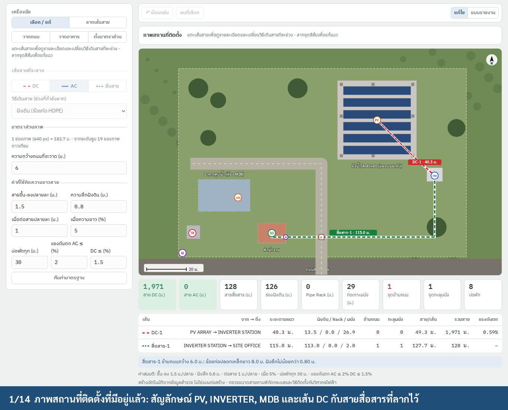
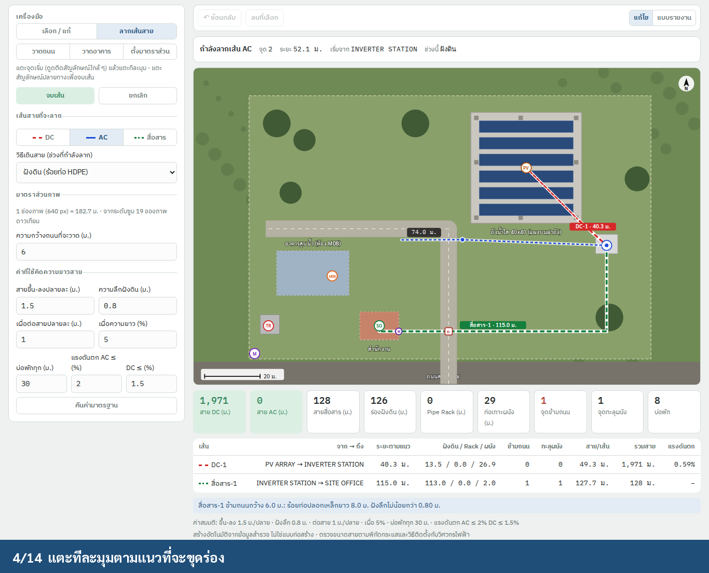
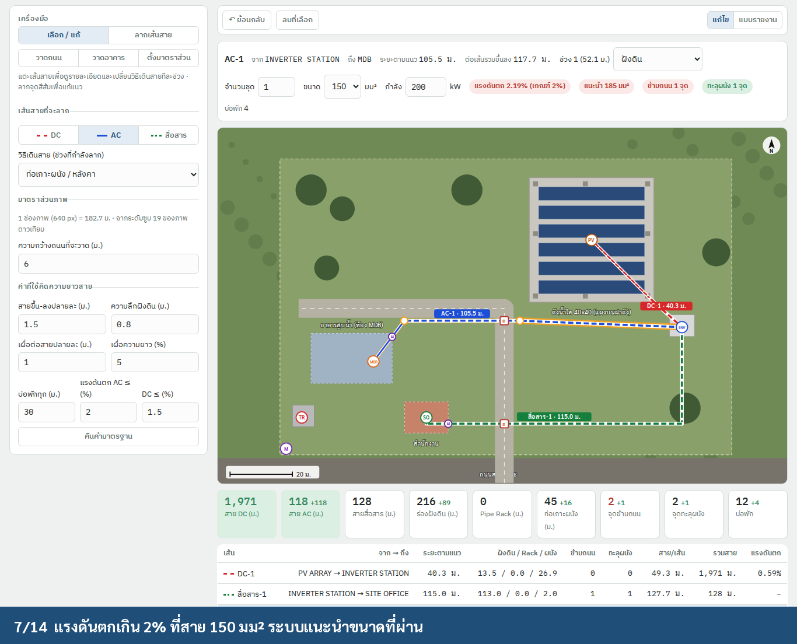
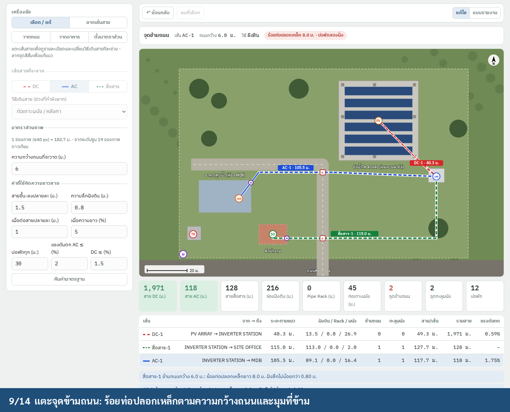
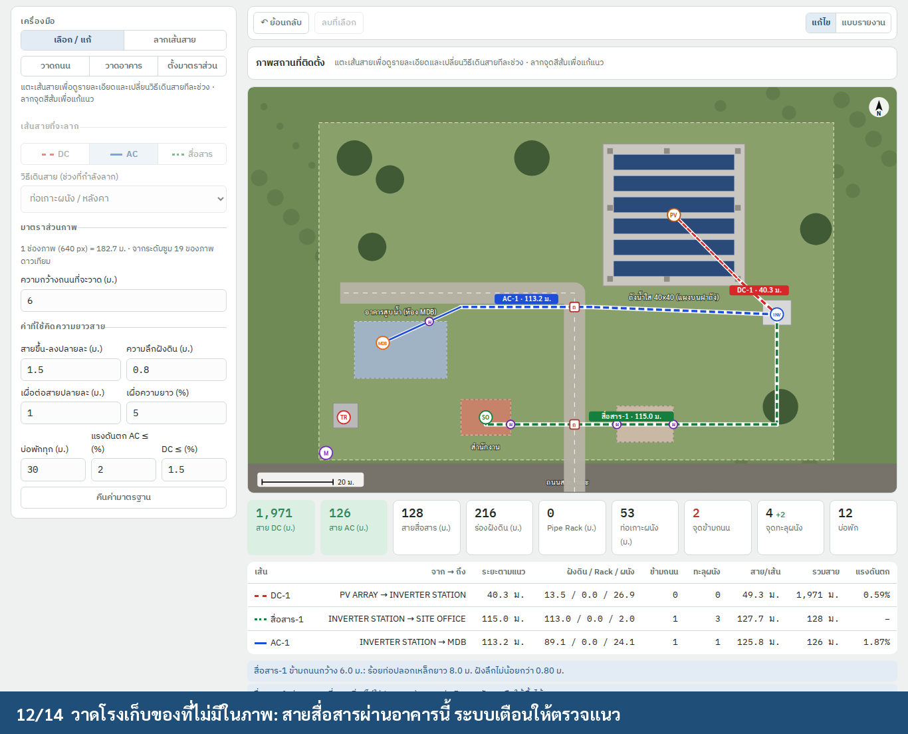
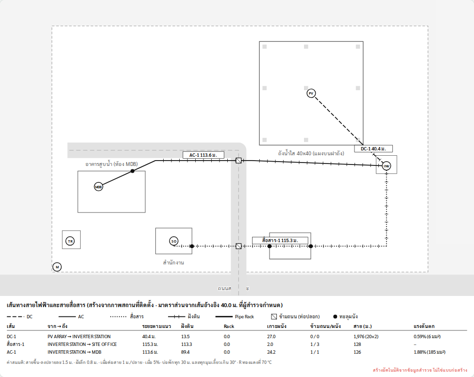

# Cable routes on the site map (วัดระยะเดินสายบนแผนที่)

**Status:** Ready for development, 2026-09-29
**Where:** job cover › ภาพสถานที่ติดตั้ง (`siteMap`), directly under the existing symbol editor (`siteMarks`)
**Prototype:** `prototype/cable-route.html` (open in a browser)
**Demo:** `img/cable_demo.mp4` (14 steps), recorded with `NODE_PATH=<global node_modules> node prototype/cable-route-demo.js <outDir>`

| Existing site picture with DC and comms routes | Drawing the AC route, snapped to INVERTER |
|---|---|
|  |  |
| **Route finished at MDB: road crossing and wall counted** | **Voltage drop over 2 % at 150 mm², size suggested** |
|  |  |
| **Tap the road crossing: steel sleeve length** | **A shed drawn by hand: the route passes through it** |
|  |  |

**Report sheet** (the drawing that goes into the PDF):



---

## 1. Goal

The surveyor draws where each cable will run on the site picture that is already in the job. Three routes are typical:
- PV array → inverter (DC)
- inverter → MDB (AC)
- inverter → office (comms)

The app then works out:
- **route length**, in total and split by installation method (underground, pipe rack/tray, wall/roof conduit)
- **cable length** per circuit and in total, including risers, burial depth, terminations and slack
- **road crossings** (with the steel sleeve length) and **wall penetrations**, counted automatically
- **handholes**, **trench length**, **rack length** and **conduit length** for the BOQ
- **voltage drop** for AC and DC at the entered cable size, with the smallest size that passes

As everywhere else in the survey, the surveyor only draws and types distances. Everything else is derived, and every
assumption is printed as ค่าสมมติ.

## 2. Scale: where metres come from

A route is stored in picture fractions (like `MapMark`). Its length needs the picture's scale in metres per picture
width.

| Picture source | Scale | Stored as |
|---|---|---|
| Fetched by the app (`SurveyModel.mapPhoto`, Google Static or Apple snapshot) | `MapImage.metersAcross(lat, zoom)`. At zoom 19 and lat 17° this is 182.7 m for 640 px | `scale = .map(zoom:, lat:)`, set when the picture is fetched |
| Drone photo, a photo from the library, a hand sketch | the surveyor taps two points of a known distance (a tank edge of 40.00 m, a building of known length) and types it | `scale = .reference(a:, b:, metres:)` |
| Unknown | lengths are hidden, and the editor shows "ตั้งมาตราส่วนก่อน" with the reference tool | — |

**Changing the scale:**
- Setting a new scale re-measures every route. The deltas show on the tiles.
- Replacing the picture keeps the routes but asks: "ภาพเปลี่ยน ตรวจแนวเส้นสายอีกครั้ง".

## 3. Data model (`TCRoofCore/SiteRoutes.swift`)

```swift
public struct SitePoint: Codable, Hashable { public var x, y: Double }          // fractions 0…1, like MapMark
public enum RouteKind: String, Codable, CaseIterable { case dc, ac, comm }
public enum RouteMethod: String, Codable, CaseIterable { case underground, rack, conduit }
public struct CableRoute: Codable, Hashable, Identifiable {
    public var id = UUID()
    public var kind: RouteKind
    public var from: UUID?, to: UUID?            // MapMark ids; nil = free end
    public var points: [SitePoint]               // ≥ 2; ends follow their marks when marks move
    public var methods: [RouteMethod]            // one per segment
    public var circuits: Int                     // AC: parallel cables; DC: strings; comm: cables
    public var sizeMM2: Int?                     // copper, per conductor
    public var kW: Double?, volts: Double?, stringAmps: Double?
}
public struct SiteRoad: Codable, Hashable { public var points: [SitePoint]; public var width: Double }   // centreline + width (m)
public struct SiteBuilding: Codable, Hashable { public var name: String; public var outline: [SitePoint] }
public enum SiteScale: Codable, Hashable { case map(zoom: Int, lat: Double); case reference(a: SitePoint, b: SitePoint, metres: Double) }
public struct SiteRoutes: Codable, Hashable {
    public var scale: SiteScale?
    public var roads: [SiteRoad] = [], buildings: [SiteBuilding] = [], routes: [CableRoute] = []
}
```

**Schema changes:**
- `FieldValue` gets a new case, `.routes(SiteRoutes)`.
- A new field kind, `.routes(photoField: "siteMap", marksField: "siteMarks")`, goes after `siteMarks`, labelled
  "เส้นทางสาย DC / AC / สื่อสาร". It is optional and counts as done when it has at least one route.
- `MarkKind` gets **`.pv` ("PV ARRAY")**, so a DC route can start at a symbol.
- The same switches as for `.marks` need updating: `FieldView`, `countable`, `Progress`, `WebBackup` (JSON
  `{s, rd, bd, rt}`), the Excel exporter.

## 4. Computation (`TCRoofCore/RouteAnalysis.swift`, pure Swift, tested on Linux)

Notation:
- `s` = metres per picture px
- the segments `i` of a route with lengths `Lᵢ`, and `L = Σ Lᵢ`

| Output | Rule |
|---|---|
| Length by method | `Σ Lᵢ` for each method |
| Road crossings | every intersection of a route segment with a road centreline segment. For an underground crossing the sleeve length is `width / |sin θ| + 2 × 1.0`, with `|sin θ| ≥ 0.2`. For a rack or conduit crossing the note is "ตรวจความสูงข้ามถนน" |
| Wall penetrations | every intersection with a building outline; hits within 0.5 m of each other count as one (corners) |
| Passes through a building | ≥ 2 wall hits on one building while neither end is inside it → note "ผ่านอาคาร … ตรวจว่าเดินบนหลังคาหรือใต้พื้นได้" |
| Underground stretches | runs of consecutive underground segments |
| Handholes | per stretch: 2 (ends) + `⌈len / spacing⌉ − 1` + bends over 30° inside the stretch |
| Vertical allowance | `2 × riser + stretches × 2 × depth` |
| Per circuit | `(L + vertical + 2 × termination) × (1 + slack)` |
| Total cable | `per circuit × circuits × (2 for DC single-core, else 1)` |
| AC voltage drop | `I = kW / (√3 V)` per circuit, `VD% = √3 · I · R(size) · per / V`, pf 1 |
| DC voltage drop | `VD% = 2 · I_string · R(size) · per / V` |
| Suggested size | smallest size in 4 … 300 mm² with VD ≤ limit |

- `R(size)` is the IEC 60228 class 2 copper value at 20 °C × 1.2 (about 70 °C). Reactance is ignored (≤ 300 mm²,
  pf 1).
- **Ampacity is not checked in v1** (Q3). The footer says so.

**Assumed values** (settings, printed as ค่าสมมติ):

| Value | Default |
|---|---|
| riser per end | 1.5 m |
| burial depth | 0.8 m |
| termination per end | 1.0 m |
| slack | 5 % |
| handhole spacing | 30 m |
| VD limit AC / DC | 2 % / 1.5 % |

**Prototype numbers:**
- DC-1: 40.3 m route, 49.3 m per string, 20 strings × 2 = 1,971 m, VD 0.59 % at 6 mm².
- AC-1 as drawn in the demo:
  - 105.5 m route, 117.7 m per circuit
  - 1 road crossing (steel sleeve 8.0 m), 1 wall
  - 200 kW at 400 V: VD 2.19 % at 150 mm², so the app suggests 185 mm² (1.75 %)

## 5. Drawing

**Editor (colour, on the photo):**
- DC is red dashed, AC blue, comms green dotted. Underground segments are drawn dashed.
- Symbols:
  - road crossing: a red square marked "ถ"
  - wall penetration: a purple circle marked "ผ"
  - route vertices: orange handles
- A label chip at the route's middle reads "AC-1 · 105.5 ม.".
- A 20 m scale bar and a north arrow.

**Report (`SiteRoutes.ops(in:)` → `Sketch`, black on white, on the site picture page of NO.215):**
- DC dashed, AC solid, comms dotted. Underground gets tick marks, and a rack is a heavy line.
- Road crossing: a square with a diagonal. Wall penetration: a dot. Labels "AC-1 105.5 ม.".
- Under the picture:
  - a legend and one table row per route: from → to, route length, by method, crossings/walls, cable, VD
    (red when over the limit)
  - the ค่าสมมติ line and the footer "สร้างอัตโนมัติจากข้อมูลสำรวจ ไม่ใช่แบบก่อสร้าง"

**Excel (NO.224):** the BOQ rows are:
- cable DC / AC / comm (m, per size)
- trench (m), HDPE conduit (m), rack (m), wall conduit (m)
- steel sleeves (pcs, m), handholes (pcs), wall penetrations (pcs, fire-stop)

## 6. Interaction (`SurveyUI/SiteRoutesEditor.swift`)

It shares the stage with `SiteMarksEditor` (same picture, same fractions, same pinch/zoom). The symbols show read-only
in this editor, except that dragging one moves the routes attached to it.

### 6.1 Tools

| Tool | Gesture | Result |
|---|---|---|
| **เลือก / แก้** (default) | tap a route segment (16 pt hit) | selects the route and that segment; the info line shows the details (§6.2) |
| | drag an orange vertex | moves it; an end vertex snaps to a symbol within 18 pt and re-links `from`/`to` |
| | drag a symbol | the ends of attached routes follow |
| | tap a road crossing | "ร้อยท่อปลอกเหล็ก 8.0 ม. · บ่อพักสองฝั่ง" or "ตรวจความสูงข้ามถนน" |
| **ลากเส้นสาย** | tap a start point (snaps to a symbol) | begins a route of the chosen kind |
| | tap each corner | adds a segment with the currently chosen **method**; a live length follows the finger |
| | tap a symbol | ends the route there. Or **จบเส้น** / double tap for a free end. **ยกเลิก** / Esc discards it |
| **วาดถนน** | tap along the centreline, **จบเส้น** | a road with the width set in the side panel (default 6 m) |
| **วาดอาคาร** | tap the corners, tap the first corner again | a building outline (for buildings not visible or not in the picture yet) |
| **ตั้งมาตราส่วน** | tap two points, type the real distance, **ตั้งมาตราส่วน** | `scale = .reference`; all lengths update |

Roads and buildings are few, and the surveyor draws them only where routes cross. They are not a site survey.

### 6.2 Info line for a route

- **Shows:** name (AC-1), from → to, route length, per-circuit length, and the handhole count.
- **Edits:**
  - the selected segment's method (a picker)
  - circuits or strings
  - size (mm²)
  - kW (AC) or string current (DC)
- **Pills:**
  - VD: green within the limit, red over it, with "แนะนำ 185 มม²"
  - "ข้ามถนน n จุด" in red, or "ไม่ข้ามถนน" in green
  - "ทะลุผนัง n จุด"
- **Changing the kind:** tapping DC / AC / สื่อสาร while a route is selected changes its kind.

### 6.3 Tiles, table, notes

- **Tiles:**
  - cable DC / AC / comm (m)
  - trench, rack and conduit (m)
  - road crossings (red when > 0), wall penetrations, handholes
  - each tile shows a green/red delta since the last change (same as the mounting editor)
- **Table:** one row per route; the selected route's row is highlighted.
- **Notes:**
  - each road crossing with its sleeve
  - each route that passes through a building
  - each route over its VD limit, with the suggested size

**Undo:** one step per finished route, vertex drag, method or size change, road, building or scale.

### 6.4 Devices

- **iPad:** the tools and assumed values sit in the left column.
- **iPhone:** the tools go in a bottom toolbar, the assumed values in a sheet, and the info line in a bottom bar.
- **Apple Pencil:** it draws routes with hover preview. A finger pans and zooms while a Pencil draws.

## 7. Swift files

| File | Contents |
|---|---|
| `TCRoofCore/SiteRoutes.swift` | §3 model, `Codable`, `WebBackup` mapping |
| `TCRoofCore/RouteAnalysis.swift` | §4 (geometry, allowances, VD, suggested size); `RouteStandard` in `SurveySettings` |
| `TCRoofCore/SiteRoutesDrawing.swift` | report ops + legend + table → `Sketch` |
| `SurveyUI/SiteRoutesEditor.swift` | §6 |
| `SurveyUI/MapImage.swift` | returns the zoom and lat with the picture so `scale = .map` is stored |
| `PDFReport/ReportLayout.swift` | routes on the site picture page + the table |
| `ExcelExport/ExcelExporter.swift` | BOQ rows |

**Tests:**
- the §4 prototype numbers
- a crossing at 45° gives a sleeve `6 / sin 45° + 2 = 10.5 m`
- a corner hit counts once
- a route that enters and leaves a building warns
- handholes for a 113 m stretch with one bend = 2 + 3 + 1 = 6
- moving a symbol moves the attached ends
- a reference scale re-measures every route
- old jobs without `.routes` decode unchanged
- snapshot SVG of the report sheet

## 8. Done when

- [ ] The demo steps pass on iPad and iPhone simulators (XCUITest mirrors `cable-route-demo.js`).
- [ ] The lengths match a tape-measured test site within 3 % when the picture comes from the map at zoom 19.
- [ ] No route length is shown without a scale.
- [ ] The report table and the Excel BOQ equal the editor's totals.

## 9. Open questions

1. **Allowances:** are 1.5 m riser, 0.8 m depth (1.0 m under roads?), 1.0 m per termination and 5 % slack the
   team's numbers?
2. **VD limits:** is 2 % AC and 1.5 % DC right, or should it follow the PEA/EIT figure the team uses?
3. **Ampacity:** add a current-carrying check (installation method, grouping, ambient) in v1, or keep it VD-only?
4. **Sleeve:** steel (GSP) under every road, or HDPE with concrete encasement? What overhang each side?
5. **Handholes:** 30 m spacing and at every bend over 30°: are both right? Is a handhole needed on both sides of each
   road?
6. **Comms:** Cat6 / RS485 / fibre: should the kind pick the cable type, with a length limit warning (100 m for
   Ethernet)?
7. **Heights:** should a rack crossing over a road ask for the clearance height (a number) and check it against the
   minimum?
