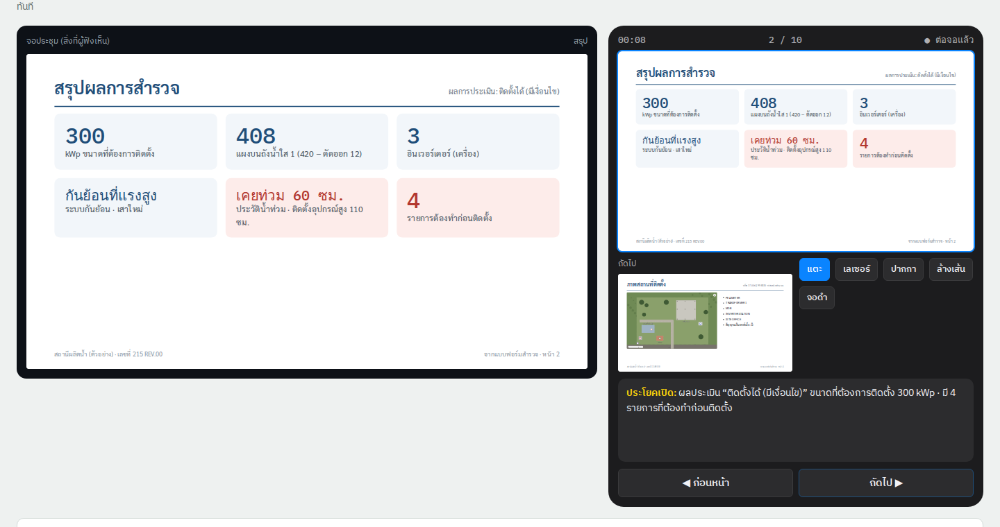
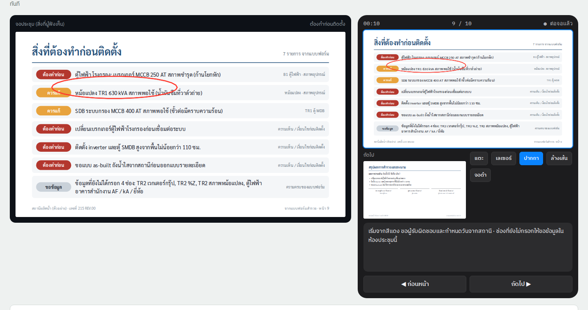
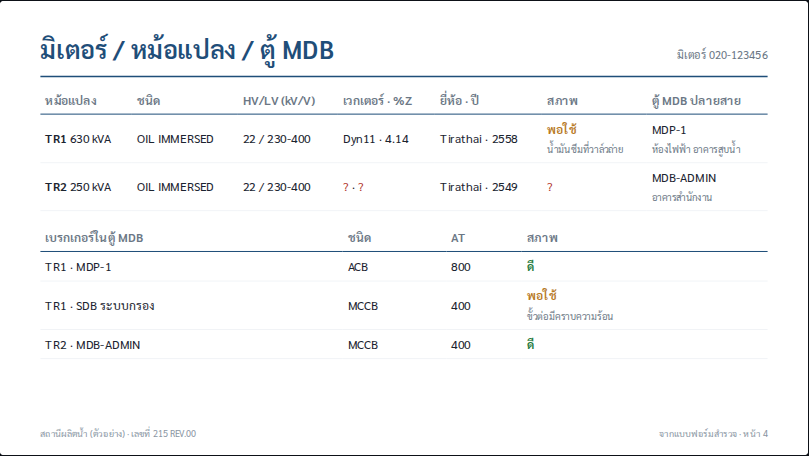
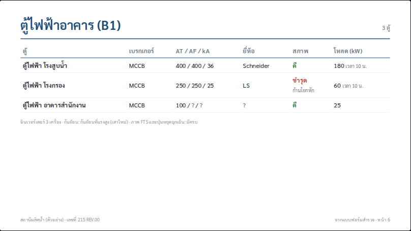
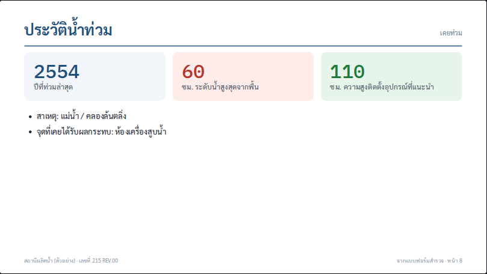

# Presentation mode (โหมดนำเสนอ), iPad app

**Status:** Ready for development, 2026-09-29
**Platform:** TCRoof on **iPad** (SwiftUI, iPadOS 17+). The meeting screen is connected by **USB-C → HDMI** or
**AirPlay** (Apple TV, or a TV with AirPlay).
**Where:** job toolbar › **นำเสนอ** (next to Export / Share).
**Prototype:** `prototype/presentation-mode.html`. It is a clickable model of both screens: the meeting display on
the left, the iPad presenter view on the right. Open it from the repo so the images load.

**Scope rule: the slides show only what is in the survey form.** That means:
- the form's own values and photos
- the drawings the report already draws from those values (site picture with symbols, single line diagram, tank
  plan)

There are no new calculations: no energy, payback, CO₂ or layout optimisation. Nothing comes from features that are
not in the form.

**Presenter view (iPad) and meeting screen:**

| Pencil ink on the iPad shows on the meeting screen | Slide: meter / transformers / MDB, straight from the form |
|---|---|
|  |  |
| **Slide: building panels (B1) with condition** | **Slide: flood history** |
|  |  |

---

## 1. Goal

At the end of a survey the team usually meets the station staff. With this mode the surveyor:
1. connects the iPad to the room's TV
2. taps **นำเสนอ**
3. presents the survey form as slides

Nothing is typed again, and nothing appears on screen that is not in the form. The same deck exports as a PDF for the
station.

What the two screens show:
- **The meeting screen:** only the slide.
- **The iPad:** the current slide, the next slide, notes, a timer, and the Pencil tools.

## 2. Slides

A slide is **hidden when its section has no data** (for example no D1 module → no tank slide). The presenter can also
switch slides off. A field left empty shows a red **?**, the same as in the report. For a station with modules of the
same type (several panels, several tanks), each module gets its own slide, in the job's order.

| # | Slide | Form source (field ids in `Schema.swift`) |
|---|---|---|
| 1 | **ปก** | `projectName`, `address`, `engineer`, `date`, `docNo`, `rev` |
| 2 | **สรุปผลการสำรวจ**: verdict + 6 tiles | `verdict`; `capacity` (kWp); panels on the tank = `panelsBefore − panelsCut`; `inverterCount`; backfeed `level` + `pole`; `floodHistory` / `floodDepth` / `equipHeight`; the number of red rows of slide 9 |
| 3 | **ภาพสถานที่ติดตั้ง** | `siteMap` with `siteMarks` (the report's marked picture), `north`, `gps`, `internet`, `siteList` |
| 4 | **มิเตอร์ / หม้อแปลง / ตู้ MDB** | `meterNo`; `trafos` (kVA, MDB breakers with type, AT, condition); `tr<i>_type`, `_hv`, `_lv`, `_vector`, `_z`, `_brand`, `_year`, `_cond`, `_condNote`, `_feed`, `_feedLoc` |
| 5 | **Single line diagram (ระบบเดิม)** | the SLD the report draws from the same fields ([`single-line-diagram.md`](single-line-diagram.md) level 1) |
| 6 | **ตู้ไฟฟ้าอาคาร (B1)**, one row per panel module | `breakerType`, `breakerAT`/`AF`/`KA`, `breakerBrand`, `cond`, `condNote`, `loadKW`, `loadTime`; footer line from B2 `inverterCount`, B4 backfeed, B5 FTS photos present |
| 7 | **หลังคา (C1) / ถังน้ำใส (D1)**, one per module | the plan the report draws from `spansX`/`spansY`/`obst`; `tankType`, `tankPos`, `tankHeight`, `surface`, `shade…`, `panelsBefore`, `panelsCut` (C1: `roofShape`, `roofMaterial`, `roofStructure`, members) |
| 8 | **ประวัติน้ำท่วม** | `floodHistory`, `floodYear`, `floodDepth`, `floodSource`, `floodHit`, `equipHeight` (the form's own rule: flood level + 50 cm) |
| 9 | **สิ่งที่ต้องทำก่อนติดตั้ง** | §3 |
| 10 | **สรุปผลการสำรวจและลงนาม** | `verdict`, `remarks`, `engineer`, `reviewer`, `customerName`, signatures (`surveyorSign`, `customerSign`) |

Photos: each slide can open the photos of its fields (§5.2) full screen on the meeting display. Examples: transformer
sides and nameplate, panel photos, FTS / emergency button, tank obstacles, flood evidence.

**Design:**
- 16:9 (1920 × 1080), white, blue headers (the report's colours), Sarabun.
- Large type for the back of the room.
- Every slide has the footer "<project> · เลขที่ <docNo> REV.<rev> · จากแบบฟอร์มสำรวจ".
- Drawings are the **same `Sketch` output as the PDF report**. There is no second drawing code.

## 3. "สิ่งที่ต้องทำก่อนติดตั้ง": collected from the form only

| Level | Colour | Rows come from |
|---|---|---|
| **ต้องทำก่อน** | red | any equipment with condition **ชำรุด** (building panels, MDB breakers, transformers), with its note; every line of `remarks` (ความเห็น / เงื่อนไข / สิ่งที่ต้องแก้ไขก่อนติดตั้ง) |
| **ควรแก้** | amber | any equipment with condition **พอใช้**, with its note |
| **ขอข้อมูล** | grey | required fields still empty (`Progress`), listed by label, to ask for in the meeting |

- Each row shows its source (section and field).
- **Long-press a row** on the iPad to open that field in the form, then come back.
- The presenter can hide a row for this meeting. The form is not changed.

**Sample:** 4 red, 2 amber, 1 grey (7 rows).
- **Red:**
  - the โรงกรอง panel breaker ชำรุด (ก้านโยกหัก)
  - the remark on replacing that breaker
  - the remark on mounting height 110 cm
  - the remark asking for as-built drawings
- **Amber:**
  - TR1 พอใช้ (น้ำมันซึม)
  - SDB ระบบกรอง พอใช้ (คราบความร้อน)
- **Grey:** 4 empty fields.

Every remark line is its own row. The summary tile counts the red rows (4).

## 4. iPad presenter view

### 4.1 Screens

- **Presenter layout on the iPad:**
  - top bar: timer, "n / N", external-display status
  - the **current slide** (large, with ink)
  - the **next slide**
  - tool buttons
  - **notes**
  - large **◀ ก่อนหน้า / ถัดไป ▶**
- **Presenter notes are fixed text per slide type.** They are filled only with form values, for example the opening
  sentence on slide 2 with the verdict and `capacity`.
- **Slide strip** (swipe up): thumbnails with a **แสดง** switch each. Tap one to jump.
- **Meeting screen:** the slide only, plus the ink and laser. **จอดำ** (B) blanks it.
- **No external display:** the iPad shows the slide full screen, and the notes are in a pull-down.

### 4.2 Input

| Input | Action |
|---|---|
| Tap right / left third of the current slide, or swipe | next / previous |
| **Apple Pencil**, tool ปากกา | red ink, mirrored live to the meeting screen (PencilKit). Kept per slide for the session. **ล้างเส้น** clears |
| **Apple Pencil hover** (iPad Pro) or tool เลเซอร์ | red laser dot on the meeting screen |
| **Pencil Pro squeeze** | toggles pen ↔ laser |
| Keyboard / Bluetooth clicker | → / Page Down / Space next, ← / Page Up previous, B black screen |
| **รูป** button on a slide | the slide's form photos, full screen on the meeting display; swipe through them, then back to the slide |
| Long-press a row on slide 9 | opens that field in the form |

### 4.3 External display

- **The display scene:** the app declares a **non-interactive external display scene**. When a display connects (HDMI,
  AirPlay as a separate display, or Stage Manager's extended display), that scene shows `SlideView` full screen,
  letterboxed to 16:9.
- **Sync between screens:** both scenes share one `@Observable PresentationModel`: slide index, photo, ink, laser
  point, black.
- **Mirroring only:** if the display is mirroring, the app shows a hint: "ตั้ง AirPlay เป็นจอแยก เพื่อซ่อนบันทึกผู้พูด".
- **Disconnect** mid-talk: falls back to single-screen mode, keeping the slide.

### 4.4 After the meeting

- **ส่งออก PDF:** one 16:9 page per shown slide. Ink is included optionally. Sent through the share sheet (LINE,
  Mail, AirDrop).
- **Signatures:** slide 10 can open the form's signature field for the coordinator to sign on the iPad (the existing
  `customerSign` field).
- The deck is not stored. It is rebuilt from the form every time, so it always matches the report.

## 5. Swift files

| File | Contents |
|---|---|
| `TCRoofCore/Present/DeckBuilder.swift` | job → `[Slide]` (§2): which slides, which fields, notes text, hiding rules |
| `TCRoofCore/Present/FixList.swift` | §3 from conditions, `remarks` and `Progress` |
| `SurveyUI/Present/SlideView.swift` | one slide at any size (1920 × 1080 logical, scaled) |
| `SurveyUI/Present/PresenterView.swift` | §4.1, §4.2 |
| `SurveyUI/Present/ExternalDisplayScene.swift` | §4.3 scene delegate and `PresentationModel` |
| `SurveyUI/Present/InkLayer.swift` | PencilKit canvas per slide, mirrored rendering |
| `PDFReport/DeckPDF.swift` | §4.4 export |

**Tests:**
- The sample job gives 10 slides.
- A job without D1 has no tank slide. A job with 3 panel modules shows 3 rows on slide 6.
- The fix list for the sample: 4 red, 2 amber, 1 grey.
- Every value on a slide equals the same field in the report (snapshot comparison).
- An empty field shows **?**.
- The PDF has one page per shown slide.

## 6. Done when

- [ ] On an iPad connected to a TV by HDMI, the TV shows slides only, and the iPad shows notes, next slide and timer.
- [ ] Pencil ink and the laser appear on the TV with no visible lag.
- [ ] No slide shows a value that is not a form field, or a drawing the report doesn't already have.
- [ ] Works offline (AirPlay needs only the local link).

## 7. Open questions

1. **Slide order:** keep the report order (A → B → C → D → E), or start with the summary and the fix list?
2. **Photos:** show the form photos only on demand (the **รูป** button), or give each module a photo slide?
3. **Branding:** company logo on the cover?
4. **Signing:** sign during the meeting (slide 10), or keep signing in the form only?
