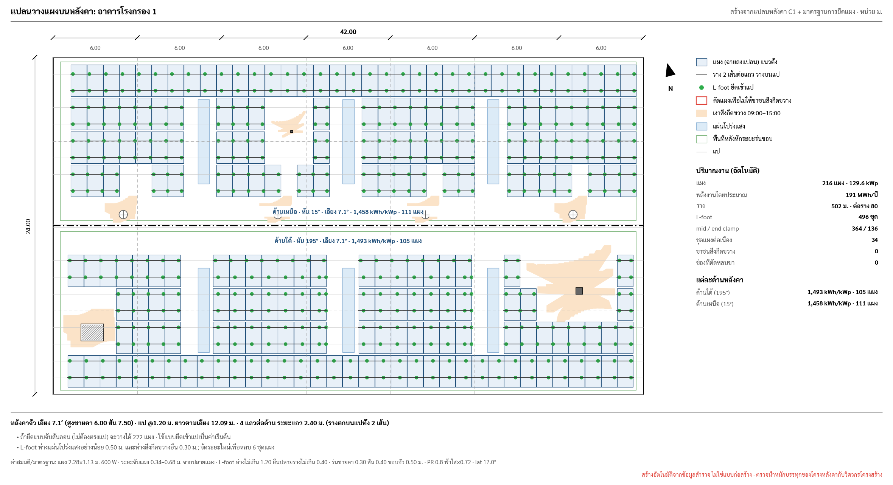
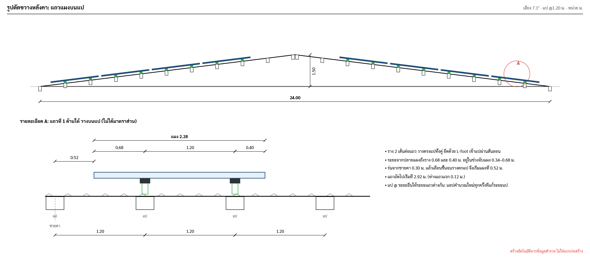
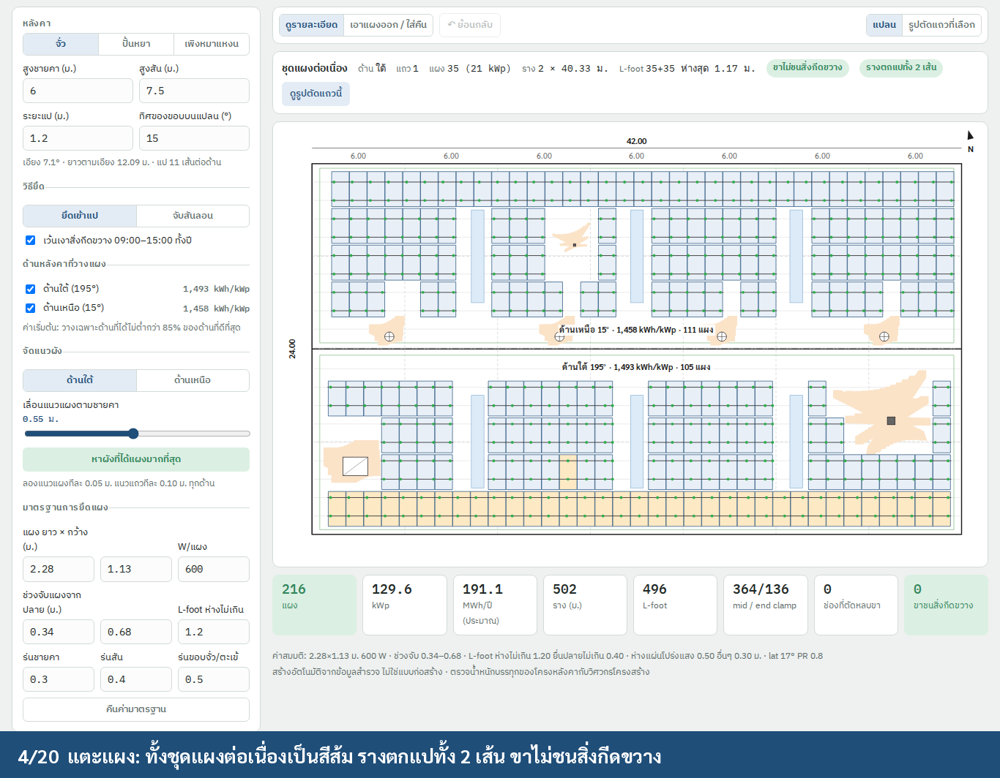
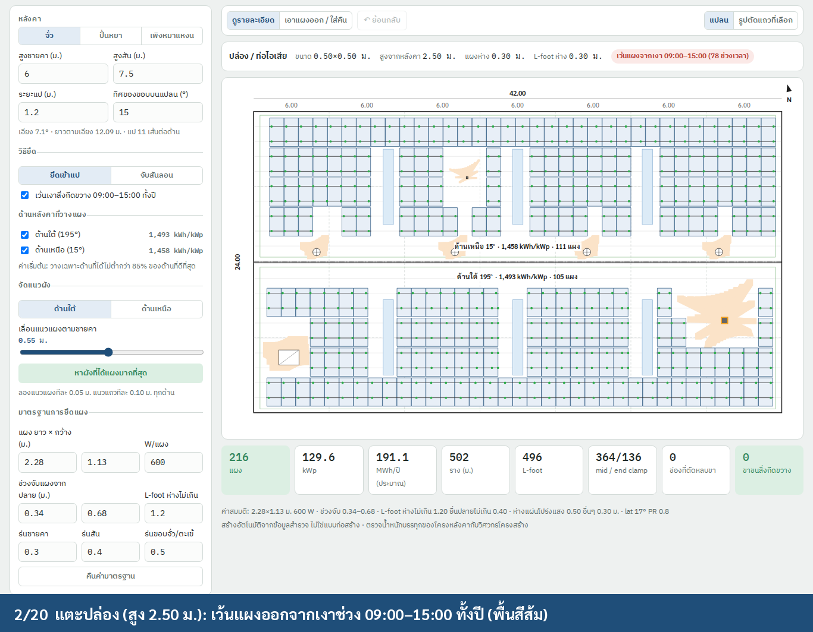
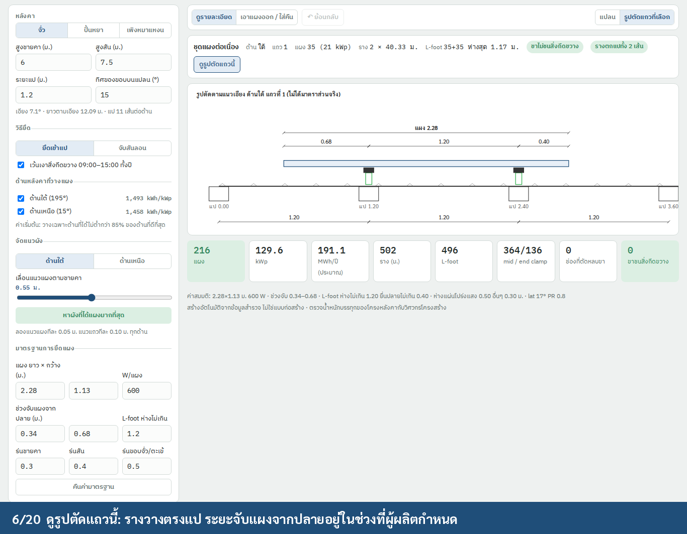
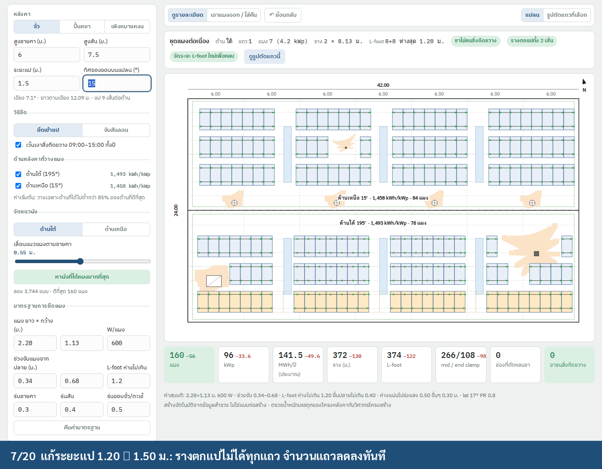
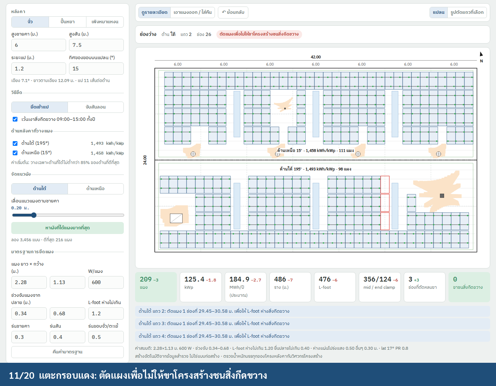
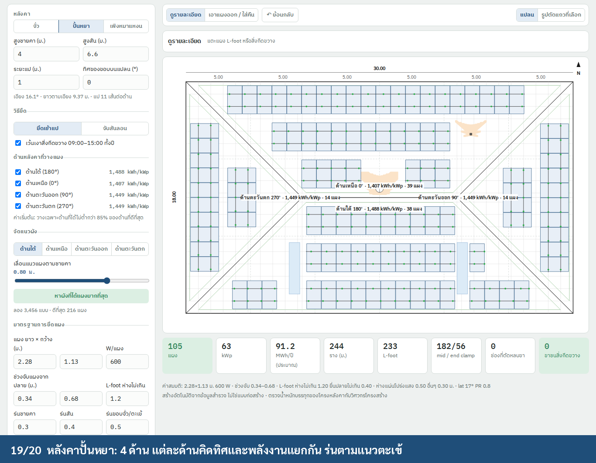
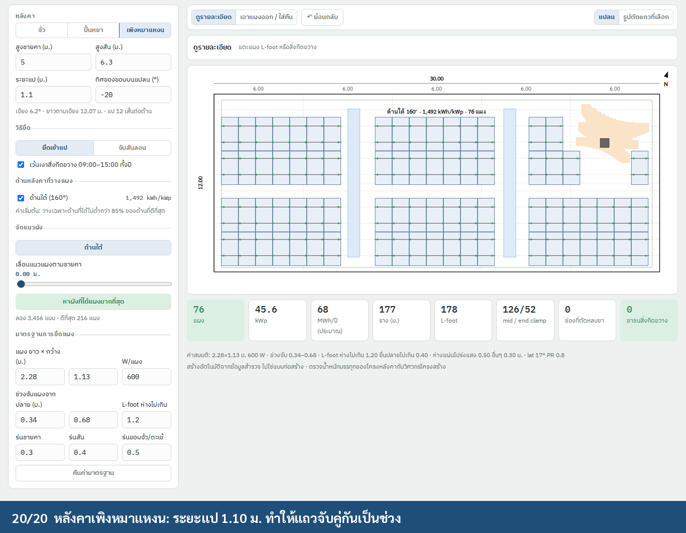

# Auto PV layout on the roof (วางแผงบนหลังคาอัตโนมัติ)

**Status:** Built (2026-10-19). Engine: `TCRoofCore/RoofPV/` (§3.1–3.8), matching `img/roof_pv.py` on the three samples (`RoofMountLayoutTests`). C1: `RoofMount` maps C1's answers and keeps the tab's choices (`pvMount`); the แผงบนหลังคา tab (`RoofPageWide+Mount.swift`) replaces the table layout, `RoofPlan` draws the layout and the section card shows the selected row (`img/roof_pv_c1_*.png`). Report (§7): the PDF prints แปลนวางแผงบนหลังคา and detail A after section A-A (`img/roof_pv_report_page.png`); Excel writes the summary and BOQ into the roof sheet's blank rows A38–A39 (NO.224 has no cells for them); จำนวนแผงก่อนเข้าสำรวจ starts from the layout when empty. Decided (19/10/2569): hips take the verge setback; a skylight marked วางทับได้ keeps only its 0.20 m lap clear of L-feet; the pitch comes from the frame type's slope (no eave/ridge heights); portrait only (question 3). The other §9 questions stay open.
**Section:** C1 หลังคา (station roofs); C2/C3 reuse it once their spans are known (§9)
**Builds on:** [`auto-drawing.md`](auto-drawing.md) (roof geometry, pitch, purlins), [`tank-mounting-layout.md`](tank-mounting-layout.md)
(the no-collision rule, the energy model), [`tank-mounting-layout.md`](tank-mounting-layout.md) (the editor pattern)
**Prototypes:**
- Python: `img/roof_pv.py` writes `roof_pv_plan.png` and `roof_pv_section.png`.
- Interactive: `prototype/roof-layout.html`.
- Demo: `img/roof_demo.mp4` (20 steps), recorded with `NODE_PATH=<global node_modules> node prototype/roof-demo.js <outDir>`.

The Python and the HTML give the same result on the sample: 216 modules, 129.6 kWp, 191 MWh/yr.



| Section across the ridge + detail A (rails on purlins) | Tap a run: rails on both purlins, legs clear |
|---|---|
|  |  |
| **Tap a stack: its 09:00–15:00 shade is kept free** | **Row section in the app** |
|  |  |
| **Purlins @1.50: fewer rows fit** | **Red outline: column cut so no L-foot hits an obstacle** |
|  |  |
| **Hip roof: 4 faces, each with its own yield** | **Shed roof, purlins @1.10: rows pair up** |
|  |  |

---

## 1. Principle

The layout is **computed** from what the surveyor already measured. The surveyor enters sizes and distances only.

The layout follows the roof:
- Modules lie **flush on the roof**, in rows parallel to the eave, one face at a time.
- Because modules are flush, rows don't shade each other. So the rules that matter are these:
  - **Rails must sit on purlins.** The purlin spacing decides where rows can go.
  - **L-feet must never touch an obstacle.**
  - **Modules stay out of the shade** of tall obstacles.
  - **Setbacks:** eave, ridge, verge and hip.

Where no L-foot can be placed clear of an obstacle, the module column is **cut** and shown as a red outline with its
reason. This is the same rule as on the tank. There is never a flagged leg that the user has to fix by hand.

## 2. Inputs

**Existing C1 fields:**

| Field | Used for |
|---|---|
| `spansX`, `spansY` | roof outline `LX × LY`; grid lines on the plan |
| `sheetDir` | ridge direction: sheets run down the slope, so vertical sheets mean the ridge runs along x |
| `eaveHeight`, `ridgeHeight` (from auto-drawing §5.1) | rise → pitch `θ = atan(rise / (B/2))` (shed: `atan(rise / B)`) |
| `roofShape` | faces: จั่ว 2, ปั้นหยา 4, เพิงหมาแหงน 1. คอนกรีต (ดาดฟ้า) → use the tank mounting layout. โค้ง → §9 |
| `comp1` (แป) `"… @1.20M"` | purlin spacing `s` (`MemberSpec.parse`). Falls back to 1.00 m and prints ค่าสมมติ |
| `obst` | obstacles (x, y, w, h) |
| `roofMaterial` | เมทัลชีท / กระเบื้อง: default fixing method (§3.2) |

**New fields (distances and numbers only):**

| Field | Kind | Default | Note |
|---|---|---|---|
| `obst[].kind` | choice per row: แผ่นโปร่งแสง, ลูกหมุนระบายอากาศ, ปล่อง/ท่อไอเสีย, ท่อระบาย, อื่นๆ | อื่นๆ (old rows) | Same `kind` key as the tank openings |
| `obst[].hgt` | number, m above the roof | by kind (0, 0.60, 2.00, 0.50, 0) | Drives the shade (§3.4) |
| `planBearing` | number, ° | the job's value when there is one, else 0 | Compass bearing of the plan's top edge, read on site with the phone compass |

Latitude comes from the survey GPS.

## 3. Algorithm

### 3.1 Faces

Each face is a convex polygon in its own plane. The coordinates are:
- `u`: along the eave
- `v`: up the slope from the eave, with slope length `Ls = h / cos θ`

Each face also has:
- an affine map (u, v) → plan (x, y)
- a 3D basis (`O`, `eu`, `ev`)
- the compass azimuth of its downslope direction

| Shape | Faces | Polygon (u, v) | Edge kinds |
|---|---|---|---|
| Gable | S, N | rectangle `A × Ls` | eave, verge, ridge, verge |
| Hip | S, N trapezoids; E, W triangles | `(0,0) (A,0) ((A+r)/2, Ls) ((A−r)/2, Ls)`, `r = A − B`; triangle `(0,0) (B,0) (h, Ls)` | eave, hip, ridge, hip |
| Shed | one | rectangle `A × Ls` | eave, verge, ridge (high side), verge |

**Setbacks:** each edge moves inward by the setback for its kind. The usable area is the intersection of the resulting
half-planes. A module is inside when all 4 of its corners are inside (valid because the faces are convex).

### 3.2 Rows on purlins

Purlins sit at `v = 0, s, 2s, …`. A last one is added at the ridge when the gap is more than `0.25 s`. This is the
same rule as the roof section in auto-drawing §6.

**Fixing method:**
- **ยึดเข้าแป (default).** A row is valid only when **both rails land on a purlin** and each rail is inside the
  module's clamping zone. The clamping zone is `clampMin ≤ rail − module end ≤ clampMax` (datasheet, default
  0.34–0.68 m).
- **จับสันลอน (metal sheet only).** The rails go at ¼ and ¾ of the module and don't need to be on a purlin. The app
  shows it as a comparison: on the sample it fits 222 modules against 216.

Rows are packed from the eave:
- A row's start is the first `v` (0.01 m steps) from `setEave` that has a valid purlin pair.
- The next row starts at least `modL + 0.02` further up.
- Because every row has the same length, the earliest start gives the most rows.

A second variant **centres** each row between its two purlins (equal clamp distances) where its neighbours allow.
The search (§3.6) keeps whichever variant fits more modules, and prefers centred when they tie.

How the purlin spacing changes the sample roof (module 2.28 m):

| Purlins | Rows per face | Modules | Why |
|---|---|---|---|
| @1.00 | 4 | 226 | rails 1.00 apart, rows every 3 purlins (3.00 m) |
| @1.10 | 4 | 223 | rows pair up: 2.30 then 3.30 |
| @1.20 | 4 | 216 | rows every 2 purlins (2.40 m) |
| @1.50 | 3 | 160 | only one purlin gap fits the clamping zone, so rows are 3.00 m apart |

### 3.3 Columns and blocked slots

Columns run from the verge setback plus a **column offset**, at a pitch of `modW + 0.02`. A slot is blocked when any
of these holds:
1. it is outside the usable area → "นอกพื้นที่ (ระยะร่นขอบ)"
2. it is within the **module clearance** of an obstacle → "แผ่นโปร่งแสง: เว้นระยะ 0.10 ม."
3. it touches a **shade hull** (§3.4) → "เงาปล่อง 09:00–15:00"
4. the user removed it → "เอาออกเอง"

| Kind | Module clearance | Foot clearance | Default height |
|---|---|---|---|
| แผ่นโปร่งแสง | 0.10 | **0.50** (never fix into the skylight or its lap) | 0 |
| ลูกหมุนระบายอากาศ | 0.30 | 0.30 | 0.60 |
| ปล่อง / ท่อไอเสีย | 0.30 | 0.30 | 2.00 |
| ท่อระบาย | 0.30 | 0.30 | 0.50 |
| อื่นๆ | 0.30 | 0.30 | 0 |

### 3.4 Shade from obstacles

Every obstacle with a height casts a shadow onto **every** face plane (a stack on one face can shade the other).

**Sun positions:**
- 09:00–15:00 every 30 min
- on 21 Dec, 21 Jun and 21 Mar

At 17° N the June sun is north of the zenith, so both solstices are needed.

**Per sun position:**
- The obstacle's top corners are projected along the sun ray onto the face plane (ray–plane intersection in 3D).
- The projections are combined with the base corners into a convex hull in (u, v).

Slots are tested against each hull with a bounding-box check and then SAT. On the sample, shade blocks 16 slots in
total, from the 2.50 m stack, the turbines, the pipe and the air-con unit. The turbines block the ends of the top
rows.

### 3.5 L-feet: never on an obstacle

Each run of neighbouring modules gets 2 rails, with `railOver` = 0.05 m past the end modules. L-feet go along each
rail, independently:
- spacing ≤ `footDx` (1.20)
- end cantilever ≤ 0.40
- shortest bay 0.30
- **never** inside `[obstacle ± foot clearance]` wherever the rail line crosses that band

Placement order:
1. Equal spacing.
2. Otherwise, greedy on a 0.05 m grid, choosing the furthest allowed point each time.
3. If both fail, **cut the module column** nearest the failure point, then retry the row.

This is the tank rule. The result always has 0 legs on obstacles.

### 3.6 Best layout

For each face, the search tries every combination of:
- column offset 0 … `modW` in 0.05 m steps
- row start shift 0 … one row pitch in 0.10 m steps
- packed or centred rows

It keeps the one with the most modules, then fewer cut columns, then centred. That is 1,656 layouts per face on the
sample. With each slot's blocked reason cached per face, both faces take under 2 s in the browser. Faces are
independent, so the search can run them in parallel off the main thread.

### 3.7 Faces and yield

- **Yield:** each face gets kWh/kWp/yr from the tank's clear-sky model: tilt `θ`, azimuth from `planBearing`, PR 0.8.
  There is no row shading because the modules are flush.
- **Default faces:** a face gets modules only when its yield is **≥ 85 %** of the best face's (ค่าสมมติ).
- **User control:** the user can switch any face on or off.
- **Sample:** a 7.1° gable at 15° gives south 1,493 and north 1,458 kWh/kWp, so both faces are used.

### 3.8 Quantities

Per run of k modules, rail length `Lr`:
- rails: `2 Lr`
- splices: `2 (⌈Lr / 4.20⌉ − 1)`
- L-feet: the feet actually placed
- mid clamps: `2 (k − 1)`
- end clamps: 4

Totals:
- modules, kWp
- energy: Σ modules × Wp × face yield
- cut columns
- legs on obstacles: always 0

Sample: 216 modules, 129.6 kWp, 191 MWh/yr, 502 m rail, 80 splices, 496 L-feet, 364 / 136 clamps, 34 runs.

## 4. Drawings (`Sketch`, same style as the tank sheets)

**Plan:**
- roof outline, grid, ridge (dash-dot), purlins (faint), usable area (green)
- shade (pale orange), obstacles by kind
- modules, rails, L-feet, cut slots (red)
- a label per face (direction, azimuth, tilt, kWh/kWp, modules)
- north arrow at `planBearing`
- legend, quantities, the per-face table
- summary line: pitch, purlins, rows, row pitch
- ค่าสมมติ line, and the footer "สร้างอัตโนมัติจากข้อมูลสำรวจ ไม่ใช่แบบก่อสร้าง"

**Section across the ridge:** roof line, purlins, every row with its rails, span and rise dimensions, and callout A.

**Detail A:** the first row at a large scale:
- sheet, purlins, L-feet, rails, module
- dimensions: eave → module, both clamp distances, rail-to-rail, purlin spacing
- notes explaining why the row starts where it does

## 5. Interaction (a tab **แผงบนหลังคา** in the C1 editor)

This follows [`tank-mounting-layout.md`](tank-mounting-layout.md): inspect and remove modes, undo, deltas,
iPad left column, iPhone sheet.

### 5.1 State

```swift
@Observable final class RoofPVEditorModel {
    var fixing: RoofFixing = .purlin              // .purlin | .ribClamp
    var avoidShade = true
    var faceUse: [RoofFace.ID: Bool] = [:]        // nil = automatic (≥ 85 % of the best face)
    var colOffset: [RoofFace.ID: Double] = [:]    // from best layout, or the slider for the chosen face
    var rowShift: [RoofFace.ID: Double] = [:]
    var centred: [RoofFace.ID: Bool] = [:]
    var standard: RoofMountStandard               // settings; per-job edits stored on the module
    var removed: Set<SlotRef> = []                // (face, row, column)
    var mode: MountMode = .inspect
    var view: RoofPVView = .plan                  // .plan | .rowSection
    var selection: RoofPVSelection?               // .slot(face,row,col) | .foot(face,row,run,rail,i) | .obstacle(i)
    private(set) var layout: RoofPVLayout
}
```

The **best layout** runs on first open and whenever any of these change: roof size, heights, purlin spacing,
bearing, obstacles, the standard, the fixing method, or the shade switch. `removed` is cleared then, with the note
"ผังเปลี่ยน จึงล้างแผงที่เอาออกเอง" and an undo step.

### 5.2 Tap targets (inspect)

Obstacles are hit-tested **before** module slots, because obstacles sit under the slot areas.

| Tap | Info line |
|---|---|
| obstacle | kind, size, height, module and foot clearance; red pill "เว้นแผงจากเงา 09:00–15:00 (n ช่วงเวลา)" or green "ไม่สูงพอจะทอดเงา" |
| L-foot (8 pt) | face, row, rail, position, which purlin; green "ห่างสิ่งกีดขวางใกล้สุด x ม."; "จัดระยะใหม่เพื่อหลบ" when the greedy placement was used |
| module | the whole run highlighted: modules (kWp), rail length, feet per rail and the largest spacing; green "ขาไม่ชนสิ่งกีดขวาง", "รางตกแปทั้ง 2 เส้น"; button **ดูรูปตัดแถวนี้** |
| empty slot | red pill with the §3.3 reason; a red-outlined cut slot shows "ตัดแผงเพื่อไม่ให้ขาโครงสร้างชนสิ่งกีดขวาง" |

### 5.3 Controls

- **Heights, purlin spacing, bearing:** changing one re-runs the best layout. A ridge ≤ eave reverts the field.
- **Fixing method:** ยึดเข้าแป / จับสันลอน. จับสันลอน is only offered for เมทัลชีท.
- **Shade switch:** "เว้นเงาสิ่งกีดขวาง 09:00–15:00 ทั้งปี".
- **Faces:** one checkbox per face with its kWh/kWp. When a face is off, its modules show dashed red and leave the
  quantities.
- **Column offset:** a slider for the chosen face (segment buttons per face).
- **หาผังที่ได้แผงมากที่สุด:** shows the result as "ลอง n แบบ · ดีที่สุด m แผง".
- **Standard:**
  - module L, W, Wp
  - clamping zone min and max
  - L-foot spacing
  - setbacks: eave, ridge, verge/hip
  - **คืนค่ามาตรฐาน** (reset)
- **Remove mode:** tap a slot to toggle it (a walkway, for example). Blocked slots show their reason instead.

### 5.4 Row section

Shows the selected row (default: row 1 of the south face) along the slope:
- sheet, purlins, L-feet, rails, module
- dimensions: module length, both clamp distances, rail-to-rail, purlin spacing
- the check line "ถูกต้องตามมาตรฐาน" or "ไม่ผ่าน"

## 6. Swift

| File | Contents |
|---|---|
| `TCRoofCore/RoofPV/RoofFaces.swift` | faces from `RoofGeometry` (shape, `A`, `B`, pitch, ridge axis, bearing): polygon, edge kinds, half-planes, plan map, 3D basis, azimuth |
| `TCRoofCore/RoofPV/RoofMountStandard.swift` | §3 values (`Codable`, in `SurveySettings`), obstacle kind table |
| `TCRoofCore/RoofPV/ShadeHulls.swift` | sun positions (shared with `MountEnergy`), ray–plane projection, convex hull, SAT |
| `TCRoofCore/RoofPV/RoofPVLayout.swift` | `compute(faces:purlins:obstacles:std:options:) -> RoofPVLayout` and `best(…)`: §3.2–3.6 |
| `TCRoofCore/RoofPV/RoofPVQuantities.swift` | §3.8; feeds the report and the Excel BOQ |
| `TCRoofCore/RoofPV/RoofPVDrawings.swift` | plan, section, detail A → `Sketch` |
| `SurveyUI/Roof/RoofPVEditorView.swift` | §5 |

**Shared with the tank:**
- sun and yield: `MountEnergy`
- foot and post placement with column cutting: `ClearPlacement.place(xa:xb:forbidden:maxSpacing:maxCantilever:minBay:)`
- polygon helpers

**Tests:**
- the §3.2 purlin table for the sample
- every rail on a purlin inside the clamping zone
- no module over a skylight
- no L-foot within the foot clearance of any obstacle
- no module intersecting a shade hull
- hip triangles never place a module past a hip line
- the Python and Swift module counts agree on the three fixtures (gable 216, hip 105, shed 76)
- snapshot SVGs of the plan and the section

## 7. Report and export

- **PDF (NO.215):** the plan, plus the section with detail A, after the roof framing drawings.
- **Excel (NO.224):** modules, kWp, MWh/yr and the BOQ on the roof sheet.
- **Survey form:** `panelsBefore` is pre-filled from the layout. The surveyor can still overwrite it.

## 8. Done when

- [ ] The three fixtures give the §3 numbers on iPad and iPhone.
- [ ] No state has an L-foot on an obstacle, a rail off a purlin (in purlin mode), or a module in shade (with the
      switch on).
- [ ] The best layout is never worse than the current one.
- [ ] The quantities in the app equal the BOQ in the PDF and Excel.

## 9. Decided questions

Decided 2026-10-19:

1. **Fixing method:** ยึดเข้าแป stays the default on metal sheet; จับสันลอน is the tab's switch. On กระเบื้องซีแพค the
   rails go on tile hooks screwed into the rafters (`RoofMountStandard.rafterSpacing`, 1.00 m by default): rows don't
   depend on the purlins (rails at ¼ and ¾ of the module), a hook goes on every rafter under a rail and none on an
   obstacle, and a rail that would skip a rafter cuts the column. กระเบื้องลอนคู่ sits on purlins like metal sheet.
2. **Clamping zone:** worked out from the module length (0.34 / 2.28 and 0.68 / 2.28 of it, to the cm) until the job
   edits it.
3. **Portrait only.**
4. **Shade rule:** 09:00–15:00 all year, unchanged.
5. **Walkways:** optional and off by default: one module wide after every n columns (8 when switched on).
6. **Shed low side:** the plan's bottom (or right) by default; the tab and the plan's `ด้านต่ำ` arrow turn it to the
   top (or left), kept in the hidden field `shedLow`.
7. **Curved roofs:** left out of v1.
8. **Roof load:** the modules, rails and fixings over the modules' area in kg/m², with a warning above the standard's
   `loadLimit` (15 kg/m²), on the tab, the PDF page and the Excel row A39.
