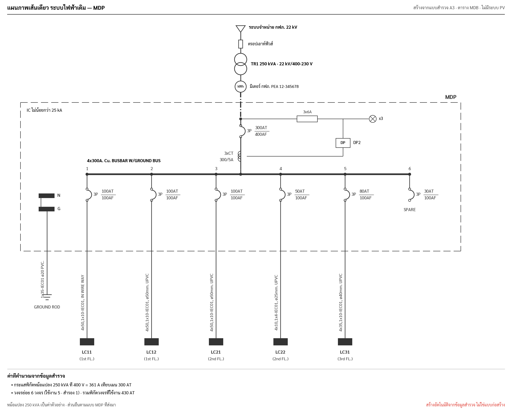
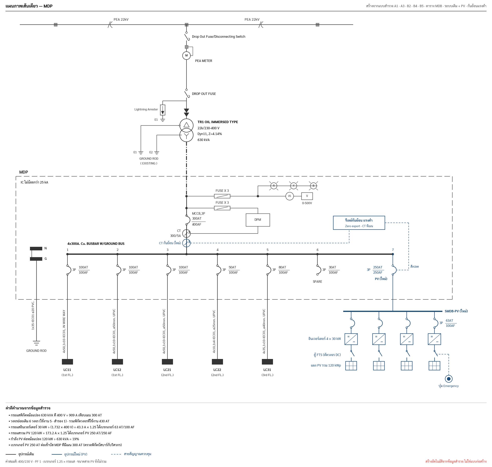
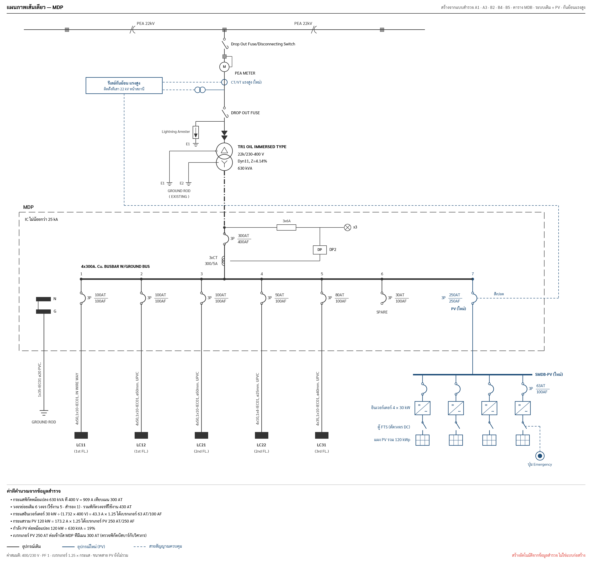

# Auto Single Line Diagram (SLD)

**Status:** Draft, 2026-09-29 · **Prototype:** `img/sld.py` → `sld_existing.png`, `sld_pv_lv.png`, `sld_pv_hv.png`
(run from `img/`) · **Builds on:** [`auto-drawing.md`](auto-drawing.md) (same `Sketch` pipeline, same rules)

**Scope:** the waterworks' existing electrical system (PEA supply down to the MDB feeders) in black, plus the new PV
system and its export limiting in blue. Export limiting is drawn at low voltage or high voltage from B4 `level`.
With no PV data yet, the same generator draws the existing system alone. The drawing follows the style of a Thai MDP drawing: dashed MDB enclosure, breakers drawn
as an arc with `3P AT/AF`, CT and DP meter with pilot lamps, numbered feeders, cable text written along each feeder and
black load blocks.

| Mode | When | Image |
|---|---|---|
| Existing only | A1 capacity or B2 inverter count blank |  |
| PV + กันย้อนแรงต่ำ | B4 level = แรงต่ำ |  |
| PV + กันย้อนแรงสูง | B4 level = แรงสูง |  |

Sample values come from the MDP sheet the team shared. The upstream values come from the PEA HV drawing (a different station). PV (120 kWp, 4 × 30 kW) are
samples.

## Inputs

The surveyor copies what is written on the panel nameplate, the breakers and the cables: sizes and text only, no
choices to design.

### Upstream (A3)

Drawn in the style of the PEA HV drawing: HV line with poles → Drop Out Fuse/Disconnecting Switch → PEA meter (HV
metering) → Drop Out Fuse with lightning arrester (E1) → cable terminations → transformer (Δ/Y) with tank ground E1
and neutral ground E2.

| Drawn item | Field | Example | Note |
|---|---|---|---|
| Grid voltage | `gridKV` | 22 | default 22 kV, printed as ค่าสมมติ when blank |
| Metering side | `meterAt` = HV / LV | HV | HV: meter "M" between the two drop-out fuses; LV: kWh meter after the transformer |
| PEA meter number | `meterNo` (exists) | | optional |
| Lightning arrester | `arrester` yes/no | yes | |
| Transformer name, kVA | `trafos[i].kva` (exists), name from order | TR1, 630 | |
| Transformer type | text from nameplate | OIL IMMERSED TYPE | |
| Vector group, impedance | text, number (%) | Dyn11, 4.14 | |

### MDB schedule (new, one per MDB in A3)

| Field | Type | Example | Drawn as |
|---|---|---|---|
| `name` | text | MDP | label at the top-right of the enclosure |
| `icKA` | number (kA) | 25 | `IC ไม่น้อยกว่า 25 kA` |
| `main` | poles, AT, AF | 3, 300, 400 | main breaker |
| `ctRatio` | text | 300/5A | `3xCT 300/5A`; hidden when blank |
| `meterName` | text | DP2 | DP box fed from the CTs; hidden when blank |
| `pilotLamps` | bool + fuse text | yes, 3x6A | fuse → ⊗ x3 |
| `busbar` | text | 4x300A. Cu. BUSBAR W/GROUND BUS | label above the bus |
| `feeders[]` | rows (below) | 6 rows | numbered columns |
| `ground` | text | 1x35-IEC01 ø20 PVC. | N/G bar, ground conductor, ground rod |

### PV (exists today)

| Drawn item | Field | Section |
|---|---|---|
| PV size | `capacity` (kWp) | A1 |
| Inverter count | `inverterCount` | B2 |
| Export limiting level, pole | `level` (แรงต่ำ / แรงสูง), `pole` | B4 |
| FTS and emergency button | B5 present | B5 |

### Feeder row

| Field | Type | Example |
|---|---|---|
| `poles` | 1 / 2 / 3 | 3 |
| `at`, `af` | number | 100, 100 |
| `cable` | text | 4x50,1x10-IEC01 |
| `conduit` | text | ø50mm. UPVC / IN WIRE WAY |
| `load` | text | LC11 |
| `location` | text | 1st FL. |
| `spare` | bool | a spare row draws the breaker and `SPARE`, no cable or load |

Numbers are typed with the same `NumberInput` rules as the rest of the form. Feeder order is the order entered; the
number above each column is its position.

## Derived values and checks (printed under the diagram, never errors)

| Value | Rule | Example |
|---|---|---|
| Transformer full-load current | kVA × 1000 ÷ (1.732 × 400 V) | 630 kVA → 909 A |
| Main vs transformer | note when main AT > full-load current × 1.25 or < 0.8 × | 300 AT vs 909 A → note (sample drawings are from different stations) |
| AT ≤ AF | note on any breaker where AT > AF | |
| Feeder count | total, in use, spare | 6 (5 + 1 spare) |
| Sum of feeder AT | in-use feeders only, shown for reference (diversity not applied) | 430 AT |
| kW per inverter | capacity ÷ inverterCount | 120 ÷ 4 = 30 kW |
| Inverter breaker | next standard AT ≥ 1.25 × kW × 1000 ÷ (1.732 × 400); AF = next frame ≥ AT | 43.3 A → 63 AT/100 AF |
| PV breaker on the MDB | same rule on the total | 173.2 A → 250 AT/250 AF |
| PV share of transformer | kW ÷ kVA; note above 100% | 48% |
| PV breaker vs main | always note "ตรวจพิกัดบัสบาร์กับวิศวกร"; flag when PV AT > main AT | 250 vs 300 AT |

Standard AT: 16, 20, 32, 40, 50, 63, 80, 100, 125, 160, 200, 250, 320, 400, 500, 630, 800, 1000, 1250, 1600, 2000,
2500, 3200. Frames (AF): 100, 160, 250, 400, 630, 800, 1000, 1250, 1600, 2000, 2500, 3200, 4000.

## Layout rules

- Top to bottom, centre column: the upstream chain above → dash-dot line into the enclosure → main breaker → CT → busbar.
- Pilot lamps and DP meter branch right from the incoming line above the main breaker; the CT signal line returns to
  the DP box.
- Busbar spans the feeder columns; columns are spaced evenly across the enclosure. The incoming line joins the bus at
  the centre column position, never on top of a feeder label.
- Each feeder: number above the bus, breaker with `3P AT/AF` to its right, line down through the enclosure edge, cable
  and conduit text rotated −90° left of the line, black load block, load name (bold) and location below.
- PV incomer: one more numbered column at the right end of the MDB bus (blue), breaker label on its left so the trip
  line can enter from the right. It drops out of the enclosure to the SMDB-PV bus; one column per inverter below:
  breaker (label on the last column only), inverter box (=/~), FTS switch, PV array. Group labels sit left of the first
  column. More than 8 inverters collapse to one column labelled "n × kW". Emergency button right of the last column,
  dashed to the FTS.
- กันย้อนแรงต่ำ: a blue CT on the main line between the existing CT and the bus; relay box inside the enclosure right
  of the DP meter; dashed CT → relay → PV breaker ("สั่งปลด").
- กันย้อนแรงสูง: blue HV CT on the line between the PEA meter and the second drop-out fuse, VT branching left; relay box
  left of the HV line labelled with the B4 pole; the trip line runs above the enclosure and down its right side to the
  PV breaker.
- Legend (existing / new PV / control) appears only when PV is drawn.
- N/G bar and ground rod sit left of feeder 1; the ground text is rotated along the ground conductor.
- More than 10 feeders: wrap into a second row under the first bus drawn as a continuation (`…ต่อ`), or reduce column
  spacing down to a minimum 60 pt, whichever keeps labels readable.
- Several MDBs on one transformer: one enclosure per MDB side by side, fed from a common LV line. One diagram page per
  transformer.
- Footer: assumptions (400/230 V, PF 1, 1.25 factor, PV cable sizes not included) and the standard line "สร้างอัตโนมัติจากข้อมูลสำรวจ ไม่ใช่แบบก่อสร้าง".

## Swift

| File (`SurveyCore/Drawing/`) | Contents |
|---|---|
| `SLDInput.swift` | `struct SLDInput { gridKV; transformers: [TransformerInput]; pv: PVInput? }` (`PVInput`: kWp, inverters, export `.lv/.hv`, pole, fts), `struct MDBSchedule`, `struct FeederRow`, `Breaker(poles, at, af)`; `init(job:)`, `missing`, `assumed` |
| `SLDGeometry.swift` | column x positions, bus extent, enclosure rect, PV ratings (`BreakerSizing`), checks (`[SLDNote]`) |
| `SLDDrawings.swift` | `SLDGeometry → Sketch`; symbols `breaker`, `ct`, `vt`, `lamp`, `meter`, `groundRod`, `inverter`, `fts`, `pvArray`, `relay` as `DrawOp` helpers |

Schema: add `mdbs: [MDBSchedule]` to each A3 transformer entry, all fields optional so older jobs decode. UI: an MDB
editor under A3 with a feeder table (add / reorder / mark spare). PDF: its own page after A3, plus a preview card on
the A3 page. Tests: the sample above (6 feeders, 1 spare), 1 and 14 feeders, blank CT/DP (hidden), two MDBs, AT > AF
note, PV breaker sizing (table above), 1 / 4 / 12 inverters, LV vs HV relay placement, and snapshot SVGs for the
three modes.

## Open questions

1. One MDB per diagram, or should one transformer with several MDBs share a page?
2. Is the "main vs transformer current" note useful, or should the SLD show values only?
3. Do SMDBs downstream of the MDB (LC11 etc.) need their own sub-diagram later, or does the load block end the drawing?
4. Is 1.25 × rated current the sizing rule the team uses for inverter and PV breakers?
5. Does PV always get a new breaker on the MDB, or sometimes use the spare breaker (e.g. feeder 6)?
6. For กันย้อนแรงสูง, what does กฟภ. expect on the SLD (recloser/LBS, relay function 32R, CT/VT ratios)? The prototype
   trips the PV breaker.
7. Keep the Thai breaker symbol (arc) everywhere, or allow the IEC symbol as a setting?
