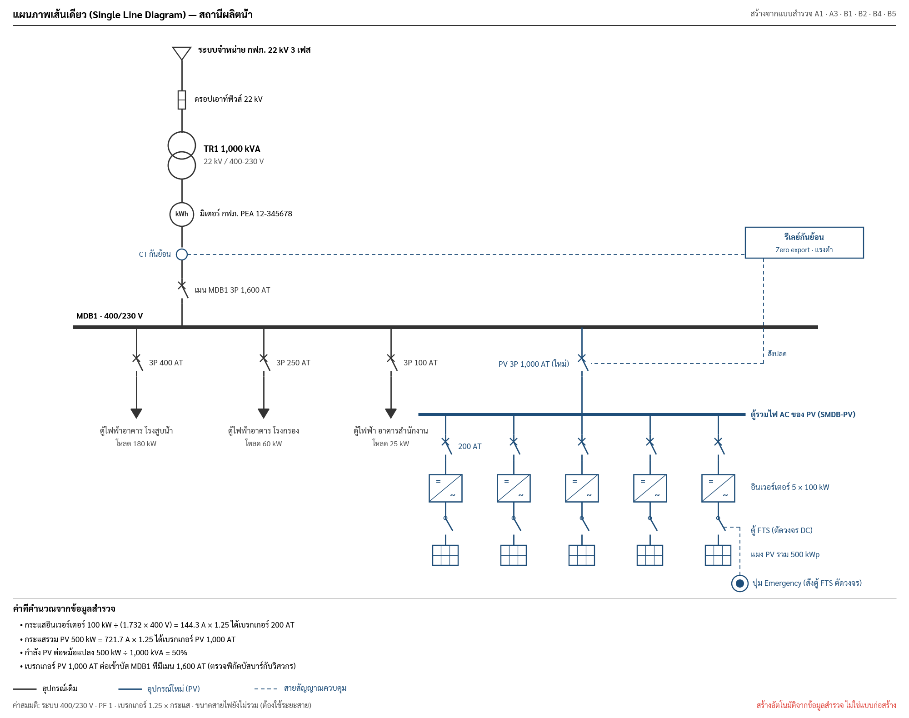

# Auto Single Line Diagram (SLD)

**Status:** Draft, 2026-09-29 · **Prototype:** `img/sld.py` → `img/sld.png` · **Builds on:** [`auto-drawing.md`](auto-drawing.md) (same `Sketch` pipeline, same rules)

The PWA survey already holds most of what a PV interconnection SLD needs. This feature draws it from those answers, marks
existing equipment in black and new PV equipment in blue, and sizes the PV breakers.

## Inputs, all already in the form

| Drawn item | Source field | Section |
|---|---|---|
| Grid voltage | new optional `gridKV` (default 22 kV, printed as ค่าสมมติ) | A3 |
| Transformer(s), kVA | `trafos[i].kva` | A3 |
| MDB per transformer + main breaker AT | `trafos[i].mdb[j]` | A3 |
| PEA meter number | `meterNo` | A3 |
| Where PV connects | `tr{i}_feed` (e.g. MDB1) | A3 |
| Existing feeders: name, AT, load kW | each B1 ตู้ไฟฟ้าอาคาร: `name`, `breakerAT`, `loadKW` | B1 |
| Inverter count | B2 `inverterCount` | B2 |
| PV size | A1 `capacity` (kWp) | A1 |
| Export limiting: LV or HV, pole | B4 `level`, `pole` | B4 |
| FTS and emergency button | B5 present (photos taken) | B5 |

Nothing new is asked except the optional grid voltage; the surveyor still enters only sizes and distances.

## Derived values

| Value | Rule | Example (prototype) |
|---|---|---|
| kW per inverter | capacity ÷ inverterCount | 500 ÷ 5 = 100 kW |
| Inverter current | kW × 1000 ÷ (√3 × 400 V), PF 1 | 144.3 A |
| Inverter breaker | next standard AT ≥ 1.25 × current | 200 AT |
| PV incomer breaker | same rule on the total | 721.7 A → 1,000 AT |
| PV share of transformer | kW ÷ kVA | 50% |
| Export relay position | B4 level: แรงต่ำ → CT on the LV main, relay trips the PV incomer; แรงสูง → relay on the HV side at the pole | LV |

Standard AT list: 16, 20, 32, 40, 50, 63, 80, 100, 125, 160, 200, 250, 320, 400, 500, 630, 800, 1000, 1250, 1600,
2000, 2500, 3200. Checks printed under the diagram (not errors): PV kW > 100% of transformer kVA; PV incomer AT above
the MDB main AT; bus rating to be confirmed by an engineer.

## Layout rules

- Top to bottom: grid → drop-out fuse → transformer (two circles) → PEA meter → export CT → main breaker → MDB busbar.
- Existing feeders hang left on the bus, each a breaker plus a load arrow labelled with name and kW.
- The PV incomer hangs right, feeding the SMDB-PV bus. Below it, one column per inverter: breaker, inverter box (=/~),
  FTS switch, PV array. More than 8 inverters collapse to one column labelled "n × kW".
- Several transformers: one column per transformer, each with its own MDB bus; PV attaches to the `feed` MDB only.
- Control links (CT → relay → PV breaker trip, emergency button → FTS) are dashed blue lines routed around labels.
- Legend: existing / new PV / control. Notes: assumptions (400/230 V, PF 1, 1.25 factor, no cable sizes).

## Swift

`SurveyCore/Drawing/SLDInput.swift` (Job → input, missing, assumed), `SLDGeometry.swift` (columns, buses, ratings),
`SLDDrawings.swift` (→ `Sketch`). It is a job-level drawing, so it goes on its own PDF page after A3 and as a preview
card on the A3 page. Tests: breaker sizing for the table above; 1 and 3 transformers; 1, 5 and 12 inverters; LV vs HV
relay placement; snapshot SVGs.

## Open questions

1. Is 1.25 × rated current the sizing rule the team uses for inverter and PV breakers?
2. Does PV always connect at the MDB named in `feed`, or sometimes at a new SMDB fed from the MDB?
3. For HV export limiting (B4 แรงสูง), what equipment does กฟภ. expect on the SLD (recloser, relay type)?
4. Should cable sizes appear in v1? That needs cable lengths (inverter → SMDB → MDB), which the form doesn't ask yet.
