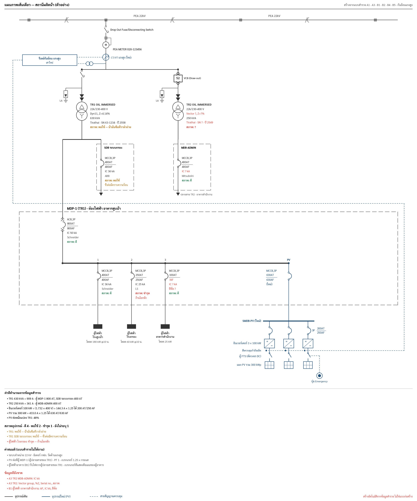
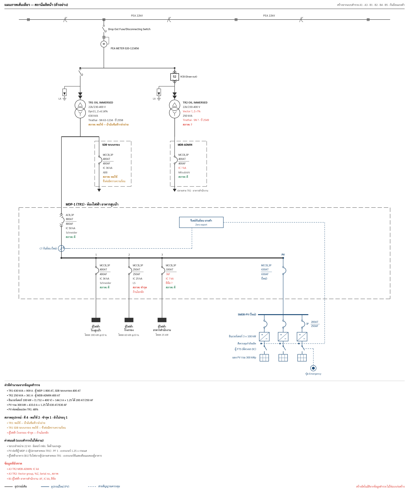
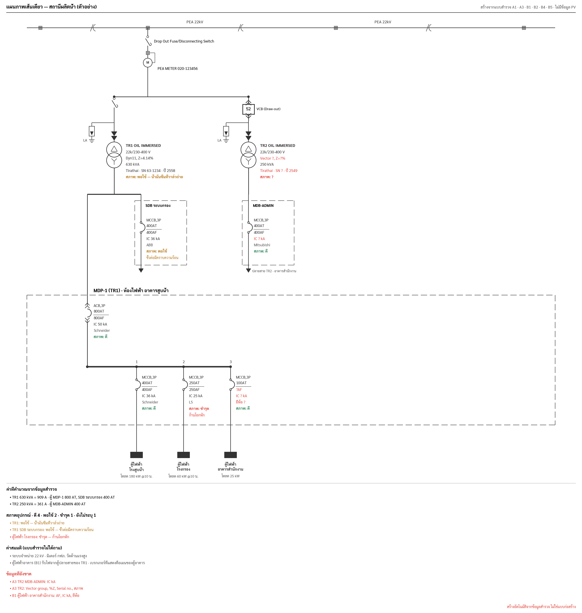

# Auto Single Line Diagram (SLD)

**Status:** Draft, 2026-09-29 · **Builds on:** [`auto-drawing.md`](auto-drawing.md) (same `Sketch` pipeline, same rules)

The SLD is generated from the survey form, with no drawing work by the surveyor. It has two levels:

| Level | Source | Prototype |
|---|---|---|
| **1. From the form as it is (v1)** | fields the PWA form already asks: A1, A3, B1, B2, B4, B5 | `img/sld_form.py` + `img/sld_form_sample.json` |
| 2. Detailed MDP (later) | level 1 plus an optional MDB schedule (feeders, cables, CT, DP) | `img/sld.py` |

Style for both: PEA HV drawing upstream (HV line, Drop Out Fuse/Disconnecting Switch, PEA meter, drop-out fuse with
lightning arrester, Δ/Y transformer), Thai MDP drawing downstream (dashed MDB enclosure, arc breakers labelled
`3P AT/AF`, numbered feeders, black load blocks). Breaker symbols: LV fixed mount = terminals + arc; LV draw-out power breaker = arc between double chevrons
(^^ above, vv below); MV draw-out power breaker = box `52` between double chevrons (used when `tr<i>_hvSwitch` = VCB,
in place of the drop-out fuse). CT symbol: a circle on the line with a slash and the CT count (3),
signal lead to the right. MDB incomer: the main breaker only, labelled `MCCB,3P` over `AT/AF` (no fuses, lamps, voltmeter or DPM, at the team's request). Existing equipment black, new PV blue, control lines dashed blue.

## Level 1 — generated from the form (v1)

| กันย้อนแรงสูง | กันย้อนแรงต่ำ | No PV data yet |
|---|---|---|
|  |  |  |

### Form changes needed (complete breaker, transformer and condition data)

The team requires every breaker and transformer to be fully recorded, with its condition, and every MDB to carry the
name written on it on site. These fields are **required** (they count in `Progress` and block "complete"); blanks
print as a red `?` on the drawing and in the missing list under it.

**Transformer (A3, per `tr<i>_`)** — from the nameplate and a visual check:

| Field id | Label | Kind |
|---|---|---|
| `trafos[i].kva` (exists) | ขนาด | number, kVA |
| `tr<i>_hvSwitch` | อุปกรณ์ตัดตอนแรงสูง | choice: Drop Out Fuse / VCB (Draw-out) |
| `tr<i>_type` | ชนิด | choice: OIL IMMERSED / DRY TYPE / อื่นๆ |
| `tr<i>_hv`, `tr<i>_lv` | แรงดันด้านแรงสูง / แรงต่ำ | number kV; text (e.g. 230-400) |
| `tr<i>_vector` | Vector group | text (Dyn11) |
| `tr<i>_z` | %Z | number |
| `tr<i>_brand`, `tr<i>_serial`, `tr<i>_year` | ยี่ห้อ, Serial no., ปีผลิต | text |
| `tr<i>_cond` | สภาพ | choice: ดี / พอใช้ / ชำรุด |
| `tr<i>_condNote` | รายละเอียดสภาพ | text, required when not ดี (e.g. น้ำมันซึม, สนิม, ซิลิกาเจลเปลี่ยนสี) |

**Each MDB under a transformer (A3)** — `Transformer.mdb[k]` stays as the AT for old data; a new optional
`Transformer.breakers: [BreakerInfo]` (Codable, defaults empty) holds the rest:

| Field | Label | Kind |
|---|---|---|
| `name` | ชื่อตู้ตามหน้างาน | text, free (MDP-1, SDB ระบบกรอง, MDB-ADMIN …); no fixed MDB1…MDB6 names |
| `type` | ชนิดเบรกเกอร์ | choice: MCCB / ACB / อื่นๆ |
| `mount` | การติดตั้ง | choice: Fixed / Draw-out — picks the symbol |
| `poles`, `at`, `af`, `ka` | โพล, AT, AF, IC kA | numbers |
| `brand` | ยี่ห้อ | text |
| `cond`, `note` | สภาพ, รายละเอียด | ดี / พอใช้ / ชำรุด + text |

`tr<i>_feed` becomes a picker over these names (typing stays allowed); a feed name that matches none is reported.

**B1 ตู้ไฟฟ้าอาคาร** — the section name is the on-site panel name; add `breakerType`, `breakerPoles`, `breakerAF`,
`breakerKA`, `breakerBrand`, `breakerMount`, `cond`, `condNote` next to the existing `breakerAT`.

Under the drawing, a condition summary counts ดี / พอใช้ / ชำรุด / ยังไม่ระบุ and lists every item that is not ดี, in
its colour (green / amber / red).

### Field → drawing

| Form field (SurveyCore id) | Section | Drawn as |
|---|---|---|
| `meterNo` | A3 | `PEA METER <no>` next to the M symbol |
| `trafos[i].kva` + `tr<i>_` nameplate fields | A3 | one drop per transformer off the customer HV bus: DOF, LA, Δ/Y; label: type, kV, vector/%Z, kVA, brand/SN/year, condition |
| `trafos[i].mdb` + `breakers[k]` | A3 | one dashed box per MDB, titled with its on-site name; breaker `<type>,<poles>P`, AT/AF, IC kA, brand, condition |
| `tr<i>_feed`, `tr<i>_feedLoc` | A3 | marks the MDB at the cable end, with its location |
| TR1 `tr0_feed` | A3 | that MDB is drawn expanded: main breaker, busbar, B1 panels as feeders, PV incomer |
| B1 name, breaker fields, `cond`, `loadKW`, `loadTime` | B1 | one feeder per panel: full breaker label + condition, load block, `โหลด <kW> kW @<time>` |
| `capacity` (kWp) + sum of B2 `inverterCount` | A1, B2 | PV breaker on the MDB bus, SMDB-PV, one column per inverter (max 6 shown), PV array |
| B4 `level` | B4 | แรงต่ำ: CT on the MDB incomer + relay in the MDB · แรงสูง: CT/VT after the PEA meter + relay |
| B4 `pole` (เสาเดิม / เสาใหม่) | B4 | written in the HV relay box |
| B5 `photoFTS` / `photoEmg` present | B5 | FTS switch per inverter + Emergency button |

Rules:

- The sheet grows sideways with the equipment: each transformer block is 180 pt per MDB (min 240), the expanded MDB
  spaces B1 feeders 150 pt apart, the PV group sits right of the last feeder with 70 pt per inverter (up to 10 drawn).
  Stress test `img/sld_form_large.json` → `sld_form_large.png`: 3 transformers, 9 MDBs, 8 feeders, 8 inverters, about
  4,700 × 3,200 px. Above an A3-landscape ratio the PDF should split pages (open question 9).

- PV and B1 panels hang from **TR1's `tr0_feed` MDB** (assumption, printed). Other MDBs are drawn compact.
- PV breakers: inverter and total current at 400 V, PF 1, × 1.25, next standard AT; AF = next frame.
- If A1 or B2 is blank, only the existing system is drawn. If one of them is filled and the other is blank, that goes
  in the list of what is missing.
- Under the drawing: calculated values (TR full-load current, MDB breakers, PV sizing, PV % of TR1), the
  assumptions (22 kV, 230-400 V, HV metering, PV connection point) and, in red, the missing fields
  (e.g. `A3 TR2 ตู้ MDB ปลายสาย`).

Swift: `SLDInput(job:)` reads exactly these ids through `Values` (`transformers("trafos")`, `text("tr0_feed")`,
section `values.number("inverterCount")`, `choice("level")`, `photo("photoFTS")`) and returns `missing` and
`assumed` lists; `SLDGeometry` places blocks; `SLDDrawings` → `Sketch`. Schema change: the fields above, all optional in `Codable` so older jobs still decode.

## Level 2 — detailed MDP (later, optional inputs)

| Mode | When | Image |
|---|---|---|
| Existing only | A1 capacity or B2 inverter count blank |  |
| PV + กันย้อนแรงต่ำ | B4 level = แรงต่ำ |  |
| PV + กันย้อนแรงสูง | B4 level = แรงสูง |  |

Sample values come from the MDP sheet the team shared. The upstream values come from the PEA HV drawing (a different
station). PV (120 kWp, 4 × 30 kW) is a sample.

### Inputs

The surveyor copies what is written on the panel nameplate, the breakers and the cables: sizes and text only, no
choices to design.

#### Upstream (A3)

Drawn in the style of the PEA HV drawing: HV line with poles → Drop Out Fuse/Disconnecting Switch → PEA meter (HV
metering) → Drop Out Fuse with lightning arrester (E1) → cable terminations → transformer (Δ/Y) with tank ground E1
and neutral ground E2.

| Drawn item | Field | Example | Note |
|---|---|---|---|
| Grid voltage | `gridKV` | 22 | default 22 kV, printed as ค่าสมมติ when blank |
| Metering side | `meterAt` = HV / LV | HV | HV: meter "M" between the two drop-out fuses; LV: kWh meter after the transformer |
| PEA meter number | `meterNo` (exists) | | optional |
| Lightning arrester | `arrester` yes/no | yes | |
| Transformer name, kVA | `trafos[i].kva` (exists), name from order | TR1, 630 | |
| Transformer type | text from nameplate | OIL IMMERSED TYPE | |
| Vector group, impedance | text, number (%) | Dyn11, 4.14 | |

#### MDB schedule (new, one per MDB in A3)

| Field | Type | Example | Drawn as |
|---|---|---|---|
| `name` | text | MDP | label at the top-right of the enclosure |
| `icKA` | number (kA) | 25 | `IC ไม่น้อยกว่า 25 kA` |
| `main` | poles, AT, AF | 3, 300, 400 | main breaker |
| `busbar` | text | 4x300A. Cu. BUSBAR W/GROUND BUS | label above the bus |
| `feeders[]` | rows (below) | 6 rows | numbered columns |
| `ground` | text | 1x35-IEC01 ø20 PVC. | N/G bar, ground conductor, ground rod |

#### PV (exists today)

| Drawn item | Field | Section |
|---|---|---|
| PV size | `capacity` (kWp) | A1 |
| Inverter count | `inverterCount` | B2 |
| Export limiting level, pole | `level` (แรงต่ำ / แรงสูง), `pole` | B4 |
| FTS and emergency button | B5 present | B5 |

#### Feeder row

| Field | Type | Example |
|---|---|---|
| `poles` | 1 / 2 / 3 | 3 |
| `at`, `af` | number | 100, 100 |
| `cable` | text | 4x50,1x10-IEC01 |
| `conduit` | text | ø50mm. UPVC / IN WIRE WAY |
| `load` | text | LC11 |
| `location` | text | 1st FL. |
| `spare` | bool | a spare row draws the breaker and `SPARE`, no cable or load |

Numbers are typed with the same `NumberInput` rules as the rest of the form. Feeder order is the order entered; the
number above each column is its position.

### Derived values and checks (printed under the diagram, never errors)

| Value | Rule | Example |
|---|---|---|
| Transformer full-load current | kVA × 1000 ÷ (1.732 × 400 V) | 630 kVA → 909 A |
| Main vs transformer | note when main AT > full-load current × 1.25 or < 0.8 × | 300 AT vs 909 A → note (sample drawings are from different stations) |
| AT ≤ AF | note on any breaker where AT > AF | |
| Feeder count | total, in use, spare | 6 (5 + 1 spare) |
| Sum of feeder AT | in-use feeders only, shown for reference (diversity not applied) | 430 AT |
| kW per inverter | capacity ÷ inverterCount | 120 ÷ 4 = 30 kW |
| Inverter breaker | next standard AT ≥ 1.25 × kW × 1000 ÷ (1.732 × 400); AF = next frame ≥ AT | 43.3 A → 63 AT/100 AF |
| PV breaker on the MDB | same rule on the total | 173.2 A → 250 AT/250 AF |
| PV share of transformer | kW ÷ kVA; note above 100% | 48% |
| PV breaker vs main | always note "ตรวจพิกัดบัสบาร์กับวิศวกร"; flag when PV AT > main AT | 250 vs 300 AT |

Standard AT: 16, 20, 32, 40, 50, 63, 80, 100, 125, 160, 200, 250, 320, 400, 500, 630, 800, 1000, 1250, 1600, 2000,
2500, 3200. Frames (AF): 100, 160, 250, 400, 630, 800, 1000, 1250, 1600, 2000, 2500, 3200, 4000.

### Layout rules

- Top to bottom, centre column: the upstream chain above → dash-dot line into the enclosure → main breaker → busbar.
- Busbar spans the feeder columns; columns are spaced evenly across the enclosure. The incoming line joins the bus at
  the centre column position, never on top of a feeder label.
- Each feeder: number above the bus, breaker with `3P AT/AF` to its right, line down through the enclosure edge, cable
  and conduit text rotated −90° left of the line, black load block, load name (bold) and location below.
- PV incomer: one more numbered column at the right end of the MDB bus (blue), breaker label on its left. It drops out of the enclosure to the SMDB-PV bus; one column per inverter below:
  breaker (label on the last column only), inverter box (=/~), FTS switch, PV array. Group labels sit left of the first
  column. More than 8 inverters collapse to one column labelled "n × kW". Emergency button right of the last column,
  dashed to the FTS.
- Export limiting controls the inverters, not a breaker: the relay's dashed control line ends on a control bus under
  the inverter boxes ("สั่งควบคุมกำลังผลิต"), with a stub and dot into every inverter. The riser runs right of the
  last inverter, clear of its breaker label.
- กันย้อนแรงต่ำ: a blue CT on the main line between the main breaker and the bus; relay box inside the enclosure;
  dashed CT → relay → inverters.
- กันย้อนแรงสูง: blue HV CT on the line between the PEA meter and the second drop-out fuse, VT branching left; relay box
  left of the HV line labelled with the B4 pole; the control line runs above the enclosure, down its right side and
  into the inverter control bus.
- Legend (existing / new PV / control) appears only when PV is drawn.
- N/G bar and ground rod sit left of feeder 1; the ground text is rotated along the ground conductor.
- More than 10 feeders: wrap into a second row under the first bus drawn as a continuation (`…ต่อ`), or reduce column
  spacing down to a minimum 60 pt, whichever keeps labels readable.
- Several MDBs on one transformer: one enclosure per MDB side by side, fed from a common LV line. One diagram page per
  transformer.
- Footer: assumptions (400/230 V, PF 1, 1.25 factor, PV cable sizes not included) and the standard line "สร้างอัตโนมัติจากข้อมูลสำรวจ ไม่ใช่แบบก่อสร้าง".

### Swift

| File (`SurveyCore/Drawing/`) | Contents |
|---|---|
| `SLDInput.swift` | `struct SLDInput { gridKV; transformers: [TransformerInput]; pv: PVInput? }` (`PVInput`: kWp, inverters, export `.lv/.hv`, pole, fts), `struct MDBSchedule`, `struct FeederRow`, `Breaker(poles, at, af)`; `init(job:)`, `missing`, `assumed` |
| `SLDGeometry.swift` | column x positions, bus extent, enclosure rect, PV ratings (`BreakerSizing`), checks (`[SLDNote]`) |
| `SLDDrawings.swift` | `SLDGeometry → Sketch`; symbols `breaker`, `ct`, `vt`, `lamp`, `meter`, `groundRod`, `inverter`, `fts`, `pvArray`, `relay` as `DrawOp` helpers |

Schema: add `mdbs: [MDBSchedule]` to each A3 transformer entry, all fields optional so older jobs decode. UI: an MDB
editor under A3 with a feeder table (add / reorder / mark spare). PDF: its own page after A3, plus a preview card on
the A3 page. Tests: the sample above (6 feeders, 1 spare), 1 and 14 feeders, blank CT/DP (hidden), two MDBs, AT > AF
note, PV breaker sizing (table above), 1 / 4 / 12 inverters, LV vs HV relay placement, and snapshot SVGs for the
three modes.

## Open questions

1. Level 1: do PV and the B1 panels always connect at TR1's "ตู้ MDB ปลายสาย"? If not, the form needs one field "PV ต่อที่ตู้" (pick from the MDBs).

2. One MDB per diagram, or should one transformer with several MDBs share a page?
3. Is the "main vs transformer current" note useful, or should the SLD show values only?
4. Do SMDBs downstream of the MDB (LC11 etc.) need their own sub-diagram later, or does the load block end the drawing?
5. Is 1.25 × rated current the sizing rule the team uses for inverter and PV breakers?
6. Does PV always get a new breaker on the MDB, or sometimes use the spare breaker (e.g. feeder 6)?
7. For กันย้อนแรงสูง, what does กฟภ. expect on the SLD (recloser/LBS, relay function 32R, CT/VT ratios)? The prototype
   sends the relay output to the inverters (power control).
8. Keep the Thai breaker symbol (arc) everywhere, or allow the IEC symbol as a setting?
9. Large stations: keep one wide sheet (zoomable in the app) or split the PDF into one page per transformer plus one
   page for the PV-connection MDB?
