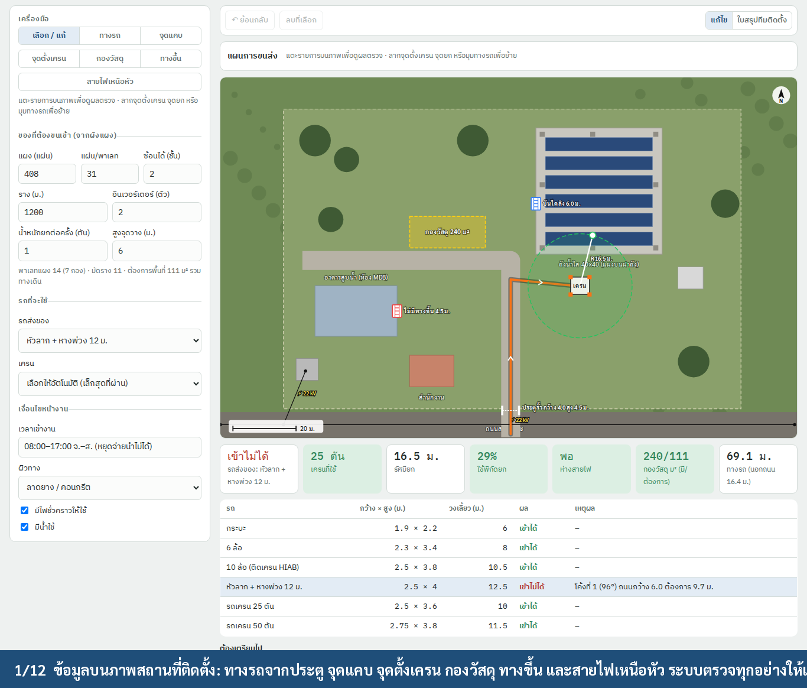
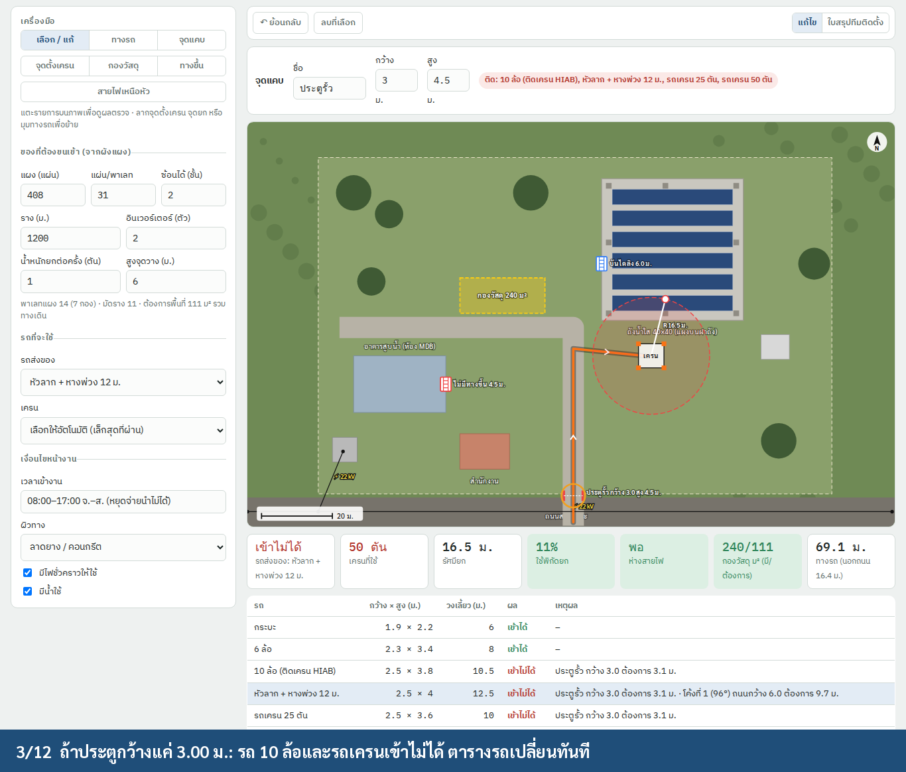
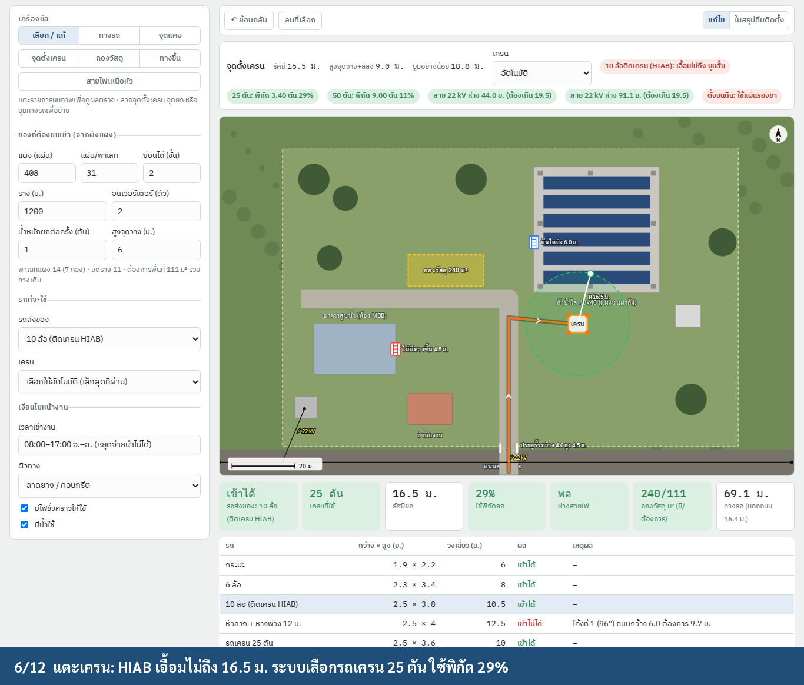
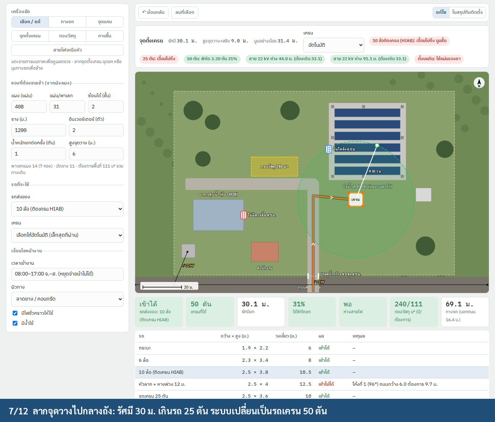
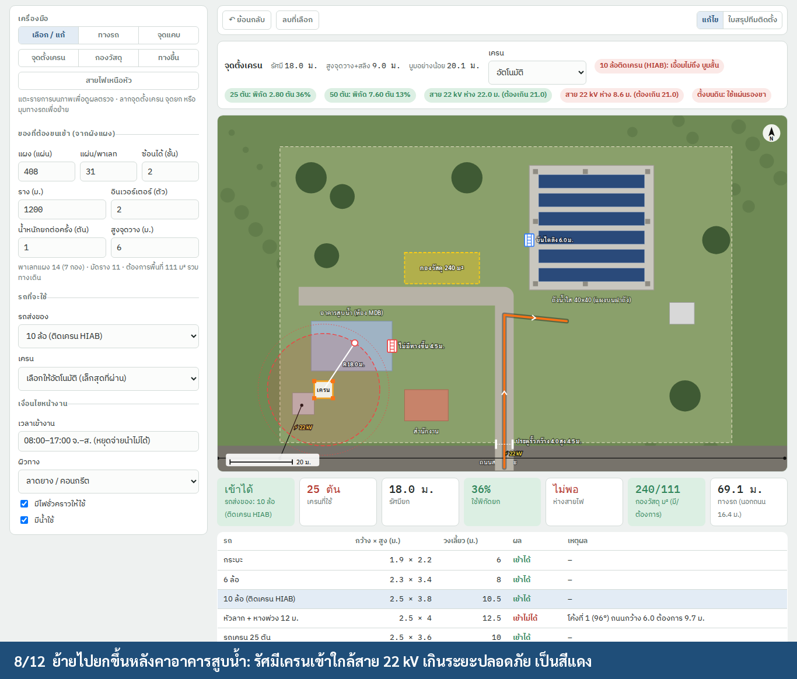
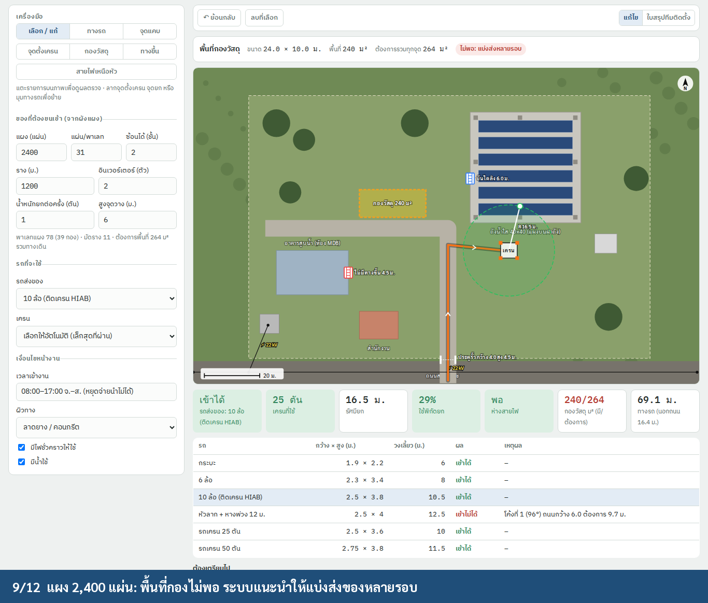
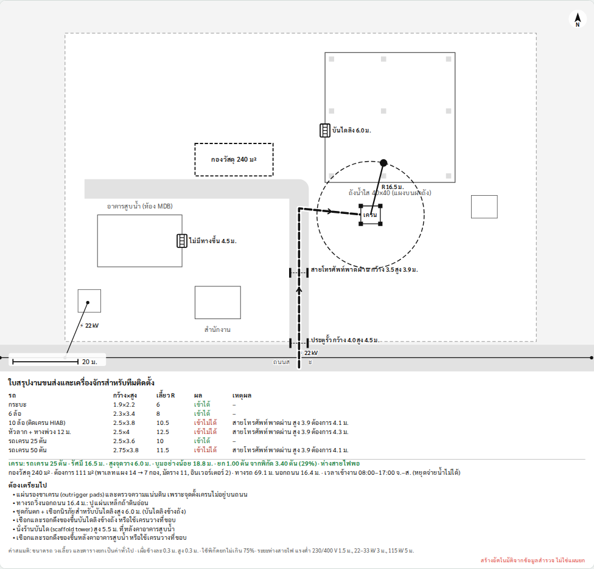

# Site logistics survey (สำรวจการขนส่งและเครื่องจักร), iPad app

**Status:** Ready for development, 2026-09-29
**Platform:** TCRoof on **iPad** (SwiftUI, iPadOS 17+, landscape first). iPhone gets the same screens in compact
layout later; nothing in this spec depends on it.
**Where:** job cover › ภาพสถานที่ติดตั้ง. It is a third layer on the same site picture, next to symbols
(`siteMarks`) and cable routes ([`cable-route.md`](cable-route.md)).
**Prototype:** `prototype/site-logistics.html`. It is only a clickable model of the iPad screen, not a web app.
**Demo:** `img/logistics_demo.mp4` (12 steps), recorded with `NODE_PATH=<global node_modules> node prototype/site-logistics-demo.js <outDir>`.

| Everything on one picture, checked automatically | Gate narrowed to 3.00 m: 10-wheeler and cranes blocked |
|---|---|
|  |  |
| **Tap the crane: HIAB can't reach, 25 t at 29 %** | **Drop point moved to 30 m: switches to the 50 t crane** |
|  |  |
| **Crane moved near the 22 kV line: red** | **Too many pallets for the laydown area** |
|  |  |

**Sheet for the installation team** (a page in the PDF, and shareable on its own):



---

## 1. Goal

The surveyor records **once, on site, on the iPad**:
- how trucks and cranes get in
- where the crane stands and what it lifts
- where materials are stored
- how people get onto the roof or tank

The app turns this into a checked plan and a list of what to bring. The installation team then **doesn't need a second
site visit**.

As in the rest of the survey, the surveyor draws on the picture, takes photos and enters measured numbers. Every check
is derived, and every assumption is printed as ค่าสมมติ.

## 2. What the surveyor records

| Item | How, on the iPad | Numbers | Photo |
|---|---|---|---|
| **Truck path** | draw with finger or **Apple Pencil** from the public road to the crane / laydown area | — (length from the picture scale) | optional |
| **Narrow / low point** (gate, arch, canopy, phone line, pipe bridge) | tap on the picture, or **"ตำแหน่งปัจจุบัน"** to drop it at the iPad's GPS position | clear width, clear height (ม.): typed, or measured with **LiDAR** (§5.3) | required: the camera opens straight away |
| **Crane position + drop point** | tap the crane spot, then the drop point (tank roof edge, roof) | drop height (ม.), prefilled from D1 tank height or C1 eave height | required: crane spot and ground |
| **Laydown area** | tap two corners | — | optional |
| **Access to the roof / tank** | tap; pick บันไดถาวร / บันไดลิง / ไม่มีทางขึ้น | climb height (ม.), prefilled from C1/D1 | required |
| **Overhead lines** | draw along the line | voltage (kV): pick 0.4 / 22 / 33 / 115 | optional |
| **Site conditions** | form fields in the side panel | working hours, surface (ลาดยาง/คอนกรีต, ลูกรัง, ดิน/หญ้า), weight limit of a culvert or bridge (ตัน), temporary power, water, parking, permit contact | — |

- Roads and buildings drawn for the cable routes are reused, so the surveyor draws them only once.
- **What has to be delivered** comes from the job, not from typing:
  - modules from the mounting layout, or the roof or tank PV layout
  - inverter count from the SLD
  - rail length from the layout BOQ

## 3. Checks (`TCRoofCore/Logistics/LogisticsAnalysis.swift`, pure Swift, tested on Linux)

### 3.1 Vehicles

Every vehicle class is checked along the path:

| Class | W × H (ม.) | Wheelbase | Outer turning R | GVW |
|---|---|---|---|---|
| กระบะ | 1.9 × 2.2 | 3.1 | 6.0 | 3 t |
| 6 ล้อ | 2.3 × 3.4 | 4.3 | 8.0 | 11 t |
| 10 ล้อติดเครน (HIAB) | 2.5 × 3.8 | 5.6 | 10.5 | 25 t |
| หัวลาก + หางพ่วง 12 ม. | 2.5 × 4.0 | 11.0 | 12.5 | 45 t |
| รถเครน 25 ตัน | 2.5 × 3.6 | 4.4 | 10.0 | 26 t |
| รถเครน 50 ตัน | 2.75 × 3.8 | 6.5 | 11.5 | 40 t |

**Rules:**
- **Narrow point:** `width ≥ W + 2 × 0.30` and `height ≥ H + 0.30`.
- **Bend > 20° on a drawn road:** off-tracking `o = R − √(R² − WB²)`, and the bend needs
  `road width ≥ W + o · min(1, θ/90°) + 2 × 0.30`.
- **Bend off any road:** noted, not failed.
- **Weight limit** (culvert, bridge): `GVW ≤ limit`.
- **Off-road length:** the parts of the path outside the roads. When the surface is ดิน/หญ้า or ลูกรัง, the app
  suggests steel road plates.

On the sample, the 12 m trailer fails the 96° turn off the 6 m road (it needs 9.7 m). Every other class gets in.

### 3.2 Crane

For each crane position:
- **Radius** `r` (picture scale) and **hook height** = drop height + 3.0 m rigging.
- **Boom needed** = `√(r² + height²)`, which must be ≤ the class's boom.
- **Capacity** at the next listed radius above `r` (conservative), from the generic charts:

  | Class | Boom | Chart (radius m → t) |
  |---|---|---|
  | HIAB | 10.5 | 2 → 3.2 · 4 → 1.6 · 6 → 1.05 · 8 → 0.8 · 10 → 0.6 |
  | 25 t | 33.5 | 8 → 11 · 12 → 6.5 · 16 → 4.2 · 20 → 2.8 · 24 → 1.9 · 30 → 1.1 |
  | 50 t | 42 | 8 → 24 · 12 → 15 · 16 → 10.5 · 20 → 7.6 · 28 → 4.2 · 38 → 2.2 |

- **Utilisation** = lift (default: one module pallet, 1.0 t including rigging) / capacity. It must be ≤ **75 %**.
- **Truck route:** the crane's own truck must pass §3.1.
- **Auto pick:** the smallest class that passes all of the above. The surveyor can force a class.
- **Outrigger footprint** (25 t: 6.0 × 5.5 m, 50 t: 7.2 × 6.8 m) is drawn on the picture. **Off-road** means the app
  adds outrigger pads and a soil check to the bring list.
- **Overhead lines:** the distance from the crane centre to every drawn line must be greater than `r` + the
  clearance for that voltage:

  | Voltage | Clearance |
  |---|---|
  | ≤ 1 kV | 1.5 m |
  | 22–33 kV | 3.0 m |
  | 115 kV | 5.0 m |

  If not, the crane shows red, and the bring list says "ขอดับไฟหรือหุ้มสาย หรือย้ายจุดตั้งเครน".

**Sample results:**
- r = 16.5 m, so HIAB can't reach and the 25 t crane is picked: 3.4 t capacity, 29 %.
- A drop point at 30.1 m switches to 50 t (31 %).
- Next to the transformer line: 8.6 m from the line, while it needs more than 21.0 m, so the crane is red.

### 3.3 Laydown area

| Item | Rule |
|---|---|
| Pallets | `⌈modules / per pallet⌉` (31), stacked 2 high |
| Footprint per stack | 2.3 × 1.15 m |
| Rail bundles | `⌈rail m / 5.8 / 20⌉`, each 6.2 × 0.6 m |
| Inverters | 1.2 × 1.0 m each |
| Needed area | net × **1.8** (aisles, forklift or hand-pallet space) |

- **Sample:** 408 modules gives 14 pallets (7 stacks), 11 bundles and 111 m² needed against 240 m² drawn.
- **With 2,400 modules:** 264 m² is needed, so the app says "แบ่งส่ง 2 รอบ".

### 3.4 Access

| Access | Result |
|---|---|
| ไม่มีทางขึ้น | scaffold tower, climb height + 1 m |
| บันไดลิง ≥ 6 m | harness and lifeline |
| every access | rope and pulley for hauling, or a crane drop at the edge |

## 4. Output

- **On the picture:**
  - path (orange, with arrows), narrow points (red when they block the chosen truck)
  - crane footprint, reach circle (green/red), drop point, line clearance ring
  - laydown area with its m², access symbols, lines with kV
  - scale bar, north arrow
- **Tiles:**
  - chosen truck: in or not
  - crane class, radius, utilisation
  - line clearance, laydown area (have/need), path length (off-road)
- **Vehicle table:** every class, in or not, with the reason.
- **ต้องเตรียมไป** (bring list): generated, with red items for anything that blocks the job.
- **PDF page** "ใบสรุปงานขนส่งและเครื่องจักร" (black on white): the picture, vehicle table, crane line, laydown
  line, bring list, ค่าสมมติ, and the footer "สร้างอัตโนมัติจากข้อมูลสำรวจ ไม่ใช่แผนยก".
  - It also goes out as its own PDF from the share sheet, so the installation team can get it on LINE without the
    whole survey.
  - The photos for each item are attached on the next page, with numbered callouts matching the picture.
- **Excel (NO.224):** rows for the vehicle chosen, crane class, pads, road plates, scaffold height, and deliveries.

## 5. iPad app design

### 5.1 Layout (regular width, landscape)

| Area | Content |
|---|---|
| **Left column (320 pt)** | tools, then ของที่ต้องขนเข้า (read-only, from the job, with an override), then รถที่จะใช้ (truck picker, crane: อัตโนมัติ / class), then เงื่อนไขหน้างาน |
| **Top bar** | undo / redo, delete selected, **Share sheet**, segmented **แก้ไข / ใบสรุปทีมติดตั้ง** |
| **Info bar** under the top bar | what is selected, its editable numbers, and green/red pills |
| **Stage** | the site picture with all layers; pinch zoom, two-finger pan |
| **Bottom** | tiles, then the vehicle table, then the bring list |

In **portrait**, the left column becomes a sheet from a toolbar button "เครื่องมือ".

### 5.2 Input

- **Apple Pencil draws, fingers navigate.** Drawing uses **Apple Pencil hover** (iPad Pro) to preview the next
  segment and its running length before touching.
- **Finger drawing** works when no Pencil has been used in the session. Touches are then treated as drawing only
  while a drawing tool is active.
- **Snapping:** path ends snap to roads and the crane spot; a narrow point snaps onto the path.
- **Dragging:** crane, drop point, access and path vertices drag directly (44 pt targets). **Long-press** opens a
  context menu: แก้ค่า, ถ่ายรูป, ลบ.
- **Numbers** use the decimal keypad (`.decimalPad`) with the input accessory "ม."; Thai digits and "3,5" are
  accepted (`NumberInput.value`).
- **Undo:** `UndoManager`, one step per finished drawing, drag or edit. **⌘Z / ⇧⌘Z** with a hardware keyboard.

### 5.3 Sensors

- **Camera:** placing a narrow point, crane spot or access opens the camera right away. The photo is stored on the
  item (`Photo` in the job folder, the same pipeline as other survey photos, uploaded by `DriveSync`).
- **LiDAR / AR measure (iPad Pro):** in the narrow-point editor, **"วัดด้วยกล้อง"** opens an ARKit view:
  - tap both gate posts for the width
  - tap the ground, then the lowest overhead object, for the height
  - the values fill the fields, marked "วัดด้วย LiDAR"

  On iPads without LiDAR, the same view uses ARKit plane detection and shows "ความแม่นยำต่ำ ตรวจด้วยตลับเมตร".
- **GPS:** **"ตำแหน่งปัจจุบัน"** drops the item where the surveyor is standing:
  - the picture's centre coordinate and scale come from `MapImage`
  - the position is converted to picture fractions
  - it works only when the picture came from the map (`scale = .map`)
- **Compass:** not needed. The picture is north-up.

### 5.4 Offline

Everything works offline: the map picture is already in the job, and all checks run on the device. The PDF and share
sheet work offline too. Only Drive upload waits for a connection.

## 6. Data model (`TCRoofCore/Logistics/SiteLogistics.swift`)

```swift
public struct NarrowPoint: Codable, Hashable, Identifiable { id; label; at: SitePoint; width: Double?; height: Double?; measured: MeasureSource; photo: Photo? }
public struct CraneSpot: Codable, Hashable, Identifiable { id; at: SitePoint; drop: SitePoint; dropHeight: Double?; forced: CraneClass?; photos: [Photo] }
public struct Laydown: Codable, Hashable, Identifiable { id; a: SitePoint; b: SitePoint; photo: Photo? }
public struct RoofAccess: Codable, Hashable, Identifiable { id; label; at: SitePoint; kind: AccessKind; height: Double?; photo: Photo? }
public struct OverheadLine: Codable, Hashable, Identifiable { id; points: [SitePoint]; kV: Double }
public struct SiteLogistics: Codable, Hashable {
    public var path: [SitePoint] = []
    public var narrow: [NarrowPoint] = [], cranes: [CraneSpot] = [], laydown: [Laydown] = [], access: [RoofAccess] = [], lines: [OverheadLine] = []
    public var truck: VehicleClass = .tenWheelHIAB
    public var hours = "", surface: Surface = .paved, weightLimit: Double?, tempPower = true, water = true, notes = ""
}
```

- `FieldValue` gets `.logistics(SiteLogistics)`, and a new field kind `.logistics(photoField: "siteMap")` goes after
  the cable routes.
- `SitePoint`, `SiteScale`, roads and buildings are shared with `SiteRoutes`.
- `VehicleClass`, `CraneClass`, the clearances and the utilisation limit live in `LogisticsStandard`, which the team
  can edit in settings.

## 7. Swift files

| File | Contents |
|---|---|
| `TCRoofCore/Logistics/SiteLogistics.swift` | §6 model, `Codable`, `WebBackup` mapping |
| `TCRoofCore/Logistics/LogisticsStandard.swift` | vehicles, cranes (charts), clearances, laydown factors |
| `TCRoofCore/Logistics/LogisticsAnalysis.swift` | §3 → `LogisticsResult` (vehicle checks, crane pick, clearances, laydown, bring list) |
| `TCRoofCore/Logistics/LogisticsDrawing.swift` | overlay and report ops → `Sketch` |
| `SurveyUI/Logistics/LogisticsEditor.swift` | §5.1 layout, tools, info bar, tiles, table, bring list |
| `SurveyUI/Logistics/PencilCanvas.swift` | Pencil/finger split, hover preview, snapping |
| `SurveyUI/Logistics/ARMeasureView.swift` | LiDAR / ARKit width and height (`ARView`, raycast to planes and mesh) |
| `SurveyUI/Logistics/GPSDrop.swift` | CoreLocation → picture fraction via `MapImage` centre + zoom |
| `PDFReport/LogisticsSheet.swift` | the team sheet + photo page; also exported alone |

**Tests:**
- the §3 sample numbers (trailer fails the bend at 9.7 m; crane 25 t at 29 %, 50 t at 31 %; line check at 8.6 m;
  laydown 111 / 264 m²)
- the next-radius-up capacity rule
- GPS → fraction round trip at zoom 19
- old jobs decode unchanged
- a snapshot SVG of the sheet

## 8. Done when

- [ ] The demo steps pass as an XCUITest on an iPad Pro 13" and an iPad (10th gen) simulator, in landscape and
      portrait.
- [ ] LiDAR measurement of a 4.00 m test gate is within ±5 cm on a device.
- [ ] Nothing needs a network connection except the Drive upload.
- [ ] The team sheet shares on its own as a PDF (to LINE) from the share sheet.

## 9. Open questions

1. **Vehicles and cranes:** replace the generic classes and charts with the team's usual rental companies' models
   and load charts.
2. **Lift weight:** is one pallet (about 1.0 t with rigging) the right default, or do they lift half pallets onto
   tank roofs?
3. **Line clearances:** confirm 1.5 / 3.0 / 5.0 m against the current PEA and ministerial regulation figures the team
   works to.
4. **Utilisation limit:** is 75 % right, or does the team work to 80 % for pick-and-carry?
5. **Laydown factor:** is 1.8 × net enough for hand-pallet aisles? Should forklift access be a separate option?
6. **Sheet language:** Thai only, or Thai + English for foreign crane operators?
