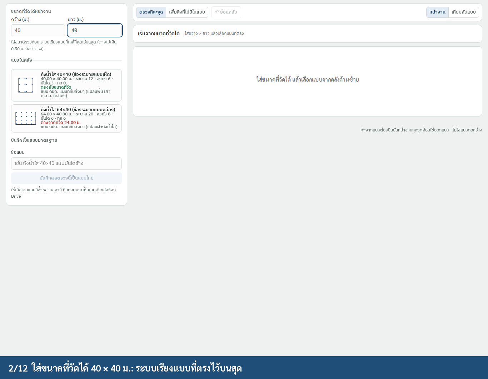
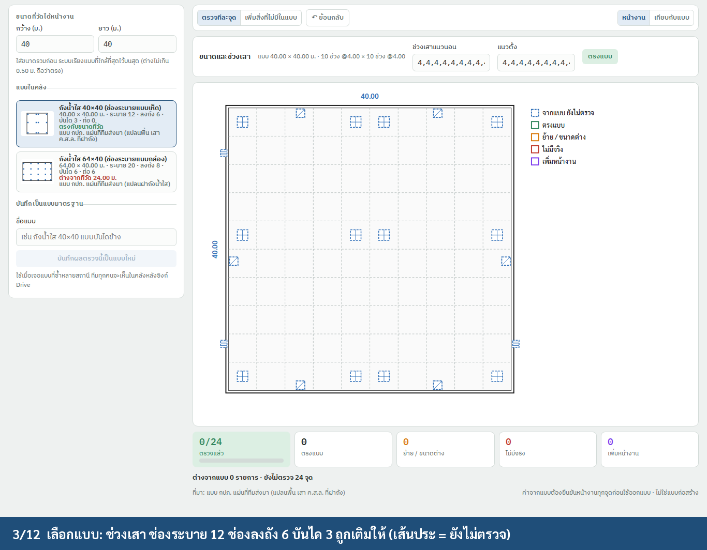
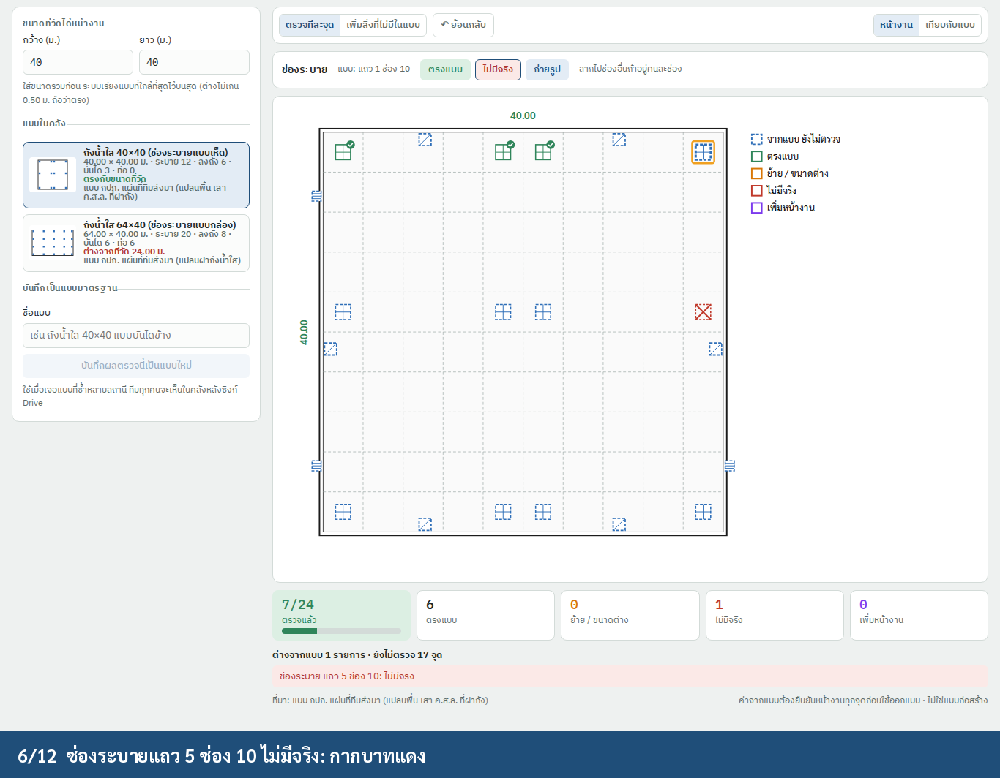
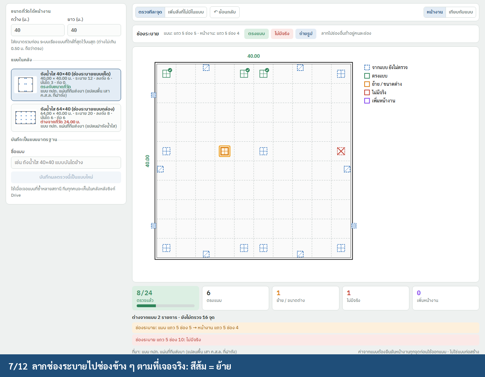
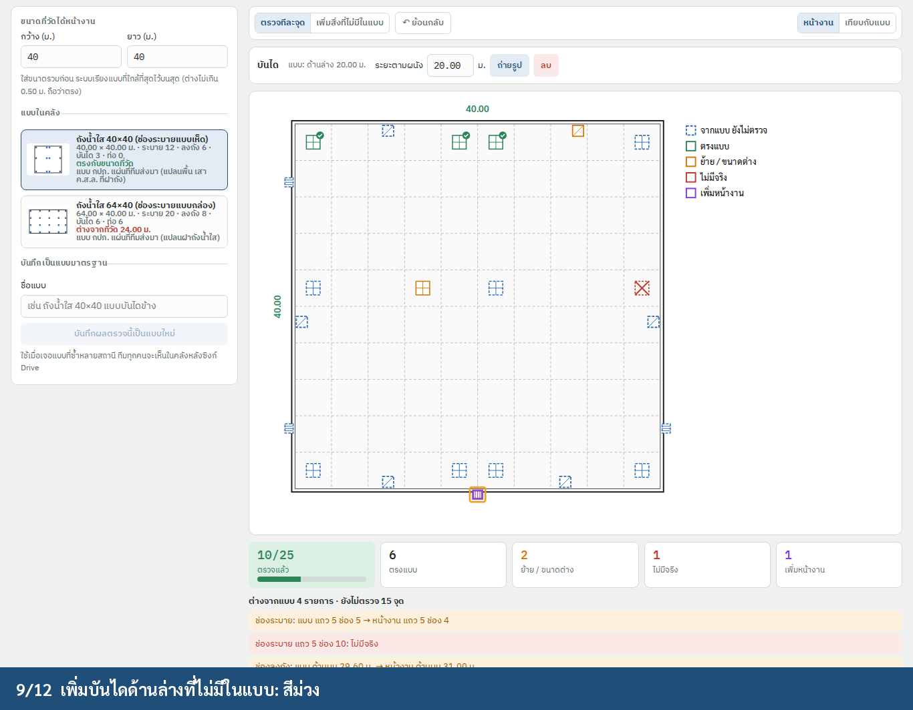
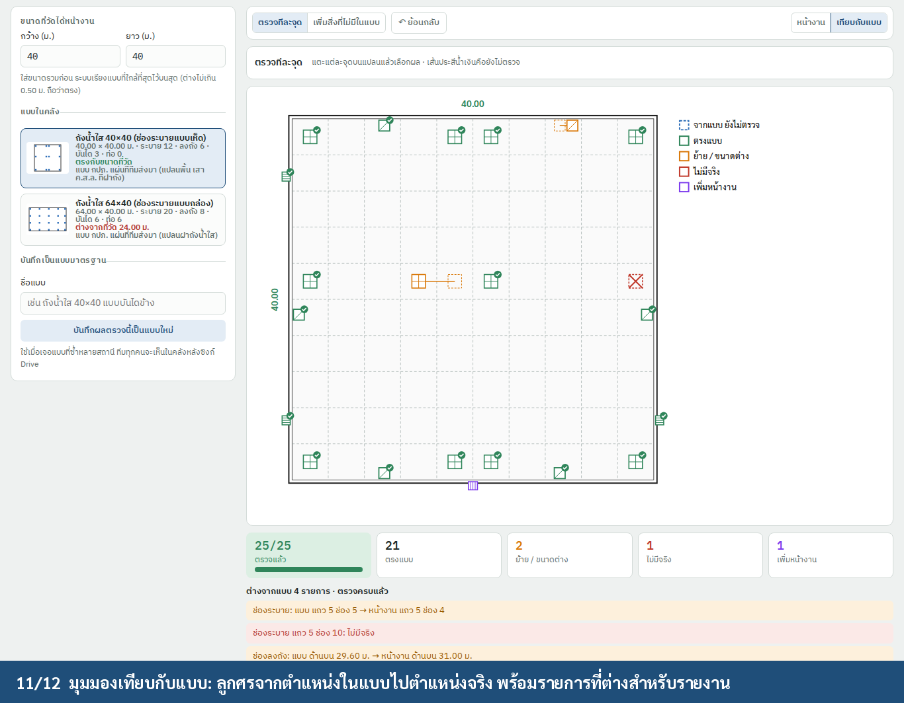

# Standard design library (คลังแบบมาตรฐาน กปภ.), iPad app

**Status:** Built (2026-10-19; first part 2026-10-17): the two sheets as `TCRoofCore/TankDesign.swift`, picked in D1 sub-step 2 (`เริ่มจากแบบมาตรฐาน กปภ.`, ranked by the measured size, turned when it fits a quarter turn), checked with the sub-step's own states, and the §6 difference list in the PDF and the counts on the Excel tank sheet (N19). `ยืนยันที่เหลือ n จุดว่าตรงแบบ` (printed as ยืนยันแบบรวม). Built 2026-10-19: tolerances ±1.00 m (overall) and ±0.20 m (a point; within it a point still matches), a photo on each point (`Obstacle.photo`) required for ไม่มีจริง / ย้าย / เพิ่มหน้างาน on a standard design (sub-step 2 isn't done without them), the `หน้างาน / เทียบกับแบบ` switch on the obstacle plan with the difference list, and the PDF's difference list with thumbnails. Library built 2026-10-19: `DesignLibrary` (Application Support `standard-designs.json`), `บันทึกเป็นแบบมาตรฐาน` once every point is checked (team only: the new capability `design.library`), revisions, a snapshot of the design on each job (`tankDesignSnapshot`), Settings › คลังแบบมาตรฐาน (rename, archive, import / export `.tcdesign`), and sync through Firestore `standardDesigns` (every member reads, the team writes, never an older revision) instead of a Drive folder (decided 2026-10-19). Scanned sheet built 2026-10-19: `แนบแบบ (PDF / รูป)` in the library (PDF pages or an image as JPEGs under ~700 KB, kept beside the library, synced one page per Firestore `standardDesignSheets` document), opened with `ดูแบบ` in the library and on D1's design line (`DesignSheetViewer`, swipe and pinch; an inset, not Split View). Roofs built 2026-10-19 (`RoofDesign`, C1's `แบบมาตรฐาน` under หลังคา): a design keeps C1's spans, shape, material, frame, ridge and sheet direction, bays, posts, purlin spacing, overhang, clear height, member sizes and the plan's obstacles; picked (ranked by size, turned too), each item is confirmed `ตรงแบบ` or counts as `ต่างจากแบบ` once its answers change (an obstacle gone `ไม่มีจริง`, a new one `เพิ่มหน้างาน`); saved by the team, kept in the library (`standard-roof-designs.json`), synced in `standardDesigns` with `kind: roof`, and printed in the roof section of the PDF. Not built: region tie ranking (§3.1), keyboard and Pencil shortcuts, Split View for the sheet, the "ยังตรวจแบบไม่ครบ" banner, the check screen's drag-to-move on roofs, the 5-minute timing (§9).
**Platform:** TCRoof on **iPad** (SwiftUI, iPadOS 17+). The same screens work on iPhone in compact layout.
**Where:**
- **D1 ถังน้ำใส:** a **"เริ่มจากแบบมาตรฐาน"** button at the top of the tank plan group.
- **C1 หลังคา:** the same button for building types (§7). The library is shared.

**Builds on:** [`tank-drawing-swift.md`](tank-drawing-swift.md) (tank input: bays, vent cells, hatches, ladders, pipes).

**Prototype:** `prototype/standard-designs.html`. It is a clickable model of the iPad screen.
**Demo:** `img/stddesign_demo.mp4` (12 steps), recorded with `NODE_PATH=<global node_modules> node prototype/standard-designs-demo.js <outDir>`.

| Measured 40 × 40: the matching design comes first | Picked: everything filled from the design (dashed = not checked) |
|---|---|
|  |  |
| **A vent that isn't there: marked missing** | **A vent in the next bay: dragged, orange = moved** |
|  |  |
| **A ladder the design doesn't have: added, purple** | **Compare with the design: arrows and the difference list** |
|  |  |

---

## 1. Goal

Most กปภ. clear-water tanks and station buildings are built from standard designs (for example the 64 × 40 and
40 × 40 tanks). Today the surveyor re-enters every bay, vent, hatch, ladder and pipe at each station.

With the library:
1. **Measure the overall size.**
2. **Pick the matching design.** Everything is filled in.
3. **Check each item** against what is really on site: ตรงแบบ / ไม่มีจริง / ย้าย, or add what the design doesn't
   have.

The result is the normal D1 input (the tank drawing, the mounting layout and the PV layout use it unchanged). The
report shows **exactly where the site differs from the design**.

The surveyor still only enters distances and taps. Nothing from the design is used for design work until it has been
checked on site (§4).

## 2. What is in the library

**Seed content: only the two sheets the team supplied.**

| Design | Size | Content | Source |
|---|---|---|---|
| ถังน้ำใส 64×40 (ช่องระบายแบบกล่อง) | 64.00 × 40.00, 16 × 10 bays @4.00 | 20 vents (box), 8 hatches, 6 ladders, 6 pipes (Ø600 / Ø700 / Ø500 overflow) | แบบ กปภ. แปลนฝาถังน้ำใส |
| ถังน้ำใส 40×40 (ช่องระบายแบบเห็ด) | 40.00 × 40.00, 10 × 10 bays @4.00 | 12 vents (cross), 6 hatches, 3 ladders | แบบ กปภ. แปลนพื้น เสา ค.ส.ล. ที่ฝาถัง |

No other กปภ. design codes or sizes are invented. The library grows in three ways:

- **บันทึกเป็นแบบมาตรฐาน (save as a standard design):** available after a complete check (every item checked).
  Saves the checked result as a new design, with a name and a reference to the design it came from. This is the main
  way the library grows: the second station of the same type starts from it.
- **Import:** a `.tcdesign` file (JSON, §5), sent by email/LINE. Saved designs reach the other devices through Firestore
  `standardDesigns` (scanned sheets in `standardDesignSheets`), not a Drive folder.
- **Scanned sheet** (optional): the PDF or photo of the original drawing is attached to the design. It opens next to
  the plan in the check screen (§3.4).

**Library management** lives in Settings › คลังแบบมาตรฐาน:
- list, rename, attach sheet, archive
- a **revision** number per design, raised whenever a design is edited
- a job keeps a **snapshot** of the design it used (id + revision + content), so later edits never change old jobs

## 3. iPad screens

### 3.1 Pick a design

- **Open it:** tap **`เริ่มจากแบบมาตรฐาน กปภ.`** in D1 sub-step 2. A confirmation dialog lists the designs, each as
  its name and its match line (`TankDesign.ranked`, `TankPageWide+Obstacles.swift`). The measured size comes from
  sub-step 1; there is no size field in the picker.
- **Match line:** "ตรงกับขนาดที่วัด" when `|ΔW| + |ΔL| ≤ 1.00 m` (`TankDesign.tolerance`) in either orientation,
  otherwise how far it differs.
- **Order:** sorted by that difference. (Not built: designs the team used most recently in the same region (เขต) first
  on a tie.)
- **After picking:** the dialog's message reads "แทนขนาดช่วงเสาและจุดบนหลังคาทั้งหมดด้วยแบบที่เลือก จุดที่ตรวจแล้วต้องตรวจใหม่";
  the pick is one undo step.
- (Not built: the design cards with a thumbnail plan, the counts and the source.)
- **Rotated tanks:** a tank measured 40 × 64 matches the 64 × 40 design **rotated**. The app rotates the template so
  the plan matches the site picture's orientation.

### 3.2 Check each item

**Layout (landscape):**
- **Left column:** the design card and the progress.
- **Stage:** the plan.
- **Info bar:** actions for the selected item.
- **Bottom:** tiles and the difference list.

**Item states:**

| State | Look | How |
|---|---|---|
| **จากแบบ (not checked)** | blue, dashed | as filled from the design |
| **ตรงแบบ** | green + tick | tap the item, then **ตรงแบบ**. The next unchecked item is selected automatically |
| **ไม่มีจริง** | red cross | **ไม่มีจริง** |
| **ย้าย / ขนาดต่าง** | orange | **drag** (snaps to 2.5 cm, `TankPoints.grid`, and takes another point's row or column within 0.30 m, the magnet); a hatch, ladder or pipe on a wall slides along it; or type the distances |
| **เพิ่มหน้างาน** | purple | mode **เพิ่มสิ่งที่ไม่มีในแบบ**, pick the kind, tap a bay (vent) or near a wall (the rest) |

- **Size and bays** are one item: **ตรงแบบ**, or edit the bay lists. Editing recalculates the overall size, and the
  item counts as "ขนาดต่าง".
- **Photos:** every item has **ถ่ายรูป**. The camera opens, and the photo is stored on the item.
  - A photo is **required** for ไม่มีจริง, ย้าย and เพิ่มหน้างาน, so the difference can be shown to the reviewer.
- **Pencil and keyboard (not built):**
  - Apple Pencil drags items precisely. Fingers pan and zoom.
  - With a hardware keyboard: **Return** = ตรงแบบ, **⌫** = ไม่มีจริง, **Tab** = next item.
- **Bulk confirm:** "ยืนยันที่เหลือ n จุดว่าตรงแบบ" is allowed. Those items are stored as `bulk` and printed as
  "ยืนยันแบบรวม" in the report, so the reviewer can see which items were not checked one by one.

### 3.3 Compare with the design

The segmented control **หน้างาน / เทียบกับแบบ** switches the view. **เทียบกับแบบ** shows:
- the design position as an orange dashed outline, with an arrow to the site position
- missing items crossed out, and added items in purple

The difference list under the plan is the same list the PDF prints (§6).

### 3.4 Side by side with the sheet

When the design has a scanned sheet, **"ดูแบบ"** opens it as an inset that can be zoomed (`DesignSheetViewer`, swipe
and pinch). The second window in Split View / Stage Manager is not built.

This lets the surveyor read notes on the original drawing while checking.

## 4. Rules

- **Nothing unchecked goes into the design outputs:**
  - Unchecked items are drawn dashed in every drawing that uses D1: tank plan, mounting layout, PV layout.
  - The mounting and PV layouts show "ยังตรวจแบบไม่ครบ n จุด" (not built).
  - The PDF won't mark D1 complete (`Progress`) until every item is checked.
- **ไม่มีจริง** removes the item from D1. **ย้าย** uses the site position. **เพิ่มหน้างาน** adds it. The downstream
  layouts are recomputed.
- **Changing to another design** after checks have started asks first. The checks are lost (undo brings them back).
- **Measured size vs design:** if the measured size doesn't match the chosen design (more than 1.00 m), the bay item
  starts as **ขนาดต่าง**, and the info bar says so.

## 5. Data model

Built as `TankDesign` (`TCRoofCore/TankDesign.swift`, `Codable`), not the draft's `StandardDesign` / `DesignCheck`:

- **`TankDesign`:** `id` (`pwa-64x40`, `pwa-40x40` or a saved one), `name`, `source`, the bay grid (`nx`, `ny`,
  `span`, or `spansX` / `spansY`), `ventStyle`, `vents` (bay cells), `hatches`, `ladders`, `pipes` (wall and distance
  along it), `revision`, `basedOn`, `savedBy`, `savedAt`, `archived` and `sheet` (the scanned pages).
  `tolerance = 1.0` (overall size) and `pointTolerance = 0.2` (a point). Roofs have their own `RoofDesign`.
- **On the job (D1 module):** `tankDesign` (the design id, `@r` when turned) and `tankDesignSnapshot` (the design as it
  was used), so later library edits never change old jobs.
- **The checks live on the points themselves:** each `Obstacle` in `obst` carries `kind`, `status` (`""` / `ok` /
  `absent`), `origin` (`standard` / `added`), `stdX` / `stdY` (the design position; moved is derived from it), `bulk`
  and `photo`. Picking a design writes `spansX`, `spansY` and `obst`; the rest of the app keeps reading D1 as before.
- **Library:** `DesignLibrary` keeps `standard-designs.json` (and `standard-roof-designs.json`) in Application Support,
  and the app syncs it through Firestore `standardDesigns` (`kind: roof` for roofs) and `standardDesignSheets`: the
  higher revision wins.
- **Old jobs** have no `tankDesign`. They decode and behave as before.

## 6. Report and export

**PDF (NO.215), D1 page, after the tank plan:**
- "เริ่มจากแบบมาตรฐาน: <name> rev <n>"
- counts: ตรงแบบ n · ย้าย n · ไม่มีจริง n · เพิ่มหน้างาน n · ยืนยันแบบรวม n
- the difference list, with each item's photo as a thumbnail

In the tank plan, differences are marked the same way as in §3.3. The note "ต่างจากแบบมาตรฐาน" goes in the legend.

**Excel (NO.224):** the design name and the counts go on the tank sheet.

## 7. Roofs (C1) with the same library

`RoofTemplate` holds:
- spans, sheet direction, shape
- eave and ridge heights
- purlin size and spacing
- typical obstacles (skylight strips, turbines)

These are the C1 inputs the roof drawings and the roof PV layout use. The check screen is the same:
- the items are the overall size, bays, heights, purlin spacing and each obstacle
- heights and spacing are "ตรงแบบ" or typed

No roof designs are seeded. The first station of each building type saves one.

## 8. Swift files

| File | Contents |
|---|---|
| `TCRoofCore/TankDesign.swift` | §5 model, the two seed sheets, match ranking (§3.1), rotation, apply to D1, the difference list |
| `TCRoofCore/DesignLibrary.swift` | load/save, revision, `.tcdesign` import/export, the Firestore sync hooks |
| `TCRoofCore/RoofDesign.swift` | §7 roofs |
| `TCRoofUI/Survey/Pages/Tank/TankPageWide+Obstacles.swift` | the picker (§3.1) and the checks (§3.2, §3.3) in D1 sub-step 2 |
| `TCRoofUI/Survey/Designs/DesignLibraryView.swift` | Settings › คลังแบบมาตรฐาน |
| `TCRoofUI/Survey/Designs/DesignSheetViewer.swift` | the scanned sheet (§3.4) |
| `PDFReport/ReportLayout.swift` | the §6 block |

**Tests:**
- Seed designs reproduce the two tank drawings exactly: same output as `img/tank_plan.py`.
- Match ranking, including rotated 40 × 64 → 64 × 40.
- Each state writes the right D1 values.
- Unchecked items keep D1 incomplete.
- A snapshot survives a library edit.
- Import / export round trip.
- The demo's difference list:
  - 1 vent moved (row 5 bay 5 → bay 4)
  - 1 vent missing (row 5 bay 10)
  - 1 hatch moved (29.60 → 31.00)
  - 1 ladder added

## 9. Done when

- [ ] The demo steps pass as an XCUITest on iPad (landscape and portrait).
- [ ] Target: a surveyor starts and checks a 40 × 40 tank in under 5 minutes. Time it against manual entry on a test job.
- [ ] No drawing or layout uses an unchecked item without showing it as unchecked.
- [ ] A design saved on one iPad appears on another after Firestore sync.

## 10. Open questions

Answered 2026-10-17: (1) yes, the team will share more sheets; (2) no drawing number: a design is a template;
(3) ±0.50 m / ±0.10 m are not right, values to come; (4) bulk confirm is allowed. Answered 2026-10-19: (3) ±1.00 m
and ±0.20 m; (5) the team only (`design.library`).

1. **More designs:** can the team send the other standard sheets they meet (tank sizes, pump buildings), so they can
   be seeded instead of saved from the first job?
2. **Design codes:** should designs carry the official กปภ. drawing number and year? If yes, which field on the sheet
   is it?
3. ~~**Tolerance:** is ±0.50 m on the overall size right for "matches"? And ±0.10 m along a wall for hatches and
   ladders?~~ ±1.00 m on the overall size, ±0.20 m for a point (2026-10-19).
4. **Bulk confirm:** allow it at all, or only after a photo of the whole roof?
5. ~~**Who may save a design:** anyone, or only an engineer role (`MemberPicker` roles)?~~ The team only, through the
   `design.library` capability (2026-10-19).
