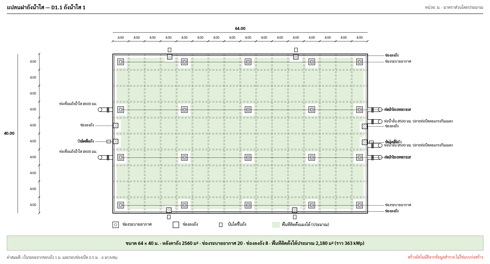
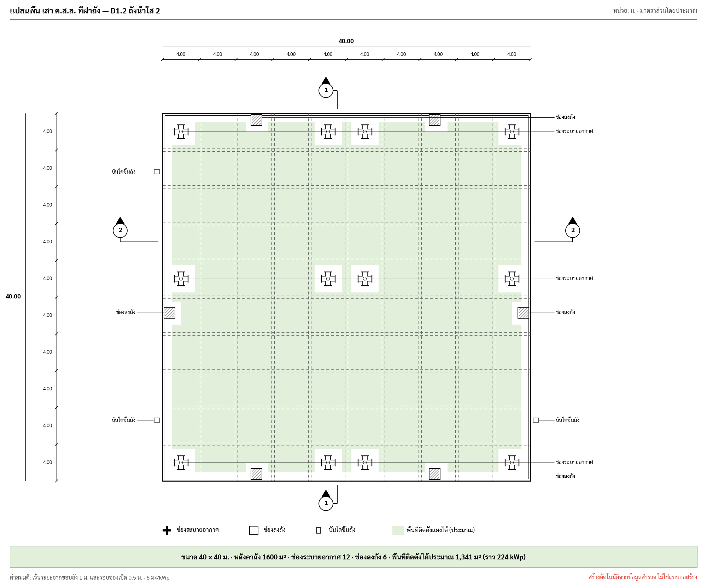

# Auto Tank Drawing (ขนาดถัง) — Swift feature spec (iPad + iPhone)

**Status:** Draft for development, 2026-09-29
**Design:** [`auto-drawing.md`](auto-drawing.md) §5–§7 (rules, drawing standard)
**Types and code detail:** [`auto-drawing-swift.md`](auto-drawing-swift.md) §2 Spans, §8 Tank, §9 UI, §10 PDF, §11 tests. This
document does not repeat them. It defines the feature as the user sees it on iPad and iPhone, and what "done" means.
**Visual reference:** `img/tank_plan.py` → `img/tank_pwa.png` (64 × 40 m), `img/tank_40x40.png` (40 × 40 m), `img/tank.png`
(plan + section); interactive prototype `prototype/tank-layout.html`
**Interaction dev spec:** [`tank-interaction-dev.md`](tank-interaction-dev.md) · **Targets:** `SolarSurveyKit` in the TCRoof app, iOS 17+, `TARGETED_DEVICE_FAMILY = 1,2`. **New dependencies:** none

| กปภ. 64 × 40 (box vents, hatches) | กปภ. 40 × 40 (cross vents, ladders apart) |
|---|---|
|  |  |

---

## 1. What the feature does

On the D1 ถังน้ำใส page the surveyor enters only **sizes and distances**. The app draws, live:

1. **Roof plan (แปลนฝาถัง)** in the กปภ. style: double wall, dashed bay grid with per-bay and total dimensions, beams,
   vents, hatches, ladders, pipes, section marks 1–1 / 2–2, and the **usable area for PV shaded green**.
2. **Section (รูปตัดถัง)**: height, ground line (above ground / buried / partly buried), soil cover.
3. **Summary strip**: size, roof area, number of vents and hatches, usable area (m²) and about how many kWp.

The same `Sketch` goes to the form preview, the full-screen editor, the PDF report and the Excel image.

**Not in v1:** PV module layout on the roof, structural checks, editing the drawing freehand.

## 2. Inputs (sizes and distances only)

| Field id | Label | Unit | Required | Notes |
|---|---|---|---|---|
| `spansX` | ระยะช่วงเสาแนวยาว | ม. | yes (rectangle) | list or shorthand: `4,4,4` or `16@4` |
| `spansY` | ระยะช่วงเสาแนวกว้าง | ม. | yes (rectangle) | same |
| `tankDiameter` | เส้นผ่านศูนย์กลาง (ถังกลม) | ม. | — | filled ⇒ round tank, spans not needed |
| `tankHeight` | ความสูงถัง | ม. | for the section | existing field |
| `tankAboveGround` | ความสูงส่วนที่พ้นดิน | ม. | — | sets the ground line; blank ⇒ `tankPos` choice, else above ground (ค่าสมมติ) |
| `sectionX`, `sectionY` | ตำแหน่งรูปตัด 1–1 / 2–2 | ม. | — | blank ⇒ centre lines |
| `ventStyle` | สัญลักษณ์ช่องระบายอากาศ | กล่อง / กากบาท | — | describes the object on site; default กล่อง |
| `obst` rows | openings | — | — | typed: vent (by bay cell), hatch / ladder / pipe (wall + distance along, pipe Ø มม.), other (x, y, w, h) |

Checks shown under the fields (never blocking): `tankAboveGround > tankHeight` → "ส่วนพ้นดินสูงกว่าถัง"; a vent outside
the grid → dropped with a warning; an opening beyond the wall length → clamped with a warning.

Assumed values (printed as ค่าสมมติ, from `DrawingSettings`): vent 1.5 m, hatch 1.2 m, beam 0.30 m, edge setback
1.0 m, clearance around openings 0.5 m, 6 m² per kWp.

## 3. Outputs and numbers the code must hit

| Case | Roof area | Openings | Usable (0.25 m raster) |
|---|---|---|---|
| กปภ. 64 × 40 (`16@4`, `10@4`), 20 box vents, 8 hatches | 2,560 m² | 20 vents, 8 hatches | 2,222 ± 10 m² |
| กปภ. 40 × 40 (`10@4`, `10@4`), 12 cross vents, 6 hatches, 3 ladders | 1,600 m² | 12, 6, 3 | 1,363 ± 10 m² |
| Round, D 10, H 5, 2 m above ground | 78.5 m² | — | volume 392.7 m³, partly buried |
| Rectangle 12 × 8 × 4.5 | 96 m² | — | volume 432 m³ |

These are the unit tests in `auto-drawing-swift.md` §11 and must stay green.

## 4. Pipeline (SurveyCore, no UIKit)

```
SurveyModule (.tank) ─► TankInput.from(_:)      missing / assumed / warnings
                     ─► TankGeometry.compute    roof area, volume, openings in metres, usable raster → runs
                     ─► TankDrawings.roofPlan   (Sketch, DrawingTransform)   ← the transform maps taps back to metres
                        TankDrawings.section    Sketch
```

- The raster for 64 × 40 at 0.25 m is 41k cells; compute on a background task, debounce 150 ms, and keep showing the
  previous drawing until the new one is ready.
- A drawing is `nil` exactly when `missing` is not empty; the UI then shows the missing list instead.

## 5. UI — shared behaviour

### 5.1 In the form (D1 page)

`FieldSpec("plan", "แปลน", .tankDrawing)` replaces the old plan preview when `SurveySettings.autoDrawings` is on.
It shows a **drawing card**:

- the roof plan (fit width) with the summary strip under it;
- a small section thumbnail;
- a red box listing what is missing when the drawing cannot be made yet ("ระยะช่วงเสา", "ความสูงถัง" …);
- tap → the full editor (§5.2).

### 5.2 Full editor — modes

A mode control sets what a tap does, so a tap is never ambiguous:

| Mode | Tap on a bay cell | Tap on / near a wall | Tap on an opening |
|---|---|---|---|
| **ช่องระบาย** (default) | add / remove a vent in that cell | — | select |
| **ที่ผนัง** | — | menu: ช่องลงถัง / บันไดขึ้นถัง / ท่อ, placed at that point (distance along rounded to 0.05 m) | select |
| **เลือก** | — | — | select, then drag along the wall (hatch, ladder, pipe) with the distance shown live |

- Selecting an opening opens its **inspector**: type, wall, ระยะ (ม.), Ø (มม., pipes), delete. Numbers stay editable
  fields; dragging only fills them.
- "Near a wall" = within 16 pt of the outline at the current zoom.
- Every change goes through `UndoManager` (one action per tap or drag). Haptic `.selection` on add/remove.
- Layer toggles in a menu: พื้นที่ติดตั้งได้ (green), มิติ, คาน, ป้ายชื่อ.
- Section tab: shows `TankDrawings.section`, read-only, with the section mark it belongs to.

### 5.3 Hit targets and zoom

- Zoom 0.5×…6×, pan, double tap toggles fit ↔ 2×. The drawing is a white paper card in light and dark mode.
- A bay cell must be at least 28 pt on screen to accept a vent tap. If it is smaller, the first tap zooms in
  around that point instead (and says so once: "ซูมเข้าเพื่อวางช่องระบาย").
- Tap mapping follows `auto-drawing-swift.md` §9.2 (view point → sketch point → metres via `DrawingTransform` →
  `GridCell` by binary search on the span edges), with the current zoom and scroll offset applied first.

## 6. iPad (regular width)

```
┌──────────────────────┬──────────────────────────────────────────┐
│ ข้อมูลถัง             │  [ช่องระบาย | ที่ผนัง | เลือก]   แปลน | รูปตัด │
│  ช่วงเสาแนวยาว 16@4   │                                          │
│  ช่วงเสาแนวกว้าง 10@4 │           roof plan (zoom / pan)          │
│  ความสูง 4.5  พ้นดิน – │                                          │
│  สัญลักษณ์ กล่อง       │                                          │
│ ช่องเปิด (28)          │                                          │
│  ▸ ช่องระบาย 20       │──────────────────────────────────────────│
│  ▸ ช่องลงถัง 8        │ 64.00 × 40.00 ม. · 2,560 ม² · ระบาย 20 ·  │
│  ▸ ท่อ 0              │ ลงถัง 8 · ใช้ได้ ≈ 2,222 ม² (≈ 370 kWp)   │
└──────────────────────┴──────────────────────────────────────────┘
```

- Left column (340 pt, collapsible): the D1 fields and the openings list grouped by type; selecting a row selects the
  opening on the plan and the reverse.
- Right: editor with the mode control and the plan/section switch in the toolbar; summary strip pinned at the bottom.
- Inspector as a popover anchored to the opening.
- Pointer and keyboard: hover highlights the cell or wall point under the pointer; right-click = the ที่ผนัง menu;
  ⌘Z / ⇧⌘Z undo/redo; ⌫ deletes the selection; ⌘+ / ⌘− / ⌘0 zoom.
- Apple Pencil works as a finger (no drawing strokes).

## 7. iPhone (compact width)

- The form shows the drawing card (§5.1). Tapping it opens the editor **full screen**:
  - top: summary strip (two lines);
  - middle: plan (fit width), zoom/pan;
  - bottom toolbar: mode control, undo, layers, plan/section switch;
  - inspector as a bottom sheet (`.presentationDetents([.height(220), .medium])`).
- The openings list is a sheet from the toolbar ("รายการช่องเปิด (28)").
- Landscape is supported and recommended for 64 × 40; the editor keeps the zoom centre on rotation.
- On small screens the 28 pt rule (§5.3) means most vent taps zoom first; that is expected.

## 8. Report and export

- PDF (`ReportLayout.planSection`): "แปลนฝาถัง" then "รูปตัดถัง", each scaled to the content width, never split
  across pages; a hand sketch photo, when attached, stays first.
- Excel: the plan PNG in the D1 frame (open question: room for the section on NO.224).
- Footer on both: "สร้างอัตโนมัติจากข้อมูลสำรวจ ไม่ใช่แบบก่อสร้าง".

## 9. Data compatibility

- `Obstacle` gains optional `kind`, `cell`, `edge`, `along`, `diameter`; old rows read as `other` and still draw
  as hatched rectangles.
- `WebBackup` writes the new keys when present and keeps them when the web app round-trips a job.
- Nothing changes for jobs that never open the new editor.

## 10. Tests

| Kind | What |
|---|---|
| Unit (SurveyCore) | the numbers in §3; spans shorthand `16@4`; vent outside grid dropped; along clamped; old obstacles decode |
| Snapshot | `Sketch.svg()` for 64 × 40, 40 × 40, round partly buried, rectangle buried |
| Tap mapping | with zoom 1× and 3× and a scroll offset, a tap at the centre of cell (r, c) returns (r, c) |
| Performance | 64 × 40 compute < 30 ms on iPhone 12, no main-thread hitch while typing spans |
| Manual, iPad + iPhone | place the 20 vents of the 64 × 40 sheet by tapping; add 8 hatches from the ที่ผนัง menu; undo all; rotate; export PDF |

## 11. Delivery (maps to `auto-drawing-swift.md` §12)

| PR | Content |
|---|---|
| 4 | `Obstacle` fields, `WebBackup`, `TankInput`, `TankGeometry`, `TankDrawings` + unit and snapshot tests |
| 5a | D1 fields, drawing card in the form, missing box |
| 5b | Full editor: modes, inspector, undo, zoom, hit-target rule — iPad layout |
| 5c | iPhone layout: full-screen editor, bottom sheet, openings sheet |
| 6 | PDF and Excel, `missingGroups` lists drawing gaps |

## 12. Done when

- [ ] Entering `16@4`, `10@4`, 4.5 m and tapping the 20 vent cells reproduces `img/tank_pwa.png`, with usable
      area 2,222 ± 10 m².
- [ ] The 40 × 40 sheet with cross vents and separate ladders matches `img/tank_40x40.png`.
- [ ] On iPhone, a vent can be placed in any cell of the 64 × 40 tank without a wrong cell being hit.
- [ ] Undo/redo works for every edit; rotating keeps the view.
- [ ] Old jobs open unchanged; web backup keeps the new keys.
- [ ] PDF shows plan and section with the summary and the ค่าสมมติ line.

## 13. Open questions

1. Confirm the setbacks: 1.0 m from the tank edge and 0.5 m around every opening.
2. Confirm the default vent (1.5 m) and hatch (1.2 m) sizes, or should they be measured per tank?
3. Are D1 spans outside dimensions? Show the volume at all, or only the roof area for PV?
4. Excel NO.224: is there room for the section image, or is the section PDF-only?
