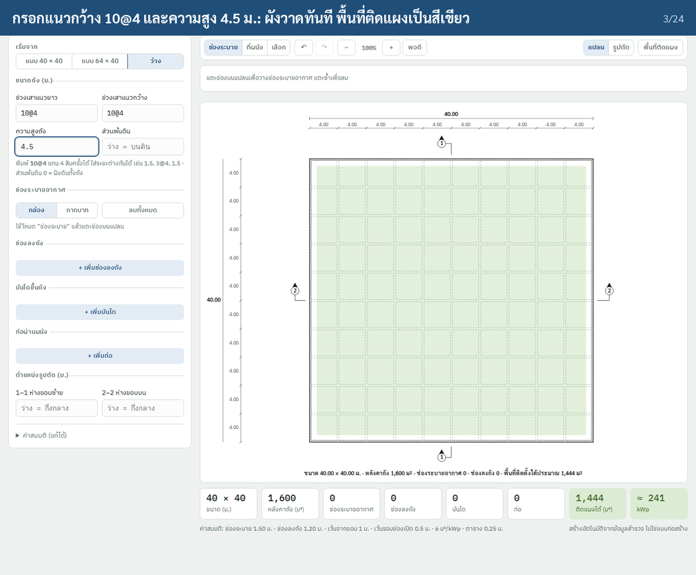
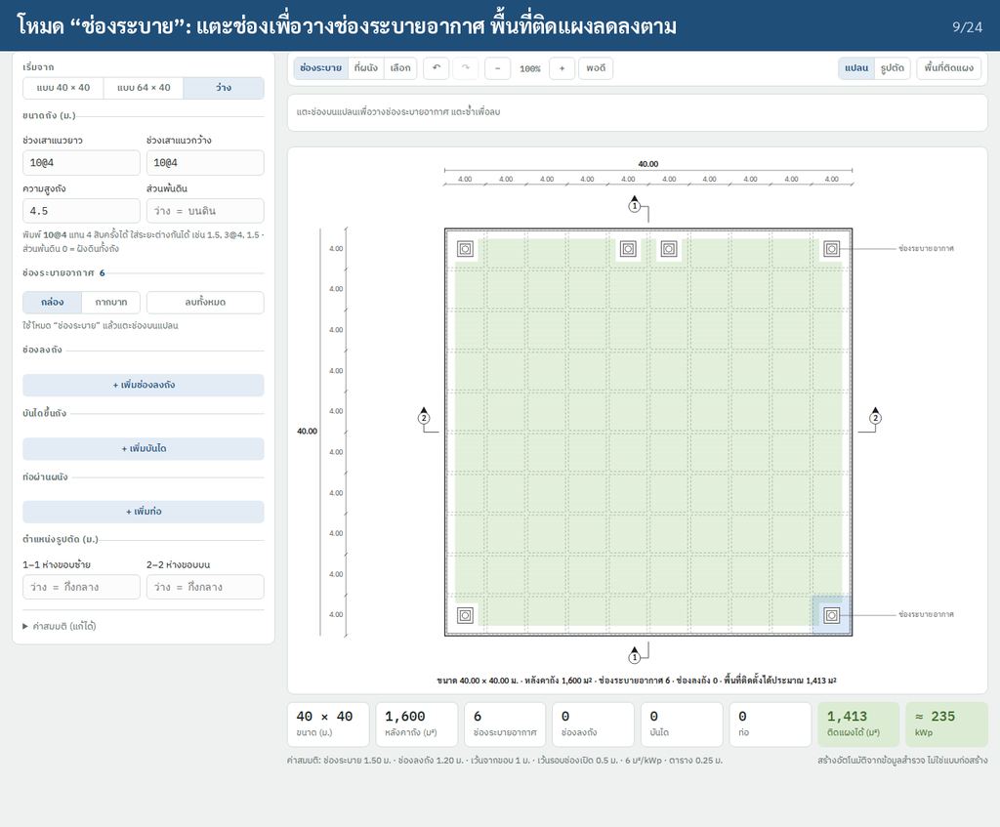
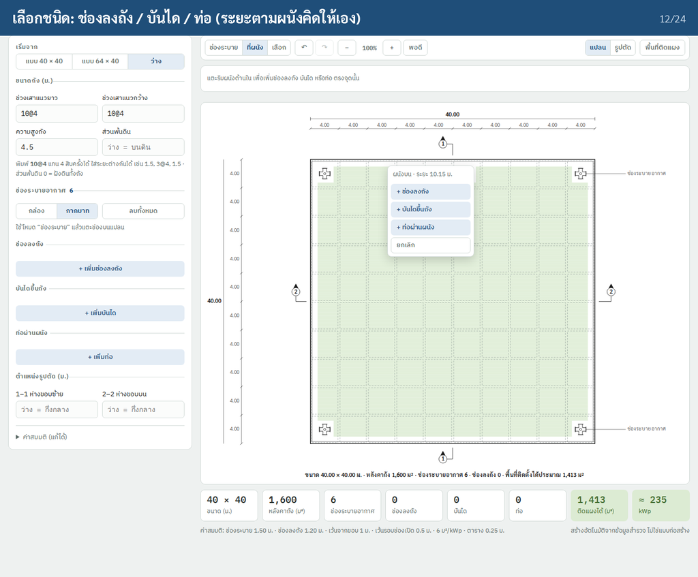
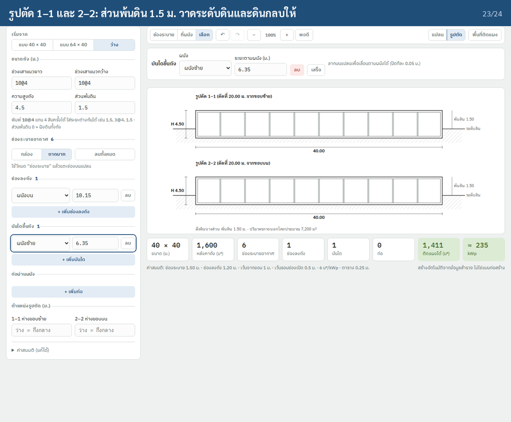

# D1 ถังน้ำใส — tank drawing and survey flow, Swift feature spec (iPad + iPhone)

**Status:** Mostly built (2026-10-19). Built: the D1 page with four sub-steps, sub-step 1 `ขนาดถัง` (presets, span editor, compass sheet), sub-step 2 `สิ่งกีดขวาง · เงาบัง` (standard points checked on site, drag, distances, add, row, bulk confirm, `เริ่มจากแบบมาตรฐาน กปภ.`, the shading questions with the object's height and distance), sub-step 3 `จัดแผง` (`TankLayout`, offsets, `หาผังแผงมากสุด`, panel edits, three checks, the shade simulation `TankShade`), sub-step 4's designed photo groups (the new ones optional), undo (`↶` / `↷`, ⌘Z), the tank sections and the row section (`TankDrawings`, also in the B1-C3 sheet), the layout, shade and sections in the PDF, the layout lines in Excel, and `ส่งออก DXF`. Not built: `บันทึกจาก GPS`, iPhone shake to undo, and the interaction draft's tool modes (§4.3). Decided 2026-10-19: the new photo slots stay optional; the shade recommendation goes to E1 when objects cost 1 % or more.
**Design:** the TCRoof canvas D1 pages (`iPadD1` ขนาดถัง, `iPadD1Obs` สิ่งกีดขวาง, `iPadD1Layout` จัดแผง, `iPadD1Shade` เงาบัง, `iPadD1Photo` ภาพถ่าย) and the folders [`docs/ui/survey-d1-size`](../ui/survey-d1-size) (iPad), [`survey-d1-size-iphone`](../ui/survey-d1-size-iphone), [`survey-d1-obstacles-iphone`](../ui/survey-d1-obstacles-iphone), [`survey-d1-layout-iphone`](../ui/survey-d1-layout-iphone). The app follows the folders where they differ from the canvas.
**Design rules and drawing standard:** [`auto-drawing.md`](auto-drawing.md) §5–§7
**Types and code detail of the first draft:** [`auto-drawing.md`](auto-drawing.md) §8 Tank, §9 UI, §10 PDF, §11 tests (the app did not build those types; see §2)
**Mounting layout algorithm (sub-step 3):** [`tank-mounting-layout.md`](tank-mounting-layout.md). This spec gives only the D1 behaviour.
**Standard designs:** [`standard-designs.md`](standard-designs.md) (`TCRoofCore/TankDesign.swift`)
**Older visual reference:** `img/tank_pwa.png` (64 × 40), `img/tank_40x40.png` (40 × 40), [`prototype/tank-layout.html`](prototype/tank-layout.html) (the interaction prototype; demo `img/tank_demo.mp4`, 24 steps, regenerated with `node prototype/tank-demo.js <outDir>` in Playwright). Still valid for the plan's drawing style.
**Code:** `TCRoofCore/Tank.swift`, `TankPlan.swift`, `TankPoints.swift`, `TankDesign.swift`, `TankLayout.swift`, `TankDXF.swift`; `TCRoofUI/Survey/Pages/Tank/`
**Targets:** `TCRoofKit` in the TCRoof app, iOS 17+, iPad and iPhone
**New dependencies:** none

## What changed from the 2026-09-29 draft

| Draft | Now (D1 as built) |
|---|---|
| tank size from `spansX` / `spansY` typed as `16@4` | pick a **preset** (40 × 40, 64 × 40, 30 × 30, 20 × 20), which writes the spans, or **`+ กำหนดขนาดเอง`**, which opens the span editor on the plan. The spans stay the only stored size. |
| round tank (`tankDiameter`) in the form | not in D1 |
| `tankType` (ชนิดถัง) | still asked and required: completion, the PDF and Excel read it |
| `tankAboveGround` always asked | `tankExposed` (`ส่วนพ้นดิน`), typed only when `tankPos` = กึ่งฝัง; บนดิน = height, ฝังดิน = 0 |
| `surface` free text | `surface` picked from คอนกรีต / คอนกรีตเคลือบกันซึม / ดินปลูกหญ้า / หินกรวด, or `อื่นๆ` typed |
| no orientation | `tankAzimuth`: the direction wall A faces, measured with the device compass and camera; the N arrow turns by it |
| vents placed by tapping bay cells, hatches by tapping a wall | openings come **pre-placed** from a standard layout; the surveyor checks each one (มีตรงแบบ / ไม่มีจริง), drags it or types its distances; can add, repeat as a row, delete what was added |
| ladders, pipes, `ventStyle`, section marks as inputs | ladders and pipes come only from a standard design (`TankDesign`); no `ventStyle` input, no sections |
| usable area (green raster, m² ÷ 6 = kWp) | replaced by the real **panel layout** in sub-step 3 |
| one page with a drawing card | four sub-steps on one D1 page, each with a derived done state |

## 1. The D1 page

The page has four sub-step tabs across the top (`TankPageWide.steps`). Each tab shows its number, which becomes ✓ when done, its name, and a one-line status under the name:

| # | Tab | Status line when done | Status when not done | Done when |
|---|---|---|---|---|
| 1 | ขนาดถัง | size, e.g. `40 × 40 ม. · เสร็จ` | `ยังไม่เสร็จ` (orange) | spans, type, height, position and surface set (`Tank.sizeDone`); the azimuth is optional |
| 2 | สิ่งกีดขวาง · เงาบัง | `{n} จุด · เสร็จ` | `ตรวจแล้ว {n}/{m}`, or `ยังไม่ตอบเงาบัง` | every standard point has a status (`TankPoints.done`) and the `เงาบัง` group is complete |
| 3 | จัดแผง | `{panels} แผง · เสร็จ` | `ตรวจผ่าน {k}/3` | a layout is stored and its three checks pass (`TankLayout.done`) |
| 4 | ภาพถ่าย | `บังคับ {k}/{n}` | same | the form's `ภาพถ่าย` group is complete |

- Done is derived from the answers, not from pressing `ถัดไป`.
- Each sub-step ends with `ถัดไป · {next} ›`. The tabs can be tapped in any order. The sub-step shown is view state, never stored in the job.
- The page bar's title is `ถังน้ำใส · ขนาด สิ่งกีดขวาง/เงาบัง จัดแผง ภาพ`.

**Layout on iPad landscape:** the plan card on the left, the step's card (330 pt) on the right. In portrait or a free width under 1100 pt, one column: the plan on top, the card below. The editor's bottom bar is as on the other pages; while required photos are missing its line reads `ยังขาดภาพบังคับ {k} ภาพ` (`Tank.statusLine`).

**Plan drawing (all sub-steps, `TankPlan`):**
- กปภ. style: grid bubbles 1… across the top and A… down the left, double wall, dashed column grid, span chains along the bottom and the right with the totals, `ระดับหลังถัง +{exposed}` tags in the four quadrants.
- Obstacles: vents and hatches as hatched red boxes with `{label} {w}x{h}`; ladders and pipes as small boxes just outside their wall. Points marked `ไม่มีจริง` are left out.
- The north arrow turned by −`tankAzimuth`. Wall A stays on top; only the arrow turns.
- Caption `แปลนหลังคาถังน้ำใส {W} × {L} ม.` and `หน่วย: เมตร`.
- iPhone draws a 330 × 300 plan (`TankPlan.compact`): outline, grid names, the two totals, the arrow.

### Sub-step 1 — ขนาดถัง

Card `ข้อมูลถัง`:

| Control | Field | Behaviour |
|---|---|---|
| `ขนาดถัง *` | `spansX`, `spansY` | Presets below, or `+ กำหนดขนาดเอง (กว้าง × ยาว)`, which opens C1's span editor on the plan (iPhone: on the full-screen plan). A size that is no preset shows `{W} × {L} ม. · กำหนดเอง`. Changing the size with obstacles placed asks first (`เปลี่ยนขนาดถัง?`, `ตำแหน่งสิ่งกีดขวางเดิมอาจอยู่นอกแปลน`). Each span number on the plan is a button that opens the editor. |
| `ชนิดถัง *` | `tankType` | ค.ส.ล. / เหล็ก / FRP / อื่นๆ (typed). Not in the design; kept because completion, the PDF and Excel read it. |
| `ความสูงถัง (ม.) *` | `tankHeight` | stepper 0.10, min 1.00 |
| `ส่วนพ้นดิน (ม.)` | `tankExposed` | stepper 0.10, clamped to 0…height. Enabled only for กึ่งฝัง (1.20 the first time); shows the height or 0 otherwise. |
| `ตำแหน่งถัง *` | `tankPos` | บนดิน / ฝังดิน / กึ่งฝัง |
| `ผิวหลังคา *` | `surface` | the four surfaces, or `อื่นๆ` typed |
| `ดินกลบลึก (ม.)` | `soilDepth` | stepper 0.05 |
| `ทิศของถัง` | `tankAzimuth`, `tankAzimuthSrc`, `tankAzimuthAt`, `tankAzimuthAcc` | `ผนังบน (แนว A) หันไปทิศ {az}° {direction}`, button `วัดด้วย iPad`, or typed (0–359). Source line: `วัดด้วยเข็มทิศ iPad · ±{acc}° · {d/M HH:mm} · แปลนและลูกศร N หมุนตามค่านี้`, or `ป้อนเอง · …`. |

Presets (`Tank.presets`). A preset is recognised by its spans; the spans are stored expanded (`4,4,4,…`).

| Label | Sub | Column grid | Roof area |
|---|---|---|---|
| 40 × 40 ม. | กปภ. มาตรฐาน | 10 × 4 m by 10 × 4 m | 1,600 m² |
| 64 × 40 ม. | กปภ. ขนาดใหญ่ | 16 × 4 m by 10 × 4 m | 2,560 m² |
| 30 × 30 ม. | กปภ. ขนาดกลาง | 6 × 5 m by 6 × 5 m | 900 m² |
| 20 × 20 ม. | สถานีขนาดเล็ก | 5 × 4 m by 5 × 4 m | 400 m² |

The grids are from the design. The 40 × 40 and 64 × 40 match the กปภ. sheets in `TankDesign`; the other two are not confirmed (open question 1).

**Measuring direction (`วัดด้วย iPad`, `TankCompass`):**
1. A sheet opens with the live back camera.
2. The prompt reads `เล็งแนวผนัง A` / `ยืนที่มุม A-1 · ให้เส้นเหลืองทับขอบผนังที่วิ่งไปมุม A-{n}` (the far corner on line A).
3. A yellow guide line and the live heading are shown, with `ยืนห่างเหล็กเสริม ราวเหล็ก ท่อ ≥ 1 ม. · เกิน ±10° ให้หมุนเครื่องเป็นเลข 8`.
4. The heading locks when every reading of the last 2 s is within ±2° of their circular mean (`HeadingLock`).
5. `บันทึกมุม` stores `tankAzimuth = heading − 90°` (the outward normal of wall A), whole degrees, with the source, time and accuracy. It is enabled only while the accuracy is known and within ±10°. `วัดใหม่` starts again.
- The heading is `trueHeading` when location is allowed, else magnetic, turned by the interface orientation.
- Without a compass (the simulator) the sheet asks for the degrees instead: `อุปกรณ์นี้ไม่มีเข็มทิศ · ป้อนมุมเอง`.

### Sub-step 2 — สิ่งกีดขวาง · เงาบัง

The plan card switches between `บนหลังคา · {n} จุด` and `เงาบัง · {answer}`.

**Points (`TankPoints`).** They live in `obst` as `Obstacle`s, so the PDF and Excel keep reading them.
- **Seeding:** on first open, a tank with a size and no obstacles gets the generic standard layout scaled to its size: V1–V10 and H1–H5, unchecked (`TankPoints.layout`, `seed`).
- **Standard designs:** `เริ่มจากแบบมาตรฐาน กปภ.` (or `เปลี่ยนแบบมาตรฐาน กปภ.`) lists the designs, closest to the measured size first, and replaces the spans and every point with the chosen sheet's vents, hatches, ladders and pipes (`แทนขนาดช่วงเสาและจุดบนหลังคาทั้งหมดด้วยแบบที่เลือก จุดที่ตรวจแล้วต้องตรวจใหม่`). The card then shows `แบบ: {design}` and how the site differs. See [`standard-designs.md`](standard-designs.md).
- **Status:** `""` ยังไม่ยืนยัน (drawn dashed blue), `ok` มีตรงแบบ, `absent` ไม่มีจริง (dashed red on the card's plan; left out of the drawings, the layout and the overlap check). `ย้ายแล้ว` is derived: a standard point away from its standard position.
- **Sizes on the plans:** vent 0.60 m, hatch 0.80 m (`ventSize`, `hatchSize`; open question 3).
- **Legend:** ยังไม่ยืนยัน / ยืนยันแล้ว / ไม่มีจริง / จุดที่เลือก (orange 3 pt border).

Card for the selected point (`จุด {label} · {kind}`, chip `ตามแบบ` / `ย้ายแล้ว` / `เพิ่มหน้างาน`):
- `‹` the points still to check `›` (all points once each is checked).
- `สถานะ *`: `มีตรงแบบ` / `ไม่มีจริง`.
- `ห่างผนังซ้าย` and `ห่างผนังบน` (m, 2 decimals, number pad): the top-left corner from the left and top walls.
- The check line: `แนวเดียวกับ V10 · ไม่ทับจุดอื่น`, or `ทับ {IDs}` / `อยู่นอกถัง` in orange (`TankPoints.check`).
- `ความสูงปล่อง` (`ventHeight`, one value per tank, stepper 0.05; not measured = 1.00 m): whether panels can pass over the vents in sub-step 3.
- `เพิ่ม / แก้ไข` (aside `กรณีไม่มีในแบบ`):
  - `+ ช่องระบาย` / `+ ช่องลงถัง`: adds one at the plan's centre, moved down 1 m at a time while it would sit on another point's label, with the next free ID, status `ok`, origin `added`, and selects it.
  - `ทำซ้ำเป็นแถว`: a sheet, `ทำซ้ำ {ID} ไปทางขวาตามแถวเดียวกัน`; `จำนวนจุดที่เพิ่ม` 1–20, `ระยะห่าง` stepper 0.05 from 0.50 (default: the first column span, else 4 m); `เพิ่ม {n} จุด`. Copies that would leave the tank are skipped.
  - `ลบจุดนี้`: only points added on site; a standard point is marked `ไม่มีจริง` instead.
- `ยืนยันที่เหลือ {n} จุดว่าตรงแบบ`: marks every unchecked point `ok` together, after a question. They are kept apart as `bulk`, and the report prints them as `ยืนยันแบบรวม`.

**Shading.** The `เงาบัง` view shows the section's form questions: `shade` (ไม่มี / มี), and when shaded `shadeFrom`, `shadeDir` and `shadeNote`. The design's simulation is not built (§1 old step 4 below).

### Sub-step 3 — จัดแผง

The sub-step places the PV structure on the roof automatically (`TankLayout`). The algorithm and its numbers are in [`tank-mounting-layout.md`](tank-mounting-layout.md) §1, §3; the code's defaults (`TankLayout.Params`):

| Rule | Value |
|---|---|
| module | 2.278 × 1.134 m, 550 W (the catalogue's default), portrait, 2 up the slope, 0.02 m gaps |
| posts | front 1.00 m and back 2.00 m high, 2.80 m apart; pairs 2.70 m along the table; 0.40 m rail overhang |
| row pitch | 5.50 m (2.70 m from a back post to the next front post) |
| edge setback | 1.00 m |
| openings | hatches grown by 0.50 m remove the columns over them; vents stay under the panels when the panel underside clears `ventHeight` + 0.10 m, else they remove them |
| footings | 0.30 m, kept 0.30 m clear of every opening; a column is cut where no post pair fits |
| tables | each run of ≥ 2 free columns |
| facing | rows face the wall nearest to south, from `tankAzimuth` (the bottom wall without one) |

- **Cards:** `การวางผังแผง` (aside `ตามแบบ B1-C3 · เอียง {tilt}°`) with `จัดแผงใหม่` and `หาผังแผงมากสุด`; `สรุป · วัสดุโครงสร้าง` (panels, kWp, rows · tables, posts, footings, rails ×4, braces…); `ตรวจสอบก่อนไปต่อ`: `ใต้คานเหนือปล่อง (แผงทับได้)`, `ขอบถังถึงขอบแผง ≥ 1.00 ม.`, `ขาโครงสร้างไม่ชนสิ่งกีดขวาง`.
- **Modes on the plan:** `เลื่อนผัง` drags the whole layout (5 cm snap, setback kept); `แก้แผง` taps a panel on or off and long-presses a table to remove it.
- `หาผังแผงมากสุด` tries every offset on the 5 cm grid: stage 1 counts modules without posts, stage 2 lays out the ten best with posts. The most modules wins, then the smallest offset. It runs off the main actor with a spinner.
- `จัดแผงใหม่` and `หาผังแผงมากสุด` ask first (`ล้างการแก้แผงที่ทำไว้?`) when panels were edited by hand.
- The offsets, the turn and the panels switched off are stored (`tankPvOrient`, `tankPvOffX`, `tankPvOffY`, `tankPvOff`), and `panelsBefore` follows the panel count.
- `ดูแบบ B1-C3` opens a placeholder: `ยังไม่มีไฟล์แบบในแอป`.
- Not built from the design: energy per year, kWh/kWp, front-row shade %, the inverter / DC-AC line, roof load and walkway checks, generated notes, the table section drawing.

### Sub-step 4 — ภาพถ่าย

Built: the form's `ภาพถ่าย` group: `obstPhotos` (max 5; the first goes in the report's size frame), `aerialPhoto`, `sidePhotos` (max 3). All three are required, so the tab reads `บังคับ {k}/3`.

Built 2026-10-19: the groups below in this order, each titled with บังคับ / ไม่บังคับ; `sidePhotos` takes 4; the three new fields are optional, so the tab still reads `บังคับ {k}/3` (`{k}/9` once the team makes them required); the PDF prints them after the side photos. A tap on a photo opens `ภาพที่เลือก` (`PhotoDetailSheet`, through the `photoDetails` environment): when, where (with a small map) and the camera's facing, `หมายเหตุ`, `ถ่ายใหม่`, `ลบภาพ`, and for obstacle photos `ผูกกับจุด` (the tank's points not marked absent, `บันได`, or a typed range of one kind such as `V1–V10`: `TankPoints.tag`). The tag and note (`Photo.tag`, `Photo.note`, optional) show on the photo and under it in the PDF.

| Group | Slots | Field |
|---|---|---|
| ภาพมุมสูง (โดรน หรือ Google Maps) | 1 required | `aerialPhoto` (existing) |
| ผนังถัง 4 ทิศ (ใช้วางแนวรางสายไฟ) | 4 required: N / S / E / W | `sidePhotos` (existing, max to be raised from 3 to 4, labelled by direction) |
| หลังคาถัง (ภาพรวม + ผิวหลังคา) | 2 required | `roofPhotos` (new) |
| เงาบัง (ถ่ายจากกลางหลังคา) | 1 required | `shadePhoto` (new) |
| ทางเดินสายไฟ (จากถังถึงห้อง Inverter) | 1 required | `cablePhoto` (new) |
| สิ่งกีดขวาง (ไม่บังคับ · ผูกรหัสได้) | any | `obstPhotos` (existing). Each photo can be tagged with an opening ID (`V9`, `H1`, a range `V1–V10`, or บันได). |

- **Selecting a photo** shows `ภาพที่เลือก`: name, time and GPS, `หมายเหตุ`, `ถ่ายใหม่`, `ลบภาพ`, and `จุดถ่ายภาพ` (small map from the photo's GPS, `บันทึกจาก GPS`).
- The new photo fields stay optional until the team agrees to make them required (open question 4).

### Old step 4 — เงาบัง simulation (built 2026-10-19 in sub-step 3)

Built as sub-step 3's card `เงาบัง · จำลองทั้งปี` and the PDF's `เงาบัง (จำลองทั้งปี)` (`TCRoofCore/TankShade.swift`,
`TankDrawings.heatMap`): over `SolarModel`'s clear-sky year, a panel of the stored layout loses its direct sun (diffuse
kept) to the row in front (tank-mounting-layout.md §3a step 4 with the portrait-2 rule; the front row never) or to the
objects beside the tank: each direction in `shadeDir` is a long object (the whole side, ค่าสมมติ) `shadeHeight` above the
ground (new, optional) and `shadeDistance` from the wall (new, optional), taken against each panel's centre height
above the roof plus the tank's exposed part. The card shows `เงาแถวหน้า %`, `เงาสิ่งบัง %`, `สูญเสียรวม %` and
`MWh/ปี` lost to the objects, one recommendation (the height to cut to for under 1 % loss, in 0.5 m steps), a moment
on the plan (21 มี.ค. / มิ.ย. / ธ.ค. at 09:00 and 15:00, the shaded panels orange) and the month × hour map. The
recommendation is not yet carried to E1. The design below is the reference.

**Left: `จำลองเงาบัง`.** Shadow snapshots on the plan for 21 มี.ค., 21 มิ.ย. and 21 ธ.ค. at two times each, and a heat map `สัดส่วนแผงที่โดนเงา รายเดือน × รายชั่วโมง` (legend ไม่มีเงา / เงา 25% / ≥ 50% / กลางคืน).

**E1 (built 2026-10-19):** `RemarkSuggestions.shade` quotes the simulation (`ตัดแต่งต้นไม้ด้านใต้ ถังน้ำใส 1 ให้สูงไม่เกิน 6 ม. (เงาทำให้เสีย 3.2%, 4.1 MWh/ปี)`) when a layout and the object's height are there and the objects cost 1 % or more, and leaves the line out below that; without them it keeps the older line.

**Right: `สิ่งที่บังแดด`.** The existing `shade`, `shadeFrom`, `shadeDir`, plus new `shadeHeight` and `shadeDistance` (`ห่างผนังถัง (ม.) *`) when shaded. Results: `เงาแถวหน้า %`, `เงาต้นไม้ %`, `สูญเสียรวม %`, `MWh/ปี ที่เสียจากต้นไม้`, and one recommendation line recorded as a proposal for E1. `shadeNote` stays; old jobs show their note until height and distance are entered.

## 2. Pipeline (TCRoofCore, no UIKit)

```
Values (.tank) ─► Tank           size label, preset, height / position / exposed, azimuth, sizeDone, photo completion
               ─► TankPoints     standard points, status, drop (snap + magnet), check, add / repeat / delete
               ─► TankDesign     standard sheets, match by size, apply, summary of the differences
               ─► TankPlan       Sketch + span chips + DXF tags + frame (ox, oy, points per metre)
               ─► TankLayout     tables, panels, posts, cuts, BOM, checks; auto / best offsets
               ─► TankDXF        plan + layout at real scale, mm, Y up
Drawings.plan(tank: true) ─► TankPlan.sketch, for the PDF and the Excel plan frame
```

- A drawing is `nil` without spans; the plan card then shows an empty frame and `เลือกขนาดถัง`.
- `TankLayout.current` caches its last answer, as one render asks for it from several cards.
- The first draft's `TankInput` / `TankGeometry` / `TankDrawings` / `MountLayout` / `ShadeModel` (`auto-drawing.md` §8) were not built.

## 3. iPhone (compact width)

- The phone design (`survey-d1-size-iphone`, 390 × 844): the step line with the photo chip, the four sub-steps as numbered circles, then each sub-step as numbered cards in one scroll. The bottom bar's ‹ › step through the sub-steps (`JobEditor.tankSubSteps`).
- Sub-step 1 draws the compact plan; the full plan with its span numbers opens full screen.
- Sub-steps 2 and 3 draw the 330 × 300 plan with their points or panels, and open it full screen with pinch or − / + zoom (1–4×) and the selected point or the panel count under it.
- iPad shows the same cards of sub-steps 2 and 3 in two columns.

## 4. Interaction

### 4.1 Points on the plan (sub-step 2, built)

- **Tap** a point (44 pt target on its 12 pt symbol) to select it.
- **Drag** moves it after 4 pt of travel (`TankPoints.drop`):
  - The top-left corner snaps to 0.05 m and stays inside the tank.
  - Within 0.30 m of another point's column or row (centre line), it takes it; a teal guide shows that line.
  - A ladder or a pipe slides along its wall only.
  - While a point is selected or dragged, a teal guide shows the points on its row / column and a tag its distance from the left wall.
- Typed distances move the point the same way (snap, clamp), without the magnet.
- Any move or status change clears `bulk`.

### 4.2 Layout plan (sub-step 3, built)

- `เลื่อนผัง`: drag the whole layout; the offset snaps to 5 cm and keeps the setback.
- `แก้แผง`: tap toggles the panel under the finger (or the nearest within 10 pt); a long press removes its table.

### 4.3 From the interaction draft (prototype, not built)

The 2026-09-29 draft and `prototype/tank-layout.html` worked out an editor with tool modes. The D1 design replaced the modes with pre-placed points, so these stay as reference for later work.

| Type sizes → drawing appears | Tap bays → vents | Wall tap → pick opening | Section 1–1 / 2–2 |
|---|---|---|---|
|  |  |  |  |

- **Undo** (designed in D1 too: `↶ เลิกทำ`, last 30 steps): `UndoManager` with snapshots of the module's values. A whole drag is **one** step (keep the values at touch-down; register only if it moved). Typing a number is one step per field focus. Undo clears the selection. iPad ⌘Z / ⇧⌘Z; iPhone shake.
- **Loupe** (D1 design): while dragging, a loupe follows the finger with `ซ้าย 16.80 · บน 16.40 ม.`; on iPhone it sits above the finger. The app shows the guide and distance tag instead (§4.1).
- **Vent by bay:** a tap finds the bay **from the coordinates** (binary search over the span edges), never by hit-testing drawn shapes: leader lines and symbols lie on top of bays and blocked taps in the first prototype. A bay under 28 pt on screen zooms in first, to at least 32 pt, with a one-time hint `ช่องเล็กเกินไปสำหรับนิ้ว จึงซูมเข้าให้ก่อน แตะอีกครั้งเพื่อวางช่องระบาย`.
- **Wall tap:** accept a tap within 18 pt of the nearest wall (up to twice that just outside it); `along` is rounded to 0.05 m; a menu titled `ผนังบน · ระยะ 10.15 ม.` offers `+ ช่องลงถัง`, `+ บันไดขึ้นถัง`, `+ ท่อผ่านผนัง`, `ยกเลิก`.
- **Zoom about the finger:** new scroll = (old scroll + p) × new / old − p. Double tap toggles fit ↔ 2×. iPad keys: ⌫ deletes the selection, Esc closes the menu then clears the selection, ⌘+ / ⌘− / ⌘0.
- **Sections:** 1–1 cuts at half of Σ spansX and shows the tank across Σ spansY; 2–2 cuts at half of Σ spansY across Σ spansX. Ground line: at the base above ground; at the roof plus 0.50 m soil cover (assumed) when buried; in between at H − exposed with a `พ้นดิน x.xx` dimension. Wall and slab 0.30 m (assumed), columns at inner grid lines, soil hatched. Footer `ปริมาตรภายนอกโดยประมาณ … ม³`. No height: `ใส่ความสูงถังเพื่อวาดรูปตัด`.
- **Plan labels on the กปภ. sheet:** right-side labels stack in a column 80 pt right of the wall, left-side ones 70 pt left, at least 17 pt apart; the same text within 16 pt shares one label with two leaders; one leader per row of vents; bays drawn as dashed rectangles inset by half a beam (0.15 m).
- **Messages are never modal:** red for warnings, blue for one-time hints (4 s).

## 5. Report and export

- **PDF (`ReportLayout.planSection`):** `แปลนหลังคาถังน้ำใส` from `TankPlan` (a hand sketch `planPhoto` replaces it), `จำนวนแผงก่อนเข้าสำรวจ` (`panelsBefore`) and `ที่ตัดออก`, the tank fields (height, surface, soil, type, position, shade), the obstacle table (`ไม่มีจริง` rows), the standard design's summary when the points came from one, then the aerial, obstacle and side photos. The drawing is scaled to the content width and never split across pages.
- **Layout and sections (built 2026-10-19, `TankDrawings`, `ReportLayout.tankLayoutUnits`):** `ผังจัดแผงบนหลังคาถัง` (the plan with the stored layout: panels, switched-off panels dashed, cut columns red, footings, the slope tag), its summary line (panels, kWp, MWh/ปี from `SolarModel` at the panels' tilt and facing and A1's latitude, tables, rows, tilt), the BOQ line, the three checks, the ค่าสมมติ line and the footer; `ภาพตัดโต๊ะแผง` (the standard two-row side section); `รูปตัดถัง 1–1` and `2–2` (§4.3's rule: ground by position, walls and slabs 0.30 m and 0.50 m soil over a buried tank assumed, the external volume).
- **Shade (built 2026-10-19):** `เงาบัง (จำลองทั้งปี)` after the layout: the losses, the recommendation, the month × hour map and the plan on 21 ธ.ค. at 09:00 and 15:00.
- **Excel (NO.224, sheet `บ่อน้ำใส`):** the plan image in `C3:X15` (or `planPhoto`), height, surface, soil, type and shade in the existing cells and the blank tail of rows 16/17, the standard design's counts in `N19`, the layout's summary and BOQ lines in the blank rows `A37` / `A38`, the photos.
- **DXF (`ส่งออก DXF`, `TankDXF`):** the plan at real scale in mm from the top-left corner, Y up, layers GRID, OUTLINE, DIM, OBSTACLE, NORTH, TEXT, plus PV and PV_GROUP for the stored layout.

## 6. Data compatibility

- New fields are optional and hidden, so the section's completion counts as before:
  - `tankExposed`, `tankAzimuth`, `tankAzimuthAt`, `tankAzimuthSrc`, `tankAzimuthAcc` (in the schema, hidden)
  - `ventHeight`, `tankDesign` (`TankDesign.id`, `@r` when turned), `tankPvOrient`, `tankPvOffX`, `tankPvOffY`, `tankPvOff` (not in the schema)
- `Obstacle` gains the optional `kind` (`vent` / `hatch` / `ladder` / `pipe`), `status`, `origin` (`standard` / `added`), `stdX`, `stdY`, `note`, `bulk`. Old rows read as `kind` "", `status` "" (unchecked), `origin` "", and draw as before; only standard points count toward the sub-step's done state.
- `tankType` and `surface` keep their ids, labels and Excel cells.
- `WebBackup` writes only schema fields, and obstacles only as label / x / y / w / h, so the new obstacle fields and the non-schema keys are lost on a web round-trip (open question 8).

## 7. Tests

| Kind | What | Where |
|---|---|---|
| Unit | presets → spans; `tankPos` → exposed (บนดิน = H, ฝังดิน = 0, กึ่งฝัง clamped); azimuth from the wall heading; `HeadingLock`; the plan's grid, chains, arrow and DXF tags; old tanks count as before | `TankTests` |
| Unit | seeding once only; status and `bulk`; drag snap and magnet; overlap check; add, repeat as a row (clamped), delete only added points | `TankPointsTests` |
| Unit | design match by size and turn; apply; summary | `TankDesignTests` |
| Unit | layout: setback, openings, post clearance, cut columns, ≥ 2 columns per table, best offsets | `TankLayoutTests` |
| Unit | DXF layers and scale | `TankDXFTests` |
| Snapshot | the plan for 40 × 40 with its points, and for 64 × 40 | not yet |
| Performance | layout < 30 ms per run on iPhone 12; `หาผังแผงมากสุด` < 3 s and cancellable | not yet |
| Manual (iPad + iPhone) | the `-surveyD1` states (CLAUDE.md); a 40 × 40 job through all four sub-steps; confirm, move, add and repeat points; `หาผังแผงมากสุด`; measure direction on a device; export PDF and DXF | |

## 8. Done when

- [x] Picking `40 × 40 ม.` draws the plan with V1–V10 and H1–H5 unchecked, and the N arrow follows `tankAzimuth`.
- [x] Every point can be confirmed, marked absent, dragged (0.05 m snap) or moved by distance.
- [x] Every change can be undone; a drag is one undo step (changes under 0.8 s apart are one step; `TankUndoUITests`).
- [x] Sub-step 3 never puts a footing on an opening, and columns that cannot be saved are cut.
- [x] `หาผังแผงมากสุด` never returns fewer panels than the automatic layout.
- [ ] Sub-step 4 counts `บังคับ {k}/9`, and the bottom bar lists what is missing.
- [x] Old tank jobs open unchanged.
- [ ] The web backup keeps the new keys.
- [x] The PDF shows plan, section, layout and shade with the summary and the ค่าสมมติ line.

## 9. Open questions

1. Confirm the 30 × 30 and 20 × 20 presets (size, column grid) against กปภ. drawings, and whether more sizes are needed.
2. Opening positions: the 40 × 40 and 64 × 40 sheets are in `TankDesign`; other sizes get the generic layout scaled to the tank. Who supplies the sheets for 30 × 30 and 20 × 20?
3. Opening sizes: the app draws vents 0.60 m and hatches 0.80 m; the design notes vents 1.45 m and hatches 1.15 m. Which, and fixed per design or measured per tank?
4. Should the new photo slots (roof, shade, cable route, fourth wall) become required? This changes D1 completion for old jobs.
5. Excel NO.224 has the plan in `C3:X15`: should the panel layout go there too, or somewhere else?
6. Energy per kWp (1,452 kWh/kWp in the design): which source (PVGIS, the team's yield table)? Sub-step 3 shows no energy yet.
7. Round tanks: still needed? If yes, the size picker needs a `ถังกลม · เส้นผ่านศูนย์กลาง` option.
8. `WebBackup`: should it carry the obstacle status fields and the D1 keys that are not in the schema?
9. Undo and the drag loupe are in the design but not built: still wanted, or are the guide, the distance fields and `ไม่มีจริง` enough?
10. Tank sections (รูปตัด) from the draft: still wanted in the PDF?
