# Auto mounting layout from the tank (ผังโครงสร้างแผงบนหลังคาถัง)

**Status:** Mostly built (2026-10-20). Built: the layout, its quantities and three checks in
`TCRoofKit/Sources/TCRoofCore/TankLayout.swift` (tests `TankLayoutTests.swift`); D1 sub-step 3 `จัดแผง` on iPhone and
iPad in `TCRoofUI/Survey/Pages/Tank/TankPageWide+Layout.swift` and `TankLayoutPlan.swift`
([`docs/ui/survey-d1-layout-iphone`](../ui/survey-d1-layout-iphone/CLAUDE_CODE_TASK.md)); the layout's PV layers in the
D1 DXF (`TCRoofCore/TankDXF.swift`); the row shade (`TankShade`, §3a step 4); the energy search (§3a,
`TankLayout+Energy.swift`, tests `TankEnergyTests`: `หาผังที่ได้พลังงานมากที่สุด`, gaps 2.70–4.70 m kept as
`tankPvGap`, energy tiles on card 2); the side section and the front elevation (`TankDrawings.tableSection`,
`tableFront`) in the B1-C3 sheet and the PDF; the true-south comparison (§3a, `TankLayout+TrueSouth.swift`, tests
`TankTrueSouthTests`); the team's structure standard, editable by managers (§1). Not built: the inspect mode, sliders, undo and deltas of the prototype (§4.3).
**Builds on:** tank drawing ([`tank-drawing-swift.md`](tank-drawing-swift.md), [`tank-drawing-swift.md`](tank-drawing-swift.md)),
types in [`auto-drawing.md`](auto-drawing.md) §8
**Interactive prototype:** `prototype/mount-layout.html` (open in a browser) · **Demo:** `img/mount_demo.mp4` (22 steps),
regenerated with `NODE_PATH=<global node_modules> node prototype/mount-demo.js <outDir>` (Playwright) ·
**Prototype:** `img/tank_mount.py` (run from `img/`) → `tank_mount_plan.png`, `tank_mount_section.png`, `tank_mount_front.png`
**Reference sheets (team standard):** `img/ref_mount_section.png`, `img/ref_mount_front.png`, `img/ref_mount_plan.png`

The surveyor already enters the tank (bays, vents, hatches, ladders). This feature places the PV mounting structure
on that roof automatically, using the team's tank-roof structure standard: rows of tables, posts, footings,
rails and clamps, avoiding openings. It counts the materials and checks the result; the prototype also draws the plan,
the side section and the front elevation. The surveyor enters nothing new except, where needed, the vent height and
the tank's azimuth.

The layout is **computed**, never drawn by hand. The user moves the whole layout and may **switch panels off**;
everything else (tables, posts, rails, clamps, quantities) follows. There is no dragging of single tables or posts.
**Rows follow the tank walls**, and **no leg ever stands on an obstacle**: where no clear spot exists for a post pair,
the module column there is cut and shown as a red outline.

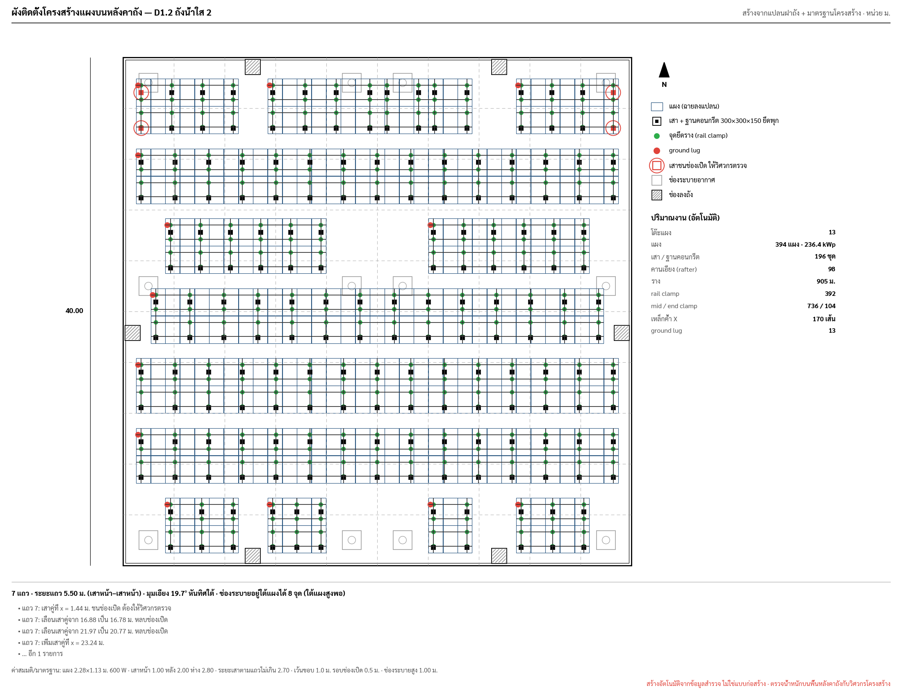

| Side section (standard) | Front elevation of one table |
|---|---|
| 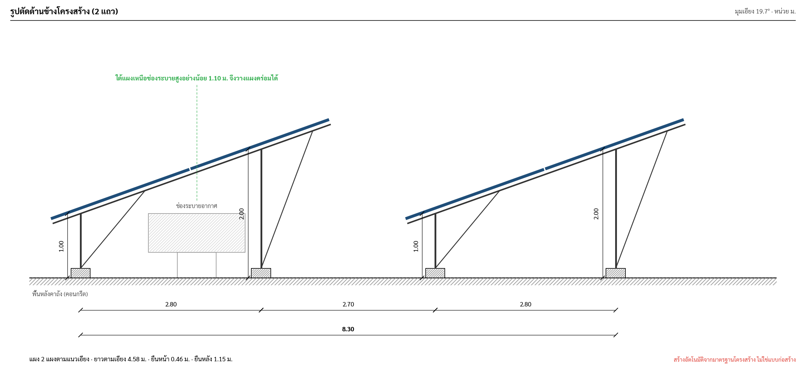 | 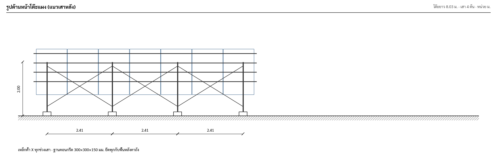 |

---

## 1. The structure standard

Taken from the reference sheets. Since 2026-10-20 it is the team's standard (`TCRoofCore/TankStandard.swift`, open
question 7 answered): one set for the team in Firestore `config/tankStandard`, the module included, changed by managers
only (`tank.standard`; the team and contractors read it) in the PWA settings' `มาตรฐานโครงสร้างแผงบนถัง`
(`TankStandardView`). These values are its built-in start (`TankStandard.builtIn`, `คืนค่าตามแบบ B1-C3`). Each tank
layout keeps a copy of the standard it was made with (`TankLayout.Key.standard`), so a saved change reaches a job only
when its layout is made again (`จัดแผงใหม่`, the energy search); D1 card 1 says when the team's standard differs from
the job's. Layouts made before keep the built-in one. The vent height stays a measurement of the tank. The prototype prints every value under the drawing as มาตรฐาน / ค่าสมมติ.

| Key | Value | Meaning |
|---|---|---|
| `moduleL × moduleW` | the catalogue's default module (`RoofPlan.Module.catalogDefault`: 2.278 × 1.134 m, 550 W) | module, portrait along the slope |
| `nSlope` | 2 | modules along the slope (slope length 4.576 m with a 0.02 m gap) |
| `hFront`, `hBack` | 1.00, 2.00 m | top of front / back post above the roof |
| `postDY` | 2.80 m | front post → back post (plan) ⇒ tilt = atan(1.00 / 2.80) = **19.7°** |
| `rowGap` | 2.70 m | back post of a row → front post of the next ⇒ row pitch **5.50 m** |
| `postDX` | ≤ 2.70 m | post pair spacing along the row |
| `endOver` | 0.40 m | rail overhang past the end posts |
| `frontOver` | 0.46 m (slope) | front post → lower panel edge (0.43 m on plan); the back overhang follows (1.15 m) |
| `rails` | 4 per table | rail clamps where each rail crosses a rafter |
| `footing` | 300 × 300 × 150 mm concrete, anchored to the slab | one per post |
| `clearance`, `openClear` | 1.0 m, 0.5 m | same setbacks as the usable-area rule |
| `legClear` | 0.30 m | footing edge → opening |
| `ventH`, `underClear` | 1.00 m, 0.10 m | vent height above the roof (0.40 + 0.60 on the sheet), clearance under the panels |
| `maxCantilever`, `minPairGap` | 1.00 m, 0.60 m | end pair → table end, least spacing between pairs (§3 step 6) |
| `bracing` | X in every post bay, front and back lines | |

Derived: table plan depth = 4.576 × cos 19.7° = **4.31 m**; panel underside height at plan distance d north of the
front post = 1.00 + d · tan 19.7°.

## 2. Inputs

| Input | Source | New? |
|---|---|---|
| tank outline, bays | D1 `spansX`, `spansY` | no |
| vents, hatches, ladders, pipes | D1 sub-step 2 points (`TankPoints`), those marked absent ignored | no |
| azimuth of the tank's top wall | D1 sub-step 1 `Tank.azimuth` (compass or typed, ° from north) | **yes**, one measurement describing the site |
| vent height | D1 `ventHeight` (ม.), one value for the tank, typed on a vent's card in sub-step 2 (`ความสูงปล่อง`, `ไม่วัดใช้ 1.00 ม.`) | **yes**, optional measurement |
| structure standard | §1 | fixed in code |

Panels face the wall nearest to south (`TankLayout.turn`): the four walls face the azimuth + 0 / 90 / 180 / 270°, and the
layout is computed in a frame turned by quarter turns so that wall is the south (+y) side, then drawn back in the
tank's frame. Without an azimuth the bottom wall faces south. The plan stays in the tank's frame; a slope tag in its
corner (`↓ ลาดลงใต้`, the arrow turned to the facing wall) shows the direction.

## 3. Layout algorithm

All in metres, in the turned frame (south is +y). `TankLayout.init`.

1. **Region:** roof inset by `clearance`.
2. **Columns:** `n = ⌊(W − 2·clearance + gap) / (moduleW + gap)⌋`, starting at the west setback plus the column
   offset `offX` (0 … the width left over). Every row uses the same columns, so tables line up north–south.
3. **Rows** from the south setback: row k has its lower panel edge at `H − clearance − offY − k·5.50`, front posts
   0.43 m north of it, back posts 2.80 m further. Stop when the upper edge passes the north setback.
   `offY` runs 0 … the depth left over modulo the pitch.
4. **Openings per row** (each opening grown by `openClear`):
   - **hatch**, or any other obstacle that is not a vent, overlapping the row → the module columns over it are removed
     (keep access).
   - **vent** overlapping the row → if the panel underside above the vent's south edge is at least `ventH + underClear`,
     the vent stays under the panels (counted as "อยู่ใต้แผงได้"); otherwise the columns over it are removed. A vent
     only inside the grown margin does not remove a column.
   - pipes and ladders stand on the walls (`TankPoints.onWall`) and do not block.
5. **Tables:** each run of at least 2 free columns is one table.
6. **Posts: legs never touch an obstacle (hard rule).** Every footing centre must be inside the tank (half a footing
   from the wall) and its footing at least `legClear` (0.30 m) clear of every opening, so the centre is at least 0.45 m
   away. Front and back posts share a rafter, so they are placed **as a pair**. Per table: try the standard equal
   spacing (`nPost = ⌈(length − 2·endOver) / postDX⌉ + 1`, from `endOver` to `endOver`); if any pair is not free, place
   the pairs greedily from the west end on a 0.05 m grid: the first pair within `maxCantilever` of the table end
   (nearest `endOver`), each next pair at most `postDX` further and at least `minPairGap` away (the furthest free spot),
   the last pair within `maxCantilever` of the east end. If no free spot exists, the **module column where it fails is
   cut** (the table is shortened or split) and the parts are posted again. Cut columns are drawn as red dashed
   outlines ("ตัดแผงเพื่อไม่ให้ขาโครงสร้างชนสิ่งกีดขวาง" in the prototype). There are no flagged posts: every drawn leg is clear.
7. **Quantities** (`TableBOM` per table with a panel on, summed in `BOM`): modules, kWp, posts = footings, rafters =
   pairs, rail length (4 × table length), rail clamps (4 × pairs), mid clamps (2 per module joint per module row),
   end clamps (2 per end per module row), X braces (2 per bay), ground lugs (1 per table).
8. **Checks** (`Checks`, the sub-step's three before going on): the least headroom over a vent under the panels
   ≥ `underClear`; tank edge to the nearest panel ≥ `clearance`; every built table has at least 2 pairs and every
   footing clears every opening. The sub-step is done when a layout is stored and all three pass (`TankLayout.done`).

The automatic layout (`TankLayout.auto`) centres the columns (`offX` half the leftover, snapped to 5 cm) and starts the
rows on the south setback (`offY` 0).

Results on the D1 40 × 40 preset with the standard points (`TankLayoutTests`, 550 W module, automatic layout): 7 rows,
13 tables, 410 modules, 6 vents under the panels, 2 columns cut. Without obstacles: 7 tables of 32 columns, 448 modules.
The Python prototype (600 W, 2.28 × 1.13 m module) gave 7 rows, 13 tables, 394 modules and 236.4 kWp before the
no-collision rule, with 8 vents under the panels.

### Best layout (`หาผังแผงมากสุด`, `TankLayout.best`)

Every `offX` and `offY` in their ranges on the 0.05 m grid. Stage 1 counts modules without posts (fast); stage 2 lays
out the ten best with posts, because a cut column can change the order. The most modules wins; ties go to the first
found (the smaller `offY`, then `offX`). It runs off the main thread with a spinner in the button; the result is never
fewer modules than any offset tried, including the automatic one. The prototype's version stepped the row offset by
0.10 m over a whole pitch and the column offset by 0.05 m over a module width (≈ 1,300 layouts) and broke ties by fewer
cut columns; on its 40 × 40 fixture it went from 386 modules at offsets 0 / 0 to **408 modules (244.8 kWp)** at row
offset 0.30 m, column offset 0.05 m, with 0 legs on obstacles.

## 3a. Accurate layout: best energy per year

The app maximises the module count. The accurate version (`img/tank_mount_opt.py`) also scores layouts by **annual
energy**, because the tank is rarely square to the compass and closer rows shade each other.

**Site inputs:** the tank's azimuth (above; the D1 compass fills it) and the latitude from the survey GPS (`gps`, A1),
required for the energy model.

**Method**

1. **Orientation: the team rule, rows follow the tank (ขนานผนังถัง).** Panels face the wall side nearest to south;
   the panel azimuth is the wall's offset from south (≤ 45°) and is used in the energy model. True-south rows are computed
   for the comparison chart only:
   - **หันทิศใต้จริง**: rows run exactly east–west (panel azimuth 0°). The tank, its setbacks and openings are rotated
     into that frame, so tables sit at an angle to the walls.
   - **ขนานผนังถัง**: rows parallel to the wall that faces closest to south.
2. **Geometry in any rotation:** module slots, footings and grown openings are polygons; a slot is valid when all its
   corners are inside the inset tank and it does not intersect a grown hatch or a too-low vent (separating axis test);
   footings follow §3 step 6.
3. **Sun model, whole year, 15-minute steps (every 3rd day):** NOAA-style sun position from latitude, clear-sky GHI
   (Haurwitz) scaled by 0.72 for Thai haze and clouds, Erbs diffuse split, isotropic sky, albedo 0.20, PR 0.80. It gives
   about 1,450–1,480 kWh/kWp·yr at 17° N, in line with Thai PV yields; the absolute value is ประมาณ, the comparison is what
   matters.
4. **Row-to-row shading** in the rows' own plane: profile angle `tan αp = tan α / cos(γs − γp)`, shaded share of the
   next row's slope `f = 1 − (pitch / slope) · sin αp / sin(αp + β)`. **Portrait-2 electrical rule:** a shadow over the
   bottom 4 % of the slope drops the whole bottom module's beam (its three bypass substrings all lose their bottom cells);
   past 54 % the top module goes too. The south-most row is unshaded.
5. **Search:** row gap from the standard 2.70 m up to 4.70 m (0.20 m steps) × row offset (0.20 m) × column offset
   (0.10 m), in the two stages of the best layout above. For each gap the layout with the most modules is kept; then
   the gap with the highest **MWh/yr** wins. Row gaps below the standard are never tried (maintenance access and
   bracing). About 16 s in Python for both orientations.

**Result (prototype), กปภ. 40 × 40 tank, 17.0° N, top wall facing 12°:**

| Orientation | Row gap | Modules | kWp | kWh/kWp·yr | Row shading | MWh/yr |
|---|---|---|---|---|---|---|
| **ขนานผนังถัง (azimuth +12°)** | 2.70 | 404 | 242.4 | 1,452 | 1.9 % | **352.0** ← chosen (6 columns cut so no leg touches a vent) |
| ขนานผนังถัง | 3.10 | 370 | 222.0 | 1,467 | 0.8 % | 325.9 |
| หันทิศใต้จริง (comparison only) | 2.70 | 368 | 220.8 | 1,455 | 1.8 % | 321.3 |
| หันทิศใต้จริง (comparison only) | 3.50 | 330 | 198.0 | 1,475 | 0.3 % | 292.1 |

Legs on obstacles in the chosen layout: **0** (198 posts, all footings ≥ 0.30 m from every opening).

What this says:

- Turning the rows 12° to face true south gains only about 0.2 % per kWp but loses 48 modules to the rotated fit, so the
  wall-parallel layout makes about **10 % more energy**, which supports the team's rule to follow the tank (the rule
  the app builds).
- The team's 2.70 m row gap costs about 1.9 % to shading at 17° N; wider gaps shade less but remove whole rows. The
  standard gap is the best choice for this tank.

| Chosen (follow the tank, best energy) | True south (comparison only) | Energy by row gap |
|---|---|---|
| 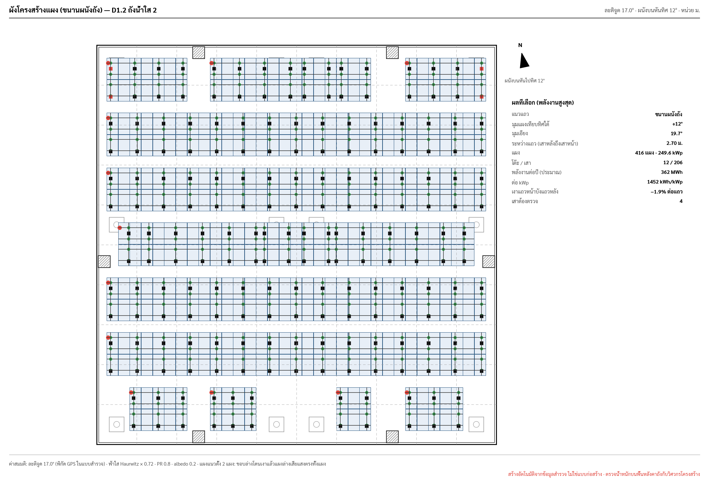 | 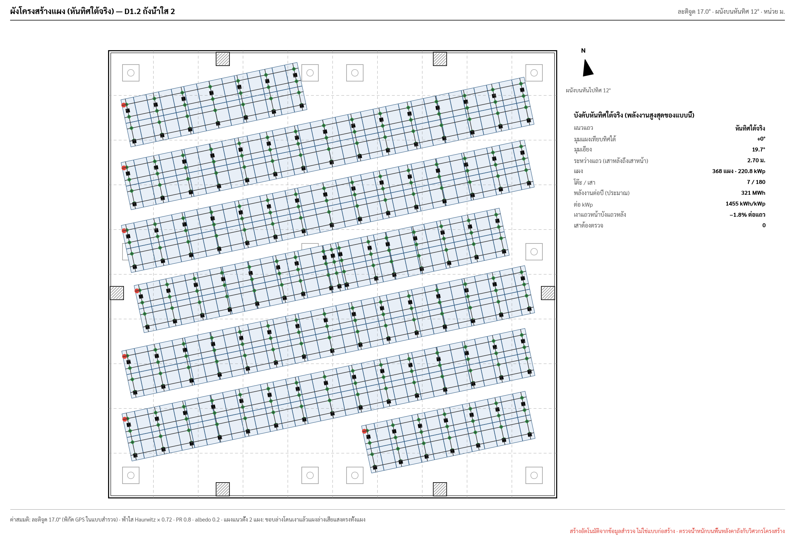 | 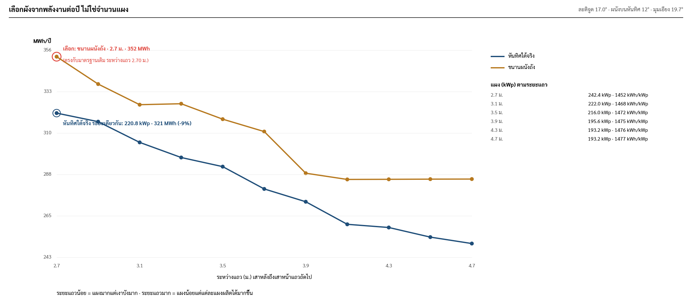 |

Built (2026-10-20): `หาผังที่ได้พลังงานมากที่สุด` replaces `หาผังแผงมากสุด` (`TankLayout.bestEnergy`). The standard gap
gets the full 5 cm offset search (so the module count never drops below the old button's), the wider gaps the coarser
pass above, and a wider winner is searched again on the 5 cm grid; energy is net of the row shade and of the objects
beside the tank (`TankShade`), on every 6th day at half hours. About 1.5 s on the 40 × 40 fixture (Mac, Debug). The gap
is stored as `tankPvGap` only when wider than the standard; `จัดแผงใหม่` goes back to 2.70 m. Card 2 shows MWh/ปี,
kWh/kWp·ปี and the row shade from card 4's simulation, and a line under the buttons lists the gaps tried. Swift results
on the 40 × 40 fixture with the standard points, 17° N, top wall facing 12°, 570 W module: 2.70 m 418 modules 346.3
MWh/yr (row shade 1.7 %), 3.10 m 382 modules 319.6, 4.70 m 320 modules 269.4; the standard gap wins, as in the
prototype.

Built (2026-10-20): the true-south comparison (`TankLayout.trueSouth`, `compareSouth`). The tank, its setback and its
openings are turned into a frame whose rows run east–west; a module is placed when its four corners are inside the
setback and it misses every grown hatch and every too-low vent (separating axes), and its posts use the same pair
placement as the wall layout (`TankLayout.post`). Unturned, it gives the wall layout's modules and posts exactly. It is
searched over the same gaps (offsets 0.10 / 0.20 m, the winner again on 5 cm) and scored with the same shade model
facing south. It runs after `หาผังที่ได้พลังงานมากที่สุด` when the walls are 1° or more off south; card 1 shows one
line and `ดูผังเทียบ` opens the turned plan and both layouts' numbers. Nothing is stored. Swift result on the 40 × 40
fixture (17° N, 12°, 570 W): 382 modules, 317.0 MWh/yr, 8.5 % less than the wall layout's 418 / 346.3.

## 4. Interaction

| Auto layout on open | Tap a vent: fits under | Tap a vent: too low | Best layout found |
|---|---|---|---|
| 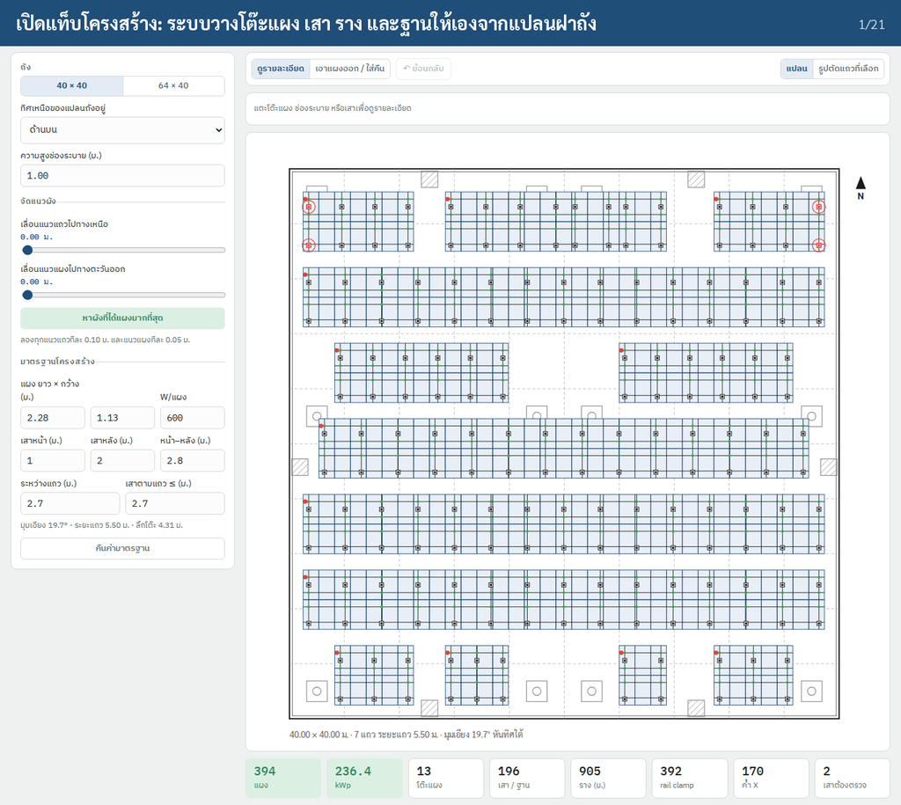 | 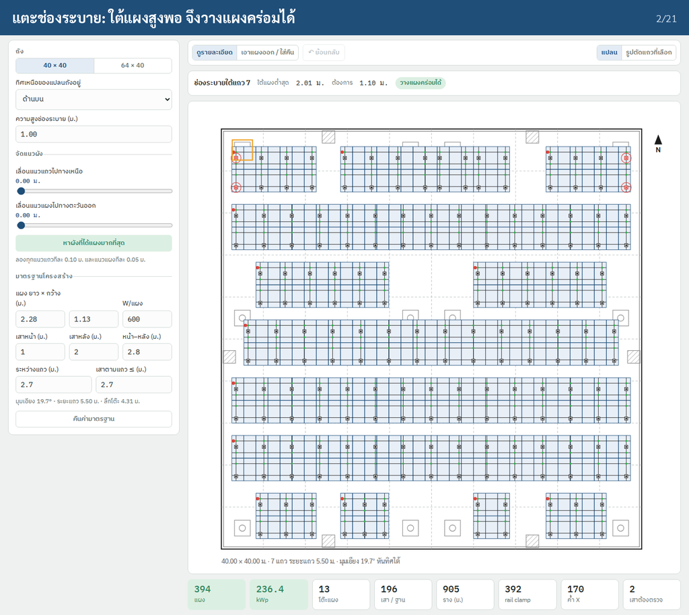 | 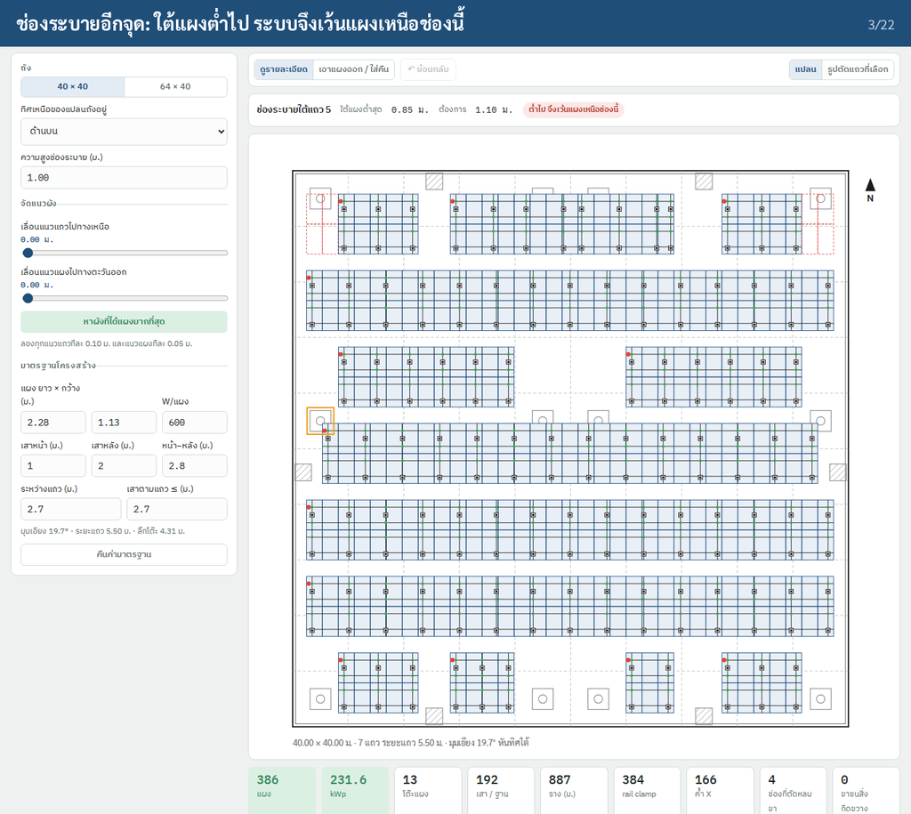 | 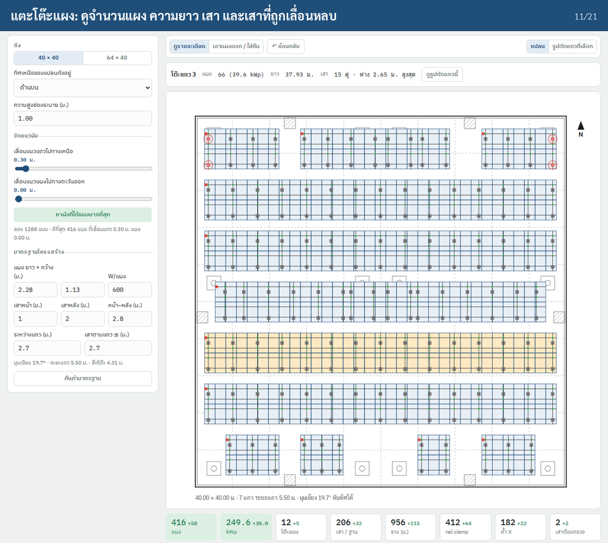 |

| Column cut so no leg hits a vent | Tap a table | Section of that row | North on the right |
|---|---|---|---|
| 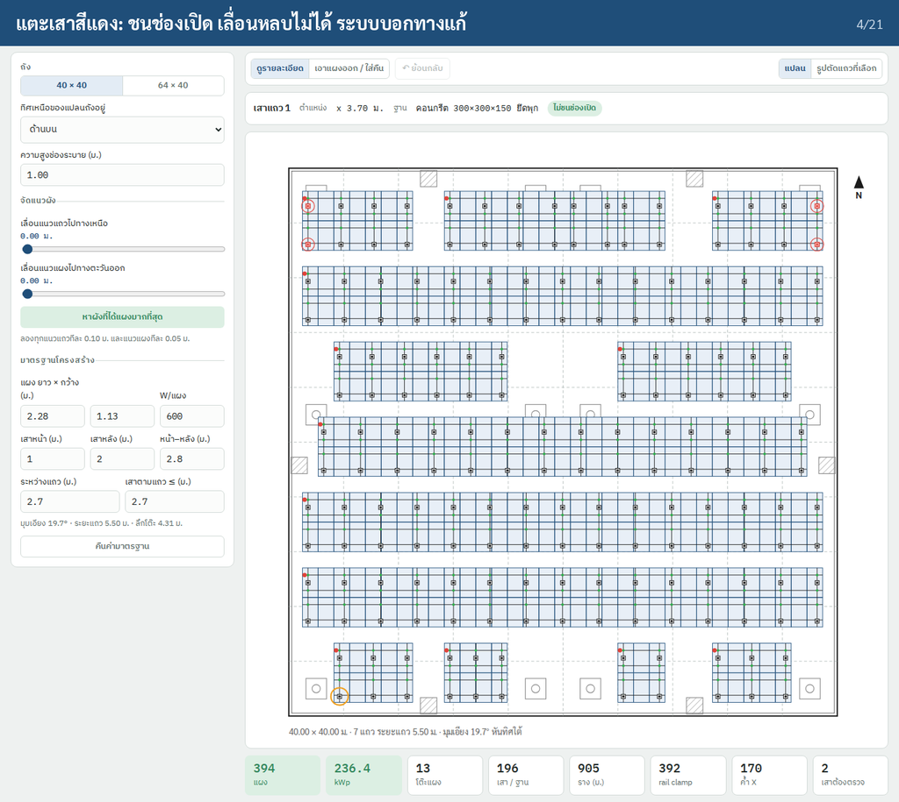 | 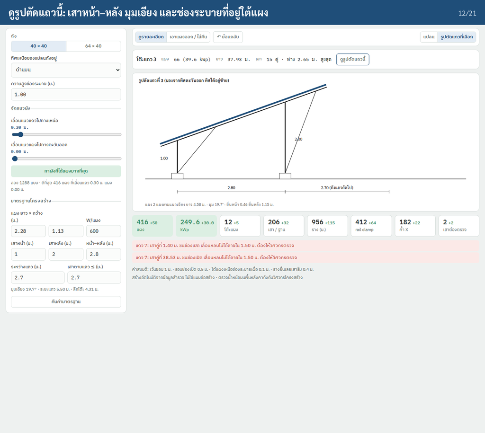 | 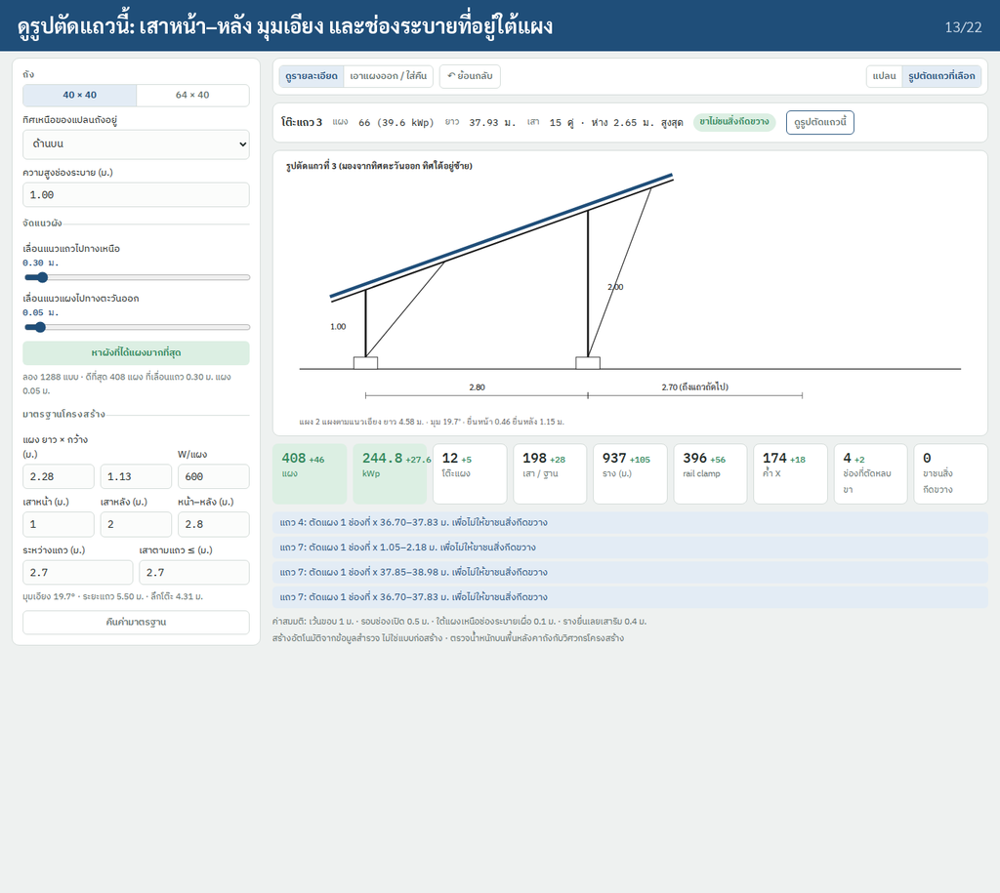 | 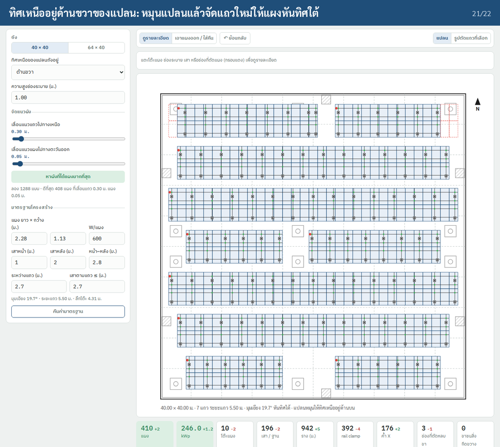 |

The pictures are the prototype (`prototype/mount-layout.html`). The app builds part of it as D1 sub-step 3 `จัดแผง`
(after `ขนาดถัง` and `สิ่งกีดขวาง`, before `ภาพถ่าย`), from the board in `docs/ui/survey-d1-layout-iphone`.

### 4.1 Built: D1 `จัดแผง`

**Open the sub-step.** The first time for a tank, the automatic layout (§3) is computed and stored. Later opens recompute
from the stored offsets and write `panelsBefore` again, since sub-step 2 may have changed.

**Card 1 `การวางผังแผง`** (aside `ตามแบบ B1-C3 · เอียง 19.7°`):
- segment `เลื่อนผัง` / `แก้แผง`;
- the plan (`TankLayoutPlan`, on `TankPlan.compact`): obstacles faint (vents solid, others dashed), panels on in blue,
  panels off as blue dashed outlines, cut columns as red dashed outlines, a teal guide along each table, posts as dots,
  the slope tag; a button opens it full screen (zoom 1–4× by pinch or − / +, the count under it);
- caption `แผงโมโน 550 W · แตะแผงเพื่อแก้` (the module's watts);
- `จัดแผงใหม่` (the automatic layout) and `หาผังแผงมากสุด` (§3 best layout). When panels were switched off by hand both
  ask first: `ล้างการแก้แผงที่ทำไว้?`, `แผงที่ปิดหรือโต๊ะที่เอาออกจะกลับมาตามผังอัตโนมัติ`.

**`เลื่อนผัง`:** drag the whole layout. The offset follows the finger, snapped to 5 cm and kept within the setback
range; the plan relayouts only when the snapped offset changes, and the layout is stored on release.

**`แก้แผง`:** tap a panel (or the nearest within 10 pt) to switch that one module off or on; a long press (0.5 s, with a
haptic) switches off every panel of its table. Switched-off panels leave the quantities; a table with none on is not
built.

**Card 2 `สรุป · วัสดุโครงสร้าง`:** chip `n แผง · x kWp`; rows `แผง 550 W`, `กำลังรวม`, `แถว · โต๊ะแผง`, `เสา + โครงหน้า`,
`ฐานราก`, `ราง (4 เส้น)`, `Mid / End clamp`, `Rail clamp`, `ค้ำยันไขว้` from `BOM`.

**Card 3 `ตรวจสอบก่อนไปต่อ`:** chip `✓ 3/3` or orange `n/3`; the three checks of §3 step 8:
`ใต้คานเหนือปล่อง (แผงทับได้)` (headroom, or `ไม่มีปล่องใต้แผง`), `ขอบถังถึงขอบแผง ≥ 1.00 ม.`,
`ขาโครงสร้างไม่ชนสิ่งกีดขวาง` (`เสา n ต้น · ตัดแผง m คอลัมน์`); then `ดูแบบ B1-C3 · ภาพตัดโต๊ะแผง · ฐานเสา`, which opens
a placeholder (`ยังไม่มีไฟล์แบบในแอป`).

**Stored** on the tank module (optional, hidden fields, `TankLayout.Key`): `tankPvOrient` (`portrait`, set once a layout
exists), `tankPvOffX`, `tankPvOffY`, and `tankPvOff`, the switched-off panels as `row.table.column.panel` keys. The
layout itself is always recomputed; `panelsBefore` = the panel count, so completion and exports keep working.

| | iPad | iPhone |
|---|---|---|
| Layout | plan card on the left (≤ 680 pt), cards 2 and 3 and `ถัดไป · ภาพถ่าย ›` in a 360 pt column on the right; one column in portrait | one column of cards under the sub-step tabs |
| Zoom | full screen: pinch or − / + | the same |

### 4.2 The prototype's controls (state)

The prototype's editor model, for the parts not built yet:

```swift
@Observable final class MountEditorModel {
    var rowOffset: Double = 0          // m, rows move north (built: offY)
    var colOffset: Double = 0          // m, columns move east (built: offX)
    var ventHeight: Double = 1.00      // D1 ventHeight (built)
    var standard: MountStandard        // edits here are per job (not built)
    var removed: Set<SlotRef> = []     // (row, column) removed by the user (built per panel: tankPvOff)
    var mode: MountMode = .inspect     // .inspect, .remove
    var view: MountView = .plan        // .plan, .rowSection
    var selection: MountSelection?     // .table(row, firstColumn) | .vent(index) | .post(row, x, line)
    private(set) var layout: MountLayout
    private(set) var previous: MountQuantities?   // for the deltas
    let undo: UndoManager
}
```

**`removed` is cleared** whenever the grid it refers to changes: an offset, the azimuth, the standard, or the tank
spans/openings; the info line says so once ("ผังเปลี่ยน จึงล้างแผงที่เอาออกเอง"), and undo brings it back. In the app,
`tankPvOff` is cleared only by `จัดแผงใหม่` and `หาผังแผงมากสุด` (after the question); a drag or a change in sub-step 1 or 2
keeps the keys, which then name the panel at the same row, table and column index (open question 8).

### 4.3 Not built: the prototype's richer editor

| Part | Content |
|---|---|
| Controls (left column 320 pt on iPad, a sheet `ปรับผัง` on iPhone with medium / large detents) | vent height, row offset slider, column offset slider (each value in metres, 0.00, the layout updating while dragging at one compute per frame, the undo step at touch-down), best layout, the structure standard (collapsed) with **คืนค่ามาตรฐาน** |
| Tool strip | mode: **ดูรายละเอียด** / **เอาแผงออก / ใส่คืน** · undo · view: **แปลน** / **รูปตัดแถวที่เลือก** |
| Info line (above the drawing on iPad; a two-line bottom bar on iPhone, tap to expand) | what was tapped and why (pills: green = OK, red = problem); or the mode hint |
| Quantities (tiles under the drawing on iPad; a tab `ปริมาณ` in the iPhone sheet) | as card 2 plus columns cut and legs on obstacles (always 0); each with a **delta** (green +, red −, hidden when it rounds to 0) against the state before the last change |
| Notes | one line per cut column ("แถว 1: ตัดแผง 1 ช่องที่ x 1.00–2.13 ม. …") |

**ดูรายละเอียด (inspect)**, tap targets in this order (hit-testing by coordinates, not drawn shapes):

| Tap on | Info line | Drawing |
|---|---|---|
| a post (8 pt) | row, x (m), footing type; green "ห่างสิ่งกีดขวางอย่างน้อย 0.30 ม." | orange ring |
| a vent (box + 3 pt) | the row above it, the lowest panel height over it, the required height (vent + 0.10); green "วางแผงคร่อมได้" or red "ต่ำไป จึงเว้นแผงเหนือช่องนี้"; no row over it: "ไม่มีแผงเหนือช่องนี้" | orange outline |
| a module slot in a table | modules (kWp), length, post pairs and max spacing, green "ขาไม่ชนสิ่งกีดขวาง", "จัดระยะเสาใหม่เพื่อหลบ" when the greedy placement was used, button **ดูรูปตัดแถวนี้** | table tinted |
| an empty slot | red pill with the reason: "ช่องลงถัง: เว้นให้เข้าถึงได้", "ช่องระบาย: ใต้แผงสูง 0.85 ม. ต่ำกว่า 1.10 ม.", "ตัดแผงเพื่อไม่ให้ขาโครงสร้างชนสิ่งกีดขวาง", "เอาออกเอง" | — |
| empty paper | clear the selection | — |

**เอาแผงออก / ใส่คืน:** a tap toggles a slot (both modules along the slope together); removed slots show as red dashed
outlines in this mode only; a slot blocked by the rules cannot be toggled and shows its reason; one undo step per tap.
Typical use (demo steps 15–18): a walkway through all rows by removing one column in every row.

**Standard fields** (module L, W, front / back post heights, front–back distance, row gap, max post spacing): commit on
end-editing, invalid (≤ 0) reverts; derived tilt, pitch and table depth shown under them.

**Row section:** the selected row (default row 1): posts with heights, rafter, modules, braces, the front–back and
row-gap dimensions, and the first vent under that row drawn green (fits) or red (does not) with its clearance.
Read-only; switching view keeps the selection.

**Undo:** `UndoManager` with snapshots of the inputs (offsets, vent height, standard, removed); best layout is one step.

## 5. Drawings

| Sheet | Content | Built |
|---|---|---|
| **Plan** | tank outline and bays, openings, panels, cut columns, row guides, posts, slope tag (§4.1) | on screen |
| **Plan** (A3, prototype) | as above plus rails, rafters, footings, rail clamps (green), ground lug per table (red), north arrow, legend, quantities, notes | no |
| **DXF** | D1's `ส่งออก DXF` adds the layout: layer `PV` (each panel on), `PV_GROUP` (each table's outline and a footing circle per post) | yes, `TankDXF` |
| **Side section** | two rows with 2.80 / 2.70 / 2.80 and the total, post heights 1.00 / 2.00, braces, the two modules, a vent under the panels with the clearance note | yes, `TankDrawings.tableSection` (B1-C3 sheet, PDF) |
| **Front elevation** | one table: posts and spacing, X bracing, 4 rails, modules, footing note | yes, `TankDrawings.tableFront` (the longest table; B1-C3 sheet, PDF) |

Footer on all printed sheets: "สร้างอัตโนมัติจากข้อมูลสำรวจ ไม่ใช่แบบก่อสร้าง · ตรวจน้ำหนักบนพื้นหลังคาถังกับวิศวกรโครงสร้าง".

## 6. Swift

| File | Contents |
|---|---|
| `TCRoofCore/TankLayout.swift` (built) | `Params` (§1, derived tilt, depth, pitch), `TankLayout(values, params:, off:)` with `tables`, `cuts`, `rows`, `bom`, `checks`; `turn`, `auto`, `best`, `offsetRange`; stored answers (`save`, `toggle`, `removeTable`, `current`, `done`) |
| `TCRoofUI/Survey/Pages/Tank/TankPageWide+Layout.swift` (built) | the three cards, the full-screen plan, the questions, iPad and iPhone layouts |
| `TCRoofUI/Survey/Pages/Tank/TankLayoutPlan.swift` (built) | the plan drawing and its drag, tap and long press |
| `TCRoofCore/TankDXF.swift` (built) | the PV layers |
| `TCRoofCore/TankLayout+Energy.swift` (built) | the energy search (§3a) over `SolarModel` and `TankShade` |
| `TCRoofCore/TankStandard.swift` (built) | the team's standard: fields and limits, the job's copy, `Store` (synced by the app's `CloudSync` through `config/tankStandard`) |
| `TCRoofUI/Survey/Designs/TankStandardView.swift` (built) | `มาตรฐานโครงสร้างแผงบนถัง`, the settings screen |

Performance: the 40 × 40 layout is a few hundred boxes and computes on the main thread; `current` keeps its last answer,
since one render asks for it from several cards. Only `หาผังแผงมากสุด` runs detached.

## 7. Tests

Built (`TankLayoutTests`): the standard's geometry (tilt 19.65°, depth 4.31, pitch 5.50, front 0.433); the empty and
seeded 40 × 40 numbers of §3; the clearance at every offset; a hatch removes exactly the columns it covers; a vent under
the back half stays, one under the front edge removes columns; post pairs never within 0.45 m of an opening, spacing
≤ `postDX` and end pairs within `maxCantilever` on every preset; the per-table BOM rules and their sum; best layout never
fewer modules than other offsets, on the 5 cm grid; the measured vent height; rows facing the wall nearest south;
`current` after every change; save, toggle, remove table and completion; completion counts as before.

To add with the rest of §4.3, an XCUITest that mirrors the demo (prototype numbers):

1. Open the 40 × 40 fixture's layout. Expect 408 modules after best layout and **0 legs on obstacles**.
2. Tap each vent; at least one shows "วางแผงคร่อมได้" and one "ต่ำไป".
3. Tap a red outline: "ตัดแผงเพื่อไม่ให้ขาโครงสร้างชนสิ่งกีดขวาง". Tap any post: "ห่างสิ่งกีดขวางอย่างน้อย 0.30 ม.".
4. Set row offset 0.0; expect 386 modules and a red delta.
5. Best layout; expect 408 again and the note with the tried count.
6. Tap a table in row 3; **ดูรูปตัดแถวนี้** shows "รูปตัดแถวที่ 3".
7. Remove mode; tap column 16 in rows 1–4; expect 8 modules fewer (4 slots × 2); undo restores the last slot.
8. Row gap 3.20; expect fewer rows. Reset the standard.
9. Top wall facing east; modules are recomputed, rows run north–south.

Done when:

- [ ] Every step above passes on iPad and iPhone simulators.
- [x] No state in which a module sits over a hatch or a too-low vent, or any footing is within 0.30 m of an opening or outside the tank.
- [x] Best layout never returns fewer modules than the current layout.
- [ ] Switched-off panels never survive a grid change silently.
- [ ] Quantities in the app equal the report / Excel BOQ.

## 8. Open questions

1. Accept the energy model assumptions (clear-sky × 0.72, PR 0.80, portrait-2 shading rule) or supply a measured TMY / PVsyst yield to calibrate?
2. Must posts land on the tank's columns or beams (4.00 m grid) rather than anywhere on the slab? If so, the post
   spacing along the row should snap to the bay grid instead of ≤ 2.70 m.
3. Is the row gap (2.70 m) fixed, or should it follow a shading rule (e.g. no shade at 9:00–15:00 on 21 December)?
4. Walkways: does the team need a maintenance path to every hatch and between tables (width?), beyond the 0.5 m clearance?
5. Vent heights: one value per tank (as built), or per vent (box vents vs mushroom vents)?
6. Grounding: one lug per table as drawn, plus ground plates at the tank edge (detail H): how many and where?
7. ~~Should the structure standard be editable, and which module?~~ Answered 2026-10-20: one team standard synced
   through Firestore, managers only, each job keeping a copy; the module is part of the standard.
8. Should a drag, or a change of the tank or its points, clear the switched-off panels (as the prototype does) instead of
   keeping their index keys?
9. The board's tilt (15°) and table types (full 6 × 2, short 3–5 columns) differ from the reference sheets' 19.7° and
   one table per free run, which the app follows. Which is the team standard?
