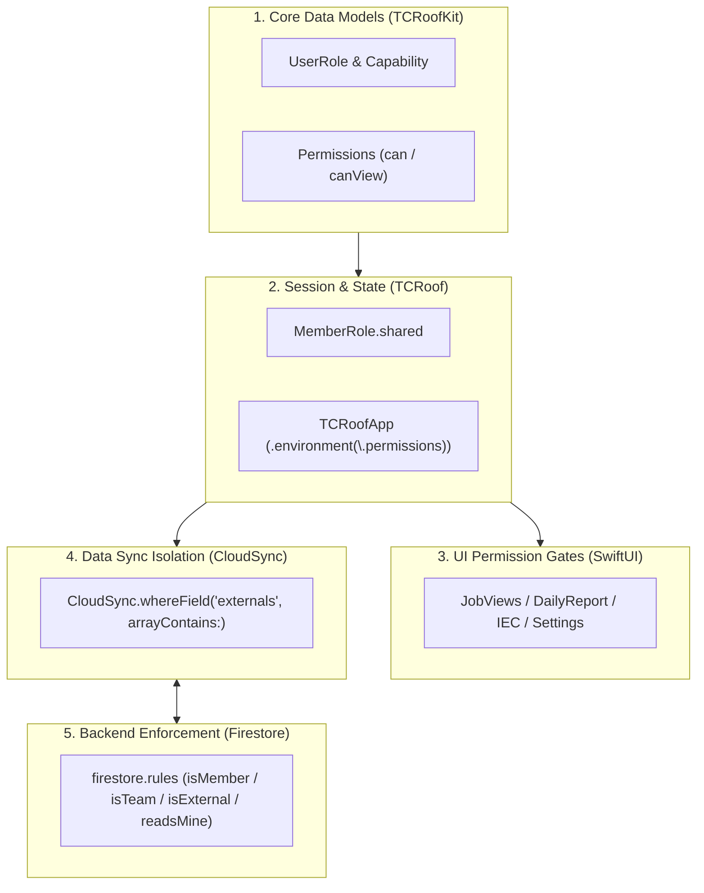

# User Roles & Access Architecture (Swift & Firestore Spec)

**Status:** Built, integrated, and verified (`TCRoofCore/UserRoles.swift`, `MemberRole.swift`, `TCRoofApp.swift`, `CloudSync.swift`, `DriveRoute.swift`, and `firestore.rules`). Verified with automated unit tests in `tools/firestore-rules-tests/rules.test.js` and `TCRoofCoreTests`.  
**Reference:** [`docs/reference/roles/user-roles.json`](../reference/roles/user-roles.json)

---

## 1. Overview & The Three Roles

TCRoof provides role-based access control across 3 roles:

| Role | Enum | Description | Key Capabilities |
|---|---|---|---|
| **ผู้จัดการ** | `.manager` | Project Manager / Executive | Full system control, permanent deletion of jobs (`job.delete`), member invitation & role assignment (`users.manage`). |
| **ทีมภายใน** | `.internalTeam` (`internal`) | Internal Engineer / Admin | Full visibility over all residential & PWA stations, MP scheduling, customer contacts, signing daily logs (`daily.sign`), closing IEC tests (`iec.close`). |
| **วิศวกรภายนอก / ผู้รับเหมา** | `.external` | External Engineer / Contractor | Sees **only assigned jobs** (`externals`). Fills daily logs, scans devices, performs IEC tests and submits results to the team (`iec.fill_submit`). Customer contacts hidden. |

---

## 2. Five-Layer Implementation Architecture



### Layer 1: Core Models (`TCRoofCore/UserRoles.swift`)
- **`UserRole`**: `manager`, `internal` (`.internalTeam`), `external`. Default fallback for legacy documents without a role is `.internalTeam`.
- **`Capability`**: 34 granular capabilities across 4 groups (Jobs & Plan, Survey/Design, Customer Docs/Permits, Site/Contractor, System/Users).
- **`RoleAccess`**: `.allow`, `.view`, `.deny`, `.conditional`, `.disabled` (e.g. BOQ features are disabled for all roles).
- **`Permissions`**: Evaluates `can(capability, on: job.access)`. Resolves conditional access:
  - `.external` can only act on jobs if their email is in `job.externals`.
  - `.finalSignoff` is permitted only for managers or the job's assigned supervising engineer (`isSupervisor`).

### Layer 2: Global State & Environment (`MemberRole.swift` & `TCRoofApp.swift`)
- When signing in, `MemberRole.shared.signedIn(email)` loads the role from local cache, then asynchronously reads `members/<email>` from Firestore.
- Injected at app root into SwiftUI environment:
  ```swift
  .environment(\.permissions, MemberRole.shared.permissions)
  ```

### Layer 3: UI Permission Gates in Views
Every view queries `@Environment(\.permissions) private var permissions`:
- **Member Directory**: `if permissions.can(.usersManage)` in `PhoneSettings.swift`.
- **Job Assignment**: `if permissions.can(.assignExternal, on: job.access)` in `JobAccessCard.swift`.
- **Job Deletion**: `if permissions.can(.jobDelete)` in `JobViews.swift`.
- **Daily Report Sign-off**: Contractor fills (`.dailyFill`), internal engineer signs (`.dailySign`).
- **IEC 62446**: Contractor submits to team (`.iecFillSubmit`), internal engineer closes (`.iecClose`).

### Layer 4: Cloud Sync Data Isolation (`CloudSync.swift`)
External members only download jobs, surveys, and logs assigned to them:
```swift
if let external = me.role == .external ? me.email : nil {
    return all.whereField("externals", arrayContains: external)
}
```

### Layer 5: Backend Enforcement (`firestore.rules`)
Cloud Firestore rules enforce exact matching logic server-side:
```javascript
function isMember() {
  return request.auth != null
    && request.auth.token.email_verified == true
    && exists(/databases/$(database)/documents/members/$(signedInEmail()));
}
function role() {
  return get(/databases/$(database)/documents/members/$(signedInEmail())).data.get('role', 'internal');
}
function isTeam()    { return isMember() && role() != 'external'; }
function isManager() { return isMember() && role() == 'manager'; }
function isExternal(){ return isMember() && role() == 'external'; }
function readsMine() { return isExternal() && signedInEmail() in resource.data.externals; }
```
- **`members/{email}`**: Read allowed for self or managers; write allowed only for managers (managers cannot delete or edit their own document).
- **`jobContacts/{doc}`**: Customer phone & address isolated to this sub-collection; external members have zero read access.
- **`jobs/{doc}`**: External members can only update `iecReport` and `iecState` (`open` -> `sent`), never close.

---

## 3. Google Drive Routing by Role (`DriveRoute.swift`)

File storage on Google Drive is separated according to corporate data governance:

1. **Internal Team & Manager**:
   - Files are stored directly in the **Company Center Drive** (`DriveConfig.centerFolderID`).
   - Automatically generates structured handover folders:
     - `1. เอกสารส่งมอบ/` (PWA Handover folders)
     - `2. เอกสารระหว่างก่อสร้าง/` (Daily logs, test reports, inspection photos)
2. **External Contractor**:
   - Files upload to the contractor's **own Google Drive** (`TCRoof Projects/<job>/`).
   - Automatically shares the job folder (read-only) with the company's designated team emails (`DriveConfig.shareWith`).

---

## 4. Key Workflows

### 4.1 Daily Reports & MP Progress
1. Contractor foreman opens the assigned job -> **รายงานประจำวัน**.
2. Fills workers, equipment, attached site photos, and scans barcodes/serials.
3. Internal engineer reviews the report in the app and applies digital signature (`daily.sign`).
4. Only signed daily reports are credited into the **Master Plan (MP) Schedule** progress calculations.

### 4.2 IEC 62446 Testing & Handover State Machine
```text
[Open] (Contractor fills Voc, Imp, IR, thermal photos)
   ↓ (Contractor taps 'ส่งผลให้ทีม')
[Sent] (Locked read-only; waiting for engineer inspection)
   ↓ (Internal engineer inspects and approves)
[Closed] (Locked permanently; auto-books Task 3.1 Pre-Commissioning in MP to 100%)
   ↳ or [Reopened] / [Sent Back] if remediation is needed
```

### 4.3 Shared iPad on Site
For shared iPads in the field:
- **ตั้งค่า › สลับบัญชี**: Flushes pending offline sync to the cloud, signs out of Google Session, and allows the next user to sign in with their personal Google account.
- The UI and visible data dynamically reload based on the new user's role.
