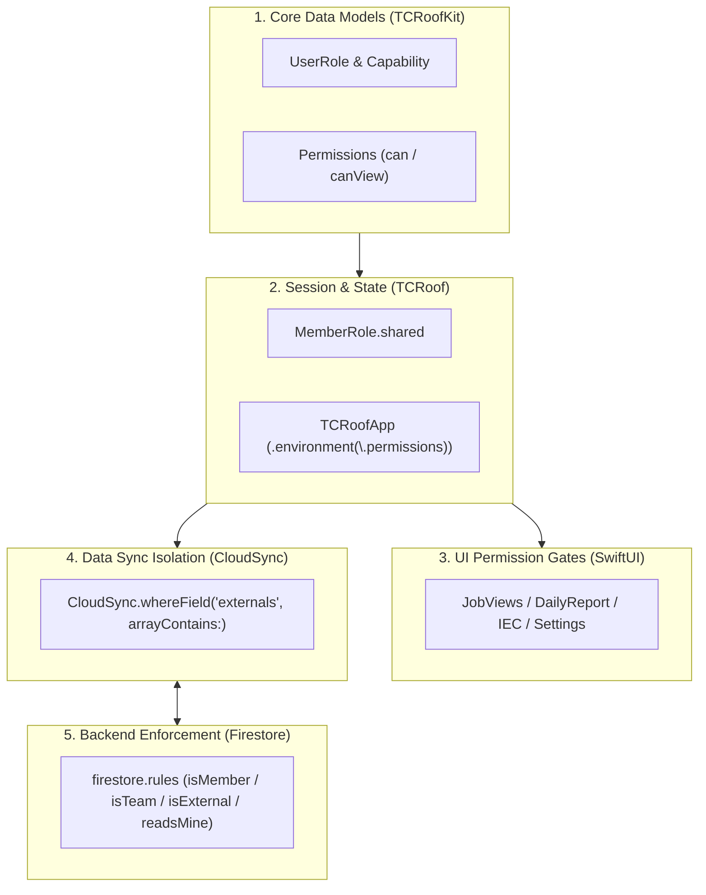

# User Roles & Access Architecture (Swift & Firestore Spec)

**Status:** Built, integrated, and verified (`TCRoofCore/UserRoles.swift`, `MemberRole.swift`, `TCRoofApp.swift`, `CloudSync.swift`, `DriveRoute.swift`, and `firestore.rules`). Verified with automated unit tests in `tools/firestore-rules-tests/rules.test.js` and `TCRoofCoreTests`. The Maintainer, suspension, the developer key, role overrides and the audit log were added 2026-10-18 with จัดการผู้ใช้และสิทธิ์ (`TCRoof/Auth/UserAdmin`, [`docs/ui/user-admin-ipad`](../ui/user-admin-ipad/CLAUDE_CODE_TASK.md), §4.5), and deployed the same day.  
**Reference:** [`docs/reference/roles/user-roles.json`](../reference/roles/user-roles.json)

---

## 1. Overview & The Roles

TCRoof provides role-based access control across 3 roles, plus the Maintainer:

| Role | Enum | Description | Key Capabilities |
|---|---|---|---|
| **ผู้จัดการ** | `.manager` | Project Manager / Executive | Full system control, permanent deletion of jobs (`job.delete`), member invitation & role assignment (`users.manage`). |
| **ทีมภายใน** | `.internalTeam` (`internal`) | Internal Engineer / Admin | Full visibility over all residential & PWA stations, MP scheduling, customer contacts, signing daily logs (`daily.sign`), closing IEC tests (`iec.close`). |
| **วิศวกรภายนอก / ผู้รับเหมา** | `.external` | External Engineer / Contractor | Sees **only assigned jobs** (`externals`). Fills daily logs, scans devices, performs IEC tests and submits results to the team (`iec.fill_submit`). Views their stations' PWA papers read only (`stationdocs.drafts` is `view`). Customer contacts hidden. |
| **Maintainer** | `.maintainer` | The app's developer | Everything a role can do (except what is off for every role, BOQ), plus suspending accounts (`users.suspend`), the role overrides (`users.permissions`) and จัดการผู้ใช้และสิทธิ์ (`users.admin`). Set **only in the Firebase console**: the app never writes `maintainer`, and nobody changes or removes a Maintainer's document from the app. Not a column of the roles table. |

A member can also be **suspended** (`members/<email>.suspended`, with `suspendedBy` and `suspendedAt`): only a Maintainer suspends or reactivates, never themselves or another Maintainer. A suspended account is no member at all to the rules; sign-in refuses it (`บัญชีนี้ถูกระงับ · ติดต่อผู้ดูแลระบบ`) and a signed-in device is signed out at its next sync.

### People on a job

The role is the member's, across the app. Each job also names people, in the job screen's `JobAccessCard`:

| List | Field | Set by | What it does |
|---|---|---|---|
| ทีมงานของเรา | `Job.teamMembers` (`teamMembers` in Firestore) | `job.assign_team`: manager, internal | Our team members working on the job, picked from the team directory (`TeamDirectory`) or typed. Opens nothing (the team sees every job): the job is in their `งานของฉัน` filter on the PWA home, and its news is announced to them. An address not in the directory is flagged `ไม่อยู่ในรายชื่อทีม`. |
| ผู้รับเหมา / วิศวกรภายนอก | `Job.externals` | `job.assign_external`: manager, internal | The only jobs an external member sees and works on. |
| ผู้ควบคุมงาน | `Job.supervisorEmail` | `job.assign_external` | May sign final acceptance (`handover.final_signoff`). |

`Permissions.isNamed(job)`: on its team, its supervisor or an assigned external. `Permissions.hearsNews(job)`: a feed notification about the job (a daily report sent, a test result, an issue and its due reminder) and its reminders (install days, the MP plan's start-tomorrow and behind-plan, the ERC flow's time limits, the routine reports) are posted on a device when the member is a manager, is named on the job, or the job names none of ours (no team member and no supervisor). The bell's list keeps every post.

---

## 2. Five-Layer Implementation Architecture



### Layer 1: Core Models (`TCRoofCore/UserRoles.swift`)
- **`UserRole`**: `manager`, `internal` (`.internalTeam`), `external`, `maintainer`. Default fallback for legacy documents without a role (or an unknown one) is `.internalTeam`. `UserRole.allCases` is the table's three roles, which a manager sets; `UserRole.every` adds the Maintainer. `managesTeam` is a manager or the Maintainer (the rules' `isManager()`).
- **`Capability`**: 38 capabilities across 5 groups (Jobs & Plan, Survey/Design, Customer Docs/Permits, Site/Contractor, System/Users), with their labels, groups and conditions in `UserRoles+Labels.swift`. `RoleTableTests` keeps all of it the same as `user-roles.json`.
- **`RoleOverrides`** (`UserRoles+Admin.swift`): the Maintainer's changes to the table, applied by `Permissions` over the built-in cells. A **locked** cell keeps the table's value (`Capability.lockReason`): disabled cells, the Maintainer's own capabilities, a manager's `users.manage`, and every capability `firestore.rules` enforces (`Capability.enforcedByRules`). Overrides change what the app shows, never what the rules allow.
- **`DevKey`** (`DevKey.swift`): the developer key's PBKDF2-SHA256 check, 5 wrong tries then a 10-minute lock (`DevKeyAttempts`, kept on the device), a 15-minute unlock.
- **`RoleAccess`**: `.allow`, `.view`, `.deny`, `.conditional`, `.disabled` (e.g. BOQ features are disabled for all roles).
- **`Permissions`**: Evaluates `can(capability, on: job.access)`. Resolves conditional access:
  - `.external` can only act on jobs if their email is in `job.externals`.
  - `.finalSignoff` is permitted only for managers or the job's assigned supervising engineer (`isSupervisor`).

### Layer 2: Global State & Environment (`MemberRole.swift` & `TCRoofApp.swift`)
- When signing in, `MemberRole.shared.signedIn(email)` loads the role from local cache, then asynchronously reads `members/<email>` from Firestore.
- `MemberRole.refresh` (at sync start) reads the role and `config/roleOverrides` (kept for offline). A removed or suspended account is signed out (`onRemoved`, with the suspended message when it is one).
- Injected at app root into SwiftUI environment:
  ```swift
  .environment(\.permissions, MemberRole.shared.permissions)
  ```

### Layer 3: UI Permission Gates in Views
Every view queries `@Environment(\.permissions) private var permissions`:
- **Member Directory**: `if permissions.can(.usersManage)` in `PhoneSettings.swift`.
- **จัดการผู้ใช้และสิทธิ์**: `if permissions.can(.usersAdmin)` in `PhoneSettings.swift` (`นักพัฒนา`), and the page itself refuses anyone else.
- **เอกสาร PWA**: `canView(.stationDocsDrafts, on: job.access)` opens the papers; `can` decides whether anything is editable, so a contractor sees their stations read only.
- **Job Assignment**: `if permissions.can(.assignExternal, on: job.access)` in `JobAccessCard.swift`.
- **Job Deletion**: manager only (`.jobDelete`). The app has no delete-job button yet; when one is added it must check `permissions.can(.jobDelete)`. `firestore.rules` already refuses a delete from anyone but a manager.
- **Daily Report Sign-off**: Contractor fills (`.dailyFill`), internal engineer signs (`.dailySign`).
- **IEC 62446**: Contractor submits to team (`.iecFillSubmit`), internal engineer closes (`.iecClose`).

### Layer 4: Cloud Sync Data Isolation (`CloudSync.swift`)
External members only download jobs, surveys, and logs assigned to them:
```swift
if let external = me.role == .external ? me.email : nil {
    return all.whereField("externals", arrayContains: external)
}
```

### Layer 5: Backend Enforcement (`firestore.rules`)
Cloud Firestore rules enforce exact matching logic server-side:
```javascript
function isMember() {
  return request.auth != null
    && request.auth.token.email_verified == true
    && exists(/databases/$(database)/documents/members/$(signedInEmail()))
    && get(/databases/$(database)/documents/members/$(signedInEmail())).data.get('suspended', false) != true;
}
function role() {
  return get(/databases/$(database)/documents/members/$(signedInEmail())).data.get('role', 'internal');
}
function isTeam()       { return isMember() && role() != 'external'; }
function isManager()    { return isMember() && role() in ['manager', 'maintainer']; }
function isMaintainer() { return isMember() && role() == 'maintainer'; }
function isExternal()   { return isMember() && role() == 'external'; }
function readsMine() { return isExternal() && signedInEmail() in resource.data.externals; }
```
- **`members/{email}`**: Read allowed for self (suspended or not, so sign-in can check) or managers. A manager invites (`role` only `manager | internal | external`), changes `role` and removes members, never their own document and never a Maintainer's. Only a Maintainer writes `suspended / suspendedBy / suspendedAt` (as themselves, at the server's time, or removes all three), never on their own or another Maintainer's document; a manager can't remove a suspended member (which would let them be invited back).
- **`jobContacts/{doc}`**: Customer phone & address isolated to this sub-collection; external members have zero read access.
- **`jobs/{doc}`**: The team creates and edits jobs; only a manager deletes one. External members can only update `iecReport` and `iecState`, and only while the test is `open` (`open` -> `sent`), never close or reopen it. Team devices drop a closing result the document's `iecState` doesn't record (`IECReport.trusting`).
- **`installLogs/{doc}`** (daily reports): External members create and edit the reports of their jobs while they are unsigned, never set or remove `engineerSignedAt` or `inspectorAckAt`, and never delete one: a signed report stays as our engineer signed it, since the MP plan counts signed reports (the feed's `แก้แล้ว` on a signed report's problem is the team's). A team member sets them only on a job that names them (team member or supervisor) or names none of ours; a manager on any job (`signsFor`, `daily.sign`). Any team member may keep or clear them, as editing a signed report does.
- **`devices`, `surveyForms`, `pwaSurveys`**: External members write only the documents of their jobs, and never change who a document is open to (`externals`).
- **`photos/{doc}`**: An external member's photo must point at a daily report of their own job or at their job's IEC test; never at an ICL.
- **`inspections/{doc}`** (ICL): External members read theirs, never write.
- **`pwaSurveyRevisions/{doc}`** (issued REVs): The team's only; written once, deleted by a team member only once its survey is gone, or by a manager.
- **`directory/{email}`** (team directory): names and emails of the team and managers, no roles, for picking a job's team members. The team reads it, external members never. Each team member writes their own entry (at sync start, with the name in settings), a manager any team member's (on invite and role change); only listed team members or managers can be in it; a manager deletes entries (on removal or a change to external).
- **`feedAcks/{doc}`**: Any member adds or removes only their own email.
- **`config/{doc}`**: Read by every member, written only in the Firebase console. Except:
  - **`config/devKey`**: the developer key's `{ hash, salt, iterations, expiresAt, setBy, setAt }` (never the digits), read and written only by a Maintainer (`tools/dev-key`).
  - **`config/roleOverrides`**: `{ "<role>|<capability>": "<access>" }`, read by every member, written by a Maintainer.
- **`auditLog/{id}`**: `{ at, by, kind, title, detail }`, created by a manager or Maintainer as themselves at the server's time (`kind` one of `role | perm | user | key | sus`), read by a Maintainer, never changed or deleted.

Tests: `tools/firestore-rules-tests` (`npm install && npm test`) covers each role, a new user from invite to removal, the IEC hand-over, the Maintainer, suspension, the developer key, overrides, the audit log and a page save as one batch.

---

## 3. Google Drive Routing by Role (`DriveRoute.swift`)

File storage on Google Drive is separated according to corporate data governance:

1. **Internal Team & Manager** signed in with full Drive access (`GoogleAuth.scope` is `drive`; `hasFullDrive`):
   - Files are stored directly in the **Company Center Drive** (`DriveConfig.centerFolderID`).
   - A team account still signed in under the older `drive.file` access uploads to its own `TCRoof Projects/<job>/`, as a contractor does, until it signs in again.
   - Automatically generates structured handover folders:
     - `1. เอกสารส่งมอบ/` (PWA Handover folders)
     - `2. เอกสารระหว่างก่อสร้าง/` (Daily logs, test reports, inspection photos)
2. **External Contractor**:
   - Files upload to the contractor's **own Google Drive** (`TCRoof Projects/<job>/`).
   - Automatically shares the job folder (read-only) with the company's designated team emails (`DriveConfig.shareWith`).

---

## 4. Key Workflows

### 4.1 Daily Reports & MP Progress
1. Contractor foreman opens the assigned job -> **รายงานประจำวัน**.
2. Fills workers, equipment, attached site photos, and scans barcodes/serials.
3. Internal engineer reviews the report in the app and applies digital signature (`daily.sign`).
4. Only signed daily reports are credited into the **Master Plan (MP) Schedule** progress calculations.

### 4.2 IEC 62446 Testing & Handover State Machine
```text
[Open] (Contractor fills Voc, Imp, IR, thermal photos)
   ↓ (Contractor taps 'ส่งผลให้ทีม')
[Sent] (Locked read-only; waiting for engineer inspection)
   ↓ (Internal engineer inspects and approves)
[Closed] (Locked; books Task 3.1 Pre-Commissioning in MP at 100%)
   ↳ [Sent] can go back to [Open] with ส่งกลับให้แก้; [Closed] reopens to [Open] with แก้ไข (internal team only)
```

### 4.3 Shared iPad on Site
For shared iPads in the field:
- **ตั้งค่า › สลับบัญชี**: Flushes pending offline sync to the cloud, signs out of Google Session, and allows the next user to sign in with their personal Google account.
- The UI and visible data dynamically reload based on the new user's role.
- When the next account is external, the previous account's records are removed from the iPad before sync starts (`LocalData`), so a contractor never sees other jobs; a team account keeps them.

### 4.4 Rolling Out a Rules Change
The rules can't tell one app build from another, so a device on an older build keeps writing what it always did. A refused write leaves its sync stuck, and an accepted one can undo the change (a job sent with its contacts after `contactsSplit`). `config/app.minSyncVersion` stops such builds:
- Each build carries `AppCompat.syncVersion` (`TCRoofCore/AppCompat.swift`: 1 for the roles, 2 for the Maintainer, suspension and the overrides). This is not the App Store version. No minimum is set yet.
- A build below the console's minimum shows `ต้องอัปเดตแอป` over the whole app, with `config/app.installLink` (`AppGate`).
- That build sends nothing. Its edits stay on the device and go up after the update.
- To roll out a change:
  1. Raise `syncVersion` in the change.
  2. Ship the build.
  3. Set `minSyncVersion` to the new number.
  4. Deploy `firestore.rules` or flip the switch.
- Builds made before this gate existed don't read the minimum, so the first rollout still waits for every device to update.

### 4.5 จัดการผู้ใช้และสิทธิ์ (Maintainer only)
Settings › นักพัฒนา › `จัดการผู้ใช้และสิทธิ์`, shown for `users.admin` (`TCRoof/Auth/UserAdmin`):
1. **Developer key.** The page opens on a 6-digit pad checked against `config/devKey`. Five wrong keys lock the pad for 10 minutes on that device. An unlock lasts 15 minutes; `ล็อกหน้านี้`, leaving the page or the app going to the background locks it again. The key is asked again before a role edit, an invite or a matrix edit. It expires every 30 days: set a new one with `node tools/dev-key/make-dev-key.mjs <email> --write` (it asks for the digits twice without showing them).
2. **ผู้ใช้.** The member list with role, status (`ใช้งาน`, `ระงับ`) and jobs (from `Job.externals`, `teamMembers`, `supervisorEmail`); the detail panel's role edit with what it gains and loses, the permission groups, and suspend / reactivate. Invite by email (role, and an external person's jobs, written to `Job.externals`).
3. **บทบาทและสิทธิ์.** The matrix from the table; in edit mode a cell cycles `allow → conditional → view → deny`, locked cells refuse with their reason. The `กฎการใช้งาน` that are facts of the system are shown locked on.
4. **ประวัติการแก้ไข.** The `auditLog`.

Every change waits in the pending bar; `บันทึกและซิงก์` writes them in one Firestore `WriteBatch` with one audit entry each, then the team directory and the invites' share sheet. Not recorded, so not shown: last seen, devices, remote sign-out, and an idle-account rule (decided 2026-10-18).
