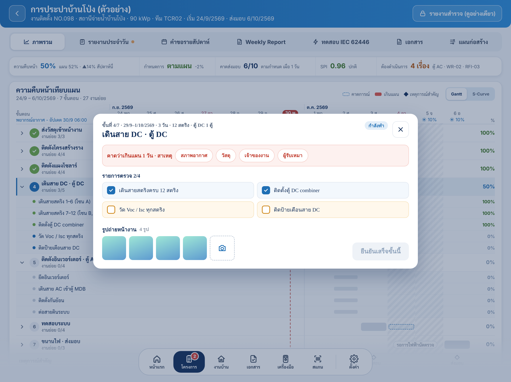

# Install stage and WBS dialog

Reusable iPad component reference for the stage detail overlay opened from an install progress row. The WBS checklist is a section within that dialog, not a separate dialog.



The screenshot documents the stage dialog's existing frame and surrounding page. Its WBS section is driven by the current plan's WBS data and may not appear in this older captured state.

## Component structure

```text
Install stage overlay
├── Scrim (tap outside closes)
└── Stage detail card
    ├── Stage header: dates, name, status, close
    ├── Optional late cause card
    ├── Progress checklist (existing report checklist)
    ├── WBS checklist (only when the selected task has WBS rows)
    │   ├── Section title and completed count
    │   ├── Parent rows (informational, no checkbox)
    │   └── Indented work rows (checkbox, evidence, owner, weight)
    └── Footer: site photos and daily report action
```

## Shared visual rules

| Element | Rule |
| --- | --- |
| Type | Sarabun throughout; 24 pt bold stage title, 16 pt section titles, 15 pt row text, 12–13 pt metadata |
| Card | `Theme.surface`, 22 pt continuous corner radius, 24 pt inset, subtle navy shadow |
| Row | 12 pt continuous radius, 10 pt horizontal inset, 6 pt vertical inset |
| Spacing | 8 pt within a section; 16 pt between major sections; 12 pt between row content |
| WBS code | `Theme.primary`, 13 pt bold monospaced digits |
| Weight | Right aligned, 13 pt bold monospaced digits; show as percent |
| Pending row | `Theme.surface`, subtle border; checkbox outline uses `Theme.pending` |
| Completed row | Soft success fill; green checked box and success metadata |
| Indentation | 24 pt per WBS level on iPad; 12 pt on compact width |

Use semantic `Theme` colors so the same rows adapt to light and dark appearance. Do not hardcode the palette in feature views.

## WBS row variants

### Parent / group

- No checkbox. The child steps own completion.
- Show code and bold title; optionally show the station type or note.
- Add the hint “ติ๊กตามขั้นงานด้านล่าง”.
- Show group weight at the trailing edge.
- Use a soft page fill to distinguish the group from actionable rows.

### Actionable work item

- A 44 × 44 pt checkbox hit target, even when the drawn square is 26 × 26 pt.
- Put WBS code and title on the first text line. Allow evidence and completion metadata to wrap below it.
- Put the responsible party and weight in a trailing column; allow long labels to wrap rather than collide with the title.
- Unchecked rows use the pending treatment. Checked rows show completion date, person, and optional document number.
- A completed item exposes “ใส่เลขที่เอกสาร” in its context menu when the user may edit it.

### Read-only row

- Keep the same row layout and state colors; disable the checkbox action and expose the reason through accessibility where available.
- Do not make the WBS heading or evidence text appear tappable.

## Dialog behavior

- Open the stage detail card by tapping a stage row in the Gantt/progress view. Tapping the scrim or close button dismisses it.
- Insert WBS between the progress checklist and the photo/action footer. Omit the whole section if the selected stage has no WBS items.
- Show a completed count for leaf rows only: `งานย่อย WBS n/m`. Parent rows are excluded from the denominator.
- Keep short content at its natural height. When the dialog exceeds the available screen height, scroll the section content while keeping the dialog header and footer visible.
- Ticking a leaf records the current user's email and local day. A permitted take-back removes that tick. A document number edits the existing tick.
- The stage's daily report action remains the only way to record reported progress; WBS ticks feed weighted plan progress.

## Responsive layout

- On iPad, center the card and cap its width at 870 pt. Preserve the page and dock behind the scrim.
- On narrow widths, stack cause chips and allow the checklist to scroll inside the dialog. Keep the close button and primary action reachable.
- Respect the device safe area and keyboard when the document-number alert is open.

## Accessibility

- Give each actionable checkbox the accessible name of its work item and the value “ยังไม่เสร็จ” or “เสร็จแล้ว”.
- Preserve the button trait and a 44 pt minimum hit target.
- Keep status understandable without color: checked state, text status, completion details, and WBS count all carry meaning.
- Close controls use the label “ปิด”; document entry announces “เลขที่เอกสาร”.

## Implementation map

- Overlay and stage selection: `InstallTrackingPage.stageSheet` and `InstallTrackingPage+Progress.stepRow`.
- Dialog shell and its section order: `InstallStageSheet`.
- WBS group/action rows and document-number alert: `WBSChecklist`.
- Shared palette and typography: `TCRoofKit/Sources/TCRoofUI/Theme.swift` and `.sarabunFixed`.

The current implementation is the source of truth for behavior; this page records the component contract for future UI changes.
