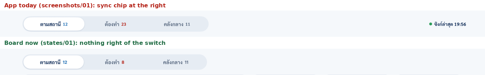

# FIX-01: iPad `เอกสาร`, remove the sync chip from the top row

Board: `iPad · เอกสาร PWA (ตามสถานี · ต้องทำ · คลังกลาง)` (`iPadPwaDocs.dc.html` in this folder, updated 18 ต.ค. 2569).

The page is built (`TCRoof/Views/Job/StationDocs/Pad/PWADocsPadView.swift`, merged in #58). Since that hand-off, the board changed in one place only: everything right of the view switch is gone. That means the project line, the sync chip and the board-only preview chip. The app only ever drew the sync chip, so that chip is the only thing to remove.

`states/01`–`09` and `11` are re-rendered from the updated board; `preview.png` = `states/01`. `states/10` (the contractor's locked page) has no top row and is unchanged.

## Change list (only this)

1. **Top row:** in `PWADocsPadView.topRow`, drop `syncChip`. The row is the view switch alone, at its 520 pt width, left-aligned.
   - Remove the `syncChip` view and anything only it uses, such as `lastSync`, if nothing else reads it.
2. **Keep `isOffline`:**
   - The upload sheet still reads it (`PWADocsUploadSheet`: `if page.isOffline { offlineNote }`).
   - `states/11` still shows the sheet's amber note `ออฟไลน์ · ไฟล์จะเข้าคิวและส่งเมื่อออนไลน์`.
   - `-pwaDocsOffline YES` keeps working for the sheet.
3. **`CLAUDE.md`:** the iPad `เอกสาร` line says `-pwaDocsOffline YES` shows "the offline chip and note". Make it "the upload sheet's offline note".

## Don't change

- The switch, summary card, tiles, lists, sheets, search panel and locked state.
- The iPhone page (`PWADocsHomeView`) and its header.
- `CloudSync` and the offline logic itself.

## Check

- [ ] Build with your own `-derivedDataPath`.
- [ ] `PadPWADocsUITests` and `HomeNavbarUITests` pass. If a test looks for the sync chip, remove that check.
- [ ] iPad Pro 13", `-screen home -homeTab docs -homeBoard YES -pwaDocsDemo YES`:
  - [ ] Save `screenshots/01-stations.png` again: nothing right of the switch, as `states/01`.
  - [ ] With `-pwaDocsOffline YES -pwaDocsPaper <id> -pwaDocsUpload YES`, save `screenshots/11-offline-upload.png`: the sheet's note is still there, and there is no chip on the page.

## Open question (report)

1. With the chip gone, the page shows nothing when the device is offline until someone opens the upload sheet. Is that fine, or should an amber `ออฟไลน์` chip appear only while offline?
