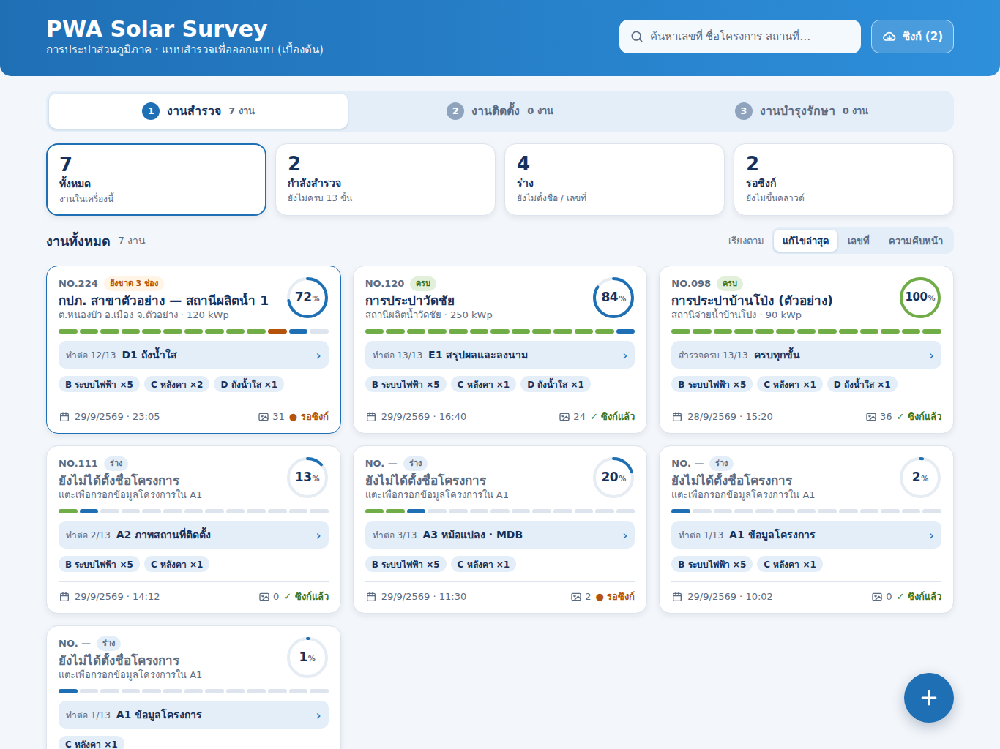

# PWA Solar Survey — หน้าแรก (งานสำรวจ · ติดตั้ง · บำรุงรักษา) · iPad

หน้าแรกของฟีเจอร์แบบสำรวจ ใช้ดูงานสำรวจทั้งหมดในเครื่อง กรองงาน และแตะเพื่อทำต่อจากขั้นที่ค้าง
แทนที่ `SurveyHomeView` / `JobCard` ใน `SolarSurveyKit/Sources/SurveyUI/SurveyHome.swift`



## อัปเดต 30/9/2569 — แยกงานเป็น 3 แท็บ

หน้าแรกเปลี่ยนจาก "รายการงานสำรวจ" อย่างเดียว เป็นรายการงานทั้งหมด 3 ขั้นของโครงการ

| ไฟล์ใหม่ | คืออะไร |
|---|---|
| `preview-install.png` / `preview-install.html` | แท็บงานติดตั้ง มีตัวอย่างงาน NO.098 ที่ดึงมาแล้ว |
| `preview-install-picker.png` | หน้าต่าง "เพิ่มโครงการติดตั้ง" |

`preview.png`, `preview.html` และ `iPadHome.dc.html` แทนที่ด้วยเวอร์ชันล่าสุดจาก canvas แล้ว

### แท็บบนสุด (แทนหัวรายการเดิม)
`① งานสำรวจ n งาน` · `② งานติดตั้ง n งาน` · `③ งานบำรุงรักษา n งาน`
- แท็บที่เลือกเป็นพื้นขาวมีเงา ตัวเลขนับงานตามขั้น
- กล่องตัวเลข 4 ช่อง (ทั้งหมด / กำลังสำรวจ / ร่าง / รอซิงก์) แสดงเฉพาะแท็บงานสำรวจ
- ปุ่ม `+ งานสำรวจใหม่` ย้ายจากหัวหน้าไปเป็นปุ่มลอยกลมมุมขวาล่าง (แท็บงานสำรวจ)

### งานติดตั้ง
- ปุ่มลอย `+ เพิ่มโครงการ` เปิดหน้าต่าง "เพิ่มโครงการติดตั้ง"
  - ดึงข้อมูลจากงานสำรวจ แสดงงานสำรวจทุกงาน
  - งานที่สำรวจครบ 100% มีปุ่ม `เพิ่มได้` (น้ำเงิน) งานที่ยังไม่ครบเป็นปุ่มเทา `เพิ่มไม่ได้` (ไม่มีแถบ %)
  - กด `เพิ่มได้` แล้วงานย้ายไปแท็บงานติดตั้ง
- การ์ดงานติดตั้ง
  - ป้าย `กำลังติดตั้ง`, วงแหวน % ความคืบหน้าติดตั้ง
  - แถบ 7 ขั้นงานติดตั้ง และปุ่ม `ขั้น 4/7 · เดินสาย DC · ตู้ DC ›`
  - ป้ายทีม (เช่น `ทีม TCR02`) และวันส่งมอบ
  - แตะแล้วไปหน้าติดตามงานติดตั้ง (`iPadInstall`)
- ยังไม่มีงาน: กล่องเส้นประ "ยังไม่มีงานติดตั้งในเครื่องนี้" พร้อมคำแนะนำให้กดเพิ่มโครงการ

### งานสำรวจที่ถูกดึงไปติดตั้งแล้ว
- การ์ดในแท็บงานสำรวจล็อกไว้ (แก้ไขไม่ได้) แต่ยังเปิดดูรายงานได้

### งานบำรุงรักษา
- โครงแท็บพร้อมแล้ว ยังไม่มีเนื้อหา

### ข้อมูลที่ต้องเพิ่มในโค้ด
| สิ่งที่แสดง | ต้องเพิ่ม |
|---|---|
| ขั้นของงาน (สำรวจ / ติดตั้ง / บำรุงรักษา) | field สถานะขั้นใน job |
| ล็อกงานสำรวจหลังดึงไปติดตั้ง | flag อ่านอย่างเดียว + ปุ่มดูรายงาน |
| ความคืบหน้าติดตั้ง 7 ขั้น, ทีม, วันส่งมอบ | โมเดลงานติดตั้ง |

ข้อมูลงานติดตั้ง NO.098 ในแบบเป็นค่าตัวอย่าง

---


## ไฟล์ในโฟลเดอร์นี้

| ไฟล์ | คืออะไร |
|---|---|
| `preview.png` | ภาพหน้าจอ 1366 × 1024 (iPad แนวนอน) |
| `preview.html` | หน้าเดียวกันแบบ HTML ไฟล์เดียว (ฝัง CSS ไว้แล้ว) เปิดด้วยเบราว์เซอร์ได้เลย เป็นภาพนิ่ง กดไม่ได้ |
| `iPadHome.dc.html` | ไฟล์ต้นฉบับจาก canvas ออกแบบ (มี logic กรอง/ซิงก์ใน `renderVals()`) เปิดดูตรงๆ ไม่ได้ ต้องใช้ใน canvas |
| `sample-jobs.json` | ข้อมูลตัวอย่าง 6 งานที่ใช้ในแบบ |

## โครงหน้า

```
┌ หัวสีน้ำเงิน (g-head) ─────────────────────────────────────────────┐
│ PWA Solar Survey                 [ค้นหา…]  [☁ ซิงก์ (2)]  [+ งานสำรวจใหม่] │
│ การประปาส่วนภูมิภาค · แบบสำรวจเพื่อออกแบบ (เบื้องต้น) · วิศวกร …          │
└──────────────────────────────────────────────────────────────────┘
 [6 ทั้งหมด] [2 กำลังสำรวจ] [4 ร่าง] [2 รอซิงก์]      ← ตัวเลข = ปุ่มกรอง
 งานทั้งหมด 6 งาน                         เรียงตาม [แก้ไขล่าสุด|เลขที่|ความคืบหน้า]
 ┌ การ์ด ┐ ┌ การ์ด ┐ ┌ การ์ด ┐                   ← grid 3 คอลัมน์ ช่องไฟ 16
 ┌ การ์ด ┐ ┌ การ์ด ┐ ┌ การ์ด ┐
```

- ความกว้างเนื้อหา 1240 px กึ่งกลางจอ
- บนมือถือ (compact) ให้หัวเรียงเป็นแนวตั้ง และ grid เหลือ 1 คอลัมน์

## ส่วนประกอบ

### 1. หัวหน้า
- ชื่อ `title` (30 px bold) + บรรทัดรอง: กลุ่มลูกค้า · `subtitle` · ชื่อวิศวกรจาก `model.settings.engineer`
- ช่องค้นหา: ค้นเลขที่ ชื่อโครงการ ที่อยู่ ผู้ประสานงาน วิศวกร (ตรงกับ `filtered` เดิม)
- ปุ่มซิงก์: แสดง `ซิงก์ (n)` เมื่อมีงานรอซิงก์ และ `ซิงก์แล้ว` เมื่อไม่มี กดแล้วบันทึกทุกงานที่รอขึ้น Google Drive
- ปุ่ม `+ งานสำรวจใหม่` เปิด `NewJobSheet` เหมือนเดิม
- เมนูเดิม (เปิดจาก Drive, นำเข้า .json, สำรองข้อมูล, ตั้งค่า) ย้ายไปไว้ในปุ่ม `⋯` บน toolbar ตามเดิม

### 2. กล่องตัวเลข / ตัวกรอง (4 ช่อง)

| กล่อง | เงื่อนไข | บรรทัดรอง |
|---|---|---|
| ทั้งหมด | ทุกงาน | งานในเครื่องนี้ |
| กำลังสำรวจ | มีชื่อโครงการ และ `!completion.isComplete` | ยังไม่ครบ 13 ขั้น |
| ร่าง | `projectName.isEmpty` | ยังไม่ตั้งชื่อ / เลขที่ |
| รอซิงก์ | ดูหัวข้อ "สถานะซิงก์" ด้านล่าง | ยังไม่ขึ้นคลาวด์ |

- กล่องที่เลือกอยู่มีขอบน้ำเงิน 2 px (`#1F6FB5`) และเงาเบาๆ
- หัวรายการเปลี่ยนตามตัวกรอง เช่น `งานทั้งหมด 6 งาน`

### 3. การ์ดงาน (บนลงล่าง)
1. **เลขที่ + ป้ายสถานะ**
   - `NO.224` หรือ `NO. —` ถ้ายังไม่มีเลขที่
   - ป้าย:
     - `ร่าง` (เทา) — ยังไม่มีชื่อโครงการ
     - `ขาด n รายการ` (แดง) — `missingItems.count > 0` และมีชื่อแล้ว
     - `ข้อมูลครบ` (เขียว)
2. **ชื่อโครงการ** (17 px bold ตัดท้ายด้วย …)
   - ถ้ายังไม่มีชื่อ แสดง `ยังไม่ได้ตั้งชื่อโครงการ` ตัวเอียงสีเทา
   - บรรทัดรอง: ที่อยู่ · kWp หรือ `แตะเพื่อกรอกข้อมูลโครงการใน A1`
3. **วงแหวน %** มุมขวาบน 52 px = `completion.percent` สีน้ำเงิน และเป็นสีเขียวน้ำทะเล (`#27A99A`) เมื่อ ≥ 80%
4. **แถบขั้น 13 ช่อง** หนึ่งช่องต่อหนึ่งขั้น (A1–A4, B1–B5, C1–C2, D1, E1)
   - มิ้นต์ = ครบ
   - น้ำเงิน = ขั้นที่ทำอยู่
   - แดงอ่อน = มีช่องบังคับที่ยังว่าง
   - เทา = ยังไม่เริ่ม
5. **ปุ่มทำต่อ** `ทำต่อ 12/13 · D1 ถังน้ำใส ›` แตะแล้วเปิด `JobEditorView` ที่ขั้นนั้นเลย
6. **ป้ายหมวด** `B ระบบไฟฟ้า ×5 · C หลังคา ×1 · D … ×1` มาจาก `sectionsByCategory` ของเดิม
7. **แถวล่าง** วันที่ · เวลาแก้ไขล่าสุด | จำนวนภาพ | `☁ ซิงก์แล้ว` (น้ำเงิน) หรือ `⟳ รอซิงก์` (ส้ม `#C46A00`)

- งานที่เปิดล่าสุดมีขอบน้ำเงินจางๆ (`rgba(31,111,181,0.55)`)
- กดค้างแล้วมีเมนู ทำสำเนา / ส่งออกข้อมูลงาน / ลบงาน เหมือนเดิม

## ข้อมูลที่ใช้ เทียบกับโมเดลในโค้ด

| สิ่งที่แสดง | มาจาก | สถานะ |
|---|---|---|
| เลขที่ / ชื่อ / ที่อยู่ | `job.docNo`, `job.projectName`, `values.text("address")` | มีแล้ว |
| kWp | `values` ของช่องขนาดติดตั้งใน A1 | มีแล้ว (ต้องอ่านค่าเพิ่ม) |
| % | `job.completion.percent` | มีแล้ว |
| ขาด n รายการ | `job.missingItems.count` | มีแล้ว |
| ป้ายหมวด | `job.sectionsByCategory` | มีแล้ว |
| จำนวนภาพ | `job.photoCount` | มีแล้ว |
| วันที่ / เวลา | `values.text("date")` + `job.updated` | มีแล้ว |
| แถบ 13 ขั้น | completion ต่อขั้น: หน้าปก (info / site / electrical / flood) + แต่ละ `module` + `Schema.final` | **ต้องเพิ่ม** helper คืนลิสต์สถานะต่อขั้น |
| ขั้นถัดไป | ขั้นแรกที่ `!completion.isComplete` | **ต้องเพิ่ม** และต้องให้ `JobEditorView` รับขั้นเริ่มต้นได้ |
| สถานะซิงก์ | `drive?.folderID == nil` หรือ `job.updated > drive?.lastSaved` = รอซิงก์ | **ต้องเพิ่ม** computed property |
| ซิงก์ทุกงาน | เรียกบันทึก Drive ทีละงานที่รอ | **ต้องเพิ่ม** action ใน `SurveyModel` |

## สีและตัวอักษร (ตาม `grf.css`)

| token | ค่า | ใช้ที่ |
|---|---|---|
| `--navy` | `#16325C` | ตัวอักษรหลัก |
| `--primary` | `#1F6FB5` → `#2E8FDB` | หัวหน้า (gradient), วงแหวน, ขั้นที่ทำอยู่ |
| `--teal` | `#27A99A` | วงแหวนเมื่อ ≥ 80% |
| `--mint` | `#9EE6D6` | ขั้นที่ครบ, ป้ายหมวด (โปร่ง 45%) |
| แดง | `#C0392B` / `#F2A09A` | ป้ายขาด, ขั้นที่ขาด |
| ส้ม | `#C46A00` / `#F08C00` | รอซิงก์ |
| รอง | `#5B6B82` | ข้อความรอง |

- การ์ด: พื้นขาว มุมโค้ง 14 ขอบ `rgba(22,50,92,0.15)` padding 14/16
- กล่องตัวเลข: มุมโค้ง 14 ตัวเลข 26 px bold

## สิ่งที่ยังไม่ได้ทำในแบบ
- ปุ่ม "เรียงตาม" และช่องค้นหาในแบบยังเป็นภาพ กดไม่ได้ (ในแอปใช้ `.searchable` เดิม)
- ข้อมูลใน `sample-jobs.json` เป็นตัวอย่าง: งาน 120 / 111 และ % มาจากภาพหน้าจอแอปปัจจุบัน ที่เหลือแต่งเพิ่ม
- ชื่อหมวด D: แบบใช้ "ถังน้ำใส" แต่ในโค้ด `SectionCategory.water.title` = "งานระบบน้ำ" ต้องเลือกใช้ชื่อเดียว
- แอปเดิมมีแถบสถานะด้านล่างกับกล่อง "ต้องตามเก็บก่อนส่งออก" ซึ่งถูกลบออกตามคอมเมนต์แล้ว

---
ที่มา: canvas "TCRoof ฟอร์มสำรวจ — Layout ใหม่" บอร์ด `iPadHome.dc.html` (อัปเดต 30/9/2569)
