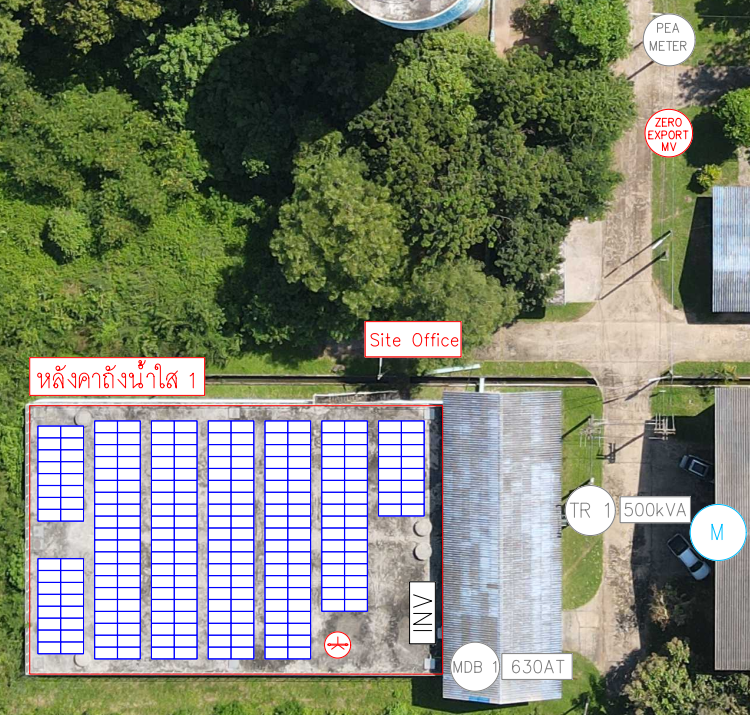
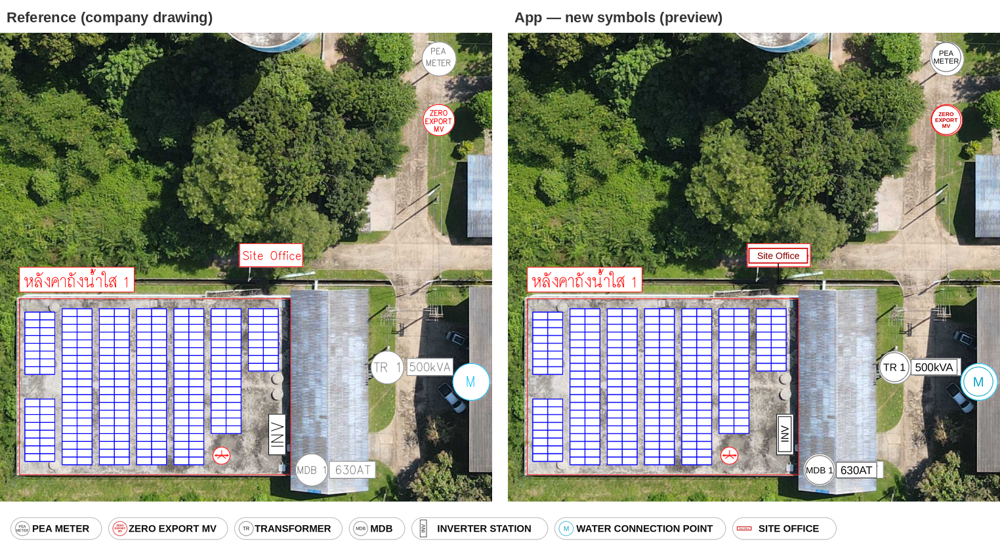

# Spec: Site-picture symbols in the company drawing style

**Feature:** ภาพสถานที่ติดตั้ง (A1 · `siteMap` + `siteMarks`) — change the symbols placed on the site picture from IEC line symbols to the style used on the company's site drawings.
**Platform:** iPad app (TCRoofKit, Swift). The web app is no longer used, so §9 does not apply.
**Status:** Replaced (checked 2026-10-19): A2's redesign (`SitePageWide`, `TCRoofCore/SiteMarks.swift`) has the company-style symbols, `zeroExport` (กันย้อน), numbered TR / MDB and the symbols feeding A3 and B4; keep this file for the reference drawing and the open questions. Was: Not built. The uncompiled draft from branch `feature/site-symbols` (2026-09-29) is kept as `draft-sitemarks.patch`; it targets the old `SolarSurveyKit` paths · moved here 2026-10-04



**Preview** (the new symbols drawn over the same photo with the spec's geometry, rendered outside Xcode; chip row as the editor shows it):



---

## 1. Why

Surveyors send the site picture to the design team, and the design team redraws it in the company's own style (reference above). The app currently draws formal IEC-style line symbols in six colours with the names only in a legend under the picture. That picture is not what the company hands out, so it gets redrawn by hand.

Goal: the picture the app produces — on screen, in the PDF (NO.215) and in the Excel export (NO.224) — looks like the reference, so it can be used as-is.

## 2. Scope

**In scope**
- New look for every symbol kind on the site picture.
- Names written inside the symbols; transformer and MDB numbered (TR 1, MDB 1).
- Rating tag beside TR and MDB (`500kVA`, `630AT`).
- One new kind: **ZERO EXPORT MV**.
- Same drawing everywhere the marks are drawn (editor, PDF, Excel image, one-page summary).

**Out of scope (possible later specs)**
- Roof outline with its title box ("หลังคาถังน้ำใส 1").
- PV panel array grid drawn on the roof.
- Rotating individual symbols by hand.
- Changing the placement interaction (tap to drop, drag to move, tap to select stays as is).

## 3. Symbol catalogue

Radius `R` = `max(8, pictureWidth × 0.03)` (about 3 % of the picture width; the old symbols used 1.9 %). Every symbol has a white fill so it reads over trees, roofs and roads. Line width `max(0.5, R × 0.05)`.

| Kind (`MarkKind`) | Look | Text | Colours |
|---|---|---|---|
| `meter` — PEA METER | White circle | `PEA` / `METER` on two lines | Grey edge `#666666`, black text |
| `zeroExport` — ZERO EXPORT MV *(new)* | White circle | `ZERO` / `EXPORT` / `MV` on three lines, bold | Red edge and text `#D00000` |
| `trafo` — TRANSFORMER | White circle + rating tag on the right | `TR n` | Grey edge, black text |
| `mdb` — MDB | White circle + rating tag on the right | `MDB n` | Grey edge, black text |
| `inv` — INVERTER STATION | Upright white box, about 0.9R × 2.4R | `INV` rotated −90° (reads bottom to top) | Black edge and text |
| `water` — WATER CONNECTION POINT | White circle | `M` | Cyan edge and text `#0FA3C4` |
| `office` — SITE OFFICE | Red-edged label above the point, leader line down to a dot on the point | `Site Office` | Red edge `#D00000`, dark red text `#8B0000`, black leader |

Text inside a circle is sized so the widest line fits about 1.5R, capped per kind so short labels ("M", "TR 1") don't become huge.

### 3.1 Numbering
- TR and MDB are always numbered, in placement order per kind: first transformer placed is `TR 1`, second `TR 2`; MDBs likewise. Numbering shows even when there is only one (the reference shows `TR 1`, `MDB 1`).
- Deleting a symbol renumbers the rest of that kind.
- Other kinds are not numbered.

### 3.2 Rating tag
- Only `trafo` (kVA) and `mdb` (AT).
- Written without a space, unit appended if missing: value `500` → `500kVA`; value `630 AT` → `630AT`.
- White box, thin grey edge, black text at `R × 0.75`, vertically centred on the symbol, starting just right of the circle.
- No tag when the value is empty.
- Suggested values keep today's behaviour (`SiteMarks.suggestedValue`): n-th TR → n-th transformer's kVA; n-th MDB → n-th breaker size from A3.

### 3.3 Toolbar chips and legend
- Chips in the editor and the legend under the picture use a **compact** form: no number, and the Site Office label is drawn centred in the chip without the leader line.
- The legend stays under the picture for now (names are now also on the symbols, so it may be dropped later — see §12).

## 4. Data model

`TCRoofKit/Sources/TCRoofCore/SiteMarks.swift`

- `MarkKind` gets `case zeroExport` (raw value `"zeroExport"`), placed after `meter` so the chip row reads in the same order as the reference. Fill in `title` ("ZERO EXPORT MV"), `badge` ("ZE"), `color` (`#D00000`), `symbol` (SF Symbol, e.g. `arrow.uturn.left.circle`), `unit` = nil.
- `MapMark` unchanged in storage (`id, kind, x, y, value`). Add computed `tag` (§3.2); keep `rating` for text lists.
- Positions stay as 0…1 fractions of the picture, so existing jobs keep their placements.

**Compatibility**
- Existing saved marks decode unchanged; they simply draw in the new style.
- A job containing `zeroExport` opened in an older build fails to decode that mark. Acceptable for an internal app; alternatively make `MapMark` decoding skip unknown kinds instead of throwing (recommended, small change in `init(from:)`).
- `WebBackup` import maps kinds by raw value, so it already skips unknown kinds from the web app.

## 5. Drawing API

```swift
public enum SiteMarks {
    /// Symbols + rating tags over the picture, company style.
    static func ops(_ marks: [MapMark], in box: Box) -> [DrawOp]
    /// Running number per kind for TR / MDB, in placement order.
    static func numbers(_ marks: [MapMark]) -> [UUID: Int]
    /// One symbol. number: written after TR / MDB. callout: false = compact form for chips and legend.
    static func symbol(_ k: MarkKind, at c: Pt, radius R: Double, number: Int? = nil, callout: Bool = true) -> [DrawOp]
    static func legend(...)          // passes callout: false
    static func legendHeight(...)    // unchanged
}
```

Built only from existing `DrawOp`s (`circle`, `rect`, `line`, `text` with `angle` in degrees), so `PDFRenderer` and the SwiftUI `Canvas` need no changes.

## 6. Where it shows

All of these already call `SiteMarks.ops` / `legend`, so they change with no extra work:

| Place | Code |
|---|---|
| Editor stage and chips | `SurveyUI/SiteMarksEditor.swift` (chips pass `callout: false`) |
| Flattened picture for Excel NO.224 | `SurveyUI/SurveyModel.swift` (~line 197) |
| PDF NO.215, site box | `PDFReport/ReportLayout.swift` (~line 183) |
| One-page summary | `PDFReport/ReportLayout.swift` (~line 282) |

## 7. Editor behaviour

Unchanged except:
- The new ZERO EXPORT MV chip appears in the chip row.
- The 44 pt hit circle stays centred on the mark's point. For Site Office the point is the tip of the leader line, so the surveyor drags the dot, not the label.
- The selection ring (yellow) stays around the point.
- The rating field under the picture still appears for a selected TR / MDB; label text unchanged ("ขนาดหม้อแปลง" / "ขนาดเบรกเกอร์ MDB").

## 8. Tests

`Tests/SurveyCoreTests` (Linux-runnable, no UIKit):
1. `numbers`: TR, MDB, TR, meter → TR 1, MDB 1, TR 2; meter has no number. Delete first TR → remaining TR becomes 1.
2. `tag`: `"500"` → `500kVA`; `"630 AT"` → `630AT`; `""` → `""`; meter with a value → `""`.
3. `ops` for a TR with value emits a circle, a `text` "TR 1" and a tag `rect` whose x is right of the circle.
4. `symbol(.office, callout: true)` has a `line` ending at the point and a `rect` entirely above it; `callout: false` has no `line` and fits inside 2R.
5. `symbol(.inv)` text op has `angle == -90`.
6. Decoding a JSON mark with `"kind":"zeroExport"` works; (if §4 recommendation taken) an unknown kind is skipped, not a decode failure.

Existing `PDFReportTests` that place meter + trafo keep passing (update any assertions tied to the old symbol ops).

Manual check on iPad: place one of each on a real drone photo, export PDF and Excel, compare with the reference picture side by side.

## 9. Web app parity (follow-up)

`SolarSurveyWeb/survey-app.html` draws the same marks in SVG (`MARK_KINDS`, `symSVG`, `siteMapWithMarks`). It should get the same look and the `zeroExport` kind so a job moved between web and iPad looks the same. Until then, a web job shows the old style and cannot place ZERO EXPORT MV.

## 10. Preview result (2026-09-29)

The preview at the top of this spec draws the new symbols with the same sizes and positions as the Swift code, over the reference photo. It was rendered outside Xcode, so it checks the geometry, not the iPad build.

**Matches the reference**
- PEA METER and ZERO EXPORT MV (red text) circles.
- TR 1 with `500kVA` tag, MDB 1 with `630AT` tag, cyan `M` circle.
- Upright INV box.
- Site Office red-edged label with a leader line down to the point.

**Still differs**
- Text weight: the app's text is slightly heavier than the drawings, which use a thinner font.
- The roof title ("หลังคาถังน้ำใส 1"), blue panel grid and small red circle on the roof in the preview come from the original photo; the app doesn't draw them (out of scope, §2; red circle is open question 1).

**Change made after the preview:** rating tag text enlarged from `R × 0.62` to `R × 0.75` to match the drawings (§3.2).

## 11. Implementation status

| Item | State |
|---|---|
| Spec and reference / preview images | Done, `docs/ui/site-symbols/` |
| `SiteMarks.swift`: new look, `zeroExport`, numbering, `tag`, compact form | Draft in `draft-sitemarks.patch`, not compiled |
| `SiteMarksEditor.swift`: chips use compact form | Draft in `draft-sitemarks.patch`, not compiled |
| Skip unknown kinds when decoding (§4) | Not started |
| Tests (§8) | Not started |
| Web app parity (§9) | Dropped, the web app is no longer used |

**Next:** port `draft-sitemarks.patch` onto `TCRoofKit/Sources/TCRoofCore/SiteMarks.swift` and `TCRoofKit/Sources/SurveyUI/SiteMarksEditor.swift` (`main` has changed both files since), build, place one of each symbol on a real site photo, and compare the PDF / Excel export with the reference. Merge to `main` after the open questions below are answered.

## 12. Open questions

1. **Red circle on the roof** in the reference (small red circle with a symbol inside, next to INV) — what is it? A new kind is needed if it should be placeable.
2. **Water connection point = cyan "M"?** The cyan circle with "M" by the road is assumed to be the water meter / connection point. Confirm.
3. **INV orientation** — always upright as in the reference, or should the surveyor be able to turn it horizontal?
4. **Legend** — keep it under the picture, or drop it now that names are on the symbols?
5. **Site Office label** — always above the point, or flip below when the point is near the top edge so the label doesn't get cut off?

## 13. Acceptance

- A picture with one of each kind, exported to PDF, matches the reference drawing's style (white circles with names, TR/MDB numbered with rating boxes, upright INV, Site Office call-out).
- Old jobs open with their marks in the same places, drawn in the new style.
- Excel NO.224 picture and one-page summary show the same drawing.
- All tests in §8 pass.
