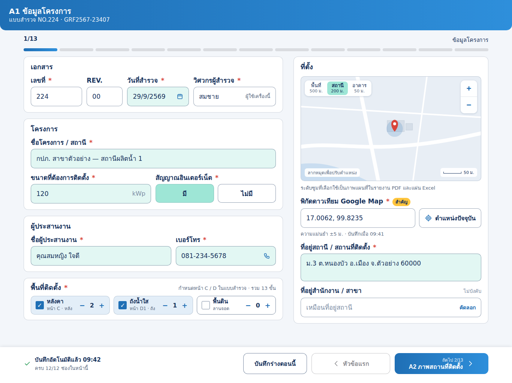

# งานสำหรับ Claude Code: หน้า A1 ข้อมูลโครงการ (iPad) ตามแบบใหม่

> วิธีใช้: เปิด Claude Code ในโฟลเดอร์ repo `TCRoof` แล้วพิมพ์
> `ทำตาม docs/ui/survey-a1/CLAUDE_CODE_TASK.md`

## เป้าหมาย
หน้า A1 ตอนนี้วาดจาก `groupPage(Schema.info, code: "A1", …)` ใน `SolarSurveyKit/Sources/SurveyUI/JobEditor.swift` เป็นรายการช่องเรียงลงมาทีละแถว
ให้ทำ layout เฉพาะของ A1 บน iPad แนวนอน ตาม `preview.png` คือ 2 คอลัมน์ จบในจอเดียว ไม่ต้องเลื่อน
- ค่าทุกช่องยังอ่าน/เขียนผ่าน `job.values` ด้วย field id เดิม
- ห้ามเปลี่ยน id หรือป้ายชื่อใน `Schema`
- ป้ายชื่อต้องตรงกับแผ่นงาน เพราะ Excel และ PDF ใช้ข้อความเดียวกัน

อ้างอิง:
- `preview.html`: หน้าเดียวกันเป็น HTML เปิดในเบราว์เซอร์ได้
- `iPadA1.dc.html`: ต้นฉบับจาก canvas
- design system "TCRoof Survey": สีและระยะตรงกับ `Theme.swift` / `Paper` ที่มีอยู่

## โครงหน้า

- เนื้อหากว้าง 1240 ชิดกลาง
- แบ่งเป็น 2 คอลัมน์ ซ้ายยืดเต็ม ขวากว้าง 520 ช่องไฟ 28
- แต่ละกล่องเป็นการ์ดพื้นขาว มุม 12 ขอบ `navy` 20% padding 16/18
- หัวกล่อง 18 bold

### คอลัมน์ซ้าย
1. **เอกสาร**: กริด 4 ช่อง สัดส่วน 1 : 0.7 : 1.2 : 1.6
   - `docNo` "เลขที่" *
   - `rev` "REV." ไม่บังคับ
   - `date` "วันที่" * แสดงเป็น พ.ศ. `29/9/2569` ผ่าน `ISODate.thai` และมีไอคอนปฏิทินเปิด date picker
   - `engineer` "วิศวกรผู้สำรวจงาน" * ค่าเริ่มต้นจาก `settings.engineer` และมีป้ายเล็ก "ผู้ใช้เครื่องนี้" ทางขวา
2. **โครงการ**:
   - `projectName` "ชื่อโครงการ / สถานี" * เต็มแถว
   - แถวล่าง 2 ช่อง: `capacity` (หน่วย kWp ท้ายช่อง ใช้แป้นตัวเลข) กับ `internet` (ChoiceChips มี/ไม่มี สูง 50)
3. **ผู้ประสานงาน**: สัดส่วน 1.4 : 1
   - `coordinator`
   - `phone` มีไอคอนโทรศัพท์ แตะแล้วโทรออก (`tel:`)
4. **พื้นที่ติดตั้ง** * (ส่วนใหม่ ดูหัวข้อถัดไป)

### คอลัมน์ขวา: ที่ตั้ง
- **แผนที่** สูง 280 มุม 10:
  - ใช้ `MapImage.fetch(gps:zoom:)` เดิม
  - มุมซ้ายบนมีปุ่มแบ่งส่วน 3 ระดับซูม: พื้นที่ 500 ม. / สถานี 200 ม. / อาคาร 50 ม. คำนวณจาก `metersAcross` ระดับที่เลือกเป็นพื้น `mint`
  - มุมขวาบนมีปุ่ม + / − 44×44
  - มุมซ้ายล่างเขียน "ลากหมุดเพื่อปรับตำแหน่ง" มุมขวาล่างมีแถบมาตราส่วน
  - ใต้แผนที่เขียน "ระดับซูมที่เลือกใช้เป็นภาพแผนที่ในรายงาน PDF และแผ่น Excel"
- **`gps`** "พิกัดดาวเทียม Google Map":
  - ป้ายมี `**` นำหน้า ให้แสดงเป็นป้ายเหลือง "สำคัญ" (`sun`) แทนดอกจัน
  - ช่องพิกัดมีปุ่ม "ตำแหน่งปัจจุบัน" (CoreLocation) อยู่ข้างๆ
  - ใต้ช่องเขียน "ความแม่นยำ ±5 ม. · บันทึกเมื่อ HH:mm"
- **`address`**: textarea สูงขั้นต่ำ 74
- **`officeAddress`**: ไม่บังคับ มีปุ่ม "คัดลอก" คัดลอกค่าจาก `address`

## ส่วนใหม่: พื้นที่ติดตั้ง
มี 3 ตัวเลือก เรียงเป็นกริด 3 คอลัมน์ แต่ละตัวมีช่องติ๊ก 22 (`radius-box`) ชื่อ คำอธิบายเล็ก และปุ่ม − / + กับตัวเลข

| ตัวเลือก | คำอธิบาย | ผลกับแบบสำรวจ |
|---|---|---|
| หลังคา | หน้า C · หลัง | จำนวนหัวข้อ C1 (`.roof`) ของงาน |
| ถังน้ำใส | หน้า D1 · ถัง | จำนวนหัวข้อ D1 (`.tank`) |
| พื้นดิน | ลานจอด | ยังไม่มีหัวข้อ; เก็บค่าไว้ก่อน |

- ติ๊กแล้วพื้นเป็น `primary-soft` ช่องติ๊กเป็น `primary` ถ้าไม่ติ๊ก พื้นขาว ขอบ `border-control`
- ขวาบนของกล่องเขียน "กำหนดหน้า C / D ในแบบสำรวจ · รวม N ขั้น" โดย N = จำนวนขั้นทั้งหมดหลังเปลี่ยน
- **การทำงาน**: เปลี่ยนตัวเลขแล้วเพิ่มหรือลบ `SurveyModule` ของชนิดนั้นใน `job.modules` ให้ตรงกับจำนวน
  - ตอนลด ถ้าหัวข้อที่จะถูกลบมีข้อมูลแล้ว ต้องถามยืนยันก่อน
  - ค่าเริ่มต้นนับจาก `job.modules` ที่มีอยู่
- ถ้าจะไม่แตะ schema ให้เก็บจำนวนพื้นดินใน `values` คีย์ใหม่ `groundAreas` (ไม่บังคับ)

## สถานะช่อง
- ช่องที่เติมอัตโนมัติจากงาน TCRoof (`jobSyncID`) ใช้พื้น "calc" (มิ้นต์อ่อนแบบใน `preview`) ได้แก่ `projectName`, `capacity`, `coordinator`, `phone`, `address`, `date`
- แบบนี้เอาแถบแจ้ง "เติมจากงาน … ให้แล้ว" ออกแล้วตามคอมเมนต์ อย่าเพิ่มกลับมา
- ช่องบังคับที่ยังว่างแสดงสถานะที่ป้ายชื่อตาม design system: จุด `pending` + "ยังขาด"

## แถบล่าง
- ซ้าย: ✓ "บันทึกอัตโนมัติแล้ว HH:mm" + "ครบ x/y ช่องในหน้านี้" (`Schema.info.completion`)
- ขวา:
  - ปุ่ม "บันทึกร่างตอนนี้"
  - ปุ่มก่อนหน้า ใช้ไม่ได้ในหน้านี้ ป้าย "หัวข้อแรก"
  - ปุ่มถัดไป "ถัดไป 2/13 · A2 ภาพสถานที่ติดตั้ง"

## เกณฑ์รับงาน
- [ ] build ผ่าน บน iPad แนวนอนทั้งหน้าอยู่ในจอเดียว (1366×1024 pt) ไม่ต้องเลื่อน
- [ ] field id และป้ายชื่อเหมือนเดิม Excel/PDF ส่งออกได้เหมือนเดิม และ `completion` ของ A1 นับเท่าเดิม
- [ ] เปลี่ยนจำนวนหลังคา/ถังแล้ว หัวข้อ C1/D1 ในแถบซ้ายของ `JobEditorView` เพิ่มหรือลดตาม
- [ ] iPad แนวตั้งและ iPhone (`compact`) ยังใช้ `groupPage` แบบเดิม (มีแบบ iPhone ใน canvas ชื่อ `PhoneA1.dc.html` ถ้าจะทำต่อ)
- [ ] ปุ่มและช่องทุกตัวสูงอย่างน้อย 44pt
