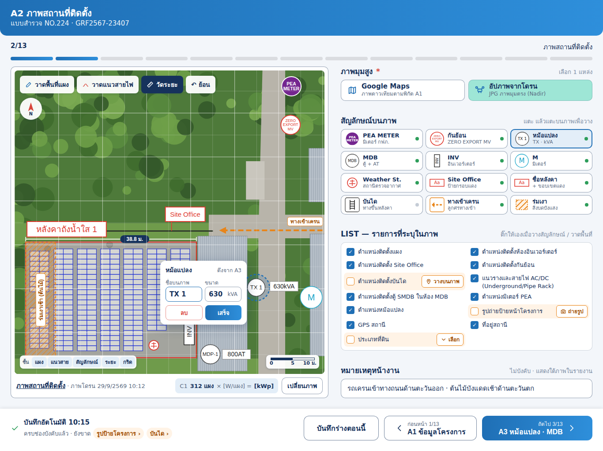

# งานสำหรับ Claude Code: หน้า A2 ภาพสถานที่ติดตั้ง (iPad) ตามแบบใหม่

> วิธีใช้: เปิด Claude Code ในโฟลเดอร์ repo `TCRoof` แล้วพิมพ์
> `ทำตาม docs/ui/survey-a2/CLAUDE_CODE_TASK.md`

## เป้าหมาย
ตอนนี้หน้า A2 วาดจาก `Schema.site` ผ่าน `groupPage` แบบรายการช่องเรียงลงมา:
- `siteMap` (รูป)
- `siteMarks` (สัญลักษณ์ 6 ชนิด ผ่าน `SiteMarksEditor`)
- `north`
- `siteList` (checkbox)

ให้ทำ layout เฉพาะของ A2 บน iPad แนวนอนตาม `preview.png`
- ซ้าย: ภาพใหญ่พร้อมเครื่องมือวาด
- ขวา: แหล่งภาพ, จานสัญลักษณ์, LIST, หมายเหตุ
- จบในจอเดียว ไม่ต้องเลื่อน

อ้างอิง:
- `preview.png`: ภาพหน้าจอ 1366 × 1024
- `preview.html`: เปิดในเบราว์เซอร์ได้ แต่ภาพพื้นหลังโดรนอาจไม่ขึ้น เพราะเป็นไฟล์ใน canvas ให้ยึด `preview.png`
- `iPadA2.dc.html`: ต้นฉบับ มีแต่ markup ไม่มี logic

## ไฟล์ที่เกี่ยวข้อง
- `SolarSurveyKit/Sources/SurveyCore/Schema.swift`: `site`, `Options.list`
- `SolarSurveyKit/Sources/SurveyCore/SiteMarks.swift`: `MarkKind`, `MapMark`, `SiteMarks.ops`, `SiteMarks.symbol`
- `SolarSurveyKit/Sources/SurveyUI/SiteMarksEditor.swift`, `SiteMapPreview.swift`, `Fields.swift`
- `SolarSurveyKit/Sources/SurveyUI/JobEditor.swift`: ที่เรียก `groupPage` ของ A2
- `SolarSurveyKit/Sources/PDFReport/ReportLayout.swift` (บรรทัดที่ใช้ `siteMap` / `siteMarks` / `siteList`)
- `SolarSurveyKit/Sources/ExcelExport/ExcelExporter.swift` (`B12:AA42`, รายการ LIST `C49…R51`)

ใช้ code-review-graph ตาม `CLAUDE.md` หา caller ของ `MarkKind`, `SiteMarks.ops`, `siteMarks` ก่อนแก้

## โครงหน้า (iPad แนวนอน, เนื้อหากว้าง 1318)
- คอลัมน์ซ้ายกว้างประมาณ 720 เป็นการ์ดภาพ
- คอลัมน์ขวายืดเต็มที่เหลือ
- ช่องไฟ 28
- แถบล่างเหมือนหน้าอื่น

### คอลัมน์ซ้าย: การ์ดภาพ
1. **ภาพ** (`siteMap`) เต็มการ์ด มุมโค้ง 10 ซ้อนด้วย layer ต่างๆ ตามลำดับ
2. **แถบเครื่องมือมุมซ้ายบน** (ปุ่มขาว สูง 44 ปุ่มที่เลือกเป็นพื้น navy ตัวขาว):
   - `✎ วาดพื้นที่แผง`: แตะทีละจุดเป็น polygon ขอบแดง ปิดรูปเมื่อแตะจุดแรก
   - `⌃ วาดแนวสายไฟ`: polyline
   - `📏 วัดระยะ`: ลาก 2 จุด แสดงป้าย "38.8 ม." ตามมาตราส่วน
   - `↶ ย้อน`: undo ขั้นล่าสุดของการวาด / วาง
3. **ปุ่มทิศเหนือ** วงกลมขาว 50 ใต้แถบเครื่องมือ
   - แตะแล้วหมุนทีละ 90° และเก็บลง field `north` เดิม (ด้านบน / ด้านขวา / ด้านล่าง / ด้านซ้าย)
   - ไม่ต้องแสดงตัวเลือก `north` แยกอีก
4. **สัญลักษณ์บนภาพ**
   - วงกลมสีตามชนิด + ป้ายค่า เช่น `TX 1` + `630kVA`, `MDP-1` + `800AT`
   - แตะสัญลักษณ์แล้วเปิด popover แก้ไข:
     - หัว "หม้อแปลง" + "ดึงจาก A3"
     - ช่อง "ชื่อบนภาพ" และ "ขนาด (kVA)"
     - ปุ่ม `ลบ` (ขอบแดง) / `เสร็จ` (น้ำเงิน)
   - ค่าตั้งต้นของหม้อแปลง / MDB ใช้ `SiteMarks.suggestedValue` เดิม
   - ลากสัญลักษณ์เพื่อย้ายได้ (มีใน `SiteMarksEditor.move` แล้ว)
5. **มาตราส่วนมุมขวาล่าง** เช่น `0 · 5 · 10 ม.`
   - คำนวณจากความละเอียดภาพ: ภาพ Google Maps รู้มาตราส่วนจากระดับซูม
   - ภาพโดรนให้ผู้ใช้วัดเทียบระยะจริงครั้งแรก (ตั้งมาตราส่วนจากเส้นวัดระยะ + ใส่ค่าจริง)
6. **ปุ่มเลือกชั้นมุมซ้ายล่าง**: `ชั้น | แผง · แนวสาย · สัญลักษณ์ · ระยะ · กริด` เปิด/ปิดการแสดงแต่ละ layer (ไม่ลบข้อมูล)
7. **แถวใต้ภาพ**:
   - ซ้าย: `ภาพสถานที่ติดตั้ง · ภาพโดรน 29/9/2569 10:12` (วันที่จาก EXIF / `Photo.takenAt`)
   - กลาง: ป้าย `C1 312 แผง × [W/แผง] = [kWp]` สรุปจำนวนแผงจากหน้า C1 ถ้ายังไม่มีข้อมูลให้แสดงเป็นช่องว่างตามแบบ
   - ขวา: ปุ่ม `เปลี่ยนภาพ`

### คอลัมน์ขวา
1. **ภาพมุมสูง \*** ขวาบนเขียน "เลือก 1 แหล่ง" มีปุ่มเลือกใหญ่ 2 ปุ่ม สูง 50:
   - `Google Maps` (รอง "ภาพดาวเทียมตามพิกัด A1"): ใช้ `gps` จาก A1 + `MapImage` เดิม
   - `อัปโหลดภาพจากโดรน` (รอง "JPG ภาพมุมตรง (Nadir)"): เลือกรูปเข้า `siteMap`
   - ปุ่มที่เลือกเป็นพื้น mint
2. **สัญลักษณ์บนภาพ** ขวาเขียน "แตะ แล้วแตะบนภาพเพื่อวาง"
   - กริด 3 คอลัมน์ × 4 แถว ปุ่มสูง 44 แต่ละปุ่ม: ไอคอนวงกลม + ชื่อ + คำอธิบาย + จุดสถานะ (เขียว = วางแล้ว, เทา = ยัง)
   - ปุ่มที่เลือกอยู่ขอบน้ำเงิน 2
   - ลำดับ:
     | ปุ่ม | คำอธิบาย |
     |---|---|
     | PEA METER | มิเตอร์ กฟภ. |
     | กันย้อน | ZERO EXPORT MV |
     | หม้อแปลง | TX · kVA |
     | MDB | ตู้ + AT |
     | INV | อินเวอร์เตอร์ |
     | M | มิเตอร์ |
     | Weather St. | สถานีตรวจอากาศ |
     | Site Office | ป้ายกรอบแดง |
     | ชื่อหลังคา | + ขอบเขตแดง |
     | บันได | ทางขึ้นหลังคา |
     | ทางเข้าเครน | ลูกศรทางเข้า |
     | ร่มเงา | สิ่งบดบังแสง |
3. **LIST — รายการที่ระบุในภาพ** ขวาเขียน "ติ๊กให้เองเมื่อวางสัญลักษณ์ / วาดพื้นที่"
   - กล่องขาว checkbox 2 คอลัมน์ ใช้ `Options.list` เดิม 13 ข้อ เรียงตามภาพ
   - ติ๊กอัตโนมัติตามสิ่งที่อยู่บนภาพ เช่น:
     - วาดพื้นที่แผง → ตำแหน่งติดตั้งแผง
     - วาง INV → ห้องอินเวอร์เตอร์
     - วาง Site Office → Site Office
     - วาง กันย้อน → กันย้อน
     - วาง บันได → บันได
     - วาดแนวสายไฟ → แนวรางและสายไฟ
     - วาง MDB → ตู้ SMDB
     - วาง PEA METER → มิเตอร์ PEA
     - วาง หม้อแปลง → หม้อแปลง
     - มี `gps` → GPS สถานี
     - มี `address` → ที่อยู่สถานี
   - ผู้ใช้ติ๊ก / เอาติ๊กออกเองได้ (เก็บใน `siteList` เดิม)
   - ข้อที่ยังไม่ติ๊กเป็นแถวพื้นส้มอ่อน มีปุ่มลัดด้านขวา:
     - `⌖ วางบนภาพ`: เลือกสัญลักษณ์นั้นในจาน
     - `📷 ถ่ายรูป`: สำหรับ "รูปถ่ายป้ายหน้าโครงการ" ต้องมี field รูปใหม่ ดูหัวข้อข้อมูล
     - `⌄ เลือก`: สำหรับ "ประเภทที่ดิน" เปิดตัวเลือก
4. **หมายเหตุหน้างาน** ขวาเขียน "ไม่บังคับ · แสดงใต้ภาพในรายงาน" เป็นช่องข้อความ 1–2 บรรทัด

### แถบล่าง
- ซ้าย: ✓ `บันทึกอัตโนมัติ HH:mm` และบรรทัดรอง `ครบช่องบังคับแล้ว · ยังขาด` ตามด้วยชิปส้มของข้อ LIST ที่ยังไม่ติ๊ก เช่น `รูปป้ายโครงการ ›`, `บันได ›` แตะแล้วเลื่อน / เลือกไปที่ข้อนั้น
- ขวา:
  - `บันทึกร่างตอนนี้`
  - `‹ ก่อนหน้า 1/13 A1 ข้อมูลโครงการ`
  - `ถัดไป 3/13 A3 หม้อแปลง · MDB ›`

## ไอคอน (อัปเดต 30/9/2569)
ไฟล์ไอคอนอยู่ใน `docs/ui/survey-a2/icons/` ดูภาพรวมได้ที่ `icons/icons.png`

| โฟลเดอร์ | เนื้อหา |
|---|---|
| `svg/symbols/`, `svg/ui/` | ต้นฉบับ SVG ดึงจาก `iPadA2.dc.html` ตรงตามแบบ |
| `png/…` | PNG @1x/@2x/@3x (พื้นโปร่ง) |
| `A2Icons.xcassets` | imageset แบบ PDF vector (`preserves-vector-representation`) พร้อมใช้ใน Xcode; ไอคอน `ui/` ตั้งเป็น template (เปลี่ยนสีตาม tint) |

ขนาดแบบ: สัญลักษณ์ 34×34 pt, ไอคอนเครื่องมือ 24×24 pt (แบบแสดง 20–22 pt, เส้น 2 pt)

### ตารางจับคู่
| ไฟล์ | ใช้กับ |
|---|---|
| `mark-meter` | `MarkKind.meter` (PEA METER) |
| `mark-zeroExport` | `.zeroExport` (กันย้อน) |
| `mark-trafo` | `.trafo` (หม้อแปลง) — ในแบบเขียน `TX 1` |
| `mark-mdb` | `.mdb` |
| `mark-inv` | `.inv` |
| `mark-meterSub` | `.meterSub` (M) |
| `mark-weather` | `.weather` |
| `mark-office` | `.office` (ป้ายกรอบแดง) |
| `mark-roofLabel` | `.roofLabel` |
| `mark-stairs` | `.stairs` |
| `shape-craneEntry` | `SiteShape.kind = craneEntry` |
| `shape-shade` | `SiteShape.kind = shade` |
| `tool-panelArea` / `tool-cableRoute` / `tool-measure` | ปุ่มเครื่องมือบนการ์ดภาพ: วาดพื้นที่แผง / วาดแนวสายไฟ / วัดระยะ |
| `source-google` / `source-drone` | ปุ่มเลือกแหล่งภาพ Google Maps / อัปภาพจากโดรน |
| `action-place` / `action-camera` | วางบนภาพ / ถ่ายรูป |

`water` ไม่มีไอคอนในแบบ ให้ใช้ SF Symbol เดิม (`drop.fill`)

### วิธีใช้
1. คัดลอก `A2Icons.xcassets` ไปที่ `TCRoofKit/Sources/SurveyUI/Resources/` แล้วแก้ `Package.swift` ให้ target `SurveyUI` มี `resources: [.process("Resources")]`
2. เพิ่ม property ใน `MarkKind` (TCRoofCore) เช่น `assetName: String` คืนชื่อไฟล์ตามตาราง แต่ห้ามลบ `symbol` (SF Symbol) เดิม ใช้เป็นตัวสำรอง
3. จานสัญลักษณ์และหมุดบนภาพใน `SitePageWide*` / `SiteMarksEditor` ใช้ `Image(kind.assetName, bundle: .module)` ขนาด 34 pt ไม่ต้องใส่สีทับ (ไอคอนมีสีตามแบบ)
4. ไอคอน `ui/` ใช้ `Image(name, bundle: .module).renderingMode(.template)` เปลี่ยนสีตามสถานะปุ่ม แทน SF Symbol ที่ใช้อยู่
5. ข้อความที่เปลี่ยนตามงาน (เลข TX, kVA/AT, ชื่อหลังคา, ข้อความป้าย) ไม่อยู่ในไฟล์ไอคอน บนภาพและใน PDF ให้วาดด้วยโค้ดตามรูปทรงใน SVG
6. `PDFReport`: วาดสัญลักษณ์ด้วย CoreGraphics ตามรูปทรง / สีใน `svg/symbols/*.svg` (วงกลม r 15, เส้น 1.3–1.6) เพื่อคงเป็น vector และใส่ข้อความได้ ห้ามวางเป็นภาพ PNG
7. ทดสอบ: build แอปและ `swift test`; เปิดงานเดิมที่มี `water` ต้องยังแสดงได้

## ข้อมูลที่ต้องเพิ่ม (ห้ามเปลี่ยน id เดิม)
- `MarkKind` เพิ่มชนิดใหม่:
  - `zeroExport` (กันย้อน), `meterSub` (M มิเตอร์), `weather`, `roofLabel` (ข้อความ), `stairs`
- ของเดิม `meter, trafo, mdb, inv, water, office` ต้องอยู่ครบ งานเก่าต้องเปิดได้
  - `water` ไม่มีในจานของแบบ ให้ซ่อนจากจานแต่ยังแสดง / แก้ได้ถ้างานเดิมมี
- เพิ่ม symbol ของชนิดใหม่ใน `SiteMarks.symbol` ให้ PDF วาดได้
- **รูปวาดบนภาพ**: เพิ่ม `SiteShape`
  - `kind`: panelArea (polygon แดง) / cableRoute (polyline) / measure (2 จุด + ความยาว) / craneEntry (ลูกศรเส้นประส้ม) / shade (polygon ลายเส้นทแยงส้ม + ข้อความ)
  - `points` เป็นสัดส่วน 0–1 ของภาพ เหมือน `MapMark`
  - `label`
  - เก็บใน `values` คีย์ใหม่ `siteShapes` (optional)
  - ถ้าต้องเพิ่ม `FieldSpec` ให้ `optional: true` เพื่อไม่ให้ completion ของ A2 เปลี่ยน
- field ใหม่ (optional ทั้งหมด):
  - `siteSource` (google / drone)
  - `siteScale` (เมตรต่อหน่วยภาพ)
  - `siteNote` (หมายเหตุหน้างาน)
  - `projectSignPhoto` (รูปป้ายหน้าโครงการ)
  - `landType` (ประเภทที่ดิน)
- **PDF / Excel**: วาด `siteShapes` + สัญลักษณ์ชนิดใหม่ทับภาพเหมือน `siteMarks`
  - `siteNote` แสดงใต้ภาพในรายงาน
  - ตำแหน่ง cell และรูปแบบ Excel เดิมห้ามขยับ

## เงื่อนไข / ข้อห้าม
- ห้ามเปลี่ยน field id / ป้ายชื่อเดิมใน `Schema` และห้ามเปลี่ยนรูปแบบ Excel
- `completion` ของ A2 นับเท่าเดิม (field ใหม่เป็น optional)
- iPad แนวตั้งและ iPhone (compact) ใช้ `groupPage` เดิม
- ปุ่มและช่องทุกตัวสูงอย่างน้อย 44 pt
- ชื่อ / ค่าในภาพตัวอย่าง (TX 1 630kVA, MDP-1 800AT, 312 แผง, ข้อความหมายเหตุ) เป็นตัวอย่าง ห้าม hardcode

## ตรวจงานก่อนจบ
1. build ผ่าน + test เดิมผ่าน และเพิ่ม test ว่า JSON งานเก่า (มี `siteMarks` 6 ชนิดเดิม ไม่มี `siteShapes`) ยังถอดรหัสได้
2. รัน iPad simulator แนวนอน 1366 × 1024 เทียบกับ `preview.png`
3. ลอง flow:
   - เลือกแหล่งภาพ → วางหม้อแปลง แก้ kVA
   - วาดพื้นที่แผง / แนวสาย / วัดระยะ → ย้อน
   - LIST ติ๊กตาม → ส่งออก PDF เห็นสัญลักษณ์และรูปวาดบนภาพ
4. สรุปไฟล์ที่แก้ และสิ่งที่ยังค้าง
