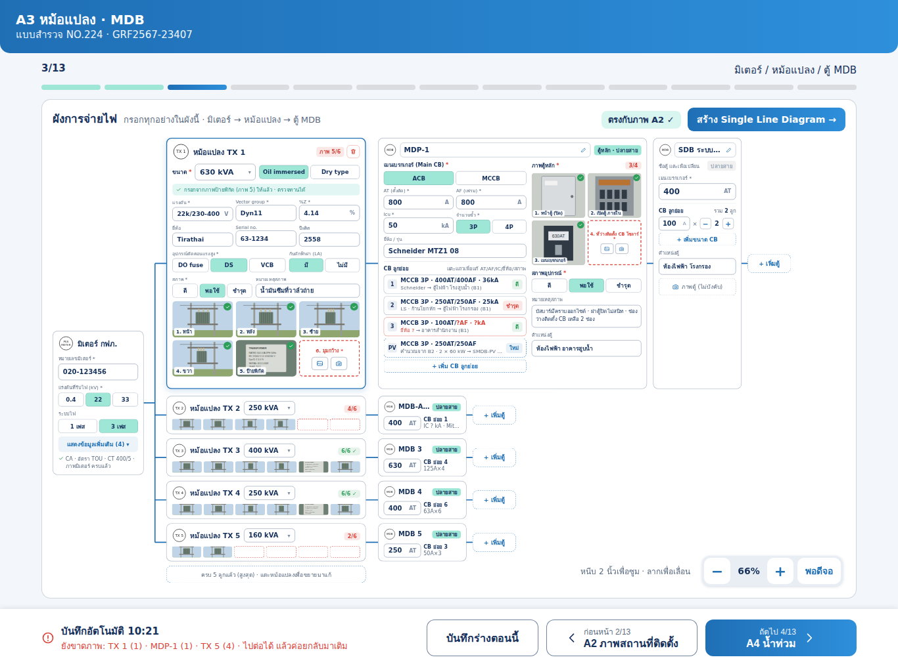

# งานสำหรับ Claude Code: หน้า A3 หม้อแปลง · MDB (iPad) ตามแบบใหม่

> วิธีใช้: เปิด Claude Code ในโฟลเดอร์ repo `TCRoof` แล้วพิมพ์
> `ทำตาม docs/ui/survey-a3/CLAUDE_CODE_TASK.md`

## เป้าหมาย
ตอนนี้หน้า A3 วาดจาก `Schema.electrical` ผ่าน `groupPage` แบบรายการช่องเรียงลงมา:
- `meterNo`
- `trafos` (`TransformersEditor`: kVA + ขนาดเบรกเกอร์ MDB 6 ช่องต่อหม้อแปลง)
- `transformerFields` (`tr{i}_front…wide`, `tr{i}_feed`, `tr{i}_feedLoc`, `tr{i}_feedPhoto`)

ให้ทำ layout เฉพาะของ A3 บน iPad แนวนอนตาม `preview.png` เป็น **ผังการจ่ายไฟ** แบบต้นไม้ที่กรอกข้อมูลได้ในผังเลย:
มิเตอร์ กฟภ. → หม้อแปลง (สูงสุด 5) → ตู้ MDB ของแต่ละหม้อแปลง → ตู้ย่อย

อ้างอิง:
- `preview.png`: ภาพหน้าจอ 1366 × 1024 ที่ซูม 66% (ค่าเริ่มต้น "พอดีจอ")
- `preview-zoom100.png`: ซูม 100% และกาง "ข้อมูลเพิ่มเติม" ของมิเตอร์
- `preview.html`: เปิดในเบราว์เซอร์ได้ (ภาพถ่ายในแบบเป็นภาพวาดแทน)
- `iPadA3.dc.html`: ต้นฉบับ logic มีแค่ซูม และกาง / ซ่อนข้อมูลมิเตอร์

## ไฟล์ที่เกี่ยวข้อง
- `TCRoofKit/Sources/TCRoofCore/Schema.swift`: `electrical`, `transformerAngles`, `transformerFields`, `transformerPresent`
- `TCRoofKit/Sources/TCRoofCore/Models.swift`: `Transformer` (`kva`, `mdb[6]`), `Values.transformers`, `shiftTransformerAnswers`
- `TCRoofKit/Sources/TCRoofCore/Progress.swift`, `Validation.swift`: การนับความครบของ A3
- `TCRoofKit/Sources/SurveyUI/Fields.swift` (`TransformersEditor`), `TransformerPhotos.swift`
- `TCRoofKit/Sources/SurveyUI/SitePageWide.swift`, `InfoPageWide.swift`: ตัวอย่างหน้าแบบ wide ที่ทำแล้วของ A1/A2 ให้ทำแบบเดียวกัน (`ElectricalPageWide`)
- `TCRoofKit/Sources/SurveyUI/JobEditor*.swift`: จุดที่เลือกหน้า wide ตามขั้น
- `TCRoofKit/Sources/PDFReport/ReportLayout.swift` (ผังมิเตอร์→หม้อแปลงบรรทัด ~221, ตารางหม้อแปลง ~333, หน้าภาพหม้อแปลง ~369)
- `TCRoofKit/Sources/ExcelExport/ExcelExporter.swift` (`METER`, หม้อแปลง `prefix(5)` บรรทัด ~116)
- `TCRoofKit/Sources/TCRoofCore/SiteMarks.swift`: `suggestedValue` ของหม้อแปลง / MDB บนภาพ A2 ต้องดึงค่าจาก A3 เหมือนเดิม

ใช้ code-review-graph ตาม `CLAUDE.md` หา caller ของ `transformers("trafos")`, `tr\(i)_`, `meterNo`, `shiftTransformerAnswers` ก่อนแก้

## โครงหน้า (iPad แนวนอน, เนื้อหากว้าง 1318)
การ์ดใหญ่ "ผังการจ่ายไฟ" เต็มพื้นที่ระหว่างแถบขั้นกับแถบล่าง
- หัวการ์ด: ชื่อ + คำอธิบาย `กรอกทุกอย่างในผังนี้ · มิเตอร์ → หม้อแปลง → ตู้ MDB`
  - ขวา: ชิปเขียว `ตรงกับภาพ A2 ✓` (จำนวนหม้อแปลง / MDB ตรงกับสัญลักษณ์บน `siteMarks`; ไม่ตรงให้เป็นชิปส้มบอกจำนวนที่ต่าง)
  - ปุ่มน้ำเงิน `สร้าง Single Line Diagram →` (หน้า SLD ยังไม่อยู่ในงานนี้ ให้เป็นปุ่ม disabled หรือซ่อนไว้ก่อน)
- พื้นที่ผังเลื่อน / ซูมได้ (ขนาดผังจริง 1720 × 1036 pt)
  - หนีบ 2 นิ้วซูม ลากเลื่อน
  - แผงควบคุมมุมขวาล่าง: `−` · `66%` · `+` · `พอดีจอ` ระดับ 50/60/66/80/90/100/125/150%
  - ข้อความ `หนีบ 2 นิ้วเพื่อซูม · ลากเพื่อเลื่อน` ด้านซ้ายของแผง
- เส้นเชื่อมสีน้ำเงินจากมิเตอร์ไปหม้อแปลงทุกลูก และจากหม้อแปลงไปตู้ MDB

### คอลัมน์ 1: มิเตอร์ กฟภ.
การ์ดเล็กชิดซ้าย กลางแนวตั้ง
- `หมายเลขมิเตอร์ *` → `meterNo` เดิม
- `แรงดันที่รับไฟ (kV) *` ปุ่มเลือก 0.4 / 22 / 33
- `ระบบไฟ` 1 เฟส / 3 เฟส
- ปุ่ม `แสดงข้อมูลเพิ่มเติม (4) ▾` / `ซ่อนข้อมูลเพิ่มเติม ▴` กางช่อง:
  - `เลขผู้ใช้ไฟ (CA)`, `ประเภทผู้ใช้ไฟ / อัตรา` (dropdown เช่น 4.2.2 TOU), `ขนาดมิเตอร์ / CT` (A), `ภาพมิเตอร์`
- ตอนซ่อน แสดงบรรทัดสรุปสีเขียว เช่น `CA · อัตรา TOU · CT 400/5 · ภาพมิเตอร์ ครบแล้ว`

### คอลัมน์ 2: หม้อแปลง
- หม้อแปลงที่เลือก **กาง** เป็นการ์ดใหญ่ (ขอบน้ำเงิน 2) ลูกอื่นเป็นแถบย่อ แตะแถบย่อเพื่อกางมาแก้ (กางได้ทีละลูก)
- แถบย่อ: ไอคอน `TX n` · ชื่อ · dropdown kVA · ชิปจำนวนภาพ `4/6` (ส้มเมื่อไม่ครบ, `6/6 ✓` เขียว) · แถวภาพย่อ 6 ช่อง (ช่องว่างขอบประแดง)
- การ์ดกาง:
  - หัว: `TX 1` · `หม้อแปลง TX 1` · ชิป `ภาพ 5/6` · ปุ่มลบ (ถังขยะแดง, ถามยืนยันก่อน แล้วใช้ `shiftTransformerAnswers`)
  - `ขนาด *` dropdown kVA → `Transformer.kva` และปุ่มเลือก `Oil immersed` / `Dry type`
  - แถบเขียว `กรอกจากภาพป้ายพิกัด (ภาพ 5) ให้แล้ว · ตรวจทานได้` (แสดงเมื่อค่าถูกเติมจากการอ่านภาพ `tr{i}_plate`; การอ่านป้ายด้วย Vision OCR ให้ทำเป็นขั้นแยกได้ ถ้ายังไม่ทำให้ซ่อนแถบนี้)
  - `แรงดัน *` (V), `Vector group *`, `%Z *`, `ยี่ห้อ`, `Serial no.`, `ปีผลิต`
  - `อุปกรณ์ตัดตอนแรงสูง *` DO fuse / DS / VCB, `กับดักฟ้าผ่า (LA)` มี / ไม่มี
  - `สภาพ *` ดี / พอใช้ / ชำรุด, `หมายเหตุสภาพ`
  - ภาพ 6 ช่อง 3 × 2 ตาม `transformerAngles` (1. หน้า 2. หลัง 3. ซ้าย 4. ขวา 5. ป้ายพิกัด 6. มุมกว้าง) ช่องที่มีภาพมีเครื่องหมายถูกเขียว ช่องว่างขอบประแดงพร้อมปุ่ม คลังภาพ / กล้อง
- ใต้หม้อแปลงลูกสุดท้าย: ปุ่มประ `+ เพิ่มหม้อแปลง` หรือเมื่อครบ 5 แสดง `ครบ 5 ลูกแล้ว (สูงสุด) · แตะหม้อแปลงเพื่อขยายมาแก้`

### คอลัมน์ 3–4: ตู้ MDB ของแต่ละหม้อแปลง
แต่ละหม้อแปลงมีแถวตู้ของตัวเอง ต่อด้วยปุ่มประ `+ เพิ่มตู้` ท้ายแถว
- **ตู้ของหม้อแปลงที่ย่ออยู่**: การ์ดย่อ ชื่อตู้ · ชิป `ปลายสาย` · เมน `400 AT` · `CB ย่อย n` + สรุป เช่น `125A×4`
- **ตู้หลัก (ปลายสาย) ของหม้อแปลงที่กาง** การ์ดใหญ่ 2 คอลัมน์:
  - หัว: ไอคอน MDB · ชื่อตู้แก้ได้ (`MDP-1`) · ชิป `ตู้หลัก · ปลายสาย`
  - ซ้าย:
    - `เมนเบรกเกอร์ (Main CB) *` ACB / MCCB
    - `AT (ตั้งตัด) *`, `AF (เฟรม) *`, `Icu *` (kA), `จำนวนขั้ว *` 3P / 4P, `ยี่ห้อ / รุ่น`
    - `CB ลูกย่อย` แต่ละแถว: เลขลำดับ · `MCCB 3P · 400AT/400AF · 36kA` · ยี่ห้อ → ปลายทาง (เช่น ตู้ไฟฟ้า โรงสูบน้ำ (B1)) · ชิปสภาพ
      - ค่าที่ยังไม่รู้แสดง `?` สีแดง และแถวขอบแดง
      - แตะแถวเพื่อแก้ AT / AF / IC / ยี่ห้อ / สภาพ / ปลายทาง (sheet)
      - แถว `PV` ขอบประ ชิป `ใหม่`: CB ที่จะเพิ่มสำหรับโซลาร์ คำนวณจากกำลังอินเวอร์เตอร์ใน B2 (เช่น 2 × 60 kW → 250AT) อ่านอย่างเดียว
    - ปุ่มประ `+ เพิ่ม CB ลูกย่อย`
  - ขวา:
    - `ภาพตู้หลัก *` ชิป `3/4` ภาพ 2 × 2: 1. หน้าตู้ (ปิด) 2. เปิดตู้ ภายใน 3. เมนเบรกเกอร์ 4. ที่ว่างติดตั้ง CB โซลาร์ *
    - `สภาพอุปกรณ์ *` ดี / พอใช้ / ชำรุด, `หมายเหตุสภาพ` (หลายบรรทัด), `ตำแหน่งตู้` → `tr{i}_feedLoc`
- **ตู้ย่อย** (เช่น `SDB ระบบกรอง`) การ์ดแคบถัดไป:
  - ชื่อตู้ (แตะเพื่อเปลี่ยน) · ชิป `ปลายสาย`
  - `เมนเบรกเกอร์ *` AT
  - `CB ลูกย่อย` รวม n ลูก: แถวขนาด `100 A × [− 2 +]` และปุ่ม `+ เพิ่มขนาด CB`
  - `ตำแหน่งตู้`, `ภาพตู้ (ไม่บังคับ)`

### แถบล่าง
- ซ้าย: `บันทึกอัตโนมัติ HH:mm` และบรรทัดแดง `ยังขาดภาพ: TX 1 (1) · MDP-1 (1) · TX 5 (4) · ไปต่อได้ แล้วค่อยกลับมาเติม` แตะชื่อแล้วกางการ์ดนั้นและเลื่อนผังไปหา
- ขวา: `บันทึกร่างตอนนี้` · `‹ ก่อนหน้า 2/13 A2 ภาพสถานที่ติดตั้ง` · `ถัดไป 4/13 A4 น้ำท่วม ›`

## ข้อมูลที่ต้องเพิ่ม (ห้ามเปลี่ยน id เดิม)
ของเดิมต้องใช้ต่อ:
- `meterNo`, `trafos` (`Transformer.kva`), `tr{i}_front…wide`, `tr{i}_feed` (= ชื่อตู้หลัก), `tr{i}_feedLoc` (= ตำแหน่งตู้หลัก), `tr{i}_feedPhoto` (= ภาพหน้าตู้ปิด)
- `Transformer.mdb[k]` = AT ของเมนเบรกเกอร์ตู้ที่ k ของหม้อแปลงนั้น (ตู้หลักคือ k = 0) เพื่อให้ Excel / PDF เดิมยังได้ค่า
- `caNo`, `userType`, `meterPhoto` มีอยู่แล้วใน module อื่น ให้ตรวจก่อนว่าอยู่ใน `Values` ชุดเดียวกันหรือไม่ ถ้าใช่ใช้ id เดิม ห้ามสร้างซ้ำ

ของใหม่ (optional ทั้งหมด completion ของ A3 นับเท่าเดิม):
- มิเตอร์: `meterKV` (0.4/22/33), `meterPhase`, `meterCT`
- หม้อแปลง: เพิ่ม field ใน `Transformer` แบบ optional มีค่าเริ่มต้น เพื่อให้ JSON เก่าถอดรหัสได้ (`decodeIfPresent`)
  - `type` (oil / dry), `voltage`, `vectorGroup`, `impedance`, `brand`, `serial`, `year`, `hvProtection` (DO fuse / DS / VCB), `hasLA`, `condition`, `conditionNote`
- ตู้: `boards: [Board]` ใน `Transformer`
  - `Board`: `id`, `name`, `isMain`, `mainType` (ACB / MCCB), `at`, `af`, `icu`, `poles`, `brand`, `breakers: [Breaker]`, `condition`, `conditionNote`, `location`, `photos` (4 ช่องสำหรับตู้หลัก, 1 ช่องสำหรับตู้ย่อย)
  - `Breaker`: `at`, `af`, `ic`, `poles`, `brand`, `target`, `condition`, `count` (สำหรับตู้ย่อยที่นับตามขนาด)
  - ถ้า `boards` ว่างแต่ `mdb[]` มีค่า ให้สร้างตู้จาก `mdb[]` ตอนแสดง (งานเก่า)
  - เขียน `mdb[k]` ตาม `boards[k].at` ทุกครั้งที่บันทึก สูงสุด 6 ตู้ต่อหม้อแปลงเหมือนเดิม
- ภาพตู้หลัก 4 ช่อง: ช่อง 1 ใช้ `tr{i}_feedPhoto` เดิม ช่อง 2–4 เป็น key ใหม่ `tr{i}_mdbOpen`, `tr{i}_mdbBreaker`, `tr{i}_mdbSpace` (ช่อง 4 บังคับตามแบบ แต่ให้เป็น optional ใน `Schema` จนกว่าจะตกลงเรื่อง completion; แสดง * และนับใน "ยังขาดภาพ" ได้) และเพิ่ม suffix ใหม่ใน `shiftTransformerAnswers`
- PV breaker คำนวณจาก B2 ไม่ต้องเก็บ

## PDF / Excel
- ตำแหน่ง cell และรูปแบบ Excel เดิมห้ามขยับ ค่าที่ Excel ใช้ (`METER`, kVA, `mdb[]`) ต้องยังมาครบ
- PDF: ผังมิเตอร์ → หม้อแปลง → MDB (บรรทัด ~221) ใช้ชื่อตู้จาก `boards` ถ้ามี; ตารางหม้อแปลงเพิ่มคอลัมน์ Vector group / %Z / สภาพ ถ้ามีค่า; หน้าภาพหม้อแปลงแสดงภาพตู้หลักครบ 4 ช่อง
- ทำเพิ่มเฉพาะส่วนที่ไม่ทำให้ layout เดิมของหน้าอื่นเลื่อน

## เงื่อนไข / ข้อห้าม
- ห้ามเปลี่ยน field id / ป้ายชื่อเดิมใน `Schema` และห้ามเปลี่ยนรูปแบบ Excel
- JSON งานเก่าต้องเปิดได้ (มีแค่ `kva` + `mdb[6]`)
- iPad แนวตั้งและ iPhone (compact) ใช้ `groupPage` เดิม
- ปุ่มและช่องทุกตัวสูงอย่างน้อย 44 pt ที่ซูม 100% (ที่ 66% แตะได้ แต่ถ้าแตะช่องให้ซูมเข้าไปที่การ์ดนั้นก่อนก็ได้)
- ค่าในภาพตัวอย่าง (NO.224, 630 kVA, Tirathai, 63-1234, MDP-1, Schneider MTZ1 08, 020-123456, 4.2.2 TOU, CT 400/5, ชื่ออาคาร / ตู้, หมายเหตุสภาพ, 2 × 60 kW) เป็นตัวอย่าง ห้าม hardcode

## ตรวจงานก่อนจบ
1. build ผ่าน + `swift test` ผ่าน และเพิ่ม test:
   - JSON งานเก่า (`Transformer` มีแค่ `kva`, `mdb`) ถอดรหัสได้ และสร้างตู้จาก `mdb[]` ได้
   - บันทึก `boards` แล้ว `mdb[k]` ตรงกับ `boards[k].at`
   - ลบหม้อแปลงลูกกลางแล้วภาพ / ตู้ของลูกถัดไปเลื่อนตามถูก
2. รัน iPad simulator แนวนอน 1366 × 1024 เทียบกับ `preview.png` และ `preview-zoom100.png`
3. ลอง flow:
   - กรอกมิเตอร์ → เพิ่มหม้อแปลง 2 ลูก → กางสลับกัน → ถ่ายภาพครบ 6
   - เพิ่มตู้หลัก + CB ลูกย่อย 3 แถว + ตู้ย่อย → ดูว่าสัญลักษณ์ MDB บน A2 ได้ค่า AT ใหม่
   - ซูม / เลื่อน / พอดีจอ → ส่งออก PDF และ Excel ตรวจค่า
4. สรุปไฟล์ที่แก้ และสิ่งที่ยังค้าง
