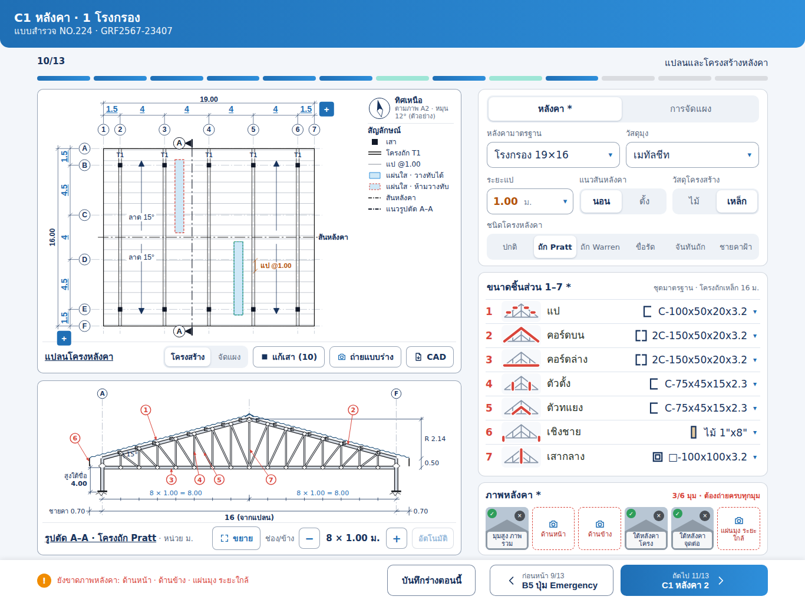

# Claude Code task: C1 Roof (หลังคา · แปลนและโครงสร้าง) page for iPad, new design

> How to use: open Claude Code in the `TCRoof` repo folder and type
> `Follow docs/ui/survey-c1/CLAUDE_CODE_TASK.md`

UI text stays in Thai exactly as shown in the previews. This document is in English. Thai strings in `backticks` are the literal labels to use. All values in the previews (19 × 16 m, member sizes, 66 panels and so on) are **example data**.

## Goal
C1 (`ModuleType.roof`, `Schema.modules[.roof]`) is currently drawn by `groupPage` as four vertical groups:
- `แปลนหลังคา`: `planFields(tank: false)`, `PlanPreview`
- `โครงสร้าง`: `.diagram`, `SketchView(Drawings.truss())`, `comp1…7` `.member`
- `รูปแบบหลังคา`: `roofShape`, `roofMaterial`, `roofStructure`
- `ภาพถ่าย`

Build a dedicated **one-screen** iPad landscape layout matching `preview.png`. Name it `RoofPageWide` and build it the same way as `InfoPageWide`, `SitePageWide`, `ElectricalPageWide` and `FloodPageWide`. Nothing scrolls. Everything fits between the step bar and the bottom bar.

## Files in this folder

| File | What it is |
|---|---|
| `preview.png` | Default state, tab `โครงสร้าง` (1366 × 1024) |
| `preview-panels.png` | Plan tab `จัดแผง` and right tab `การจัดแผง` (PV layout) |
| `preview-edit-posts.png` | `แก้เสา` mode: tap grid nodes to add or remove posts |
| `preview-section-zoom.png` | `ขยาย`: section A–A full-screen sheet |
| `preview-std-dropdown.png` | `หลังคามาตรฐาน` dropdown open (PWA standards + team-saved) |
| `preview.html` | Default state, opens in a browser |
| `states/*.pdf` | **Vector** PDF of each state at 1366 × 1024. Use these to measure exact sizes, colours and strokes. |
| `iPadC1.dc.html` | Design source. Its `<script type="text/x-dc">` (`renderVals`) holds the reference logic: plan geometry, purlins, posts, section drawing, PV packing, member lists, DXF export (`cadBuild`). Read it for formulas. Do not port the HTML. |
| `svg/` | All vector assets (see below) |

### `svg/` assets
- `drawings/`
  - `plan-structure.svg`: plan with all labels
  - `plan-panels.svg`: plan with PV layout
  - `section-AA-pratt.svg`: section A–A
  - `section-AA-pratt-fullscreen.svg`: full-screen section
  - `*-lines-only.svg`: the same drawings without text, as a geometry reference. The page draws its labels as separate overlay text.
  - Use these as visual references. The app must **draw the plan and section in code** (SwiftUI `Canvas` / `Path`) from the job's values, because they change live.
- `legend/`: 24 × 14 legend symbols for both tabs (`structure-*`, `panels-*`)
- `members/`
  - `member-1…7-*.svg`: truss thumbnails with the member highlighted in red
  - `profile-1…7-*.svg`: steel section glyphs (C, 2C, □, timber)
  - Can go into `Assets.xcassets` as vector images (Preserve Vector Data), or be redrawn as `Path`.
- `roof-types/`: 40 × 24 glyphs for the standard-roof dropdown, one per frame type
- `icons/`
  - `north-arrow`, `cad-export`, `camera-add`, `camera-sketch`, `expand`, `edit-posts`, `chevron-prev/next`
  - Prefer SF Symbols where one matches: `camera`, `arrow.up.left.and.arrow.down.right`, `chevron.left/right`, `square.and.arrow.down`. Use the SVG only when there is no match (north arrow).
  - `photo-thumb-sample-*` is a placeholder for the photo tiles in the preview, not an app asset.

The design uses the Sarabun font. Keep the app's current fonts (`Theme.swift`). Do not add Sarabun.

## Relevant files
- `TCRoofKit/Sources/TCRoofCore/Schema.swift`
  - `modules[.roof]`
  - `planFields(tank:)`: `spansX`, `spansY`, `sheetDir`, `obst`, `plan`, `planPhoto`
  - `Options.components`, `roofShape`, `roofMaterial`, `structure`
  - `FieldKind.member`, `.diagram`, `.plan`
- `TCRoofKit/Sources/TCRoofCore/StructureSizes.swift`: member size lists
- `TCRoofKit/Sources/TCRoofCore/Sketch.swift`, `SketchSVG.swift`: `Drawings.truss()`, current SVG output for the report
- `TCRoofKit/Sources/SurveyUI/Fields.swift`: `PlanPreview` (~line 188), `.diagram`, `.member` rows
- `TCRoofKit/Sources/SurveyUI/JobEditor.swift`: `detailArea` routing. Add `cardRoof` like `cardFlood`.
- `TCRoofKit/Sources/SurveyUI/JobEditor+Detail.swift`: `groupPage`
- `TCRoofKit/Sources/SurveyUI/FloodPageWide.swift`, `SitePageWide.swift`: patterns for a wide page plus bottom-bar gaps (`InfoPageBar.Gap`)
- `TCRoofKit/Sources/TCRoofCore/Progress.swift`, `Validation.swift`: C1 completeness and missing items
- `TCRoofKit/Sources/PDFReport/ReportLayout.swift`, `ExcelExport/ExcelExporter.swift` (sheet `หลังคาทั่วไป R`): the report must still get the same answers

Per `CLAUDE.md`, use code-review-graph before editing. Find the callers of `spansX`, `spansY`, `comp1…7`, `roofStructure`, `PlanPreview` and `Drawings.truss`, and check `tests_for` on `Validation` / `Progress`.

## Layout (iPad landscape, content 1240 × 792 below the step bar)
Measured from the design. All values are in pt.

| Region | x, y, w, h |
|---|---|
| Header + 13-step bar | as on the other pages (`10/13` · `แปลนและโครงสร้างหลังคา`) |
| Left column | 63, 151, **720** × 792 |
| · Plan card | 720 × 483 |
| · Section A–A card | 720 × 297 (gap 12) |
| Right column | 811, 151, **492** × 792 (gap 28) |
| · Roof / PV card (tabs) | 492 × 301 |
| · Members 1–7 card | 492 × 347 |
| · Photos card | 492 × 124 |
| Bottom bar | 73 high: gap status · `บันทึกร่างตอนนี้` · `ก่อนหน้า 9/13 B5 ปุ่ม Emergency` · `ถัดไป 11/13 C1 หลังคา 2` |

### Left column

**1. Plan card `แปลนโครงหลังคา`**: canvas, legend at right, footer toolbar.
- **Structure plan** (`plan-structure.svg`):
  - Grid from `spansX` / `spansY` (default `1.5,4,4,4,4,1.5` × `1.5,4.5,4,4.5,1.5`), scaled to fit about 380 × 320.
  - Grid bubbles `1…n` on top and `A…` on the left.
  - Two dimension chains on each side: spans, and the overall total (`19.00` / `16.00`, vertical text rotated −90°).
  - **Span values are tappable**: popover `−` value `+`, step 0.05 m, plus the quick actions `แบ่งครึ่ง`, `ลบช่วง`, `ถัดไป ›`, `EQ เท่ากันทั้งแนว`.
  - A blue `+` at the end of each chain adds a span.
- Structure elements drawn from the frame type (`ชนิดโครงหลังคา`):
  - `ปกติ` / `ถัก Pratt` / `ถัก Warren`: trusses `T1` across, double line, labelled.
  - `ขื่อรัด` / `ชายคาฝ้า`: rafters `จันทัน @1.00` plus eaves beams `อเส`.
  - `จันทันถัก`: `T1` across plus `T2` along.
  - Purlins parallel to the ridge at `ระยะแป` measured along the slope (plan spacing = `pp·cos(angle)`).
  - Posts are black squares at defaults per frame type.
  - Ridge line is dash-dot, labelled `สันหลังคา`. It is horizontal or vertical from `แนวสันหลังคา นอน/ตั้ง`.
  - Slope arrows `ลาด 15°`: 15° by default, 30° for `ขื่อรัด`.
  - Skylights: light-blue rectangles. Dashed red outline = `แผ่นใส · ห้ามวางทับ`, teal = `แผ่นใส · วางทับได้`.
  - Section mark `A ◀` at both ends of line A–A.
  - The orange callout `แป @1.00` follows `ระยะแป`.
- **Legend** (`legend/structure-*`) with a north arrow `ทิศเหนือ`, rotated from A2 (`ตามภาพ A2 · หมุน 12° (ตัวอย่าง)`).
- **Footer**:
  - Title `แปลนโครงหลังคา` (underlined link style)
  - Segmented `โครงสร้าง | จัดแผง`
  - `แก้เสา (10)`: toggles post-edit mode (see `preview-edit-posts.png`). Every grid node shows a 22 pt target, red-filled = has post, blue dashed = empty. Tap to toggle. The button reads `เสร็จ · เสา 10 ต้น`.
  - `ถ่ายแบบร่าง` → existing `planPhoto` (a hand sketch replaces the auto plan).
  - `CAD`: opens a sheet `ส่งออก CAD` / `DXF R12 · เปิดได้ใน CAD ทั่วไป`, with units `มม. (1:1)` / `ม.` and layer list. Port `cadBuild` from the design script. It writes plain DXF R12 `LINE`/`CIRCLE`/`TEXT` entities, with Thai mapped to TIS-620 code points.
- **Panels plan** (`preview-panels.png`, `plan-panels.svg`):
  - The same grid with PV tables packed between eaves and ridge on each slope.
  - Skips `ห้ามวางทับ` skylights and blocked bays.
  - Shows `ห่าง 0.40` between tables.
  - Uses the `legend/panels-*` legend.

**2. Section card `รูปตัด A–A · โครงถัก Pratt`** (`section-AA-pratt.svg`)
- Truss drawn from frame type, span (= plan depth across the ridge), bays per side (`ช่อง/ข้าง` stepper `− 8 × 1.00 ม. +`, `อัตโนมัติ`), slope, height under tie `สูงใต้ขื่อ 4.00` and eaves `ชายคา 0.70`.
- Includes:
  - purlin cleats on the top chord
  - corrugated roof sheet line
  - rise dimension `R 2.14` (= span/2·tan(angle)) and `0.50` truss depth
  - bottom dimension chain `8 × 1.00 = 8.00` per side and overall `16 (จากแปลน)`
- Red numbered callouts `1…7` point at the members.
  - Tapping a row in **Members 1–7** highlights that member in red here.
  - Tapping a callout scrolls to and selects its row.
- `ขยาย` opens a full-screen sheet (`preview-section-zoom.png`) with the caption `หน่วย ม. · แตะรายการขนาดชิ้นส่วนเพื่อไฮไลต์ตำแหน่ง` and `ปิด`.

### Right column

**3. Card with tabs `หลังคา *` | `การจัดแผง`**
- **Tab `หลังคา`**:
  - `หลังคามาตรฐาน`: dropdown, see `preview-std-dropdown.png`.
    - Section `แบบมาตรฐาน กปภ.` shows a glyph, name and size, subtitle (`ถัก Pratt · ช่วงเสา 4 ม. · 7 × 6 กริด`) and ✓.
    - Section `แบบที่ทีมบันทึก` shows who and when.
    - Footer `＋ บันทึกค่าปัจจุบันเป็นแบบใหม่` opens the save sheet (`ชื่อแบบ`, `ใครใช้ได้ ทั้งทีม / เฉพาะฉัน`, `บันทึกแบบ`).
    - Picking a standard fills `spansX`, `spansY`, frame type and `ระยะแป`.
    - The standards list is `STD` in the design script.
  - `วัสดุมุง`: dropdown with subtitles. The list is `RM` in the design script (`เมทัลชีท`, `เมทัลชีทบุฉนวน`, `กระเบื้องลอนคู่`, `กระเบื้องคอนกรีต`, `แผ่นโปร่งแสง`, `คอนกรีต (ดาดฟ้า)`).
  - `ระยะแป`: value button `1.00 ม. ▾` opens a number popover, `−`/`+` step 0.05, range 0.60–1.50, `วัดตามแนวลาด`.
  - `แนวสันหลังคา`: segmented `นอน | ตั้ง`.
  - `วัสดุโครงสร้าง`: segmented `ไม้ | เหล็ก`.
  - `ชนิดโครงหลังคา`: 6-way segmented `ปกติ | ถัก Pratt | ถัก Warren | ขื่อรัด | จันทันถัก | ชายคาฝ้า`.
- **Tab `การจัดแผง`**:
  - Count `66 แผง` and `37.6 kWp`, with subtitle `{n} ชุด · แผง 570 W`. The module spec is `MOD` in the script, W = 0.57 kW.
  - `แนวแผง ตั้ง | นอน`
  - `แถวต่อชุด (ตามแนวลาด)`: chips
  - `แผงต่อชุด`
  - `ระยะห่างระหว่างชุด`: stepper, 0.40 m.

**4. `ขนาดชิ้นส่วน 1–7 *`** with subtitle `ชุดมาตรฐาน · โครงถักเหล็ก 16 ม.`
- Each row has the number, the `members/member-n` thumbnail, the name, the `profile-n` glyph, the size and `▾`. Tapping opens a size list with ✓.
- Rows: `แป`, `คอร์ดบน`, `คอร์ดล่าง`, `ตัวตั้ง`, `ตัวทแยง`, `เชิงชาย`, `เสากลาง`. Size lists are in the design script (array `M`).
- Map rows to the existing `comp1…7` fields. The current `Options.components` names (`แป, จันทัน, อเส, ขื่อ, ค้ำยัน, เชิงชาย, ดั้ง`) apply to timber or rafter frames. For truss frames, use the design's names. **Keep `comp1…7` storage keys unchanged**, so the report and Excel still work, and label each row by frame type.

**5. `ภาพหลังคา *`** with chip `3/6 มุม · ต้องถ่ายครบทุกมุม`
- Six 73 pt tiles: `มุมสูง ภาพรวม`, `ด้านหน้า`, `ด้านข้าง`, `ใต้หลังคา โครง`, `ใต้หลังคา จุดต่อ`, `แผ่นมุง ระยะใกล้`.
- Taken tiles show the photo, a green ✓ and a delete ×. Empty tiles are red dashed with a camera and the name.
- Map them onto `aerialPhoto`, `generalPhotos` and `structPhotos`. Do not rename existing keys. The order above is display only.

### Bottom bar
- Left: an orange gap status, e.g. `ยังขาดภาพหลังคา: ด้านหน้า · ด้านข้าง · แผ่นมุง ระยะใกล้`. Tapping jumps to the first gap.
  - Provide `RoofPageWide.gaps(job)` like `SitePageWide.gaps` and wire it into `InfoPageBar`.
  - When nothing is missing it turns green: `ครบช่องบังคับแล้ว`.
- Then `บันทึกร่างตอนนี้` · `‹ ก่อนหน้า` · `ถัดไป ›`. Previous and next sit next to each other, as on the other pages.

## Data
- Reuse existing keys wherever they exist: `spansX`, `spansY`, `sheetDir`, `obst`, `planPhoto`, `roofShape`, `roofMaterial`, `roofStructure`, `comp1…7`, and the photos.
- New values (add them to `Schema` as optional fields so old jobs still open):
  - `roofStd`
  - `purlinSpacing` (default 1.00)
  - `ridgeDir` (`นอน`/`ตั้ง`)
  - `frameType` (`n p w c r k`)
  - `sectionBays` (0 = auto)
  - `posts`: an edited set of grid nodes per frame type, stored as text, e.g. `"2,1;3,1"`
  - `pvOrient`, `pvRows`, `pvPerTable`, `pvGap`
- `roofMaterial` options change to the design list. Map old answers on read: `กระเบื้องซีแพค` → `กระเบื้องคอนกรีต`, `กระเบื้องลอนคู่/เดี่ยว` → `กระเบื้องลอนคู่`. Keep `อื่นๆ`.
- `roofStructure` (`ไม้`/`โครงเหล็ก`) is driven by `วัสดุโครงสร้าง`.

## Acceptance
1. On a 1366 × 1024 iPad landscape, C1 matches `preview.png` with no scrolling.
2. Changing spans, ridge direction, frame type, purlin spacing or posts redraws the plan, the section, the dimensions and the panel count live.
3. `จัดแผง` packs panels as in `preview-panels.png` and respects `ห้ามวางทับ` skylights.
4. Member row ↔ section callout highlighting works both ways. `ขยาย` opens the full-screen section.
5. The CAD sheet writes a DXF that opens in a CAD viewer with the layer names from the design.
6. The gap status and C1 completeness agree with `Validation` / `Progress`.
7. The PDF report and Excel export for an existing job are unchanged. Add or extend tests in `TCRoofKit/Tests`.
8. Portrait or narrow width: stack the right column under the left, the same way `FloodPageWide(stacked:)` does.
