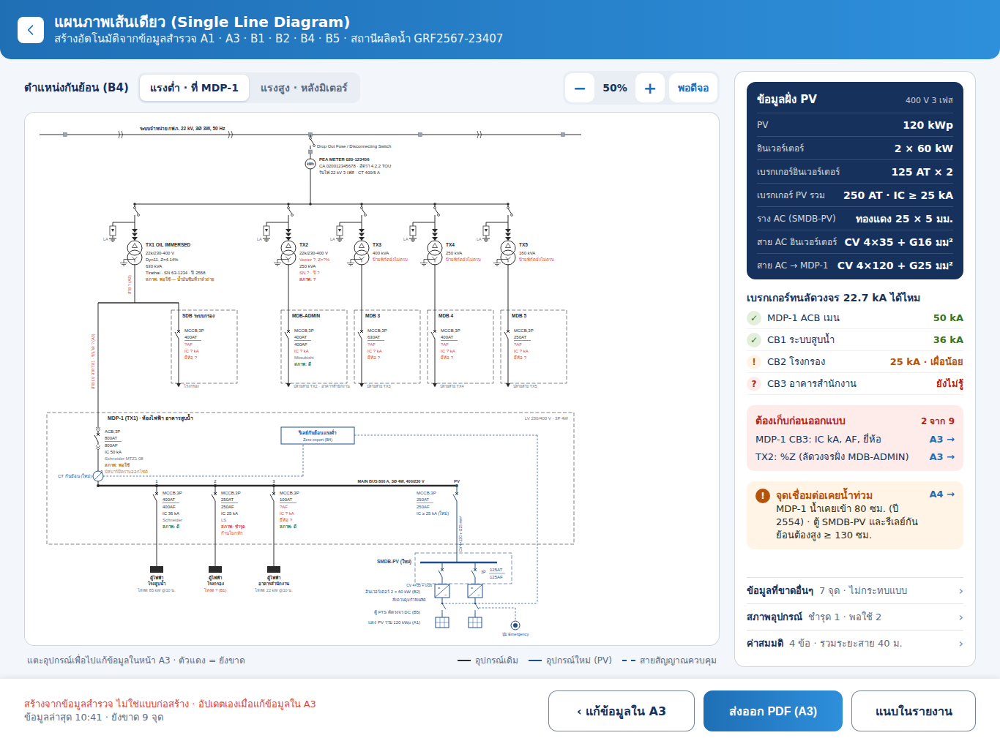

# Claude Code task: SLD แผนภาพเส้นเดียว (Single Line Diagram) page for iPad, generated from A3

> How to use: open Claude Code in the `TCRoof` repo folder and type
> `Follow docs/ui/survey-sld/CLAUDE_CODE_TASK.md`

UI text stays in Thai exactly as shown in the previews. This document is in English; Thai strings in `backticks` are the literal labels to use.

## Goal
The A3 wide page (`ElectricalPageWide.swift`) has a disabled button `สร้าง Single Line Diagram →` ("the single line diagram page is not in the app yet"). Build that page.

The SLD is **generated automatically** from the survey data. It is not edited by hand:
- A1 `capacity` (PV kWp)
- A3 meter fields, transformers and boards (`Transformer`, `Board`, `Breaker`)
- A4 flood check (`FloodCheck`)
- B1 building panels (`loadKW`, `loadTime`)
- B2 inverter sections (`inverterCount`)
- B4 zero export (`backfeed.level`, `pole`)
- B5 FTS / emergency button

It shows what is missing (red `?`) and links back to the page where each value is entered. It exports as an A3 PDF and can be attached to the survey report.

References:
- `preview.png`: page at 1366 × 1024, zero export on the low-voltage side (default)
- `preview-hv.png`: same page with `แรงสูง · หลังมิเตอร์` selected
- `diagram-lv.png` / `diagram-hv.png` and `diagram-lv.svg` / `diagram-hv.svg`: the full diagram at 1560 × 1480 (design units). **Use the SVGs as the drawing reference**: symbols, line weights, colours, text positions.
- `preview.html`: opens in a browser
- `iPadSLD.dc.html`: design source. Its logic covers only zoom and the LV/HV toggle.

## Relevant files
- `TCRoofKit/Sources/SurveyUI/ElectricalPageWide.swift` (`cardHeader`: enable the button and navigate to the new page), `ElectricalPageWide+Cards.swift`
- `TCRoofKit/Sources/SurveyUI/JobEditor.swift` (`Page` enum: add `.sld`, or present it as a full-screen cover from A3), `JobEditor+Detail.swift`, `JobEditor+Sidebar.swift`
- `TCRoofKit/Sources/TCRoofCore/Models.swift`: `Transformer`, `Board`, `Breaker`, `resolvedBoards`
- `TCRoofKit/Sources/TCRoofCore/Schema.swift`: `electrical` (meter fields `meterNo`, `meterKV`, `meterPhase`, `meterCA`, `meterRate`, `meterCT`), module specs `.panel`, `.inverter`, `.backfeed`, `.fts`, A1 `capacity`
- `TCRoofKit/Sources/TCRoofCore/Flood.swift`: `FloodCheck.state`, `level`, `minCm`
- `TCRoofKit/Sources/SurveyUI/FloodPageWide.swift`, `ElectricalPageWide.swift`: zoom / pan implementation to reuse
- `TCRoofKit/Sources/PDFReport/PDFRenderer.swift`, `ReportLayout.swift`: PDF drawing primitives (`DrawOp`) and report units
- `TCRoofKit/Sources/SurveyUI/ExportSheet*.swift`: export options (add the SLD attachment toggle)

Use code-review-graph per `CLAUDE.md` to find callers of `resolvedBoards`, `transformers("trafos")`, `FloodCheck`, `ReportLayout` units and the `Page` enum before editing.

## Architecture
1. **`TCRoofCore/SingleLine.swift`** (pure, testable, no UI):
   - `SingleLineModel.build(job) -> SingleLine`, a value tree: source → meter → transformers → boards → breakers → loads, plus the PV branch and control links.
   - Every text item carries a status: `known`, `missing`, `assumed`, `new`, `condition(good/fair/bad)`. Each `missing` item also carries a `target` (page + transformer/board/breaker id) for navigation.
   - Calculations (see below) and the missing-item list.
2. **`TCRoofCore/SingleLineLayout.swift`**: turns the model into positioned primitives (lines, symbols, texts) in design units (1560 wide, height grows with content). Used by both the screen and the PDF, so they always match.
3. **`SurveyUI/SingleLinePage.swift`**: the page, rendering the layout with SwiftUI `Canvas`, plus hit-testing for taps.
4. **PDF**: render the same primitives with `DrawOp` onto an A3 landscape page.

## Icons (added 2026-10-01)
All icons are in `docs/ui/survey-sld/icons/`; see `icons/icons.png` for an overview.

| Folder | Contents |
|---|---|
| `svg/` | SLD symbols cut from `diagram-lv.svg` / `diagram-hv.svg` (the design's exact geometry and colours) |
| `svg/ui/` | page icons: back chevron, IC-check badges, flood alert, legend line samples |
| `png/` | PNG @1x/@2x/@3x, transparent |
| `SLDIcons.xcassets` | PDF vector imagesets (`preserves-vector-representation`), ready for Xcode; `ui-back` is a template image |

Symbols (design units = points at 100 % zoom):

| File | Diagram element |
|---|---|
| `sld-line-break` | `))` break on the PEA HV line |
| `sld-dropout-switch` | Drop Out Fuse / Disconnecting Switch under the HV line (DO fuse / DS) |
| `sld-pea-meter` | `kWh` PEA meter |
| `sld-ct-vt-hv` | HV zero export CT/VT under the meter (HV mode) |
| `sld-hv-switch` | switch at the top of each transformer drop |
| `sld-lightning-arrester` | LA branch with ground (only when `hasLA == true`) |
| `sld-cable-terminations` | three cable-termination triangles above the transformer |
| `sld-transformer` | Δ/Y transformer with grounded neutral |
| `sld-breaker-mccb` | fixed breaker (MCCB) |
| `sld-breaker-acb-drawout` | draw-out main breaker (ACB) |
| `sld-ct-lv` | LV zero export CT on the connection board incomer (LV mode) |
| `sld-load` | black load block at the end of an outgoing breaker |
| `sld-inverter` | inverter (=/~) |
| `sld-dc-disconnect` | DC disconnect in the FTS (B5) |
| `sld-pv-array` | PV array |
| `sld-emergency-button` | emergency button (B5) |

| File | Page element |
|---|---|
| `ui-back` | header back button |
| `ui-check-ok` / `ui-check-marginal` / `ui-check-insufficient` / `ui-check-unknown` | IC check rows `✓` / `!` / `✗` / `?` |
| `ui-flood-alert` | flood card icon |
| `legend-existing` / `legend-new-pv` / `legend-control` | footer legend |

How to use:
1. **Diagram and PDF stay vector:** draw every symbol with `DrawOp` paths in `SingleLineLayout`, copying the geometry, stroke widths and colours from `icons/svg/sld-*.svg`. Do not place the images in the diagram or PDF: the drawing must scale and stay sharp. The SVGs are the reference for matching.
2. **Asset catalog:** copy `SLDIcons.xcassets` into `TCRoofKit/Sources/SurveyUI/Resources/`. Merge it with `A2Icons.xcassets` if that folder already exists; `resources: [.process("Resources")]` is already needed for A2.
3. **Side panel and legend:** use `Image(name, bundle: .module)` for the IC-check badges, the flood icon and the legend samples. Use `ui-back` with `.renderingMode(.template)`.
4. **Glyph-only items:** keep the zoom `−` / `+`, `›` rows and `พอดีจอ` as text or SF Symbols, as in the design.

Note: `diagram-lv.svg` / `diagram-hv.svg` were re-exported on 2026-10-01. The first export had lost the `width` / `height` of every `<rect>`, so boxes were missing: LA box, board frames, relay box, inverter box, PV array, load blocks, SMDB-PV frame and pole marks. If the current `SingleLineLayout` was matched against the old files, check those items again.

## Page layout (iPad landscape)
- **Header bar** (blue gradient as on other pages):
  - round white back button `‹`
  - title `แผนภาพเส้นเดียว (Single Line Diagram)`
  - subtitle `สร้างอัตโนมัติจากข้อมูลสำรวจ A1 · A3 · B1 · B2 · B4 · B5 · {project/station name} {job number}`
- **Left: diagram area** (~950 pt wide)
  - Toolbar above it:
    - `ตำแหน่งกันย้อน (B4)` with a segmented control `แรงต่ำ · ที่ MDP-1` / `แรงสูง · หลังมิเตอร์`. It reads and writes the B4 `level` choice (`กันย้อนที่แรงต่ำ` / `กันย้อนที่แรงสูง`). If there is no B4 section, the toggle is a preview only and shows a hint to add B4.
    - zoom control `−` · `50%` · `+` · `พอดีจอ`, levels 35 / 50 / 60 / 75 / 90 / 100 %; pinch to zoom, drag to pan.
  - White card containing the diagram.
  - Footer row: left hint `แตะอุปกรณ์เพื่อไปแก้ข้อมูลในหน้า A3 · ตัวแดง = ยังขาด`; right legend: solid black `อุปกรณ์เดิม`, solid blue `อุปกรณ์ใหม่ (PV)`, dashed blue `สายสัญญาณควบคุม`.
- **Right: side panel** (~310 pt, scrolls if needed)
  1. Navy card `ข้อมูลฝั่ง PV`, aside `400 V 3 เฟส`. Rows:
     - `PV`
     - `อินเวอร์เตอร์`
     - `เบรกเกอร์อินเวอร์เตอร์`
     - `เบรกเกอร์ PV รวม`
     - `ราง AC (SMDB-PV)`
     - `สาย AC อินเวอร์เตอร์`
     - `สาย AC → MDP-1`
  2. `เบรกเกอร์ทนลัดวงจร {Isc} kA ได้ไหม`: one row for the main breaker and one for each outgoing breaker of the board the PV connects to. Icons and values:
     - `✓` green: IC ≥ 1.25 × Isc
     - `!` orange `{ic} kA · เผื่อน้อย`: Isc ≤ IC < 1.25 × Isc
     - `✗` red `{ic} kA · ไม่พอ`: IC < Isc
     - `?` red `ยังไม่รู้`: no IC
  3. Red card `ต้องเก็บก่อนออกแบบ` with `{n} จาก {total}`: the blocking missing items, each with a link `A3 →` that opens A3 on that transformer/board/breaker.
  4. Orange card `จุดเชื่อมต่อเคยน้ำท่วม` with link `A4 →`, shown only when `FloodCheck.state` is flooded or unknown-fetched. Text: `{board} น้ำเคยเข้า {level} ซม. (ปี {year}) · ตู้ SMDB-PV และรีเลย์กันย้อนต้องสูง ≥ {minCm} ซม.`
  5. Disclosure rows, each opening a sheet with the list:
     - `ข้อมูลที่ขาดอื่นๆ` `{n} จุด · ไม่กระทบแบบ`
     - `สภาพอุปกรณ์` `ชำรุด {n} · พอใช้ {n}`
     - `ค่าสมมติ` `{n} ข้อ · รวมระยะสาย {m} ม.`
- **Bottom bar**
  - Left, red line: `สร้างจากข้อมูลสำรวจ ไม่ใช่แบบก่อสร้าง · อัปเดตเองเมื่อแก้ข้อมูลใน A3`; grey line: `ข้อมูลล่าสุด HH:mm · ยังขาด {n} จุด`
  - Right buttons:
    - `‹ แก้ข้อมูลใน A3`: back to A3
    - `ส่งออก PDF (A3)`: primary; share sheet with the A3 PDF
    - `แนบในรายงาน`: toggles whether the SLD is added to the survey PDF. Store it in a new optional field `sldAttach`; the selected state shows a check.

## Diagram content (top to bottom, see `diagram-lv.svg`)
1. **PEA line**: horizontal line with `))` breaks and the label `ระบบจำหน่าย กฟภ. {meterKV} kV, 3Ø 3W, 50 Hz`.
2. **Tap and protection**: switch symbol with `Drop Out Fuse / Disconnecting Switch`. Use the text for TX1 `hvProtection` when all transformers agree.
3. **Meter**: circle `kWh` with three lines:
   - `PEA METER {meterNo}`
   - `CA {meterCA} · อัตรา {meterRate}`
   - `รับไฟ {meterKV} kV {meterPhase} · CT {meterCT} A`
4. **HV zero export (HV mode only)**, blue:
   - CT/VT symbol under the meter labelled `CT/VT แรงสูง (ใหม่)`
   - a box `รีเลย์กันย้อนแรงสูง` / `เสาใหม่ (B4)` (or `เสาเดิม`, from B4 `pole`)
   - a dashed control line to the inverters
5. **HV bus** with one drop per transformer (1–5), each drop showing:
   - switch
   - LA branch with ground (only when `hasLA == true`; show `LA ?` red when nil)
   - transformer symbol (two circles, Δ over Y, grounded neutral)
   - text block:
     - `TX{n} {OIL IMMERSED|DRY TYPE}`
     - `{voltage} V`
     - `{vectorGroup}, Z={impedance}%`
     - `{kva} kVA`
     - `{brand} · SN {serial} · ปี {year}`
     - `สภาพ: {condition} — {conditionNote}`
   - Missing values are shown as `?` in red. If more than half the nameplate is missing, collapse the block to `{kva} kVA` + red `ป้ายพิกัดยังไม่ครบ`.
6. **LV side of each transformer**:
   - cable label (red `สาย ? (A3)` while the cable is unknown)
   - the transformer's boards: the main board plus sub-boards as branches (dashed boxes)
   - each board box: `{name}`, breaker text stack `{MCCB|ACB},{poles}` / `{at}AT` (underlined) / `{af}AF` / `IC {ic} kA` / `{brand}` / `สภาพ: …`, and at the bottom an arrow with `ปลายสาย TX{n} · {location}`
7. **The PV connection board** (the main board of the transformer chosen for connection; default TX1 main board). It is drawn large in a dashed frame:
   - title `{board} (TX{n}) · {location}`, right note `LV 230/400 V · 3P 4W`
   - main breaker with draw-out marks, full text stack, condition and note
   - LV mode: CT `CT กันย้อน (ใหม่)` on the incomer, box `รีเลย์กันย้อนแรงต่ำ` / `Zero export (B4)`, dashed control lines
   - main bus: `MAIN BUS {at} A, 3Ø 4W, 400/230 V`, outgoing breakers numbered 1…n, each with a load block `ตู้ไฟฟ้า` / `{target}` / `โหลด {loadKW} kW @{loadTime}` (from the matching B1 section; red `โหลด ? (B1)` if missing)
   - PV breaker (blue, `(ใหม่)`) at the bus end → cable `CV 4×120 + G25 mm²` → `SMDB-PV (ใหม่)` bus → one breaker per inverter `3P {at}AT/{af}AF` → cable `CV 4×35 + G16` → inverter symbol (=/~) labelled `อินเวอร์เตอร์ {count} × {kW} kW (B2)` → DC disconnect `ตู้ FTS ตัดวงจร DC (B5)` → PV array symbol `แผง PV รวม {kWp} kWp (A1)`
   - Emergency button `ปุ่ม Emergency` linked by a dashed line; label on the control line `สั่งควบคุมกำลังผลิต`
8. **Tap targets**: every transformer, board and breaker. A tap opens A3 with that item expanded and scrolled into view. PV items open the matching B-section. Hit areas are at least 44 pt at the current zoom; below 75 % zoom, a tap zooms to the item first.

Layout rules:
- Transformers are spaced evenly across the width.
- The connection board sits under its transformer, spanning the width.
- Other boards stack under their transformer.
- Keep the diagram readable with 1–5 transformers and up to 6 boards each. The canvas height grows as needed; `พอดีจอ` fits the width.

## Calculations
Put all constants in one place with doc comments, and mark every value that is not survey data as `assumed`, so it is counted under `ค่าสมมติ`.

- **Inverter power**: from B2. Until B2 has a per-inverter kW field, use `A1 capacity ÷ inverterCount`, rounded to standard sizes 5 / 10 / 15 / 20 / 25 / 30 / 36 / 40 / 50 / 60 / 75 / 100 / 110 kW. This is an assumption.
- **Inverter breaker**: `I = P / (√3 × 400 V)`, `× 1.25`, rounded up to a standard frame 16 / 20 / 25 / 32 / 40 / 50 / 63 / 80 / 100 / 125 / 160 / 200 / 250 / 320 / 400 / 500 / 630 / 800 A (60 kW → 125 AT). AF = the next frame ≥ AT.
- **PV total breaker**: the same rule on the sum (2 × 60 kW → 250 AT). Required IC is `≥` the Isc below, rounded up to a standard 10 / 15 / 25 / 36 / 50 / 65 / 85 kA.
- **Cables and busbar**: lookup table by breaker AT (copper, CV 0.6/1 kV, in conduit). The design uses 125 A → `CV 4×35 + G16`, 250 A → `CV 4×120 + G25`, busbar 250 A → `ทองแดง 25 × 5 มม.`. Cable length is an assumption (default 20 m per run, summed in `รวมระยะสาย`).
- **Short-circuit at the connection bus**: `Isc = S / (√3 × 400 V × Z)`. S = kVA and Z = %Z of the connection transformer; infinite HV source, cable impedance ignored. Show 1 decimal kA. The design's 22.7 kA is an example. If %Z is missing, assume 4 % (assumed) and add a blocking item.
- **Breaker check** thresholds as in the side panel list.
- **Flood**: `FloodCheck.minCm` and level from A4.

## Missing items
- **Blocking** (`ต้องเก็บก่อนออกแบบ`):
  - IC / AF / brand of any breaker on the connection bus
  - %Z of any transformer whose boards are drawn
  - main breaker AT/IC of the connection board
  - A1 `capacity`
  - B2 `inverterCount`
- **Non-blocking** (`ข้อมูลที่ขาดอื่นๆ`): everything else shown as `?`, e.g. nameplate fields, cables, B1 loads.
- The total `ยังขาด {n} จุด` = blocking + non-blocking.

## Data changes
- New optional fields only; old job JSON must still decode:
  - `sldAttach`: attach the SLD to the report
  - `sldTransformer`: index of the connection transformer, default 0
  - `sldBoard`: board id, default the main board
- Add a small picker in the diagram toolbar, or a long-press on a board, `เชื่อมต่อ PV ที่ตู้นี้` to set these. If this is too much, keep the defaults and note it in the summary.
- Do not change existing field ids / labels or the Excel format.

## PDF
- `ส่งออก PDF (A3)`: one A3 landscape page with:
  - the diagram from the shared layout, vector (no bitmap)
  - a title block: job number, station, date, `สร้างจากข้อมูลสำรวจ ไม่ใช่แบบก่อสร้าง`
  - the PV data table and the breaker check table
- When `sldAttach` is on, add that page to the survey PDF after the A3 electrical section. The report's other pages must not shift.

## Constraints
- iPad portrait and iPhone: the page still opens. Show the diagram full-width with zoom, and the side panel as a sheet opened by a toolbar button.
- Every button is at least 44 pt.
- Values in the previews are examples. Do not hardcode them. Examples: 22 kV, 020-123456, 020012345678, 4.2.2 TOU, CT 400/5, TX1 630 kVA Tirathai 63-1234 2558, MDP-1, Schneider MTZ1 08, 85 kW, 2 × 60 kW, 120 kWp, 22.7 kA, 80 cm, 2554, 130 cm, 40 m, 9 missing.

## Check before finishing
1. Build passes and `swift test` passes. Add tests for `SingleLineModel`:
   - breaker sizing: 60 kW → 125 AT; 2 × 60 kW → 250 AT
   - Isc: 630 kVA, 4.14 % → 22.0 kA
   - IC classification (50 / 36 / 25 / none against 22 kA)
   - missing-item counts on a fixture job
   - an old job (only `kva` + `mdb`) builds without crashing
2. Run the iPad simulator in landscape at 1366 × 1024. Compare with `preview.png` / `preview-hv.png`, and the drawing with `diagram-*.png`.
3. Try the flow:
   - A3 → `สร้าง Single Line Diagram →` → the page opens
   - toggle LV/HV and check B4 changes
   - tap a red `?` breaker → A3 opens on it → fill IC → back → the item is gone from the list
   - export the A3 PDF → turn on `แนบในรายงาน` → the survey PDF has the page
4. Summarize the changed files and anything left open.
