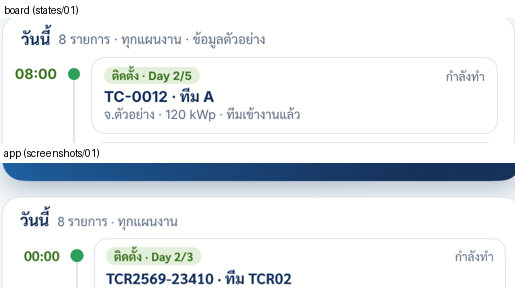
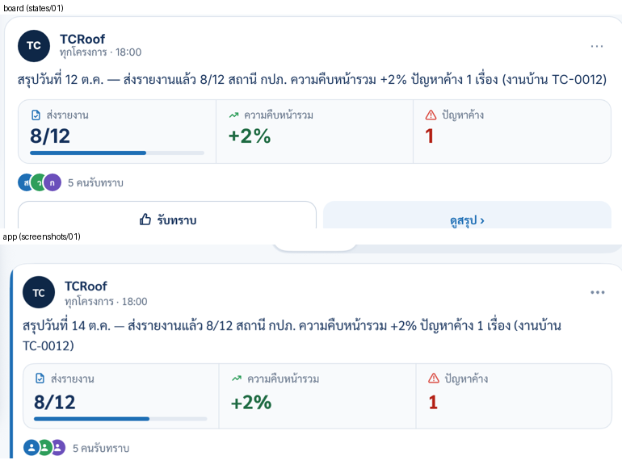

# FIX-01: iPad home, install time `00:00` and the feed's left edge

Board: `iPad · หน้าหลัก TCRoof` (`iPadMenu.dc.html` in this folder). The board has not changed since the v3 hand-off, and v3 is built.
I compared `screenshots/01` (the app) with `states/01` (the board). Two differences are bugs in the app. The rest is example data, or is open question 1 of v3.

## 1. An install day with no start time reads `00:00`

- **Board:** `08:00 · ติดตั้ง · Day 2/5`.
- **App:** `00:00 · ติดตั้ง · Day 2/3` for a job whose `installStart` has no time of day. The date was picked, the time was not, so the hour is midnight.
- **Where:** `TCRoof/Views/Home/PadHome.swift`, `TimelineItem.list`, the install loop. It builds `start` from the hour and minute of `installStart`.
- **Change:**
  - When `installStart` is at 00:00, the row's clock reads `ทั้งวัน` and the row sorts first. This is how the plan rows of the same file already handle no time: `clock: item.start.map(PWAPlan.clock) ?? "ทั้งวัน"`. Reuse that path rather than a second rule.
  - The right label is `กำลังทำ` (as for a day under way). Never show `อีก n ชม.` counted to midnight.
  - A job with a real start time (08:00) keeps it, as now.
- **iPhone:** check whether the iPhone `แผนงานถัดไป` hero and the PWA plan show the same `00:00`. Fix them with the same helper only if they do, and report.

## 2. Feed posts have a 4 pt coloured left edge that the board no longer draws

- **Board v3:** post cards are white with a 1 pt `#DDE4ED` border and no coloured edge. The board still computes an `accent`, but no markup uses it.
- **App:**
  - `TCRoofKit/Sources/TCRoofUI/Feed.swift` draws `.overlay(alignment: .leading) { if pad { tone.accent.frame(width: 4) } }`. That came from the v2 hand-off.
  - The edge also pushes the text inward, so the summary wraps a word earlier than on the board (`(งานบ้าน TC-0012)` drops to a second line).
- **Change:**
  - Remove the 4 pt edge on iPad.
  - Keep the post's inset as the board's: 16 pt content padding inside the card.
  - Leave the iPhone card as it is (it never had the edge).
- Update `ComponentGallery`'s feed section if it shows the edge.

## Don't change

- The hero (`แผนงานวันนี้` vs the board's `นัดวันนี้` is v3's open question 1; leave it).
- The default open row in `วันนี้` (the `next` item, as v3 asked).
- The dock, the search bar, `งานสำรวจค้างอยู่`, and the feed's data and filters.

## Check

- [ ] Build with your own `-derivedDataPath`.
- [ ] Run `PhoneHomeFeedUITests` and `HomeNavbarUITests`.
- [ ] iPad Pro 13" simulator, `-screen home -homeDemo YES -homeFeed demo -homeBoard YES`:
  - Screenshot `screenshots/fix01-01-home.png`.
  - No `00:00` row.
  - No coloured edge on the posts.
  - The first summary fits on one line as on the board.
- [ ] An install job with a real start time still shows that time.

## Open question (report)

1. Should `ทั้งวัน` install rows show the team's working hours from the station settings (e.g. `08:00`) when the station has them, instead of `ทั้งวัน`?
