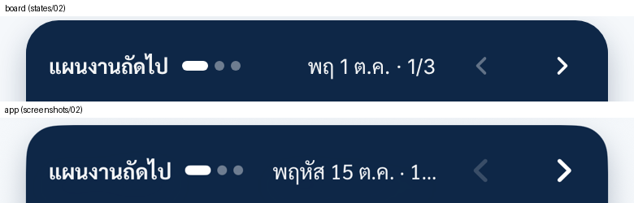

# FIX-01: iPhone home hero, date label cuts off the page counter

Board: `iPhone · หน้าหลัก TCRoof` (`PhoneMenu.dc.html` in this folder). The board has not changed since the v4 hand-off.
v4 is built. Comparing `screenshots/` (the app) with `states/` (the board) leaves one visible difference. It is in the hero card's top row, on both `นัดวันนี้` and `แผนงานถัดไป`.

| | Board | App today |
|---|---|---|
| Date label | `พฤ 1 ต.ค. · 1/3` | `พฤหัส 15 ต.ค. · 1...` |
| Page counter | always visible | truncated by `lineLimit(1)` |

## Cause

`HomeParts.swift` (the hero header) formats the date with `ThaiFormat.weekdayShort` (`EEE d MMM`). In Thai that gives the long weekday `พฤหัส`, so the label is too wide and the trailing ` · n/m` is cut off.

## Change list (only this)

1. **Weekday:** format the hero's date with the short Thai weekday.
   - Use `EEEEEE d MMM` (as `NewJobFormat.weekdayDayMonth` in `NewJobPhone.swift`), so the label reads `พฤ. 1 ต.ค.`.
   - Move that formatter from `NewJobPhone.swift` into `ThaiFormat` (`TCRoof/Utilities/Formatters.swift`) as `ThaiFormat.weekdayTiny`, and use it in both places. Don't change `weekdayShort`, because other screens use it.
2. **Counter first:** draw the date and the counter as two `Text`s.
   - The counter ` · n/m` has a higher `layoutPriority` and never truncates.
   - Only the date part may truncate, and only on very narrow widths.
3. **VoiceOver:** the accessibility label stays `<full weekday> d MMMM · รายการที่ n จาก m`.
4. **iPad:** apply the same change to the iPad hero header (`size.isPad`) so both sizes match.

The board writes `พฤ` without the period. iOS's Thai `EEEEEE` gives `พฤ.`; keep the system form (see the open question).

## Don't change

- The hero's other content: the pager dots, ‹ ›, the time, the ring and the buttons.
- The `นำทาง` rule: it is shown only when the item has a coordinate, which is correct. Demo plan items have none.
- The feed, the dock, and anything on iPad other than the hero header.

## Check

- [ ] Build with your own `-derivedDataPath`.
- [ ] iPhone 16 simulator, `-screen home -homeDemo YES -homeNoAppointments YES -homeHeroPlan demo`:
  - Screenshot `screenshots/fix01-02-no-survey-plan-1.png`.
  - The label reads `พฤ. <d> <MMM> · 1/3`, with no ellipsis.
- [ ] `-screen home -homeDemo YES` (`นัดวันนี้`, 2 items):
  - Screenshot `screenshots/fix01-01-home.png`.
  - The label shows `· 1/2`.
- [ ] iPhone SE (375 pt): the counter is still whole.
- [ ] `PhoneHomeFeedUITests` passes.

## Open question (report)

1. Should the weekday be `พฤ.` (the iOS short form, with the period) or `พฤ` as the board draws it?
