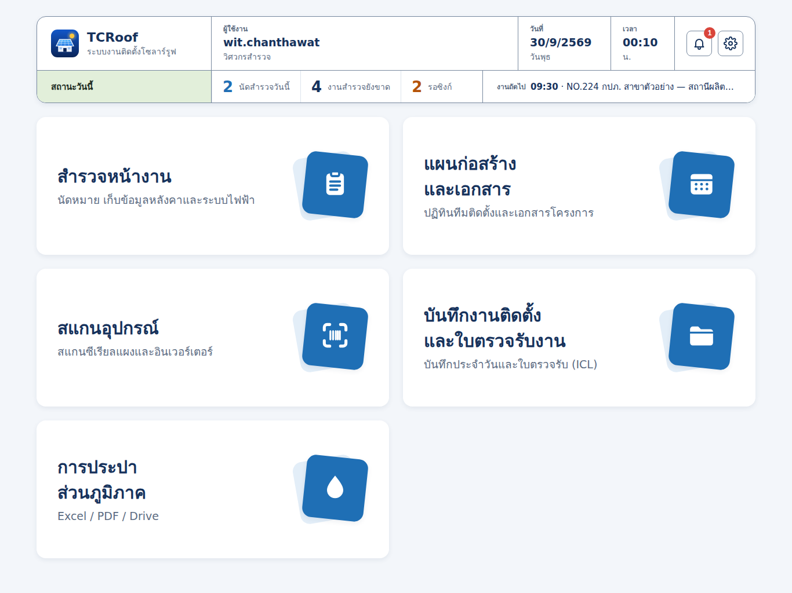
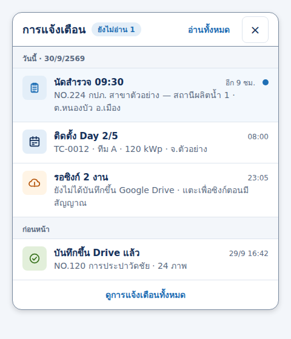

# งานสำหรับ Claude Code: ปรับหน้าหลัก TCRoof (HomeView) ตามแบบใหม่

> วิธีใช้: เปิด Claude Code ในโฟลเดอร์ repo `TCRoof` แล้วพิมพ์
> `ทำตาม docs/ui/tcroof-home/CLAUDE_CODE_TASK.md`

## เป้าหมาย
เปลี่ยน **ส่วนหัว** ของ `TCRoof/Views/Home/HomeView.swift` เป็นแบบ "title block" (กรอบชื่อแบบของแบบก่อสร้าง) ตาม `preview.png`
**ห้ามเปลี่ยน**: เมนู 5 หัวข้อ (`AppModule`: ชื่อ คำอธิบาย สัญลักษณ์ ปลายทาง) และลำดับของมัน



อ้างอิงแบบ: `iPadMenu.dc.html` ในโฟลเดอร์นี้ (ต้นฉบับจาก canvas; เปิดตรงๆ ในเบราว์เซอร์ไม่ได้ ใช้อ่านค่าสี/ขนาด)
ระบบสี/ขนาด: design system "TCRoof Survey" (ค่าตรงกับ `Theme.swift` + โทเคนด้านล่าง)

## ส่วนหัวใหม่ (แทน `header` เดิมที่เป็น "สวัสดี, …" + วันที่ + ปุ่มกลม)

กล่องเดียว: พื้น `surface` (#FFFFFF), ขอบ 1pt `border-control` (#77889E), มุม 16, เงา `shadow-card` (y 3, blur 8, navy 8%) แบ่ง 2 แถว

**แถวบน (สูง ~92pt)** แบ่งช่องด้วยเส้นตั้ง 1pt `border-control`
1. **แบรนด์** (กว้าง ~300): ไอคอนแอป (asset AppIcon 48×48 มุม 11) + "TCRoof" (22 bold `navy`) + "ระบบงานติดตั้งโซลาร์รูฟ" (14 `ink-muted`)
2. **ผู้ใช้งาน** (ยืดเต็ม): ป้าย "ผู้ใช้งาน" (12 bold `ink-muted`) · `userName` (19 bold) · บทบาท "วิศวกรสำรวจ" (14 `ink-muted`)
3. **วันที่** (~160): ป้าย "วันที่" · `d/M/yyyy` ปี พ.ศ. ไม่เติม 0 เช่น `30/9/2569` (19 bold, `.monospacedDigit()`) · ชื่อวัน "วันพุธ"
4. **เวลา** (~110): ป้าย "เวลา" · `HH:mm` · "น." — อัปเดตด้วย `TimelineView(.everyMinute)` เหมือนเดิม
5. **ปุ่ม**: แจ้งเตือน (`bell`) + ตั้งค่า (`gearshape`) เป็นปุ่มเหลี่ยม 44×44 มุม 8 ขอบ 1pt `border-control` พื้นขาว; badge แจ้งเตือน = แคปซูล `danger` (#D9453B) ตัวเลขขาว 12 bold มุมบนขวา (ใช้ `todaysJobs.count` เดิม)

**แถวล่าง (สูง ~56pt)** เส้นบน 1pt `border-control`
1. **"สถานะวันนี้"** (กว้างเท่าช่องแบรนด์): พื้น `paper-band` (#E2EFDA) ตัวอักษร `paper-ink` (#1F2E24) 15 bold
2. **ตัวเลข 3 ช่อง** (ยืด, คั่นด้วยเส้น 1pt `border-subtle` #DDE4ED) — ตัวเลข 26 bold + ป้าย 14 `ink-muted` อยู่บรรทัดเดียวกัน
   - นัดสำรวจวันนี้ → สี `primary` — จำนวนงานที่ `surveyDate.isToday`
   - งานสำรวจยังขาด → สี `navy` — งานสำรวจที่ completion ยังไม่ครบ (ถ้ายังไม่มีข้อมูลนี้ใน HomeView ให้ดึงจาก `SurveyModel.shared.jobs` ของ SolarSurveyKit หรือซ่อนช่องนี้ไว้ก่อน)
   - รอซิงก์ → สี `pending` (#B45309) — จำนวนงานที่ยังไม่ได้บันทึกขึ้น Drive/คลาวด์ (ถ้ายังคำนวณไม่ได้ ให้ซ่อน)
3. **"งานถัดไป"** (~470): ป้าย 12 bold `ink-muted` + "`HH:mm` · NO.xxx ชื่อโครงการ" (15, ตัดท้าย …) — งานแรกของวันนี้ที่ยังไม่ถึงเวลา; ไม่มีงาน = "ไม่มีนัดวันนี้"

## การ์ดเมนู (เปลี่ยนแค่สไตล์ ไม่เปลี่ยนเนื้อหา)
- พื้น `surface` ทึบ (เดิม `.white.opacity(0.9)`), มุม 16 (เดิม 24), เงา `shadow-card`
- คำอธิบายใช้ `ink-muted` #5B6B82 (เดิม `Theme.muted` #7A8BA3 คอนทราสต์ไม่ถึง 4.5:1)
- `ModuleIllustration`: สี่เหลี่ยมหลังใช้ `primary-soft` (#E3EEF8), สี่เหลี่ยมหน้าใช้ `primary` ทึบ (เลิก `headerGradient`), มุม 16
- กริด 2 คอลัมน์บน iPad ช่องไฟ 24

## หน้าโดยรวม
- พื้นหน้า `Theme.background` (#F3F6FA) ทึบ แทน `Theme.pageGradient`
- ตัวอักษร Sarabun 400/700 เท่านั้น ไม่ใช้ monospace font (ใช้ `.monospacedDigit()` กับตัวเลขได้)
- ส่วน "งานวันนี้" (`todaySection`) ด้านล่าง: คงไว้ตามเดิม
- iPhone (`isPhone`): แถวบนเหลือ แบรนด์ + ปุ่ม; ผู้ใช้/วันที่/เวลาย่อเป็นบรรทัดเดียวใต้แบรนด์; แถวล่างเหลือตัวเลข 3 ช่อง (งานถัดไปย้ายเป็นบรรทัดใต้กล่อง)

## โทเคนที่ต้องเพิ่มใน `Theme.swift` (ถ้ายังไม่มี)
```swift
static let surface      = Color.white
static let inkMuted     = Color(hex: 0x5B6B82)
static let borderControl = Color(hex: 0x77889E)
static let borderSubtle = Color(hex: 0xDDE4ED)
static let primarySoft  = Color(hex: 0xE3EEF8)
static let paperBand    = Color(hex: 0xE2EFDA)
static let paperInk     = Color(hex: 0x1F2E24)
static let pending      = Color(hex: 0xB45309)
```

## เกณฑ์รับงาน
- [ ] build ผ่าน, เมนู 5 หัวข้อเหมือนเดิมทุกตัวอักษรและพาไปหน้าเดิม
- [ ] ส่วนหัวตรง `preview.png` บน iPad แนวนอน; ไม่มีข้อความตัดล้นบน iPad mini
- [ ] ตัวเลขในแถวสถานะมาจากข้อมูลจริง (ค่าในภาพเป็นตัวอย่าง: 2 / 4 / 2, 09:30 NO.224)
- [ ] VoiceOver: ปุ่มแจ้งเตือน/ตั้งค่ามี label เดิม, ตัวเลขอ่านพร้อมป้าย
- [ ] ปุ่มทุกตัวสูง ≥ 44pt

## แผงการแจ้งเตือน (Notification) — เพิ่ม
แทน `.sheet(isPresented: $showNotifications) { NotificationsView(...) }` เดิม ด้วย popover ใต้ปุ่มกระดิ่ง (iPad) / sheet (iPhone) ตาม `notification.png` · ต้นฉบับ `iPadMenu-notif.dc.html`



- กล่องกว้าง 440 พื้น `surface` ขอบ 1pt `border-control` มุม 16 เงา `shadow-sheet` (y 3, blur 8, ดำ 15%)
- หัว (สูง 56): "การแจ้งเตือน" 18 bold · ป้าย "ยังไม่อ่าน n" (พื้น `primary-soft` ตัว `primary`; เมื่อ 0 = "อ่านครบแล้ว" พื้น `paper-band` ตัว `paper-tick-strong`) · ปุ่ม "อ่านทั้งหมด" (ตัวอักษร `primary`) · ปุ่ม × 44×44
- หัวกลุ่ม "วันนี้ · d/M/พ.ศ." และ "ก่อนหน้า": 12 bold `ink-muted` บนพื้น `background`
- แถว: ไอคอน 40×40 มุม 8 (สี/พื้นตามประเภท) · หัวเรื่อง 15 bold · เวลา/สัมพัทธ์ขวาบน 12 `ink-muted` · รายละเอียด 14 `ink-muted` · เส้นใต้ `border-subtle`
  - นัดสำรวจ `list.clipboard` → `primary` บน `primary-soft`
  - งานติดตั้ง Day x/y `calendar` → `navy` บน `primary-soft`
  - รอซิงก์ `icloud.and.arrow.up` → `pending` บน `pending-soft`
  - ซิงก์/บันทึกสำเร็จ `checkmark.circle` → `paper-tick-strong` บน `paper-band`
- ยังไม่อ่าน: พื้นแถว #F3F8FD + จุด 10pt `primary` ขวา; badge บนกระดิ่ง = จำนวนยังไม่อ่าน (ซ่อนเมื่อ 0)
- ขณะเปิด: ปุ่มกระดิ่งขอบ 2pt `primary` พื้น `primary-soft`
- ท้ายแผง "ดูการแจ้งเตือนทั้งหมด" → `NotificationsView` เต็มจอ
- ที่มาข้อมูล: `todaysJobs` (นัดสำรวจ / ติดตั้ง) + สถานะซิงก์ของงานสำรวจ; สถานะ "อ่านแล้ว" เก็บใน `@AppStorage` ตาม id รายการ
